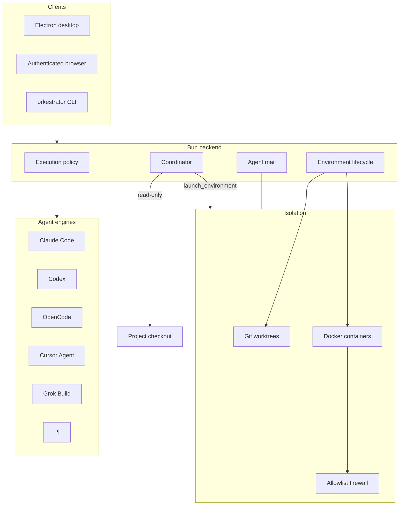

# Orkestrator

Orkestrator is a desktop application for running coding agents under explicit control.

It creates isolated development environments — Docker containers or local Git worktrees — for **Claude Code**, **Codex**, **OpenCode**, **Cursor Agent**, **Grok Build**, and **Pi**. Each environment has its own checkout and branch, so one agent’s work stays in that environment instead of writing into the project’s main working copy.

A project **Coordinator** reads the configured checkout, inspects Orkestrator state, and delegates implementation to worker environments. It cannot edit the checkout itself. Permissions, network, sandbox and approvals are resolved by the backend as an execution policy for every native session — not left as an honour system.

Work continues when you switch away. Agent sessions, terminals, mail and pipelines live in the backend, not only in the visible React tree.

## Safety and control

### Isolated environments, limited blast radius

Create several environments per repository. A **container** environment runs in its own labelled Docker runtime. Capable images keep the workspace and agent session files on owner-labelled volumes, and (network policy 2 or later) a private Docker network. A **local** environment is a linked Git worktree (`git worktree add --no-track -b`), with a dedicated branch that does not track the base branch — so a plain `git push` publishes that branch rather than pushing onto `main`.

The Coordinator is not a disposable workspace whose `worktreePath` happens to be the project root. Existing environment delete, merge and cleanup paths assume they own that workspace; routing the checkout through them would risk modifying or deleting the user’s repository. Coordinator runtime, transcripts and generated configuration live under application data. Opening Coordinator does not run project setup scripts, install dependencies, or load repository hooks.

Delegation cannot target the **project home** environment (the writable record for the canonical checkout). Side agents receive Control MCP credentials with only `discovery` and `mail`; they cannot launch environments or jobs. Agent mail is bounded, idempotent, and routed: a side agent may message only the main coordinator; cross-project and external mail is stored and never auto-injected.

Closing a tab stops owned work and denies parked approvals. It retains the conversation. It never calls Claude `deleteSession`, Codex `thread/delete`, or OpenCode `session.delete`.

### Sandboxing and network isolation

Container sessions treat the container as the isolation boundary (`sandbox: "container"`). The image runs agents as the non-root `node` user. Root terminals use a separate `orkroot` identity; `node` has no sudoers path to become `orkroot`. On images with network policy 2 or later, each environment gets its own labelled Docker bridge network with IPv6 disabled, so sibling containers are not on the same `/24`.

Restricted containers apply an iptables/ipset allowlist (`docker/init-firewall.sh`). A new install persists `DEFAULT_ALLOWED_DOMAINS` (GitHub, npm, Bun, mise, Anthropic, Sentry/Statsig, the VS Code marketplace, Context7, Playwright’s CDN), the one default list; the image's fallback for a container started without an allowlist is generated from it. Enabled agent platforms add the hosts those CLIs need. `full` mode skips the firewall. Local worktrees have no container firewall; a host session that requests restricted network without a sandbox reports that the restriction is not applied.

Host interactive sessions default to **no vendor sandbox** (`sandbox: "none"`). Vendor sandboxes hold `.git` read-only, which stalls ordinary Git work in a worktree. Tighten sandbox, network and approvals per environment under **Settings → Execution policy**.

The Coordinator’s read-only boundary is stronger than a prompt instruction. On macOS and Linux, Claude’s command sandbox (Seatbelt, or bubblewrap/landlock) is required for the `enforced` tier. Codex uses a permission profile the bridge reads back and refuses to run without. Pi gates every tool call inside the bridge. OpenCode is `provider-configured`: it denies mutating tools through its own rules, but always loads the checkout’s project configuration. Cursor is `provider-configured`: it applies sandbox and tool restrictions, but its SDK exposes no approval callback to verify them. Grok is `advisory`: write, edit, shell, subagent and web tools are removed; remaining permission requests are denied; tools that never ask stay advisory.

### Per-environment permissions

Every native session receives a `NativeAgentExecutionPolicy`:

| Axis | What it controls |
| --- | --- |
| `sandbox` | `provider`, `container`, or `none` |
| `approvals` | `ask`, `auto-approve`, or `deny` |
| `networkAccess` | `restricted` or `full` |
| `projectResources` | Whether the session may load project-local MCP / extensions |
| `capabilityPolicy` | Provider-neutral denials (`file.write`, `file.patch`, `shell.mutate`, `network`, `web.search`) that each bridge translates |
| `toolPolicy` | User-editable allow/deny of provider tool names |

Interactive sessions inherit host or container defaults; **Settings → Execution policy** overrides apply to new native sessions in that environment. Coordinator sessions always receive `coordinator-read-only` (`approvals: "deny"`, mutating capabilities denied, `projectResources: false`). That policy is not user-overridable. Bridges are launched with `ORKESTRATOR_BRIDGE_EXECUTION_POLICY=coordinator-read-only`, so a request body or a persisted record cannot widen a live coordinator conversation across a restart.

A `network` denial also removes hosted web tools (they run on the vendor’s servers, so a local firewall cannot stop them). Coordinator web research can reopen hosted search only; live page fetches and mutating shell stay off.

### Human approval points

Questions, plan approvals, command/file approvals, permission prompts and MCP elicitations go through one interaction contract. Interactive sessions wait for the user; unknown kinds fail closed (`deny-and-fail`). Unattended workflows (build pipeline, looped review) decline input and deny authorisation.

Interactive environments default to **`approvals: "auto-approve"`**. There is no inner sandbox to escalate against on a trusted host checkout, and a container already holds the outer boundary. Set **Ask** on an environment when a human must approve tools. Coordinator sessions deny rather than prompt.

When an approval is parked, timeout, disconnect, process death and an unparseable answer **deny**. They never approve. The default wait is five minutes; a pause can hold a card for up to 24 hours, after which expiry still denies.

### Parallel agents

Several environments can run at once. Switching the UI away does not cancel them.

The Coordinator is the planned parallel path: one **main** conversation per project (at most 16 open conversations including side agents) inspects the checkout and launches worker environments with `launch_environment`. Workers report back over durable agent mail. Side agents read and discuss; they do not launch workers. The agent registry answers which tabs exist and what each is doing (`working`, `waiting`, `idle`, `stopped`).

**Multi Review** commits a snapshot, runs a validation worker, seals an evidence package, then fans that package out to reviewers. Unattended interactions on that path cannot silently approve a mutation.

There is no separate “swarm orchestrator” product. Parallelism is environments, coordinator delegation, mail, and pipelines — all of which keep running while another environment is on screen.

## Architecture



| Layer | Role |
| --- | --- |
| `apps/web` | React UI (Electron renderer and remote browsers) |
| `apps/desktop` | Electron shell, preload, backend supervision |
| `apps/backend` | Authoritative Bun service: Docker, PTY, storage, bridges, mail, coordinator |
| `bridges/` | Claude, Codex, Cursor, Pi, and Grok/ACP session servers |
| `packages/protocol` | Shared contracts (policy, interactions, mail, platforms) |
| `packages/toolchain` | Pinned, hash-verified agent CLIs for local environments |
| `docker/` | Container image, firewall, workspace setup |

The backend owns long-running state. Electron may supervise it, or it can run standalone. Each environment gets its own agent process set and a per-environment bridge token; a missing token fails closed rather than open.

Live events are incremental updates over authoritative snapshots. An inactive tab rehydrates from the snapshot; it does not depend on an event it missed.

```text
apps/backend/   Standalone Bun service and authoritative long-running state
apps/desktop/   Electron shell, preload API, native IPC, and backend supervision
apps/web/       React/Vite application used by Electron and remote browsers
apps/ios/       iOS client for a Tailscale-published backend
packages/       Shared contracts, toolchain, published CLI
bridges/        Claude, Codex, Cursor SDK, Pi SDK, and Grok ACP bridges
docker/         Base image, firewall, and container setup
```

## Quick start

macOS or Linux. Windows is not supported: terminal sessions use Bun’s native PTY, and the backend refuses to start on `win32`.

You need [mise](https://mise.jdx.dev) (pins Bun 1.4.4) and, for container environments, [Docker](https://docker.com).

```bash
git clone https://github.com/orkestrator-ai/orkestrator-v2.git
cd orkestrator-v2

# Install the tool versions pinned in mise.toml
mise install

# Install dependencies with the repository-pinned Bun
mise exec -- bun install

# Optional: build the Docker image used by container environments.
# Local worktrees do not need it. The task stamps the image capability manifest.
mise run docker:build

# Run the Electron application (it supervises one backend)
mise run dev
```

`mise run docker:build` tags `orkestrator-v2:latest`. Existing environments keep the image they were created with; rebuild an environment to move it.

### Using it

1. Add a Git repository (URL or local folder).
2. Open the project. **Coordinator** is the default project page: it reads the checkout and can launch workers. **Home** is the writable project checkout.
3. Create environments from the project. Each local environment gets a worktree and branch; each container clones into `/workspace`.
4. Under **Settings → Execution policy**, set sandbox, approvals and network for that environment’s native sessions. Coordinator policy cannot be loosened from here.
5. Work continues if you switch to another environment. Return, or reload, and the UI rehydrates from the backend snapshot.

Application data lives in `~/Library/Application Support/orkestrator-v2/` on macOS, or `${XDG_CONFIG_HOME:-~/.config}/orkestrator-v2/` on Linux.

### Development commands

```bash
mise run test          # Complete non-iOS suite
mise run build         # Production desktop build
mise run check         # Format, lint, and typecheck
mise run format:check  # Formatting only
```

Repository tasks live in `mise.toml`. Use `mise run <task>`, not npm. Isolated real-stack QA is documented in [`docs/development/agent-testing.md`](docs/development/agent-testing.md).

### Packaging

```bash
mise run package:mac      # Unpacked macOS app, local ad-hoc signing
mise run package:release  # Signed, notarised macOS DMG (needs Developer ID)
mise run package:linux    # Unpacked Linux app under XDG_DATA_HOME
```

Published desktop releases and the in-app updater are described in [`docs/development/releasing.md`](docs/development/releasing.md). Container images are published to `ghcr.io/orkestrator-ai/orkestrator-v2`.

`mise run release:desktop` creates and pushes the version tag that triggers container publishing; the tag must match the root `package.json` version.

### Standalone backend and hosted client

Open [`orkestrator.dev`](https://www.orkestrator.dev) and select **Log in**, or connect directly at [`orkestrator.dev/connect`](https://www.orkestrator.dev/connect).

The hosted client is static. The browser connects directly to your backend over Tailscale; commands, terminal traffic and agent sessions are not relayed through the website. Both devices must be on the same tailnet, and the backend needs a tailnet-only HTTPS address (a plain `http://100.x.y.z:34121` URL is blocked as mixed content).

From the desktop app, enable **Settings → Web client → Allow web access**, then enter the HTTPS address and gateway token shown there. Without the desktop app or a clone, install Bun if needed and run the published backend:

```bash
curl -fsSL https://orkestrator.dev/install.sh | \
  bash -s -- --tailscale-serve \
  --allowed-origins https://orkestrator.dev,https://www.orkestrator.dev
```

See the [CLI guide](packages/cli/README.md) for service options and Tailscale Serve setup. Remote browser access (`mise run start:web`, `mise run start:web-public`, tokens, Tailscale Serve) is documented in [`docs/architecture/remote-gateway.md`](docs/architecture/remote-gateway.md). The gateway binds Tailscale addresses by default and requires a token.

### Reporting a problem

Run `bunx orkestrator --fix claude` (or `codex`, `opencode`, `grok`). It opens that agent instead of Orkestrator, with instructions to ask what went wrong, read Orkestrator's logs on this machine, and file a redacted GitHub issue on this repository once you approve the draft. See the [CLI guide](packages/cli/README.md#reporting-a-problem).

## Further reading

| Document | Contents |
| --- | --- |
| [`docs/README.md`](docs/README.md) | Documentation catalogue |
| [`docs/architecture/coordinator.md`](docs/architecture/coordinator.md) | Coordinator, tiers, delegation |
| [`docs/architecture/agent-engines.md`](docs/architecture/agent-engines.md) | How the six engines are wired |
| [`docs/architecture/container-lifecycle.md`](docs/architecture/container-lifecycle.md) | Container ownership, volumes, rebuilds |
| [`docs/architecture/agent-messaging.md`](docs/architecture/agent-messaging.md) | Agent mail |
| [`AGENTS.md`](AGENTS.md) | Contributor invariants |
