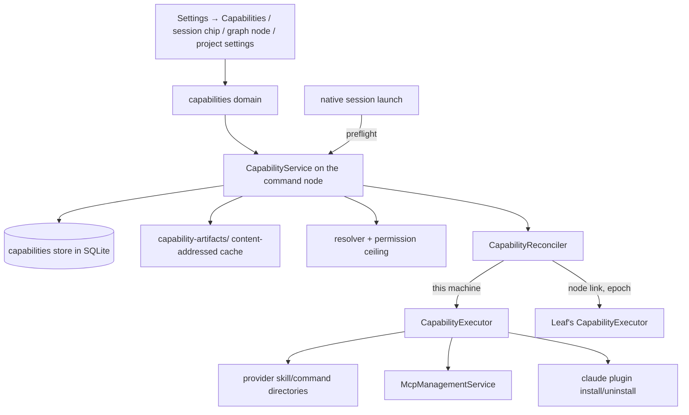

# Agent Capabilities management

Settings → **Capabilities** is one manager for the things an agent can be given:
Agent Skills, native plugins (with their subagents, hooks and commands), MCP
servers, and commands, prompts and hooks. A user adds a package once, chooses
where to use it, and sees, machine by machine and agent by agent, whether it is
there and what proves it.

Capabilities are **not** permissions. Operation-level permissions
(`file.write`, `network`, `mcp:<server>`) stay `NativeAgentCapability`
(`packages/protocol/src/native-agent-capabilities.ts`) and the Permissions
settings. A capability package can only *ask* for resources; the resolver
narrows the request with the session's permission policy and never widens it.

## Vocabulary

| Term | Meaning | Code |
| --- | --- | --- |
| Package | One installable thing, identified by its source and subpath (never its display name). Two marketplaces' `review` are two packages; one package used by five providers is one package. | `CapabilityPackage`, `capabilityPackageId` |
| Component | One part of a package: skill, native plugin, MCP server, command, prompt, hook or subagent. Compatibility, risk and approval are judged per component. | `CapabilityComponent` |
| Setup | A named selection of packages with target selectors and exceptions. **My setup** is built in; **toolkits** are named setups (Frontend, Review, …). | `CapabilitySetup` |
| Assignment | Toolkits a project, environment, agent template, graph node or session uses. | `CapabilityAssignment` |
| Effective resources | What one target (machine, agent, project, environment, session) resolves to, with a manifest digest. | `EffectiveAgentResources` |
| Receipt | One physical installation on one machine, with the bytes' digest and the setups that reference it. | `InstallationReceipt` |

The protocol modules are browser-safe:

- `capability-resources.ts`: types, identity, statuses, verification levels, limits.
- `capability-resources-support.ts`: the provider support matrix and the shared-location table.
- `capability-resources-resolve.ts`: deterministic resolution, the permission ceiling, update approval.
- `capability-resources-manifest.ts`: portable manifest and lockfile validation.
- `capability-resources-api.ts`: the bounded command results.
- `contract/domains/capabilities/`: the `capabilities` domain (version 1).

## Architecture

Backend code is in `apps/backend/src/core/capabilities/`:

| Module | Responsibility |
| --- | --- |
| `service.ts` | Every command: library, setups, inspection, preview/apply, updates, import/export, verification, launch preflight, executor handlers. |
| `index.ts` | Builds the service from the backend context; the MCP installer over `McpManagementService`; inventory sources. |
| `source-inspection.ts` | Reads a tree without running anything from it; detects components, risk, requirements and secrets; fetches Git sources safely. |
| `security.ts` | Bounded tree reads, link and special-file refusal, confined paths, atomic writes, tree digests. |
| `artifact-store.ts` | Content-addressed cache and the chunked transfer bundle. |
| `planning.ts` | Desired installations per machine, shared-location dedupe, reference lists, the plan diff. |
| `operations.ts` | Change parsing and application, plan digests, operation state, supersession, activity. |
| `reconciler.ts` | Per-machine observe → settle unknown outcomes → drift → plan → stage → apply. |
| `node-transport.ts` | The executor commands over a node link. |
| `executor.ts` | This machine's writer: idempotent per key, epoch-checked, ownership-preserving. |
| `native-ownership.ts` | Location ids → this machine's directories; ownership markers and the location index. |
| `inventory.ts` | Managed and external items, plugins (fully qualified ids) and MCP servers. |
| `runtime-evidence.ts` | Verification levels from session catalogues; never readiness from a copy. |
| `update-checker.ts` | Remote head checks, re-inspection, update proposals. |
| `import-export.ts` | `orkestrator.capabilities.yaml` and `orkestrator.capabilities.lock.json`. |
| `authoring.ts` | Skills, commands, prompts, subagents, hook manifests, MCP definitions and uploads authored in the UI. |

Storage is the `capabilities` envelope store (`storage-capabilities.ts`,
`CapabilitiesRepository`, reached as `storage.capabilities`) written only
through `updateStore`, so every compare-and-swap is one SQLite transaction; and
`capability-executor`, this machine's accepted epoch and applied plan keys.
Package bytes live in `<data dir>/capability-artifacts/<sha256>/`, never in a
row. Both stores are part of the database, so the existing backups cover them.

### Authority

The command node is the authority: its store holds the library, setups,
assignments, operations and receipts. Every machine, the command node
included, is an executor. A leaf answers `get_capability_node_observation`,
`stage_capability_node_artifact`, `apply_capability_node_plan` and
`export_capability_node_item` (all `internal`) and refuses a call whose epoch
is older than the highest it has seen, or the same epoch from a different
controller. A leaf keeps what it last applied while its command node is away,
and its own Capabilities page refuses fleet mutations ("manage capabilities
from the command node"). A command-node handover that transfers this state
raises the epoch, so the previous controller is refused everywhere.

## Resolution

Two passes (`resolveEffectiveAgentResources`):

1. **Desired resources**: My setup (only on an enrolled machine) → toolkits
   that apply machine-wide → project assignments → template and environment
   assignments → graph-node assignments → session assignments and explicit
   selections. A later layer may override a version (reported as a conflict
   diagnostic) or exclude a component. Exclusions are `<selector>|<id>`.
   Administrator policy (`forbiddenSources`, `forbiddenComponents`) wins over
   every layer.
2. **Permission ceiling**: the session's denied capabilities and MCP grant.
   An MCP server the policy denies (`mcp:<server>`, no grant, or `network`
   denied for a networked server) is `blocked`; a hook is blocked when shell is
   denied; a subagent when `subagents` is denied.

Then each component is checked against the provider's support matrix. A
required component that is unsupported or blocked is a **launch blocker**;
an optional one is skipped with a warning.

## Shared locations and isolation

Several providers read the same directory (mirrors `rootSpecsFor` in
`agent-skills.ts`):

| Location | Read by |
| --- | --- |
| `~/.claude/skills` | Claude, Cursor, Grok, OpenCode, Pi |
| `~/.agents/skills` | Codex, Cursor, Grok, OpenCode, Pi |
| `$CODEX_HOME/skills` (deprecated) | Codex, Cursor |
| `~/.cursor/skills`, `~/.grok/skills`, `~/.pi/agent/skills`, `~/.config/opencode/skills` | their own provider |
| `~/.claude/commands`, `~/.cursor/commands`, `~/.config/opencode/command` | their own provider |
| `$CODEX_HOME/prompts`, `~/.pi/agent/prompts` | their own provider |
| `~/.claude/agents`, `~/.config/opencode/agent` | their own provider |

`planCapabilityLocations` picks the fewest locations covering the requested
providers, preferring locations nobody else reads, and names every provider
that also sees the copy (`alsoVisibleTo`). All six providers need two copies
(Claude's and the shared one). A Claude-only skill cannot be isolated: four
other providers read `~/.claude/skills`, and Claude has no per-skill switch, so
the UI says "Exclusion cannot be enforced" instead of promising it. Added
Claude and Codex accounts link these directories to the host's
(`agent-accounts-homes.ts`), so one copy serves every account and no
credential is copied.

## Provider support

`BASELINE_CAPABILITY_SUPPORT` is the qualified baseline, per provider, kind and
operation: `supported` (implemented and tested), `unqualified` (files written,
not proven to load: shown as "installed; not runtime-verified") or
`unsupported` (with the reason). `describeCapabilitySupport` narrows it for the
observed context: a provider that is not installed, or a container.

| Provider | Skills | Native plugins | MCP servers | Commands / prompts | Hooks |
| --- | --- | --- | --- | --- | --- |
| Claude | install, live inventory | marketplace install/uninstall through `claude plugin` | through MCP management | `~/.claude/commands`, `~/.claude/agents` | only inside a plugin |
| Codex | install, live inventory | discovery only | through MCP management | prompts (unqualified) | unsupported |
| Cursor | install, no live inventory | unsupported (SDK has no plugin API) | through MCP management | commands (unqualified) | unsupported |
| Grok | install, no live inventory | discovery only | through MCP management | unsupported | unsupported |
| OpenCode | install, no live inventory | **unsupported**: the OpenCode 2 mirror strips user plugins | through MCP management | commands and agents (unqualified) | unsupported |
| Pi | install, no live inventory | **unsupported**: the Pi bridge excludes discovered extensions and packages | through MCP management | prompts | unsupported |

A plugin's portable parts (its skills and commands) are separate components:
on a provider without that plugin format they are delivered on their own, and
the plugin component is shown as not delivered, never as installed. Standalone
hooks are never installed; they run programs outside the session's policy.

## Reconciliation and remote safety

Every change is **preview → approve → apply**. The preview computes the plan
against a copy of the state; its digest covers every target's key, action,
digest and status. Apply re-plans and refuses unless the digest is the approved
one, so a package revision, setup or machine that moved since the preview
invalidates the approval. The change, the approval record and the operation
commit together; delivery then follows the newest desired state.

One reconcile pass per machine (`CapabilityReconciler.passOnce`):

1. observe the inventory; no answer → targets are `offline` and nothing is queued;
2. settle unknown outcomes from that observation: an unanswered write whose
   bytes are there is confirmed, otherwise it is planned afresh (never re-sent
   blindly);
3. record drift: a managed item with changed or missing bytes is a **Local
   changes** entry and is skipped until the user keeps, adopts or replaces it;
4. plan, stage artifacts in chunks (verified by digest on arrival) and apply.
   A dropped answer marks the keys `outcome-unknown` and schedules another
   observation.

Triggers: a change, a machine connecting (`NodeCoordination.onNodeConnected`),
backend start (resuming operations in flight) and a five-minute timer. An
offline machine reconciles against the **latest** desired state when it
returns; superseded operations are never replayed.

The executor never overwrites or removes an item without its marker or index
entry (external), and never overwrites a managed item with local changes
unless the user chose Replace. Adopting an external item takes ownership in
place only when its bytes equal the package's. Removal happens only when no
setup or assignment still references the copy.

## Statuses and proof

| Status | Meaning |
| --- | --- |
| Ready | Runtime evidence (`advertised` or better) for a session generation. |
| Next session | Files present; no running session has reported it yet. |
| Queued until idle | Will load when the running session is idle. |
| Waiting for machine | The machine is offline; it applies the latest setup on reconnect. |
| Checking | An unknown outcome is being read back. |
| Local changes | Drift, kept until the user decides. |
| Needs sign-in | An MCP server needs credentials on that machine. |
| Unsupported / Blocked by policy | With the reason. |

Verification levels: `requested` → `present` → `enabled` → `allowed` →
`advertised` → `load-confirmed` → `observed-in-use`. A copy is `present`; a
provider with no live inventory stays "installed; not runtime-verified".
`advertised` comes only from a session's own `ready` command catalogue
(`recordCatalogueEvidence`); a stale catalogue is not evidence. "Synced" is
never used for "Ready".

## Runtime connection points

- **Native session launch**: `NativeAgentService.createProviderSession` calls
  the `capabilityPreflight` option, which resolves the session under its own
  policy, records the frozen manifest (`launches`) and refuses a launch with
  a required component it cannot have. Any internal failure is logged
  (`capabilities/service.preflight-failed`) and never blocks a session. Graph
  agent nodes launch through the same path, so their manifest digest is
  recorded at launch too.
- **Session chip**: the agent information panel's Capabilities section shows
  the setups, readiness, each component's live semantics, Change (session
  toolkits), See details, Test (non-destructive, with consent) and Copy
  diagnostics (ids and digests only). A session keeps the packages it
  launched with; a change since shows as Next session.
- **Graph designer**: the agent node's Capabilities tab has a Toolkits section
  beside the permission form; a toolkit component the node's compiled policy
  denies is shown as a conflict.
- **Project and environment settings**: the same resolver, with project and
  environment toolkit assignments, and Write to / Import from the repository.

## Editing authored packages

A package authored in Orkestrator (one skill, command, prompt or subagent) has
**Edit source** on its detail page. The edit is inspected like any source and
becomes a new revision of the same package, applied through the same preview
and approval; its exceptions are kept and the previous revision is available
for rollback.

## Updates and rollback

`refresh_capability_updates` (and a six-hour timer) asks each Git package's
remote for the newest commit of its channel; only a moved head is fetched and
inspected. The proposal lists component changes and escalations (a new hook,
program, endpoint, MCP server or higher risk). Approval is the default; a
`trusted-auto` setup with the source on the trusted list applies updates that
escalate nothing. Pinned packages never move. The previous five revisions are
kept for rollback; rollback pins the package and cannot undo work a tool
already did.

## Portable manifests

`export_capability_setup` writes `orkestrator.capabilities.yaml` (intent:
setups, sources, revisions, provider and group selectors, exclusions, update
policy) and `orkestrator.capabilities.lock.json` (resolved digests and
components). Machine, session, environment and account selectors, local-only
packages and every credential are left out; both validators refuse secrets
and host paths. Import previews setups and packages, fetches each Git package
at its locked revision, and fails the whole import if a digest differs.

## Security

- Inspection reads files; it never runs a repository's scripts. Git fetches
  use `core.hooksPath=/dev/null`, `core.symlinks=false`, no submodules, no
  `file://` or `ext::`, and only https or SSH addresses.
- Trees are bounded (2,000 files, 32 MiB, 8 MiB per file, depth 24); special
  files and escaping links are refused.
- Writes go through `confinedPath` under a location the backend chose; no
  command takes a destination path or a command to run.
- MCP definitions keep environment and header keys only; literal values are
  dropped with a warning. Secrets found in a package block adding it.
- Events (`capability-management-changed`) carry a revision and opaque ids.
- Logs carry codes and references only (`capabilities` log area).

## Troubleshooting

- **"Waiting for machine"**: the machine is offline or its link is down. It
  applies the latest setup when it reconnects; nothing needs re-queuing.
- **"Local changes"**: someone edited or deleted a managed item. Machines →
  Local changes: Keep local (Orkestrator stops managing that copy's updates),
  Adopt (inspect the local version as a new package), or Replace.
- **"Unsupported" for a plugin on OpenCode or Pi**: by design; Orkestrator's
  bridges do not load those plugins. Their skills are still delivered when the
  package has portable skills.
- **"This machine's Orkestrator predates capability management"**: update that
  machine.
- **Copy diagnostics** from the session chip gives the manifest digest, policy
  digest, package digests and component statuses for a bug report.

## Not yet qualified

Live conformance runs against each pinned provider binary, isolated provider
homes per session (exclusive claims are reported as not enforceable instead),
merging local changes, a package registry, signed team manifests,
organisation policy editing in the UI and delivery into existing containers
(they receive capabilities through their portable inputs on a rebuild) are
not implemented; see
[8314](../todo/cross-cutting/8314-agent-capabilities-follow-ups.md).
