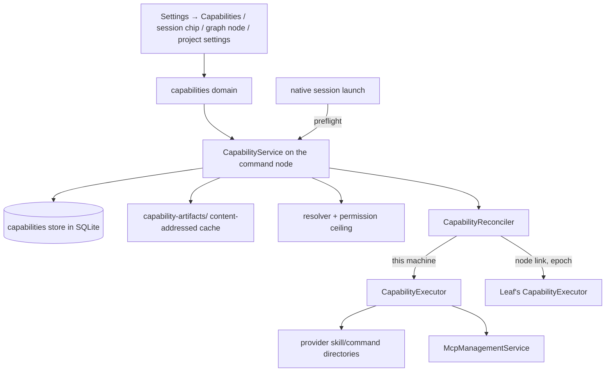

# Agent Capabilities management

Settings → **Capabilities** is one manager for the things an agent can be given:
Agent Skills, native plugins (with their subagents, hooks and commands), MCP
servers, and commands, prompts and hooks. A user adds a package once, chooses
where to use it, and sees, machine by machine and agent by agent, whether it is
there and what proves it.

Capabilities are **not** permissions. Operation-level permissions
(`file.write`, `network`, `mcp:<server>`) stay `NativeAgentCapability`
(`packages/protocol/src/native-agent-capabilities.ts`) and the Permissions
settings. A capability package can only *ask* for resources; the resolver
narrows the request with the session's permission policy and never widens it.

## Vocabulary

| Term | Meaning | Code |
| --- | --- | --- |
| Package | One installable thing, identified by its source and subpath (never its display name). Two marketplaces' `review` are two packages; one package used by five providers is one package. | `CapabilityPackage`, `capabilityPackageId` |
| Component | One part of a package: skill, native plugin, MCP server, command, prompt, hook or subagent. Compatibility, risk and approval are judged per component. | `CapabilityComponent` |
| Setup | A named selection of packages with target selectors and exceptions. **My setup** is built in; **toolkits** are named setups (Frontend, Review, …). | `CapabilitySetup` |
| Assignment | Toolkits a project, environment, agent template, graph node or session uses. | `CapabilityAssignment` |
| Effective resources | What one target (machine, agent, project, environment, session) resolves to, with a manifest digest. | `EffectiveAgentResources` |
| Receipt | One physical installation on one machine, with the bytes' digest and the setups that reference it. | `InstallationReceipt` |

The protocol modules are browser-safe:

- `capability-resources.ts`: types, identity, statuses, verification levels, limits.
- `capability-resources-support.ts`: the provider support matrix and the shared-location table.
- `capability-resources-resolve.ts`: deterministic resolution, the permission ceiling, update approval.
- `capability-resources-manifest.ts`: portable manifest and lockfile validation.
- `capability-resources-api.ts`: the bounded command results.
- `contract/domains/capabilities/`: the `capabilities` domain (version 1).

## Architecture



Backend code is in `apps/backend/src/core/capabilities/`:

| Module | Responsibility |
| --- | --- |
| `service.ts` | `CapabilityService`: builds the parts below, owns the authority (handover, leaf launches) and environment-copy views, and delegates each command to its collaborator. |
| `service-context.ts` | The service's dependencies and the context object its collaborators share. |
| `service-args.ts` | Bounded parsing of command arguments (targets, ceilings, selections, lists). |
| `library-reads.ts` | Reads: the library, package files, setups, inventories, provider support, effective resources, the session chip, machines, local changes, activity, operations and updates. |
| `resolution.ts` | One target's effective resources: the setup layers from assignments, required-delivery checks for a launch. |
| `inspection-commands.ts` | Inspecting a Git, registry or marketplace source and authoring a package; stores the inspection for a later preview. |
| `change-commands.ts` | Previewing, applying and cancelling a change (plan digests, approval, delivery start). |
| `setup-commands.ts` | Setups, assignments, exceptions, machine enrollment and package pin/pause state. |
| `update-commands.ts` | Update checks (trusted auto-apply included), taking or dismissing an update, update policy, rollback. |
| `import-commands.ts` | Exporting setups and previewing and completing an import against the store and the package sources. |
| `preflight.ts` | Non-destructive verification and native-session launch preflight. |
| `executor-handlers.ts` | This machine's executor commands for its command node (observe, stage, apply, environment plans, item export). |
| `environment-authority.ts` | A leaf's container staging from the command node's plan (cached, or nothing, when it is away) and the environment card for any machine's environment, answered from the command node's receipts. |
| `index.ts` | Builds the service from the backend context; the MCP installer over `McpManagementService`; inventory sources. |
| `source-inspection.ts` | Reads a tree without running anything from it; detects components, risk, requirements and secrets; fetches Git sources safely. |
| `security.ts` | Bounded tree reads, link and special-file refusal, confined paths, atomic writes, tree digests. |
| `artifact-store.ts` | Content-addressed cache and the chunked transfer bundle. |
| `planning.ts` | Desired installations per machine, shared-location dedupe, reference lists, the plan diff. |
| `operations.ts` | Change parsing and application, plan digests, operation state, supersession, activity. |
| `reconciler.ts` | Per-machine observe → settle unknown outcomes → drift → plan → stage → apply. |
| `node-transport.ts` | The executor commands over a node link. |
| `executor.ts` | This machine's writer: idempotent per key, epoch-checked, ownership-preserving. |
| `native-ownership.ts` | Location ids → this machine's directories; ownership markers and the location index. |
| `inventory.ts` | Managed and external items, plugins (fully qualified ids) and MCP servers. |
| `runtime-evidence.ts` | Receipt status. A catalogue name does not establish the identity of the loaded artifact. |
| `update-checker.ts` | Remote head checks, re-inspection, update proposals. |
| `import-export.ts` | `orkestrator.capabilities.yaml` and `orkestrator.capabilities.lock.json`. |
| `authoring.ts` | Skills, commands, prompts, subagents, hook manifests, MCP definitions and uploads authored in the UI. |

Storage is the `capabilities` envelope store (`storage-capabilities.ts`,
`CapabilitiesRepository`, reached as `storage.capabilities`) written only
through `updateStore`, so every compare-and-swap is one SQLite transaction; and
`capability-executor`, this machine's accepted epoch and applied plan keys.
Package bytes live in `<data dir>/capability-artifacts/<sha256>/`, never in a
row. Both stores are part of the database, so the existing backups cover them.

### Authority

The command node is the authority: its store holds the library, setups,
assignments, operations and receipts. Every machine, the command node
included, is an executor. A leaf answers `get_capability_node_observation`,
`stage_capability_node_artifact`, `apply_capability_node_plan` and
`export_capability_node_item` (all `internal`) and refuses a call whose epoch
is older than the highest it has seen, or the same epoch from a different
controller. A leaf keeps what it last applied while its command node is away,
and its own Capabilities page refuses fleet mutations ("manage capabilities
from the command node").

**Handover** (`handover.ts`, hooked into `NodeService.completeHandover` and
`acceptHandover` through `setCapabilityHandover`). Before the old command node
asks the target to accept command, it marks its state `sending` (from then on
it is not the authority: its reconciler stops and its mutations refuse), waits
for passes in flight, and sends `stage_capability_node_handover` (`internal`):
every artifact its state references, through the chunked transfer bundle and
verified against its digest on arrival, then the state itself (library,
setups, assignments, operations, receipts, drift, updates, activity,
approvals, launches; not short-lived previews) as one JSON bundle in bounded
chunks, verified against its sha256 digest. Only the machine's current
authority may stage (the executor's epoch check). When the target accepts, it
installs the bundle after adopting the machines and before detaching its
controllers: the bundle becomes its state with epoch `max(seen) + 1` and
itself as controller, its own executor moves to that epoch, and it reconciles
every machine against the latest desired state as they connect (operations in
flight resume; superseded revisions are never replayed). The old node then
records `sent` and moves its executor to the new epoch, so the old controller
is refused by every executor, its own included. Each step is idempotent per
handover id, so the handover journal's retry resumes a lost answer or a
partial transfer, and an install already done answers as done. A transfer
that fails before the target was asked to accept abandons the handover and
the old node stays the authority. A target that predates capability
management takes command only when there is nothing to carry (no package,
receipt or operation in flight); otherwise the handover is refused until it is
updated.

**Leaf launches** (`launch-authority.ts`). A leaf's store holds no setups, so
its native launch preflight asks the command node. Links run from command node
to leaf, so the leaf emits `node-capability-launch-requested` on its own event
stream (which the command node follows) with the target, the permission
ceiling, its managed copies and the target's own copies (the managed copies
in the environment's worktree, or its container's staged record and label;
ids and digests only). The command node
resolves the target against the authoritative state, records the launch
(`<nodeId>|<sessionKey>`, with the observed deliveries and `resolvedBy`), and
answers with `answer_capability_node_launch` (`internal`, admitted only at the
leaf's current epoch and controller). The leaf enforces the answer's launch
blockers, re-checks the required copies against its own bytes, and caches the
answer per logical session, target, template, graph node, worktree and
ceiling digest. When no command node has been in contact for three heartbeats
or none answers within five seconds, the leaf uses the cached answer only if it
is under six hours old, came from its current controller and epoch, and this
machine's applied installations and required copies are unchanged; otherwise
a required component blocks the launch ("command node unreachable") and
optional ones are a warning. Whether anything is required comes from the last
answer; a leaf that never had one does not block.

**Leaf containers and environment cards** (`environment-authority.ts`, held
as `context.capabilityEnvironments`). The same channel serves two more
questions only the command node can answer. The leaf emits
`node-capability-leaf-requested` with a `kind`, and the command node answers
with `answer_capability_node_request` (`internal`, at the leaf's current
epoch and controller):

- `container-staging`, when the leaf creates or rebuilds a container
  (`commands-containers.ts` asks `prepareContainerStaging`): the container's
  environment and project ids, providers and stage names. The command node
  plans the container target for that machine (`containerCapabilityPlan`),
  sends every artifact the plan names over `stage_capability_node_artifact`,
  and then answers with the plan (location ids, component ids, revisions;
  never a directory). The leaf rebuilds the plan from its own location table,
  recomputes its digest (`containerPlanDigest`, the same function the command
  node uses, so the label equals the command node's current digest), caches
  it per container target (environment, project, providers, stages; newest
  100) and stages it from its own verified artifacts. It waits up to 20
  seconds. Without an answer it stages the cached plan for that target when
  every artifact it names is still in its cache, it came from the current
  executor controller and epoch, and it is at most six hours old (the record's
  `source` says `cached`), and otherwise stages nothing, with a record whose `unstaged`
  says `command-node-unreachable`: the card shows "Capabilities not staged:
  command node unreachable", and a required component blocks with that
  reason, both on the command node's answer and in the leaf's own fail-closed
  fallback, until the container is rebuilt. A late answer is still cached for
  the next rebuild. Nothing is written into a running container.
- `environment-delivery`, when the leaf's own window opens one of its
  environment cards: the environment's ids and type and its container's
  staged record. The command node answers from its receipts and plan; with no
  answer in five seconds the leaf shows only its own record, with a notice
  that it may not be current.

`get_capability_environment_delivery` is answered by the window's command
scope. The command node answers for its own environments and, from the
federation read model, for those on any machine it controls: a worktree from
its receipts for that machine (`<node>|env:<environment>|…`) and its desired
project state; a container from its plan for that machine and the staged
record that machine reads from its own inputs revision and label
(`get_capability_node_container_delivery`, `internal`). A machine that does
not answer leaves the card with what the current setup would stage and a
notice. The card names the machine (`nodeId`) when it is not the one that
answered.

**Launch deliveries.** On every launch, a required component is checked
where the target reads it (`verifyLaunchDeliveries`): a container only
against the record staged into its inputs revision, and an added account with
a private directory only against its own copy, so a drifted host copy does
not block them (a stale or missing staged record blocks with the rebuild
remedy). Otherwise each recorded machine-wide copy the provider reads must be
observed, managed, unchanged and equal to its receipt's digest; in a worktree
that holds even when its project copy matches, because the provider reads
both and Claude ranks a personal skill above a project one. The launch record
lists exactly the observed digests (`deliveries`, with `container:<location>`,
`account:<location>` and project location ids for those copies).

## Resolution

Two passes (`resolveEffectiveAgentResources`):

1. **Desired resources**: My setup (only on an enrolled machine) → toolkits
   with explicit machine-wide selectors → project assignments → template and environment
   assignments → graph-node assignments → session assignments and explicit
   selections. A later layer may override a version (reported as a conflict
   diagnostic) or exclude a component. Exclusions are `<selector>|<id>`.
   Administrator policy (`forbiddenSources`, `forbiddenComponents`) wins over
   every layer (see "Administrator policy").
2. **Permission ceiling**: the session's denied capabilities and MCP grant.
   An MCP server the policy denies (`mcp:<server>`, no grant, or `network`
   denied for a networked server) is `blocked`; a hook is blocked when shell is
   denied; a subagent when `subagents` is denied.

Then each component is checked against the provider's support matrix. At
launch, optional components also need delivery evidence. A required component that is unsupported or blocked is a **launch blocker**;
an optional one is skipped with a warning.

## Administrator policy

Settings → Capabilities → Setups → Policy edits two lists in the store's
settings (`admin-policy.ts`, `@orkestrator/protocol/capability-admin-policy`):

- **Forbidden sources**: package id prefixes. `git:github.com/org/` forbids
  that organisation's repositories (an https or SSH address is accepted and
  canonicalised the way package ids are), `registry:<id>/` a whole registry
  (`registry:<id>` gains its slash, so it cannot match `registry:<id>2/`),
  `git:` every Git package; `marketplace:`, `local:` and `managed:` prefixes
  work the same way.
- **Forbidden components**: an exact package id, an exact component id
  (`<packageId>#<kind>:<key>`), or a whole kind (`kind:hook`; a bare kind is
  accepted).

`get_capability_admin_policy` (workspace) returns both lists, the policy's own
revision and the library packages the policy blocks now (with the matching
entry and whether a setup uses them). `set_capability_admin_policy` (admin)
replaces the lists it names if `expectedRevision` is still the policy's
revision (`settings.policyRevision`; a stale one is a `conflict`); every entry
is validated by the same parser the form uses, and one bad entry refuses the
edit. A change is recorded in Activity (`admin-policy`) and every machine is
reconciled: the resolver blocks what the policy forbids ("Administrator policy
forbids this source/component", shown as **Blocked by policy** wherever the
package is assigned, and a launch blocker when required), so installed copies
are removed on the next pass and nothing new is fetched from a forbidden
source.

## Shared locations and isolation

Several providers read the same directory (mirrors `rootSpecsFor` in
`agent-skills.ts`):

| Location | Read by |
| --- | --- |
| `~/.claude/skills` | Claude, Cursor, Grok, OpenCode (not Pi: its pinned SDK never reads it) |
| `~/.agents/skills` | Codex, Cursor, Grok, OpenCode, Pi |
| `$CODEX_HOME/skills` (deprecated) | Codex, Cursor |
| `~/.cursor/skills`, `~/.grok/skills`, `~/.pi/agent/skills`, `~/.config/opencode/skills` | their own provider |
| `~/.claude/commands`, `~/.cursor/commands`, `~/.config/opencode/command` | their own provider |
| `$CODEX_HOME/prompts`, `~/.pi/agent/prompts` | their own provider |
| `~/.claude/agents`, `~/.config/opencode/agent` | their own provider |

`planCapabilityLocations` picks the fewest locations covering the requested
providers, preferring locations nobody else reads, and names every provider
that also sees the copy (`alsoVisibleTo`). All six providers need two copies
(Claude's and the shared one). A machine-wide Claude-only skill cannot be
isolated: three other providers read `~/.claude/skills`, and Claude has no
per-skill switch, so the UI says "Exclusion cannot be enforced" instead of
promising it. A selection made for one Claude session, graph node or template
is isolated instead, by session-private delivery (below).

### Session-private delivery

A component a launch selects that no copy on the target already holds is not
written into a shared provider home. For Claude on a host (any account), the
kinds a Claude plugin carries (skills, commands, prompts, subagents) are staged
by `session-delivery.ts` into a content-addressed plugin directory the backend
owns, `<dataDir>/capability-session-plugins/<digest>/` (`.claude-plugin/plugin.json`,
`skills/`, `commands/`, `agents/`), from verified artifacts only, and read back
before the launch is recorded. The launch record keeps its digest and items
(`privatePlugin`). Every turn of that session, ordinary native turns
(`native-agent-prompt-dispatch.ts`) and graph activations
(`agent-branch-runner.ts`, `GraphAgentBranchHost.capabilityPlugins`) alike,
sends the directory as the prompt's `capabilityPlugins`; the Claude bridge
passes it to the SDK as an inline plugin (`--plugin-dir`,
`capability-session-plugins.ts`), only from inside the root the backend names in
`ORKESTRATOR_CAPABILITY_SESSION_PLUGINS_DIR`, only as that root's own
content-addressed children, and never on a read-only turn (a coordinator or a
review), whose boundary admits no skill frontmatter hooks or tool grants.

- **Isolated by construction.** No other session, provider or account home
  sees the directory, and its skills are namespaced
  (`orkestrator-session:<name>`), so a personal copy cannot shadow them. The
  live conformance run proves the pinned Claude binary lists the namespaced
  skill only when the directory is passed.
- **Frozen at launch.** The directory is named by its content and recorded at
  launch; a setup change later never alters what a running session loads. A
  turn re-stages a pruned directory from the artifact cache and refuses to run
  when the recorded bytes cannot be reproduced. Private-plugin records survive diagnostic retention
  and stay on the machine running the session through handover. Unreferenced
  directories are pruned after an hour.
- **Never a substitute for a copy the provider already reads.** When any
  receipt or observed item for the component exists on the target (a drifted
  or older shared copy, a worktree copy), the launch is judged on that copy as
  before: the drift is reported and a required component blocks.
- **Leaves.** The command node resolves a leaf's launch with the same rule,
  sends each selected artifact to the leaf over the node link before
  answering, and lists the items in its answer; the leaf stages the plugin
  from its own artifact cache. A transfer that fails drops an optional item
  (reported unsupported) and blocks a required one.
- **Not delivered this way:** hooks and MCP servers (their own approval and
  lifecycle), native plugins, and any part a native plugin carries (the plugin
  delivers it whole). Other providers have no per-session plugin channel in
  their pinned bridges, so a launch-only selection for Codex, Cursor, Grok,
  OpenCode or Pi, or for a container, is still reported as unsupported and a
  required one stops the launch.

**Added accounts.** Added Claude and Codex accounts link their `skills`,
`commands`, `agents` (Claude) and `skills`, `prompts` (Codex) directories to
the host's (`agent-accounts-homes.ts`), so one copy serves every account. A CLI
that saved one of them by atomic rename leaves a private directory instead;
`scoped-delivery.ts` checks each entry (linked, private, missing, or a link
elsewhere, which is never written through) and gives a private directory its
own copy of the machine-wide installations, with receipts keyed
`<node>|account:<provider>:<id>|<location>|<component>`. Only package files are
written; the account's login is never read or copied. When the directory is
linked again its receipts are forgotten and the host copy is left alone.

**Project setups in a worktree.** Project and environment assignments
(including imports from `orkestrator.capabilities.yaml`) are written into each
local worktree of that project, never into the shared homes, after that
machine's reconcile pass, after any applied change, and before a launch from a
worktree on the command node (`scoped-delivery.ts`, locations in
`scoped-locations.ts`, the writer in `worktree-writer.ts`):

| Project directory | Read by | May also be read by |
| --- | --- | --- |
| `.claude/skills` | Claude, OpenCode | Cursor, Grok, Pi |
| `.agents/skills` | Codex, OpenCode, Pi | Cursor, Grok |
| `.cursor/skills`, `.grok/skills`, `.pi/skills`, `.opencode/skills` | their own provider | |
| `.claude/commands`, `.cursor/commands`, `.opencode/command`, `.pi/prompts` | their own provider | |
| `.claude/agents`, `.opencode/agent` | their own provider | |

Codex has no project prompts, so a command reaches Codex only through My
setup. Packages the machine-wide copies already give a provider at the same
revision are not written again. Receipts are keyed
`<node>|env:<environment>|<location>|<component>`, so the "Where available"
matrix and the environment card show the worktree as its own row, with
`alsoVisibleTo` naming the providers in that worktree that read the same
directory. Git never sees the copies: before writing, the managed paths (and
the atomic writers' transient names) are listed in a block owned by the
environment in the repository's `info/exclude` (the Git common directory, so
linked worktrees share it; the tracked `.gitignore` is never edited). A path
the index tracks, anything already there that Orkestrator did not write, or a
directory reached through a link is a collision: reported on the receipt and
left alone. A managed copy edited by hand is a Local changes entry, kept until
the user decides. A copy is removed only when no project or environment
assignment still selects it; the exclude block goes with the last one.

**Worktrees on other machines** (`scoped-remote.ts`). The command node lists
each machine's local-worktree environments from its federation read model
(environment id, project id and type; never a path), adds every environment
it holds receipts for there, and plans each exactly like its own. One bounded
read, `get_capability_node_environment_observation` (`internal`), names the
copies by location id and component and returns their digests on disk and
which planned copies would collide; the artifacts then travel over the
existing chunked transfer and `apply_capability_node_environment_plan`
(`internal`) writes them. The machine resolves the environment id to its own
worktree from its own environment store, accepts only keys of that
environment (`<its node>|env:<environment>|…`) at project locations, and
writes with the same rules (collisions re-checked before writing,
`info/exclude`, markers, atomic writes), behind the executor's epoch. The
command node keeps the receipts; it marks them before each write, so a lost
answer is settled from the next observation (confirmed, restored or planned
afresh), never re-sent blindly. An environment the machine no longer has
releases its receipts; one it has but cannot reach keeps them.

**Project MCP servers.** A project setup's MCP server goes into the project
MCP file the provider reads in that worktree, written by that machine's MCP
management through the environment's target and that file's source only (its
editors, revisions and ownership fingerprints; `project-mcp.ts`):

| Provider | File | Loaded when |
| --- | --- | --- |
| Claude | `.mcp.json` (Grok also reads it) | native sessions load project servers |
| Codex | `.codex/config.toml` | the project is trusted in Codex |
| Cursor, Pi | `.cursor/mcp.json`, `.pi/mcp.json` | the environment's policy turns project resources on |
| Grok | `.grok/config.toml` | the folder is trusted in Grok, or the environment's policy turns project resources on |
| OpenCode | `opencode.json` | project configuration is not disabled |

A provider set to ignore the file there is reported unsupported with MCP
management's reason; an unknown trust is installed with that reason. Only the
definition is written: a server with environment or header keys is
`needs-auth` until the user supplies the values on that machine (a matching
local definition counts), and nothing is written for it. A file Orkestrator
creates is listed in `info/exclude` and deleted when its last server goes and
nothing else is in it; an untracked file the user already had is edited in
place and never excluded or deleted; a tracked file, or one behind a link, is
a collision; a same-named server Orkestrator did not add is left alone. A hand
edit is a Local changes entry (keep or replace).

## Provider support

`BASELINE_CAPABILITY_SUPPORT` is the qualified baseline, per provider, kind and
operation: `supported` (implemented and tested), `unqualified` (files written,
not proven to load: shown as "installed; not runtime-verified") or
`unsupported` (with the reason). `describeCapabilitySupport` narrows it for the
observed context: a provider that is not installed, or a container.

| Provider | Skills | Native plugins | MCP servers | Commands / prompts | Hooks |
| --- | --- | --- | --- | --- | --- |
| Claude | install, live inventory | install, update, remove from the approved artifact (see below) | through MCP management | `~/.claude/commands`, `~/.claude/agents` | only inside an approved plugin |
| Codex | install, live inventory | discovery; enable and disable of installed plugins | through MCP management | prompts (unqualified) | unsupported |
| Cursor | install, no live inventory | unsupported (SDK has no plugin API) | through MCP management | commands (unqualified) | unsupported |
| Grok | install, no live inventory | discovery only | through MCP management | unsupported | unsupported |
| OpenCode | install, no live inventory | **unsupported**: the OpenCode 2 mirror strips user plugins | through MCP management | commands and agents (unqualified) | unsupported |
| Pi | install (`~/.pi/agent/skills`, `~/.agents/skills`), no live inventory | **unsupported**: the Pi bridge excludes discovered extensions and packages | through MCP management | prompts | unsupported |

A plugin's portable parts (its skills and commands) are separate components:
on a provider without that plugin format they are delivered on their own, and
the plugin component is shown as not delivered, never as installed. Standalone
hooks are never installed; they run programs outside the session's policy.

### Claude plugins

A Claude marketplace id (`name@marketplace`) resolves inside Claude at install
time, so the bytes it installs could differ from the bytes the user approved.
Orkestrator therefore installs a Claude plugin only from the inspected
artifact (a Git, upload or authored package whose root has
`.claude-plugin/plugin.json`), through a marketplace it owns
(`provider-adapters/claude-plugins.ts`):

- `<Claude home>/orkestrator-marketplace/plugins/<name>/<sha256>/` holds the
  approved artifact, written atomically and never edited in place; an update
  writes a new digest directory and prunes the old one.
- `.claude-plugin/marketplace.json` lists each managed plugin at its digest
  directory; `.orkestrator-marketplace.json` records the package and component
  that own each plugin name.
- The marketplace is registered with `claude plugin marketplace add <dir>
  --scope user` (Claude's own writer for `settings.json` and
  `known_marketplaces.json`), and the plugin is installed with `claude plugin
  install <name>@orkestrator-managed --scope user`. An update uninstalls with
  `--keep-data` and installs again, because Claude caches by the manifest's
  version, which need not change between revisions.
- Every write is followed by `claude plugin list --json`. Claude 2.1.326 reads
  a directory marketplace's plugin in place (`readFromFolder`) and keeps a
  copy (`installPath`): the entry must be enabled, read from the approved
  digest directory, and both trees must hash to the approved digest. A
  non-zero exit, a timeout or unreadable output is settled by that read-back,
  never by running the write again; the reconciler settles an unanswered plan
  from the inventory, which reports managed plugins at `plugin:claude` with
  the digest Claude reads.
- A plugin from any other marketplace is external and never updated, disabled
  or uninstalled. A same-named external plugin that is enabled blocks
  delivery ("Local changes") unless the user chooses Adopt and its installed
  bytes equal the approved digest; the external copy then satisfies the
  package and removal still leaves it installed. A marketplace named
  `orkestrator-managed` that Orkestrator did not register is left untouched
  and the install fails.
- Removal uninstalls only `<name>@orkestrator-managed` (keeping the plugin's
  data directory), and unregisters and deletes the marketplace when it is
  empty. Edited bytes in the managed copy, or the plugin disabled in Claude,
  are local changes: kept until the user keeps or replaces them.
- For Claude the plugin carries its parts: its skills, commands, agents, MCP
  servers and hooks are not delivered again on their own (they would load
  twice), and a required part is satisfied by the plugin's receipt. Hooks
  inside the plugin are part of the approved revision: the plugin's risk is
  the highest of its parts and its preview lists their commands, so adding or
  updating it needs approval. Other providers still get the portable parts.
- A `provider-marketplace` package (a bare `name@marketplace`) has no
  reviewed bytes and stays unsupported for delivery.

### Codex plugins

Codex 0.169.0 records each installed plugin as `[plugins."<name>@<marketplace>"]`
with `enabled = true|false` in `$CODEX_HOME/config.toml`, and honours the flag
in `codex plugin list --json` and in the skills a session gets.
`set_capability_plugin_enabled` (admin, the machine that answers) flips that
flag (`provider-adapters/codex-plugins.ts`) through MCP management's
format-preserving TOML editor, for a plugin Codex reports as installed and
whose entry is already a table: no entry is added or removed, inline or dotted
layouts stay read-only, a linked or oversized file is refused, only `enabled`
changes (checked by re-parsing), the file keeps its mode and is replaced only
if unchanged since it was read, and the result is confirmed with Codex's own
list. Installing Codex plugins stays with Codex. Capabilities → Installed on
this machine → Plugins → Codex shows an "Enable <plugin>" switch in a
plugin's details (`AgentPluginsBrowser.tsx`); it reads Codex's list back after
the change and reports a refusal in an alert. It is disabled, with the reason,
for a plugin Codex reports without its marketplace, for a failed or pending
one, and when Settings shows another machine (the command only edits the
machine that answers). Other providers have no switch.

### Qualification against the pinned binaries

`provider-conformance.live.test.ts` (slow tier, opt-in with
`RUN_LIVE_CAPABILITY_CONFORMANCE=1`; binaries from
`ORKESTRATOR_CONFORMANCE_<CLAUDE|CODEX|OPENCODE2>` or the mise install of
exactly the pinned version, never Orkestrator's own toolchain directory) runs
each binary with a fresh HOME, `CLAUDE_CONFIG_DIR`, `CODEX_HOME` and XDG
directories and a minimal environment, and asks the provider's own
credential-free listing. Run 2026-11-19 on Linux x64:

| Provider (pinned) | What was proven | Listing used | Result |
| --- | --- | --- | --- |
| Claude Code 2.1.326 | Executor skill in `~/.claude/skills` is listed, and gone after removal | `claude -p` `init` event (`apiKeySource: none`, then "Not logged in") | pass |
| Claude Code 2.1.326 | Plugin install from the approved artifact, replay, update with an unchanged version, removal of only Orkestrator's copy with an external plugin kept; the session loads `<plugin>:<skill>` | `claude plugin list --json`, `claude plugin validate`, `init` event | pass |
| Codex 0.169.0 | Executor skill in `~/.agents/skills` is listed, and gone after removal | `codex debug prompt-input` | pass |
| Codex 0.169.0 | A discovered plugin switched off and on through `config.toml`; comments kept | `codex plugin list --json`, `codex debug prompt-input` | pass |
| OpenCode 2.3.1 | Executor subagent in `~/.config/opencode/agent` is listed by the binary | `opencode debug agents --standalone` | pass (binary only) |
| Claude Code 2.1.326 | A session plugin staged by `session-delivery.ts` is listed as `orkestrator-session:<skill>` only when passed with `--plugin-dir`; nothing lands in `CLAUDE_CONFIG_DIR` | `init` event with and without `--plugin-dir` | pass |
| Pi SDK 1.5.2 (same version as the pinned `pi` binary) | Skills in `~/.pi/agent/skills` and `~/.agents/skills` and templates in `~/.pi/agent/prompts` are listed, also with project resources off; the repository's `.pi/` resources are not; `~/.claude/skills` is never read | the bridge's resource-only loader (`readResourceCommands`), `bridges/pi-bridge/src/capability-delivery-conformance.test.ts`, default tier | pass |
| Grok Build 1.0.88 | Not run: no pinned binary on the host outside Orkestrator's toolchain, and no credential-free listing qualified | | skipped |
| Cursor SDK | Not run: no CLI | | skipped |

Matrix levels follow the evidence: Claude native-plugin install, update and
remove are `supported`. OpenCode subagents and commands stay `unqualified`:
the binary lists the agent, but Orkestrator's OpenCode 2 session configuration
mirror is not covered, and OpenCode 2.3.1 has no credential-free command
listing. Codex prompts, Cursor commands and Grok and Cursor skill loading stay
as they were. The Pi run found two defects, both fixed: the Pi bridge loaded
no skill or template at all unless the session enabled project resources
(user-level ones now load; the project's stay behind project trust), and the
location table claimed Pi reads `~/.claude/skills`, so a Pi-only skill could
have been placed where Pi never looks.

**Native plugins beyond Claude and Codex.** Grok, OpenCode and Pi report
plugin discovery and a structured reason for every other operation, by
decision rather than omission: Grok's plugins are managed by Grok and need a
restart Orkestrator does not trigger; Orkestrator's OpenCode 2 configuration
mirror strips user plugins; and Pi extensions and packages would run inside
the shared bridge process, where they could answer another session's approval
(`bridges/pi-bridge/AGENTS.md`). A plugin's portable parts still reach those
providers as separate components.

## Reconciliation and remote safety

Every change is **preview → approve → apply**. The preview computes the plan
against a copy of the state; its digest covers every target's key, action,
digest and status. Apply re-plans and refuses unless the digest is the approved
one, so a package revision, setup or machine that moved since the preview
invalidates the approval. The change, the approval record and the operation
commit together; delivery then follows the newest desired state. Changes
above the operation target limit are refused before approval. Enabling a
populated toolkit on the fleet uses this preview. Editing assignments uses
an administrator command and requires the current assignment revision.

One reconcile pass per machine (`CapabilityReconciler.passOnce`):

1. observe the inventory; no answer → targets remain `offline` until reconnect or supersession;
2. settle unknown outcomes from that observation: an unanswered write whose
   bytes are there is confirmed, otherwise it is planned afresh (never re-sent
   blindly);
3. record drift: a managed item with changed or missing bytes is a **Local
   changes** entry and is skipped until the user keeps, adopts, merges or
   replaces it;
4. plan, stage artifacts in chunks (verified by digest on arrival) and apply.
   A dropped answer marks the keys `outcome-unknown` and schedules another
   observation.

Triggers: a change, a machine connecting (`NodeCoordination.onNodeConnected`),
backend start (resuming operations in flight) and a five-minute timer. An
offline machine reconciles against the **latest** desired state when it
returns; superseded operations are never replayed.

The executor checks the ownership marker for files and the native source and entry fingerprint for MCP definitions. It leaves externally owned entries in place, and never overwrites a managed item with local changes
unless the user chose Replace, or approved a revision that adopted or merged
exactly those bytes. Adopting an external item takes ownership in
place only when its bytes equal the package's. Removal happens only when no
setup or assignment still references the copy.

### Adopting and merging local changes

`drift.ts` (a collaborator of `CapabilityService`) handles a package's local
changes on one machine together: every open entry for that package and
machine, all of its components, read back through the machine's own executor
(`export_capability_node_item` for a leaf) and checked against the digest the
drift recorded. Both paths publish through the normal preview, approval and
apply, and apply re-reads the machine and refuses if any of those bytes moved.

- **Adopt** (`preview_capability_change` with `adopt-drift` and `mode`) lays
  the local files over the package's current files (a deleted component is
  dropped) and inspects the whole tree like any source: components, risk and
  secrets. The user picks the identity. **Next revision** keeps the package's
  identity (the default for authored packages); a Git, registry or marketplace
  package then **diverges**: `CapabilityPackage.diverged` records the upstream
  revision and digest, pending proposals made against the replaced revision are
  dropped, the update checker compares the remote head with the upstream
  revision, and every later proposal is marked `diverged`, needs approval and
  never auto-applies (the inbox shows "Diverged from upstream"). Taking such an
  update ends the divergence. **Separate package** (a local variant, the
  default for anything with an outside source) publishes a new `managed`
  package with `derivedFrom` naming the original; it replaces the original in
  every setup that selected it (component choices and exceptions are re-keyed),
  and its installs carry `takeoverFrom`, so the executor may take over a copy
  the original owns (and nothing else). The original's removal then finds the
  copy owned by the variant and settles without touching it.
- **Merge** (`merge_capability_drift`) is a text three-way merge per file
  (`merge.ts`, line-based diff3 over a bounded Myers diff): base is the
  revision the copy was installed from (the receipt's package digest, kept in
  the artifact cache with the previous five revisions and older pins), local is the
  machine's files, configured is the package's current revision. A region one
  side changed takes that side, identical changes merge, line-ending-only
  changes do not conflict, and anything else is a conflict returned per file
  with its three texts, the marked-up merge and hunk lines. The user resolves
  conflicts in the merge dialog and submits the resolved text with the merge's
  `basis` digest (a moved side is refused); text with conflict markers is
  refused, and the result is inspected like any authored source, so detected
  credentials block it. Binary files (NUL or not UTF-8) and conflicted files
  over 256 KiB changed on both sides cannot be merged; the dialog offers Keep,
  Adopt or Replace instead. A merge always publishes the package's next
  revision (and so diverges a package with an outside source).

## Statuses and proof

| Status | Meaning |
| --- | --- |
| Ready | Runtime evidence (`advertised` or better) for a session generation. |
| Next session | Files present; no running session has reported it yet. |
| Queued until idle | Will load when the running session is idle. |
| Waiting for machine | The machine is offline; it applies the latest setup on reconnect. |
| Checking | An unknown outcome is being read back. |
| Local changes | Drift, kept until the user decides. |
| Needs sign-in | An MCP server needs credentials on that machine. |
| Unsupported / Blocked by policy | With the reason. |

Verification levels: `requested` → `present` → `enabled` → `allowed` →
`advertised` → `load-confirmed` → `observed-in-use`. A copy is `present`; a
provider without artifact-specific runtime evidence stays "installed; not runtime-verified".
Catalogue names are insufficient to identify the installed revision.

## Runtime connection points

- **Session launch**: native launches and graph activations resolve the target
  and its policy before provider work begins. A required component needs
  a matching observed delivery for that target (`scopedRequiredDelivery`):
  - a local worktree: its project copies are brought up to date first (on the
    command node), and a project receipt whose bytes match on disk qualifies
    and is recorded; a host copy the provider also reads must still match. On
    a leaf, the leaf reports its worktree's managed copies with the launch;
  - an isolated graph worktree: a local command node stages supported files
    in the activation's own branch. A leaf reports the branch's files rather
    than the parent checkout's;
  - an added account: the host receipt when the account links that directory
    (or will link it at launch), its own receipt and matching bytes when the
    directory is private;
  - a container: the record staged into its inputs revision, whose digest must
    equal the container's `orkestrator-capabilities-digest` label and whose
    entry for the component must be the required revision; host copies are
    not checked (a leaf sends its container's record and label). Container
    native MCP definitions have no capability receipt and are reported as
    unsupported for managed delivery.
  A session-only selection without a verified scoped copy is delivered to a
  Claude host session alone ("Session-private delivery" above); for any
  other provider or a container it is reported as unsupported, and a
  required selection in that state stops the launch.
  The launch manifest records the selected revisions for diagnostics.
  Shared provider homes stay shared: an existing session can still see a
  machine-wide change there, but never a change to its private plugin.
- **Containers**: a container never receives a write from outside. At
  creation and rebuild, `container-staging.ts` resolves every staged provider
  for the container target (My setup, toolkits, project and environment
  setups) and stages each file component into the input directory the
  entrypoint copies into that provider's home (`claude-config/skills`,
  `agents-skills`, `codex-home/prompts`, ...; Cursor's skills and commands are
  not staged), bounded (5,000 files, 64 MiB), from verified artifacts only, with
  the executor's markers. Managed host skills enter through this plan. A host
  item with the same name that Orkestrator did not write is kept and reported. The record (per component: revision, digest,
  staged or why not) lands in the revision's `manifest.json`, its digest on the
  container's label. The environment card shows "installed revision X ·
  current Y" from `get_capability_environment_delivery`. It offers the existing
  rebuild when revisions differ or when a planned copy failed to stage. On a leaf the plan is the
  command node's, with its artifacts transferred first; with the command node
  away, the leaf stages its last plan for that container or nothing ("Leaf
  containers and environment cards" above).
- **Session chip**: the agent information panel shows the owning machine's
  receipts, Change (session toolkits), See details, Test (read-only, with
  consent) and Copy diagnostics (ids and digests only).
- **Graph designer**: the agent node's Capabilities tab has a Toolkits section
  beside the permission form; a toolkit component the node's compiled policy
  denies is shown as a conflict.
- **Project and environment settings**: the same resolver, with project and
  environment toolkit assignments, and Write to / Import from the repository.
  An environment's card also lists its own copies: the worktree's project
  delivery, or the container's staged and current manifests.

## Editing authored packages

A package authored in Orkestrator (one skill, command, prompt or subagent) has
**Edit source** on its detail page. The edit is inspected like any source and
becomes a new revision of the same package, applied through the same preview
and approval; its exceptions are kept and the previous revision is available
for rollback.

## Updates and rollback

`refresh_capability_updates` (and a six-hour timer) asks each Git package's
remote for the newest commit of its channel, and each registry package's index
for its `latest` version; only a moved head or a new version is fetched and
inspected. The proposal lists component changes and escalations (a new hook,
program, endpoint, MCP server or higher risk). Approval is the default; a
`trusted-auto` setup with the source on the trusted list applies updates that
escalate nothing, with trust checked again before applying. Changed files
used by executable hooks require approval. Pinned packages never move. The
previous five revisions and older revisions referenced by a setup are kept
for rollback. Rollback pins the package and cannot undo work a tool already did.

### Package registries

A registry is a trusted HTTPS index an administrator adds under Setups →
Registries (`set_capability_registry`: id, name, `https://` index address and
an optional pinned Ed25519 signing key); the list lives in the capabilities
store (`settings.registries`). The index
(`@orkestrator/protocol/capability-registry`) is bounded JSON:

```json
{
  "format": "orkestrator-capability-registry",
  "version": 1,
  "packages": {
    "team/review": {
      "displayName": "Review",
      "latest": "1.1.0",
      "versions": [
        { "version": "1.1.0", "git": { "repo": "https://github.com/team/tools", "subpath": "skills/review", "commit": "<40 hex>" } },
        { "version": "1.0.0", "tarball": { "url": "https://cdn.example.com/review-1.0.0.tgz", "sha256": "<64 hex>", "subpath": "package" } }
      ]
    }
  },
  "signature": { "algorithm": "ed25519", "keyId": "<32 hex>", "value": "<base64url>" }
}
```

The signature covers the document without `signature`, as canonical JSON
(keys sorted, no whitespace); it is required, and checked, only when the
registry pins a key. A registry package's identity is
`registry:<registryId>/<qualifiedId>` and its revision is the registry
version; its artifact digest is the inspected tree's, as for every source.
Add → Registry browses the index (`list_capability_registry_packages`) and
inspects the latest version: a Git version through the same safe fetch as a
Git source, at the published commit (a different commit is refused); a
tarball is downloaded (https on every redirect hop, at most 32 MiB, 60 s),
checked against its SHA-256 before anything is unpacked, and unpacked in
memory (`registry.ts`). An organisation forbids a registry with the
`forbiddenSources` prefix `registry:<id>/`: nothing is fetched from it, its
packages get no updates and the resolver blocks those already in setups. A
Git version whose repository is forbidden is refused too. Importing a
manifest that names a registry package needs a registry configured under the
same id.

## Portable manifests

`export_capability_setup` writes `orkestrator.capabilities.yaml` (intent:
setups, sources, revisions, provider and group selectors, exclusions, update
policy) and `orkestrator.capabilities.lock.json` (resolved digests and
components). Machine, session, environment and account selectors, local-only
packages and every credential are left out; both validators refuse secrets
and host paths. Import previews setups and packages, verifies the locked bytes and component
inventory before approval, and checks that the library still matches the
preview when applying. Existing packages at a revision the library does not
keep go through the update or rollback workflow; a locked revision the library
keeps (current, or an earlier one with its inventory) is unchanged. Project
imports create project-owned setups and leave fleet setups intact. Project-only
assignments never write into shared provider homes: they are delivered into
each local worktree of the project (kept out of Git) and staged into each of
its containers at creation or rebuild (see "Shared locations and isolation").

**Lockfile formats.** Format 1 locks one revision per package and lists each
setup's package ids. Format 2 locks a package once per revision and each setup
names the exact entry (`{ id, artifactDigest }`) it uses, so setups pinned to
different revisions of one package export together; import creates the package
at its first entry (the exporter's current revision), keeps the others as
earlier revisions with their inventories and pins every setup to its entry, so
the pinned graph is the same on both sides. Both formats are read. Export
writes format 1 whenever it suffices (one revision per package, unsigned), so
installations that read only format 1 can still import it, and format 2 for
mixed revisions or a signature; an older installation refuses format 2 with
"Expected format version 1" instead of misreading it.

**Signed manifests.** Export can sign the lockfile (Setups → "Sign exports
with this installation's key") with the installation's graph-sharing Ed25519
key, the one graph bundles use (`graph-template-signing.ts`), creating it on
first use. The signature block holds the algorithm, key id, public key, the
SHA-256 of the validated intent and the signature over the lockfile without
the signature value (canonical JSON), so an edit to either file invalidates
it; it holds no secret and no host path (`manifest-signing.ts`). The import
preview shows **trusted** (this installation's key or a key on the
graph-sharing trusted list, with its label), **untrusted** (valid, unknown key:
the preview shows the fingerprint and offers Trust key), **invalid** (blocks
the import) or **unsigned**. With **Require signed project manifests** on
(`set_capability_manifest_policy`), unsigned and untrusted manifests are
blocked too, and an import previewed before the policy was turned on must be
previewed again.

## Security

- Inspection reads files; it never runs a repository's scripts. Provider-loaded
  Markdown with unsupported frontmatter and Claude bundles with executable
  definitions outside the supported inventory are refused. Git fetches
  use `core.hooksPath=/dev/null`, `core.symlinks=false`, no submodules, no
  `file://` or `ext::`, and only https or SSH addresses.
- Trees are bounded (2,000 files, 32 MiB, 8 MiB per file, depth 24); special
  files and escaping links are refused.
- Writes go through `confinedPath` under a location the backend chose; no
  command takes a destination path or a command to run.
- MCP definitions keep environment and header keys only; literal values are
  removed before computing the artifact digest. Detected credentials block package
  inspection and revision approval. Git repository URLs with embedded credentials
  are rejected before fetch.
- Registry fetches are https only (every redirect hop too, no credentials in
  the address), bounded in size (index 2 MiB, tarball 32 MiB, 40 MiB
  unpacked) and time (15 s, 60 s). A pinned registry key must sign the index.
  A tarball's SHA-256 is checked before it is unpacked; links, devices, FIFOs,
  absolute and escaping paths refuse the whole archive, and nothing is written
  to disk before inspection.
- An invalid lockfile signature always blocks an import; the signed-manifest
  policy also blocks unsigned and untrusted ones.
- Events (`capability-management-changed`) carry a revision and opaque ids.
- Logs carry codes and references only (`capabilities` log area).

## Troubleshooting

- **"Waiting for machine"**: the machine is offline or its link is down. It
  applies the latest setup when it reconnects; nothing needs re-queuing.
- **"Local changes"**: someone edited or deleted a managed item. Machines →
  Local changes: **Keep local** (Orkestrator stops managing that copy's
  updates), **Adopt** (publish every local change to the package on that
  machine, all components, as the package's next revision or as a separate
  package that replaces it), **Merge** (three-way merge with the configured
  revision; resolve conflicts in the dialog, then approve) or **Replace**.
  Merge refuses binary files changed on both sides and offers the other
  three. "The revision … was installed from is no longer cached" means the
  base fell out of the five kept revisions: adopt, keep or replace instead.
  A package that adopted local changes over its Git source shows "Diverged
  from upstream" on its updates; approving one replaces the local changes.
- **"Unsupported" for a plugin on OpenCode or Pi**: by design; Orkestrator's
  bridges do not load those plugins. Their skills are still delivered when the
  package has portable skills.
- **"This machine's Orkestrator predates capability management"**: update that
  machine.
- **Copy diagnostics** from the session chip gives the manifest digest, policy
  digest, package digests and component statuses for a bug report.

## Not yet qualified

Live conformance against Grok Build and the Cursor SDK (no pinned binary
outside Orkestrator's toolchain and no credential-free listing), a live
Orkestrator OpenCode 2 session loading delivered agents and commands, switching
another machine's Codex plugins from this window, per-session delivery for
providers other than Claude (Codex, Cursor, Grok, OpenCode and Pi bridges have
no per-session plugin channel, so exclusive claims for them are reported as
not enforceable), a session-private plugin on a read-only turn,
writing into a running container (a
container takes a changed setup on its next rebuild, which the environment
card offers) and adopting a worktree copy's local changes as a new revision
(keep and replace work) are not implemented; see
[8314](../todo/cross-cutting/8314-agent-capabilities-follow-ups.md).
A leaf's container staging and the cards of another machine's worktrees and
containers are proven over the real node link on the in-memory network
(`environment-authority.test.ts`), not between two real backends. The
command node finds another machine's environment through its read model, so
a card for an environment created moments ago can read as empty until the
summaries refresh. A leaf waits at most 20 seconds for a container's
manifest: a large first transfer that takes longer falls back to the cached
plan or to nothing, and the late answer is cached for the next rebuild. Project MCP servers are proven through the real MCP
management service's read-back (`project-mcp.test.ts`), not by a provider
loading them; OpenCode is written only when its project configuration is
`opencode.json`. A personal copy at another revision with the same name
shadows a worktree's project copy in Claude.
A Claude plugin loads all of its parts: an exception on one part (a skill, a
hook) cannot be enforced while the plugin itself is selected, and when Codex
is not among the providers a plugin's portable skill is placed for, that copy
can land in `~/.claude/skills` and Claude then sees it twice (as `<plugin>:<skill>`
and on its own).
Adopting or merging local changes covers file components (skills, commands,
prompts, subagents); a hand-edited MCP server or plugin configuration can only
be kept or replaced. A leaf running a build from before local variants does
not know `takeoverFrom` and reports the variant's install as a collision until
it is updated.

Package registries and signed manifests are proven with in-memory indexes,
tarballs and Git fakes (`registry.test.ts`, `registry-service.test.ts`,
`manifest-signing.test.ts`), not against a published registry. Registry
packages carry no per-file provenance beyond the index entry; a registry's
signing key is pinned by hand (no key rotation or revocation list). Registry access needs no
credentials: an index or tarball behind authentication cannot be used.

Command-node handover of capabilities is proven over the real `NodeService`
handover and node links on the in-memory network (`handover.test.ts`,
`launch-authority.test.ts`) and across two real backends with real gateways on
loopback (`tests/capabilities-two-node.integration.test.ts`: delivery, offline
catch-up, a leaf launch, handover to the leaf). Not proven on real machines: a
third machine moving with the handover (loopback routes do not move) and
separate OS processes. Capability authority moves with the handover as a whole:
machines the user leaves behind with the old command node keep what they last
applied but get no new plans until they join the new one, and a node that
handed over does not take the authority back unless command is handed back to
it. A launch on a leaf whose command node is away records nothing on the
command node; the leaf's own record names the cached answer's controller.
