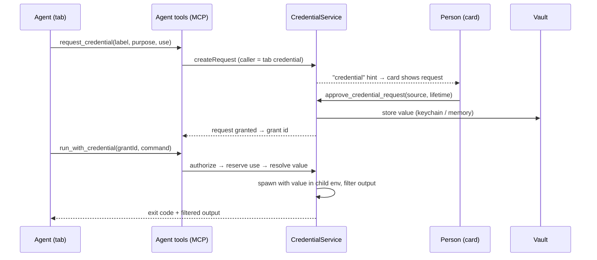

# Agent credentials

Status: Living. How an agent gets to use a secret (an API key, token or
password) without the value ever passing through chat, a transcript, a draft
or a tool result. The research behind it is the credentials plan
(`plans/credentials/credentials.md`, 29 October 2026); this page records what
was built and why, where it departs from that plan.

## In one paragraph

An agent calls `request_credential`. A card appears above the composer of the
tab that asked. The person picks a saved credential or types a value, picks
how long the grant lasts, and allows it. The backend stores the value (in the
system keychain, or in memory for a one-off), creates a **grant** for the
**environment** (bound to its runtime), and the agent receives the grant id.
Eligible native agent tabs in that environment, OpenCode included, may use the grant under their execution policy.
The agent then uses the grant through `run_with_credential` (the backend
runs a command with the value in that command's environment or a private
file) or `http_request_with_credential` (the backend sends one HTTPS request
to an approved host with the value attached). Output is filtered for the value
before the agent sees it. Grants end on expiry, use limit, revocation, a
rebuilt or moved runtime, a change to the saved credential, environment
deletion, and (for one-off values) restart. Closing a tab or starting a new
conversation does not end them; it only cancels that tab's pending requests.

## Where the code is

| Area | Files |
| --- | --- |
| Shared types, limits, validators | `packages/protocol/src/agent-credentials.ts` |
| Commands (the person's side) | `packages/protocol/src/contract/domains/config/credential-commands.ts`, `apps/backend/src/core/commands-registry-credentials.ts` |
| Service | `apps/backend/src/core/credentials/`: `service.ts` (facade, sweep), `connections.ts` (saved credentials), `access.ts` (requests, approval, grants, lifecycle), `operations.ts` (authorization and each use), `runner.ts` (command runs), `http-operation.ts` (trusted HTTP), `redaction.ts` (output boundary), `vault.ts` (value storage), `records.ts` + `layout.ts` (database rows), `tools.ts` (agent MCP tools) |
| Backend wiring | `apps/backend/src/core/credentials-host.ts` (sessions, runtimes, launch), `index.ts` (`startCredentials`, writer-startup reconciliation, shutdown), `environment-delete.ts`, `commands-registry-teardown.ts` (tab close), `control-mcp/server.ts` (coordinator deny list), `agent-tools.ts` (registration) |
| Renderer | `apps/web/src/components/native-agent/CredentialRequestCard.tsx`, `apps/web/src/hooks/useCredentialSnapshot.ts`, `apps/web/src/components/settings/CredentialsSettings.tsx`, `apps/web/src/lib/backend/credentials.ts` |

## Model

Four user-facing records, all metadata, in four database stores (`credential-connections`,
and `credential-requests`, `credential-grants`, `credential-operations`, each
owned by its environment). The `credential-vault-cleanup` store tracks
staged writes and retired entries. The `credential-run-cleanup` store tracks
command materializations until cleanup succeeds, even if the operation is
already terminal or its environment record has been removed. Values are never
in the database.

- **Connection** (a saved credential): name, description, the projects that
  may ask for it (`null` = every project on this machine), the hosts a trusted
  HTTP request may send it to, where the value is stored, `revision` (bumped on
  every change) and `valueVersion` (bumped when the value is replaced). Saving
  one authorizes nothing.
- **Request**: what the agent asked for (label, purpose, use, binding or HTTP
  policy, an optional exact command, an optional suggested connection name),
  and the runtime it was made in. Its `tabId` is the tab that shows the card:
  the asking tab, a valid native tab named by an environment-wide caller, or
  `*` for every native agent tab of the environment. States: `pending`,
  `granted`, `declined`, `expired`, `cancelled`. Waits 10 minutes for a
  person. Each authenticated caller may have four pending at once, regardless
  of where the cards appear. A pending request is cancelled
  when its tab closes or the conversation that asked ends.
- **Grant**: the effective permission the backend computed: environment,
  project, runtime, the tab that asked (for display only), source (connection with its pinned value version, or a temporary
  value), use, binding or HTTP policy, exact command if any,
  lifetime (15 minutes to 8 hours; 1 hour by default), use limit, use count.
  States: `active`, `revoked`, `expired`, `invalidated`, each ended grant with
  a content-free reason.
- **Operation**: one use: `reserved`, `running`, `succeeded`, `failed`,
  `failed_no_effect`, `outcome_unknown`, `cancelled_before_start`, plus
  cleanup (`confirmed`/`unconfirmed`), exit code or HTTP status, and a short
  summary (the command's first line, or `METHOD host/path`). Output is kept in
  memory only (the last 128 operations), never in the database or a log.

An environment's operation history holds up to 400 rows. The oldest settled
rows go first, except keyed operations whose grants are active. If all rows are
open or protect active grants' idempotency keys, new operations wait for
capacity. Open requests and grants also stay in their stores until settled.

## Authorization at every use

Every `run_with_credential` and `http_request_with_credential` call passes the
same checks, in `CredentialOperations.authorize`:

1. The caller is identified by its own agent-tools credential (never an
   argument): a tab, or for OpenCode the whole environment. The grant must
   belong to that environment and project. Any tab of the environment may use
   it.
2. The grant is active, not past its wall-clock expiry, not past its lifetime
   on the issuing process's monotonic clock (a clock moved backwards does not
   extend it), and has uses left. A temporary grant is usable only in the
   process that holds its value.
3. The environment still has the same runtime (container id, worktree path,
   coordinator checkout). A mismatch **ends** the grant. Conversations do not
   matter: a new conversation in any tab keeps using the grant.
4. A connection-backed grant's connection still exists, has the pinned value
   version, still allows the project and (for HTTP) still allows every host
   of the grant. A mismatch ends the grant. Renaming a connection does not;
   changing its projects or hosts ends its grants when it is saved.
5. The use matches the grant (`command` vs `http`), the **calling** session's
   execution policy allows it (below; for OpenCode, or a tab with no session
   record yet, the environment's interactive policy), and a command-bound grant gets exactly its
   command.
6. One transaction rechecks the grant, applies the idempotency key and the
   per-tab bound (four open operations), counts the use and records the
   operation. Concurrent calls cannot exceed the use limit.
7. The value is read after admission. Dispatch rechecks both expiry clocks,
   the runtime and the calling session's policy. It atomically claims
   the reservation before spawning or sending. Cancellation, shutdown or a
   scope change during preparation can end a reservation and refund its use.

An ambiguous outcome is never retried automatically: a timeout or a lost
connection after sending is `outcome_unknown`. A use that ended before
anything ran (`cancelled_before_start`) gives its use back. Within one grant and authenticated caller, replaying the same idempotency
key with the same request returns the retained operation even after the grant
ends. Reusing that key for a different request returns
`IDEMPOTENCY_CONFLICT`. Cancellation of a running operation is recorded
durably so its owner can act on it and report the outcome.

### Execution policy

A credential grant never widens what the session may already do:

| Session | `command` use | `http` use |
| --- | --- | --- |
| Interactive, `approvals: auto-approve` | Any command in the tab's workspace, or one exact command, subject to the rows below | Any method allowed by the grant and network policy |
| Interactive, `approvals: ask` | Only an exact command the person approved on the card | As above |
| `approvals: deny`, or shell denied by capability or tool policy | Refused | As above |
| Provider sandbox | Refused because the runner cannot apply the provider sandbox | Refused if networking is restricted |
| Restricted network in a worktree | Refused | Refused |
| Restricted network enforced by the container firewall | Runs inside the firewall under the command rules above | Refused |
| Network capability denied | Refused | Refused |
| Coordinator (read-only) | Refused | Refused under the coordinator's network policy |
| OpenCode read-only turn | Credential tools withheld | Credential tools withheld |

## Running a command

`runner.ts` runs the command where the tab's own agent runs, as a `!` command
would: in the worktree with the user's login shell, managed binaries and
isolation variables, or in the container as `node` in `/workspace`.

- The value goes into the child's own environment (`env` delivery) or a
  private file whose path is the variable (`file` delivery). Never argv, a
  shell string, a shared process (the Codex app-server, a bridge) or the
  worktree. In a container the docker client is started with the value in
  *its* environment and `-e NAME`, so the value is not on any command line;
  a file is written through `docker exec -i` from stdin into
  `/tmp/orkestrator-credentials/<operation>` with umask 077.
- Binding names are validated. Names that change how programs start
  (`PATH`, `LD_*`, `DYLD_*`, `NODE_OPTIONS`, `BASH_ENV`, `ORKESTRATOR_*`, …)
  are refused. Docker client controls such as `DOCKER_*` and proxy settings
  are also refused for container environment-variable delivery.
- A worktree run is its own process group. When the command exits, times out
  (10 minutes by default, 60 at most) or is cancelled, the whole group is
  ended, so a background descendant does not keep the value. A container run
  is tagged with `ORKESTRATOR_CREDENTIAL_RUN` and ended by process group and
  tag inside the container. Startup and cleanup acquire the same per-run lock.
  Cleanup closes admission before it checks for processes, so a queued Docker
  exec that arrives after cancellation cannot start the command. A worktree run's private files live under
  `<data dir>/credentials/runs/<operation>/` and are removed afterwards.
- A tool call waits up to 45 seconds (110 at most) and then answers `running`
  with the operation id; `get_credential_operation` collects the result, so a
  lost answer never means running the command again.

## Trusted HTTP

`http_request_with_credential` is the trusted operation: the value never
enters agent-controlled execution. The grant (approved by the person, and for
a saved credential bounded by its configured hosts) fixes the hosts and how
the credential is presented: bearer token, a named header, or basic auth. The
request must be `https` to one of those hosts exactly (port included), with no
user info. The default HTTPS port and numeric port spelling are canonicalized.
The backend checks every address returned by DNS and connects directly to a
validated public address. TLS and HTTP still use the approved hostname.
The agent may not set `Authorization`, `Cookie`, `Host`, `Accept-Encoding`,
hop-by-hop headers or the credential's own header. Header names are
case-insensitive and duplicates are rejected. The transport requests identity
encoding. Redirects are returned, not followed,
so a credential never reaches a host nobody approved. The answer carries the
status, a short list of safe headers (no `set-cookie`) and up to 128 KiB of
body, all filtered. A truncated body drops the suffix still held by the filter.

## Output boundary

`redaction.ts`. Every byte of command output and HTTP answer passes through a
streaming filter before anything keeps it. It replaces the value and these
encodings of it with `[redacted]`: exact text, JSON string escaping, percent
encoding, standard and URL-safe base64, and base64 of `user:value` for basic
auth. A value split across chunks is still caught (the filter holds back the
longest pattern length minus one). The shape-based detector
(`redactSecrets`) runs afterwards as a second layer. Values shorter than four
characters are refused at intake, because they cannot be filtered usefully.

This catches accidental echoes. It does not stop code that transforms the
value some other way, writes it to a file, or sends it over the network. The
card says so: "Code running in this environment will be able to read this
credential."

## Storage

`vault.ts`. A pending cleanup record is committed before writing the saved
value under a random entry ID. The value is read back and compared, then the
pending record is removed in the same transaction that publishes the connection. Reads and deletion use the vault recorded for that
entry, even if the backend chose a different default on restart. Replacing
or deleting a connection ends its grants immediately. Physical removal is
retried from a durable cleanup record until the original vault confirms it.

| Backend | Where values go |
| --- | --- |
| Production with a working system keychain | `Bun.secrets`: macOS Keychain, Linux Secret Service, Windows Credential Manager. The service name carries a digest of the data directory, so profiles never share items. |
| Production without one (headless Linux) | Owner-only files (`0600` in `0700`) in `<data dir>/credentials/vault/`, outside the database and its snapshots. Settings and the card say they are not encrypted. |
| `ORKESTRATOR_CREDENTIAL_VAULT=keychain` without a keychain | Nothing can be saved; one-off values still work. |
| Development and agent-test profiles | Owner-only files, so `dev:reset` removes them and no keychain item outlives the profile. |
| Tests (`NODE_ENV=test`) | Memory only. No test can reach the real keychain. |

One-off ("temporary") values are held only in the backend's memory and are
gone when their owning backend exits. The registry writer checks process
identity during recovery before ending a grant or settling an operation from
another boot. It leaves work owned by a live backend in place. The cleanup
sweep retries unresolved vault and command materializations
(`CredentialService.reconcileStartup`).

The four provider keys in `config.json` are unchanged; see
[storage.md, "Provider secrets at rest"](storage.md#provider-secrets-at-rest)
and the decisions below.

## Agent tools

Registered on eligible connections to the general agent-tools server
(`credentials/tools.ts`). Claude tmux and shared bridge fallback connections
have no approval card and omit the credential tools. OpenCode's read-only turns
also omit them at the provider and authenticate to MCP with a restricted token.
An eligible environment-wide connection may pass a native `tabId` as a
placement hint for `request_credential`.

| Tool | Does |
| --- | --- |
| `request_credential` | Asks for a credential: `use` `command` (with `envVar`, optional `delivery: file`, optional exact `command`) or `http` (with `hosts`, `auth`, optional `header`/`username`/`methods`). Waits up to `waitSeconds` for a decision. |
| `get_credential_request` | A request's state, waiting while a person decides; the grant once granted. |
| `list_credential_grants` | The environment's usable grants (after a compaction the agent can find them again). |
| `run_with_credential` | Runs a command with the grant. |
| `http_request_with_credential` | Sends one trusted HTTPS request with the grant. |
| `get_credential_operation` | The state and filtered output of a use, waiting for it to finish. |
| `cancel_credential_operation` | Cancels a reservation or requests cancellation of a running operation. |

Stable error codes (`CREDENTIAL_ERROR_CODES`) lead every refusal:
`GRANT_NOT_FOUND`, `ACCESS_EXPIRED`, `SCOPE_MISMATCH`, `POLICY_DENIED`,
`UNSUPPORTED_RUNTIME`, `OUTCOME_UNKNOWN`, …. No message ever includes a
value.

## Commands and who may call them

In the `config` domain (since version 2; adding commands does not bump it):

| Command | Access | Notes |
| --- | --- | --- |
| `get_credential_snapshot` | workspace | One environment's or tab's requests and grants, and the connections its project may use. The card's read. |
| `get_credential_overview` | workspace | Settings' read: connections, active grants, recent operations. Grants stay revocable while a reserved or running operation holds their last use. |
| `approve_credential_request` | admin | Takes the value (or a connection id). `lifetimeMs`, `maxUses` and `hosts` are critical. |
| `decline_credential_request` | admin | |
| `revoke_credential_grant` | workspace | Only takes access away. |
| `create_credential_connection`, `update_credential_connection`, `replace_credential_connection_value`, `delete_credential_connection` | admin | |

`admin` keeps a short-lived workspace grant and the node relay from approving
or storing anything; on a node the window does not run on, the card's approval
goes through the command node (`invoke_on_node`). The coordinator invoker
refuses every human-only command, also when wrapped
(`CREDENTIAL_HUMAN_ONLY_COMMANDS`), and no public action or Control MCP tool
reaches them. Value-carrying arguments are declared `Unknown` and validated by
the handler, so a decode failure can never quote one. No invocation path logs
command arguments (the slow-command record, gateway metrics and IPC carry the
command name only), and `commands-secret-sweep.test.ts` calls every registered
command with canary values.

Changes announce the `credential` resource (id = environment id, or
`connections`). The card re-reads its snapshot on that hint, on resync and on
the view safety cadence, so a hidden or reloaded tab shows the same pending
request.

## What it does not promise

- **Same-user processes.** On a local (worktree) environment the agent runs as
  the user. It can read the vault files of a profile without a keychain, and
  it could read the gateway token and call the approval command itself. The
  keychain keeps values out of plaintext files and backups; it is not a
  boundary against the user's own processes. A container environment cannot
  reach the data directory, the keychain or the gateway token.
- **Inside a container, the run and the agent share a user.** A command runs as
  `node`, like the agent's own shell, so while it runs the agent could read
  its environment (`/proc/<pid>/environ`) or its private file. An exact-command
  grant limits which command Orkestrator runs; it does not hide the value from
  other code in the same container while that command runs.
- **Code that receives a value can keep it.** Ending a grant stops new uses and
  running commands; it cannot take back a value a command already read.
  Deleting a connection removes Orkestrator's copy, not the credential at its
  provider.
- **Filtering is not data-loss prevention** (see "Output boundary").
- **Upstream scope.** A grant cannot make a full-access token read-only. The
  trusted HTTP operation narrows destinations and methods, not what the token
  can do at those destinations.

## Decisions

Each records the choice, the alternatives considered and why.

### 1. Scope: task credentials only; provider keys stay where they are

- **Chosen:** a new store for credentials agents use in tasks. The provider
  sign-in keys in `config.json` (GitHub, Anthropic, Cursor, OpenCode) are not
  migrated.
- **Alternative: migrate them too** (the plan's WP2). Pro: one storage path,
  no plaintext provider keys. Con: `config.json` is read by Electron before
  the backend starts, a standalone headless backend has no keychain, and
  [storage.md](storage.md#provider-secrets-at-rest) records the reasoned
  acceptance of that risk (finding L17); it also mixes credential purposes,
  which the plan itself says must stay apart.
- **Why:** the new feature has none of those constraints, and keeping the two
  apart means a provider key can never become grantable to a task.

### 2. Value storage: system keychain, owner-only file fallback, memory for one-offs

- **Chosen:** `Bun.secrets` when a write/read/delete probe succeeds; otherwise
  owner-only files, disclosed as unencrypted; memory for temporary values and
  tests; files for development profiles.
- **Alternatives:** Electron `safeStorage` (unavailable to a standalone
  backend); an encrypted file with a key stored beside it (no protection
  against the same account, and custom crypto); refusing to save without a
  keychain (unusable on headless hosts); always plaintext files (no gain over
  `config.json`).
- **Why:** the keychain keeps values out of plaintext and backups where it
  exists, and the fallback is the same protection the repository already
  accepts for provider keys, stated wherever a value is saved.

### 3. Grant handle: the grant id, authorized by the caller's credential

- **Chosen:** the agent holds the grant id. Every use is authorized from the
  authenticated tab credential plus the server-side binding checks.
- **Alternative: a random bearer reference stored as a digest** (the plan's
  suggestion). Pro: defence in depth if a tab credential leaked. Con: the
  reference must be delivered and recovered (after a lost answer, a
  compaction, a restart) and it narrows nothing: the tab credential already
  authenticates the caller per tab, and a copied id fails every other scope.
- **Why:** same authority, simpler recovery. A copied grant id is useless outside its environment, project and runtime.
  Retained operation results and replay are scoped to the environment and project.

### 4. Ways to use a credential: runner and trusted HTTP; no provider-shell injection

- **Chosen:** an owned command runner (`command` use) and one trusted
  operation, host-allowlisted HTTPS (`http` use).
- **Alternatives:** inject values into the agent's own shell or provider
  process (shared by every turn and tab, so it would leak across them); a
  proxy that swaps placeholders (strongest, but a new network component; the
  plan defers it too); provider-specific integrations such as GitHub App
  tokens (narrow and per service).
- **Why:** the runner works for every provider and keeps the value in one
  child; trusted HTTP covers the common "call an API" case without exposing
  the value at all. The HTTP operation is not a general fetch: the person
  fixes the hosts, and redirects are never followed.

### 5. Commands run in the agent's own workspace

- **Chosen:** the runner executes where the agent already runs (worktree or
  container), under the session's execution policy.
- **Alternative: a separate disposable container per run.** Pro: isolation
  from the agent's other processes and an enforced deadline that survives a
  backend crash. Con: the command usually needs the workspace and its tools,
  and it would be a new container lifecycle with its own image, mounts and
  cleanup.
- **Why:** no execution privilege is added, and the honest disclosure ("code in
  this environment can read it") holds in both cases. A dedicated sandbox can be a
  later runtime adapter.

### 6. Approvals require a full session (`admin`)

- **Chosen:** approving, declining and storing are `admin` commands; reads and
  revoke are `workspace`.
- **Alternative: `workspace`**, so a short-lived workspace grant (a tailnet
  browser) could approve. Con: anyone holding such a grant could hand saved
  credentials to agents or plant values.
- **Why:** handing out a secret is closer to a machine setting than to agent
  work. A workspace-grant client sees the card; its approval is refused.

### 7. Placement in the `config` domain

- **Chosen:** the commands join the existing `config` domain (machine
  settings, credentials, permission rules) at version 2.
- **Alternative: a new `credentials` domain.** Pro: its own version. Con: a
  new domain needs a legacy adapter, the domain name list, the adapters
  manifest and machine routing entries, with no compatibility benefit for
  commands every peer either has or answers `unknown-command`.
- **Why:** new commands do not bump a domain, and the routing for `config`
  already exists.

### 8. One-off values do not survive a restart

- **Chosen:** temporary values live in memory; restart ends their grants.
- **Alternative:** persist them in the vault until the grant expires. Con: a
  value the person chose not to save would then be on disk.
- **Why:** "not saved" should mean not saved. A saved connection is the way to
  keep access across restarts.

### 9. Output filtering by value and listed encodings, with a plain marker

- **Chosen:** known-value replacement (with the listed encodings) before any
  consumer, then the shape detector; the marker is `[redacted]`.
- **Alternatives:** pattern detection alone (misses arbitrary values); a
  labelled marker (`[redacted npm]`; the shape detector then mangles it after
  `token=`).
- **Why:** exact values are what can leak by accident; the marker stays
  readable.

### 10. Real-process tests are in the slow tier

- **Chosen:** `service.test.ts` drives the runner through a fake spawner
  (default tier, deterministic); `service-runs.test.ts` runs real shells,
  deadlines and process-group cancellation (slow tier).
- **Why:** the default suite stays fast and deterministic, and the fake spawner
  is what lets a test assert that the value is in the child's environment and
  never in any argv, including the container path.

### 11. Bridges do not auto-approve the credential tools

- **Chosen:** the credential tools go through each session's normal MCP tool
  approval, unlike mail and artifact tools, which every bridge allows
  outright.
- **Alternative:** add them to the bridges' always-allowed lists. Pro: one
  fewer prompt under `ask`. Con: `run_with_credential` runs a command, and an
  `ask` session's person should see it as they see any other command.
- **Why:** under `ask` the provider's own prompt shows the command the agent is
  about to run, on top of the card's exact-command rule; under the default
  `auto-approve` nothing extra is asked.

### 12. Grants belong to the environment, not a tab or conversation

- **Chosen:** a grant can be used by every agent tab of its environment,
  across conversations, until it expires, runs out, is revoked or its runtime
  changes. The calling tab's execution policy still applies to each use.
- **Alternative: bind to the asking tab and its conversation** (the first
  version, following the plan's per-task grants). Pro: a new conversation
  starts with no credentials. Con: OpenCode, whose tool connection is one per
  environment, could not use credentials at all; and the binding was not a
  real boundary, because every agent in an environment shares its workspace,
  user and (in a container) its processes.
- **Why:** the environment is the actual isolation boundary, so it is the
  honest scope, and it makes the feature work on every platform. Approval
  still happens per environment, and revocation is one click in Settings.

## Known limits of this release

- A tool call waits at most 110 seconds. Some MCP clients time a tool call out
  sooner (Codex's default is 60 seconds); the agent then calls
  `get_credential_request` or `get_credential_operation` again, which is what
  the tool descriptions tell it to do. Nothing is lost.
- A worktree run's deadline is enforced by the backend process. If the backend
  dies mid-run, the command's process group is not ended by anyone (its id
  cannot be safely signalled by a later process); startup marks the operation
  `outcome_unknown` with cleanup `unconfirmed` and removes its private
  directory. A container run left this way is ended inside its container at
  startup, by process group and run tag, and its private files are removed.
- If a command hands its output pipes to a process outside its group (a
  `setsid` daemon), the run ends after a grace period, its output stops there,
  and cleanup is reported `unconfirmed`.

## Not built (deferred)

- A dedicated sandbox runtime per run, a placeholder-swapping proxy, and
  provider-specific trusted operations (GitHub App tokens and the like).
- Standing rules ("always allow this connection for this project"): every
  grant needs an approval on its card today.
- Sharing a grant with another environment, and cross-machine raw transfer: a
  grant never leaves its environment or its machine. (Saved credentials are
  shared per project; each environment needs its own approval.)
- Revoking a credential at its provider.

## Tests

- `apps/backend/src/core/credentials/service.test.ts`: requests, approval
  races, staleness, every authorization check, use limits, idempotency, both
  launch targets' argv/env, trusted HTTP, connection changes, lifecycle.
- `service-runs.test.ts` (slow tier): real runs, filtering, deadlines,
  cancellation, private files, restart.
- `tools.test.ts`: tool registration per connection kind, caller scope, no
  value in any answer.
- `redaction.test.ts`, `vault.test.ts`.
- `apps/backend/src/core/control-mcp/server-coordinator-workflows.test.ts`:
  the coordinator cannot reach the human-only commands.
- `apps/web/src/components/native-agent/CredentialRequestCard.test.tsx`,
  `apps/web/src/components/settings/CredentialsSettings.test.tsx`.
