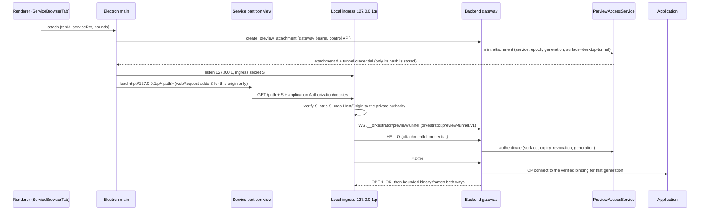

# Service Browser Previews

Status: Living. Shipped in #831 (`4f02156b`). Rollout gates, the evidence log
and remaining work are in
[0042-service-preview-rollout.md](../todo/previews-and-annotations/0042-service-preview-rollout.md).

A browser tab previews a **service**: a backend-owned identity for one
application port in one environment. It does not preview a host port. The tab
follows the service when a container is recreated or its host binding changes,
and it never follows a reused port to another application.

Every new transport ships **disabled by default**. The service registry,
service tabs and terminal-link intents are always on; with every transport
off, a desktop service tab loads the service's current host port over the
legacy gateway loopback route ("compatibility" mode).

## Components

| Owner | Module | Responsibility |
| --- | --- | --- |
| Backend | `core/preview-service-registry.ts` | Definitions, generations, lifecycle revocation, events |
| Backend | `core/preview-target-resolver.ts` | Verified Docker/worktree/backend-host targets |
| Backend | `core/preview-readiness.ts` | TCP/TLS/HTTP readiness layers, bounded probing |
| Backend | `core/preview-access.ts` | Scoped attachments, one-use grants, sessions, revocation |
| Backend | `preview-tunnel-server.ts` | Desktop tunnel (`/__orkestrator/preview/tunnel`) |
| Backend | `preview-publication.ts` | Private HTTPS origins, bootstrap host |
| Backend | `preview-relay-supervisor.ts` | Optional in-container relay |
| Backend | `core/commands-registry-previews.ts` | Trusted control commands |
| Protocol | `packages/protocol/src/preview-*.ts` | Contracts, HTTP/1.1 and WebSocket codecs, header policy |
| Desktop | `electron/preview-transport-manager.ts` | Per-service loopback ingress over the tunnel |
| Desktop | `electron/preview-external-handoff.ts` | External-browser handoff without a credential in a URL |
| Web | `stores/previewServiceStore.ts`, `components/browser/*` | Snapshots, service tabs, picker, diagnostics |

## Identity

- `backendInstanceId` is stored in the `backend-identity` store and bound to
  the data directory. Copying a data directory to another path yields a new
  identity.
- `backendEpoch` changes on every backend start.
- `serviceId` is stable for the life of a definition.
- `endpointGeneration` changes whenever the resolved binding changes: a
  different container, host port, family, or transport. All access for the
  old generation is revoked before the new one is used.

Definitions live in the `preview-services` store (see [storage](storage.md)).
Only definitions, idempotency records, the backend identity and operator
settings are persisted; resolved host ports, grants and cookies never are.
Mutations are compare-and-set on
`definitionRevision`, deduplicated by operation ID, and removals leave
tombstones so clients can detect deletions they missed.

## Registering services

Services are generated automatically from an environment's entry port and,
for containers, its TCP port mappings (`mapping:<port>` keys). A local
environment gets only its entry port, as a `worktree` service (see
**Local environments** below). Others are registered in **Environment
settings → Preview services** or with `register_preview_service`. Nothing is
ever generated from a port scan.

| Target kind | Where the application runs | Port meaning |
| --- | --- | --- |
| `container` | Owned container | The **container** application port. The backend finds the published host port by inspecting Docker. |
| `worktree` | Local environment on the backend host | Backend-host loopback port |
| `backend-host` | Any process on the backend host | Backend-host loopback port (explicit, manual) |

Container targets require the container to carry this backend's owner label
and the environment's ID label. Orkestrator's own ports (gateway, Control MCP,
agent tools, local agent servers, Docker API ports) and in-container agent
servers (4096–4101) are refused with `forbidden`. Container targets are reached
only through Docker's loopback binding for that exact application port, and
manual targets are backend-loopback only: an arbitrary remote host is never a
target.

### Local environments

Every local environment of a project carries the same entry port (copied from
the repository config at creation), and they all share the backend host's
loopback, so an open port proves nothing about whose server it is. Loopback
targets (`worktree`, `backend-host`) are resolved with a listener check
(`preview-listener-ownership.ts`):

1. `lsof -nP -a -i4TCP:<port> -sTCP:LISTEN -Fp` (or `-i6`) for the one port the
   definition names, never a range. Linux hosts without `lsof` use
   `ss -H -ltnp -4|-6 "sport = :<port>"`.
2. `ps -A -o pid=,ppid=,lstart=`, then the listener's parent chain up to a
   *managed process root*: a local terminal shell (`TerminalRuntime`) or a local
   agent bridge (`LocalServerRuntime`) this backend started for an environment.
   A dev server run in an Orkestrator terminal, or started by an agent's shell
   tool, descends from one.

The answer is the endpoint's `listener` field: `this-environment`,
`other-environment`, `unattributed` (no managed ancestor: another terminal app,
another user, a system service), `none`, or `unchecked` (neither `lsof` nor
`ss`, a timeout, or a platform other than macOS and Linux).

| Listener | Generated `worktree` service | User `worktree` service | `backend-host` service |
| --- | --- | --- | --- |
| `this-environment` | `managed-process` | `managed-process` | `managed-process` |
| `other-environment` | refused | refused | `user-registered` |
| `unattributed`, `none`, `unchecked` | refused until confirmed | `user-registered` | `user-registered` |

Refusals are `target-unverified`. `managed-process` means "started under this
backend's terminal or agent for that environment", not cryptographic proof.
Its binding key includes a digest of the listener's pid and start time, so a
restarted server on the same port gets a new endpoint generation and old
attachments are revoked. A `user-registered` target shows whatever listens on
the port, and route details say so.

A generated local service waits for its own server. While refused for
`none`, `unattributed` or `other-environment` it is re-resolved on the
readiness backoff schedule (1, 2, 4, 8, 16, 30 s), and **Retry** restarts it.
**Show any process** (an empty `update_preview_service` patch) confirms it:
any edit flips `userOverride`, which makes it the user's own registration.

**Port increments.** When a dev server finds its port taken and moves to the
next one, open the address it prints (⌘⇧-click in the terminal). The link
resolves in that environment; an unregistered port offers **Move `<service>`
from port A to B** for nearby services of the same kind and scheme, next to
**Register**. Nothing moves without that click.

**Agent links.** In an environment's agent tab, ⌘⇧-click (Ctrl+Shift-click) on
a loopback link opens a preview tab with the `agent-link` intent, resolved in
that environment like a terminal link. A plain click still opens the system
browser. Coordinator and mail transcripts have no environment and keep the
plain behaviour.

**Automatic host ports.** A port mapping with **Auto** (`hostPortMode: "auto"`,
`hostPort: 0`) is published as `127.0.0.1::<port>` so Docker chooses a free
host port. The resolver reads the real binding, so an auto mapping gets a
different host port after recreation without breaking tabs. Adding or changing
a mapping still requires recreating the container.

## Transports

The client chooses a mode from the authenticated `get_preview_capabilities`
response:

- **Desktop app, in-app tab:** desktop tunnel. If the transport is off, it
  falls back to the legacy gateway path. The legacy path rewrites HTML, has no
  WebSocket support, and shares one origin between applications; the tab shows
  these limitations. **Open in browser** uses the private origin.
- **Web and iOS clients:** the private HTTPS origin, opened top-level. Without
  publication, the tab explains the required setup. It never falls back to an
  unauthenticated or embedded view.

The legacy route (`/__orkestrator/browser/loopback/<port>/`) stays available
for old clients and legacy URL tabs. A legacy URL tab whose loopback port
belongs to exactly one enabled, available service of its own environment in
the current backend epoch offers **Open as service**. The click re-reads the
service list and converts the tab only if the same service still has the
same endpoint generation, keeping the path, query and fragment
(`legacyUrlServiceMatch` in `apps/web/src/lib/preview-service-entry.ts`).
Ownership is never inferred from the port alone or from the active
environment, so ambiguous tabs get no offer.

### Desktop tunnel

For each service it previews, Electron opens a loopback ingress
(`127.0.0.1:<random>`). Each browser connection becomes one WebSocket to the
backend using subprotocol `orkestrator.preview-tunnel.v1`. The WebSocket
authenticates with a scoped attachment credential in the first frame, never in
a URL or header. The backend connects only to that service's current target.
The client never names a host, port, or container.

- The ingress accepts only requests carrying the per-listener
  `x-orkestrator-preview-ingress` header. Electron injects that header for the
  service's own partition and origin, and strips it before forwarding. It also
  checks `Host` against DNS rebinding.
- Each service gets its own Electron partition,
  `persist:orkestrator-preview-svc-<slot>-<connection>-<hash>`, so cookies and
  storage never mix between services. Tabs of one service in one window share
  the partition and the listener; different windows or connections never
  share. **Reset site data** clears only that partition, and never runs on a
  tab switch.
- Partitions nothing can use again are ended by Electron
  (`PreviewPartitionRetention`, `preview-partition-retention.ts`), because the
  backend knows nothing about client partitions. A minute after a window's
  preview transport starts, and every 30 minutes while it lives, Electron
  fetches its backend's full, unfiltered `get_preview_services` list and
  clears that connection's service partitions (in every window slot) whose
  service is gone. Forgetting a connection clears all its service partitions,
  and its shared legacy partitions once no window uses it. Clearing goes
  through the Electron session (storage, cookies, service workers, caches);
  the emptied directory is removed on the next start, before any session
  exists (`preview-partitions-pending.json`). A partition a live transport
  or window holds is never touched; a filtered, not-modified or failed list
  clears nothing. Partitions are listed before the list is fetched, and service ids
  are never reused, so a service created meanwhile is never a candidate.
  Forgotten connection keys are recorded durably in
  `preview-partitions-pending.json.forgotten` before clearing starts. An
  independent retry owner attempts at most 64 clears per pass, including
  failures, even after every transport closes. Failed clears and held
  partitions remain eligible; retries rotate candidates so failures cannot
  starve the rest. At startup, the whole-connection journal also identifies
  directories whose clear never completed. They can be removed before any
  preview session exists. A failed removal retains the connection intent;
  it never counts as evidence of a successful native clear. The per-directory
  journal admits at most 1,024 entries until startup removes them, and the
  forgotten-key journal refuses admission at 1,024 keys without evicting
  earlier cleanup intent.
- A workspace realm's previews are keyed to its node (`node:<nodeId>`), not
  to a connection. Each time a realm opens, Electron records in
  `preview-partitions-pending.json.nodes` which command connection it reached
  the node through. The same window schedule that reconciles services also
  fetches that command node's `list_nodes`; once every command connection
  that listed a node has dropped it from a full, unsuspended registry, the
  node's service and shared partitions are forgotten like a connection's. An
  unreachable, suspended or malformed registry is no evidence of removal. A
  command handover moves the source's nodes to the target before the source
  drops them, and forgetting a command connection forgets nodes reached only
  through it. A node opened again after removal leaves the forgotten and
  pending journals, so its new site data survives the next start.
- The listener first binds the port it used last for that service (bind, never
  probe-then-close), so origin-keyed storage such as localStorage usually
  survives a restart. If the port is taken, a fresh one is used and that
  storage is lost.
- A window's previews belong to the connection they were opened on. Their
  transport invokes and tunnels to that connection's backend, never to
  whichever backend the window uses now. When the window moves to another
  connection (choosing one, adding one, or forgetting the current one), its
  previews end and their attachments are released on the backend that issued
  them; a window close releases the same way
  (`apps/desktop/electron/preview-connection-backend.ts`).
- Remote sessions block navigation to client-local and private addresses, so a
  remote preview cannot reach services on the user's own machine.
- Close codes: 4401 unauthenticated, 4403 forbidden, 4409 generation changed,
  4410 revoked, 4429 capacity.
- The view owns its path. A link, a redirect or Back moves the view first, and
  the tab learns the new path from a state event. Every state carries
  `service.navigation`, a per-view count of main-frame navigations (a history
  move counts the moment it starts). The renderer sends each attach with the
  count its path was chosen against (`navigationBasis`), and main navigates
  the view only for a path chosen against its latest navigation. A bounds or
  visibility re-attach still carrying the previous path, or a late echo of the
  tab's own earlier save, therefore never undoes a navigation. Renderers that
  send no basis fall back to navigating only for a path they have not already
  asked for. Legacy URL tabs follow the same rule since 2026-10-25: their
  states carry `navigation` and their attaches `navigationBasis`
  (`attachUrl` in `browser-preview-manager.ts`).

HTTPS upstream services are not carried by the desktop tunnel. They need the
private origin.

### Private HTTPS origins

Each service gets its own host: `s-<hash>.<domain>`, where the hash is the
first 20 hex characters of SHA-256 over the instance and service IDs. There is
also one `bootstrap.<domain>` host. The operator provides:

- a DNS name that resolves `*.<domain>` to the backend's Tailscale address. Use
  split DNS or a private zone. Never use Tailscale Funnel or a public address.
- a certificate and key covering `*.<domain>` (and therefore `bootstrap.<domain>`).
- a listen address. Only loopback or Tailscale addresses are accepted. Public
  binds are refused.

Opening a preview works like this:

1. A trusted client creates a `browser-top-level` attachment and receives a
   one-use grant.
2. The grant is POSTed to `bootstrap.<domain>/bootstrap`. On desktop this goes
   through a one-use loopback handoff page. On the web client it is a form POST.
3. The bootstrap host answers with a 303 to
   `https://s-…/__orkestrator_preview/session?code=…`. The code is one-use,
   expires after 30 seconds, and is bound to that one host.
4. The service host exchanges the code for a host-only
   `__Host-orkestrator-preview` cookie (Secure, HttpOnly, SameSite=Lax), then
   redirects to the application path.

The iOS client cannot POST across apps. It receives the step 3 URL directly
(`create_preview_handoff_url`), which is the same one-use, host-bound,
30-second code. The session code is the only preview credential that ever
appears in a URL. Grants and tunnel credentials never do.

The bootstrap host never serves application content, so no application
service worker can be registered on it. A worker on the service host can
intercept the session redirect, but the code only yields a session for the
service whose code it already runs. Bootstrap responses are `no-store` with
`Referrer-Policy: no-referrer`, and the web client submits the grant as a
no-referrer form POST from a pre-opened top-level window, so it never reaches a
URL, history entry or `Referer`. Paths under `/__orkestrator_preview/` are never
forwarded upstream.

The reserved cookies (the preview cookie and `orkestrator_gateway_auth`) are
removed from requests before they reach the application, and upstream
`Set-Cookie` fields using a reserved name are dropped. Upstream `Domain`
attributes are removed, so application cookies become host-only rather than
widened. The preview listener has no control dispatch, so control cookies are
never valid on preview hosts. Cookie-authenticated writes and WebSocket
upgrades must carry a same-service `Origin` (or `Sec-Fetch-Site: same-origin`)
and are refused before forwarding otherwise. Reads (`GET`, `HEAD`, `OPTIONS`)
are checked too, because every service host is same-site with its siblings and
the `SameSite=Lax` cookie rides their subresource requests. With
`Sec-Fetch-Site: same-origin` or `none` they pass. From any other site or
service only a top-level document navigation (`Sec-Fetch-Mode: navigate`,
`Sec-Fetch-Dest: document`, not a `Sec-Purpose: prefetch`) passes, so links,
redirects and the sign-in chain keep working while fetches, images, scripts,
frames and workers get `403` before forwarding. Without Fetch Metadata a
foreign `Origin` is refused. All of these count as `http.rejected{forbidden}`
(`crossSiteViolation` and `crossServiceReadViolation` in
`packages/protocol/src/preview-header-policy.ts`). The application's own
`Authorization` headers and cookies pass through unchanged.

External-browser access is its own attachment with a session lease (30 minutes
idle, 8 hours absolute). It outlives the tab that opened it and ends on service
removal, an endpoint generation change, the access kill switch or credential
rotation.

Certificates are checked for coverage and expiry. A renewed certificate is
detected and the listener is re-bound on the same port. A certificate that does
not cover the preview hosts disables publication, and capabilities show why.
`publicPort` is the port browsers use when a TLS terminator (for example
Tailscale Serve) listens on a different port than `port`.

### Optional container relay

When the relay is enabled, a container service whose port is **not published**
resolves to `container-relay` instead of `target-unmapped`. The backend runs
one relay per owned container through `docker exec -i -u node`, preferring
`node` and falling back to `bun`. The relay:

- talks only over the exec's stdio. It has no listener and no credential on a
  command line.
- opens only ports registered for that environment. The allow list is updated
  as services change.
- uses per-channel credit windows (256 KiB), so a stalled reader stops only its
  own channel. Each environment is limited to 64 channels.
- exits when its stdin closes: on environment stop, recreate, or delete, on
  backend shutdown, or when the relay is disabled.

A relay crash fails that environment's open channels and backs off
exponentially (1 s up to 30 s). It never stops the backend and never replays
application bytes. HTTPS services are verified over the relay channel as usual.
Images without `node` or `bun` cannot run the relay. For those, publish the
port (Auto is enough) and recreate the container.

## Security boundaries

Application code is untrusted relative to Orkestrator control and to other
services. Its authority is exactly the service being previewed. Every change
to the preview path must keep these boundaries:

- **Local ingress is credentialed.** Port secrecy is not authentication. The
  desktop ingress requires `x-orkestrator-preview-ingress`, which Electron main
  injects through `webRequest` only for requests from that service's partition
  to that listener's origin (HTTP and WS). The header is stripped before bytes
  enter the tunnel. Other local processes get `403`.
- **The tunnel cannot choose destinations.** An attachment is bound to
  `(serviceId, backendEpoch, endpointGeneration)`. An `OPEN` frame carrying
  host or port fields is malformed. The backend re-resolves the upstream and
  re-checks the generation immediately before connecting; a changed generation
  fails the `OPEN`.
- **Gateway credentials never ride application traffic.** The tunnel
  authenticates in-band with its own credential, and browser sessions use the
  host-only preview cookie. The application's own `Authorization` and cookies
  pass through untouched.
- **Chromium sandboxing is not a firewall.** Partitions of remote-backend
  previews refuse requests to client-local loopback and private addresses
  (including CGNAT tailnet ranges) other than the service's own ingress, so a
  page cannot silently fall back to a service on the user's machine. This is
  enforced through `webRequest`, not assumed from the sandbox.
- **Services cannot reach each other with the user's session.** On private
  origins, a request carrying one service's preview cookie is forwarded only
  if it comes from that service, from the user, or is a top-level document
  navigation. The desktop tunnel gets the same result from per-service
  partitions and an ingress credential injected only for the service's own
  origin.

### Desktop credential and data path

Each upstream TCP connection is one outer WebSocket. Idle connections are
pooled per service; nothing is replayed after a reconnect.

### Resource ownership

| Resource | Owner | Cleanup |
| --- | --- | --- |
| Definition, endpoint generation, readiness | Backend `PreviewServiceRegistry` | Definitions persist; runtime state is rebuilt on restart under a new epoch |
| Attachment and credential hash | Backend `PreviewAccessService` | Release (by the client, on the issuing backend, including after a connection change or window close), lease expiry, generation change, service removal, credential rotation, kill switch, shutdown |
| Tunnel sockets and upstream TCP | Backend `PreviewTunnelServer` | Closing either leg closes both; revocation closes everything tracked for the attachment |
| Local ingress listener and ingress secret | Electron `PreviewTransportManager` | Last attachment release plus a short retirement lease, connection change, window close, app quit |
| Service partition cookies and storage | Electron session | **Reset site data** for that service only; cleared once its service is gone from the backend's list or its connection is forgotten, directory removed on the next start (shared legacy partitions of live connections: see [0042-service-preview-rollout.md](../todo/previews-and-annotations/0042-service-preview-rollout.md)) |
| Browser preview session cookie | Browser holds the value; backend owns validity | Server-side idle and absolute expiry, revocation |

## Operator controls

**Settings → Previews** (`get_preview_settings`/`update_preview_settings`),
stored in the `preview-settings` store:

| Setting | Default | Effect |
| --- | --- | --- |
| `transport` | off | **Kill switch for new access.** Off: no new attachments of any kind; existing access continues until revoked or expired. |
| `relay` | off | Enables the container relay; turning it off stops all relays and re-resolves services |
| `publication.enabled` + fields | off | Private HTTPS origins |
| `publication.upstreamCaFile` | none | Extra CA for HTTPS upstreams (added to, never replacing, system roots) |

`ORKESTRATOR_PREVIEW_TRANSPORT=0|1` and `ORKESTRATOR_PREVIEW_RELAY=0|1`
override the stored values. While an override is set, the settings switch
has no effect, so remove it before relying on the switch.

**Revoke all active preview access** (`revoke_preview_access`, optionally with
a `serviceId`) is a separate action. It closes every tunnel, session, and
upgrade and makes their credentials unusable. It does not stop applications,
delete service definitions, or clear application cookies. Rotating the gateway
token also revokes all preview access.

### Rollback

1. Turn **transport** off. Capabilities now report the reason and no new access
   is issued.
2. **Revoke all.** Open tunnels close with 4410 and sessions stop working.
3. Service definitions, applications, and layouts are kept. The legacy gateway
   route keeps working for old clients.
4. Turn off publication or the relay if needed. This affects only
   Orkestrator's own listener and relay processes, not Tailscale settings.
5. Re-enable when ready. Clients get fresh access to the same `serviceId`.
   Nothing that was in flight is replayed.

`apps/backend/tests/gateway-preview.test.ts` ("rollback drill") runs this
sequence against a real gateway.

**Schema downgrade.** Older clients load saved service tabs
(`orkestrator-preview://service/...` in `browserData.url`). They show
"supports backend-local HTTP addresses" and keep the stored value unchanged.
Preview definitions, settings and identity are database stores; a downgrade
to a build that reads JSON files follows the downgrade note in
[storage](storage.md). Port mappings using Auto (`hostPort: 0`) are rejected
by pre-preview backends' validation. Change them to fixed ports before
downgrading that far.

## Diagnostics

`get_preview_diagnostics` (trusted control API only) returns counts, bounded
failure categories, gauges (tunnel sockets and queued bytes, publication
sockets, relay processes and channels, active admissions), and
p50/p95 connect times. It never contains URLs, paths, queries, headers,
credentials, or page contents. Preview credentials cannot call it. A test
("logs, diagnostics, and events never carry credentials…") enforces this.

Readiness in the picker and in environment settings distinguishes these cases:

- the environment is stopped;
- the port is unmapped (the UI offers **Publish port (auto)**, or the relay when
  it is available);
- the connection is refused;
- TLS failed;
- headers timed out;
- the backend is unavailable;
- a local port is served by another environment's process;
- a generated local service is waiting for this environment's server.

Route details name the owner: owned container, started in this environment,
or user-registered (any process listening on the port is shown).

## Limits

Defaults from `PREVIEW_LIMITS` (`packages/protocol/src/preview-services.ts`):

| Resource | Limit |
| --- | --- |
| Service definitions | 32 per environment, 1,024 per backend |
| Tunnels | 16 per service, 128 per backend, 32 pending handshakes |
| HTTP requests (publication) | 32 active per service, 128 per backend |
| Upgrades (publication) | 8 per service, 128 per backend |
| Tunnel queues | 256 KiB per direction, 64 MiB aggregate |
| Headers | 32 KiB, 100 fields; 30 s to first response header |
| Idle body | 60 s |
| Upload / download | 128 MiB / 512 MiB per request |
| Grants | 60 s, 8 pending per client and service |
| Sessions | 30 min idle, 8 h absolute |

When a limit is exceeded, the request fails with `capacity-exceeded`: HTTP 503
with `x-orkestrator-preview-error`, or tunnel close code 4429.

A full tunnel queue is backpressure, not a failure. When the queue toward the
client reaches 256 KiB, the backend pauses the upstream and returns the rest of
the current read to the upstream's buffer. It resumes once the queue drains,
so the queue never exceeds the limit by more than one frame. Liveness is
any frame from the client within a 30-second interval. A client whose reader
stopped (the browser is not consuming, such as paused media) cannot answer
the backend's ping queued behind the unread data, so the desktop pings the
backend every 15 seconds (`PREVIEW_TUNNEL_CLIENT_PING_MS`) and its tunnel
stays open, holding at most the queue, one read and its admission slot until
the tab closes it. A client that sends nothing for an interval (network
loss, a crashed process) is closed. Older desktops only answer pings, so a
stopped reader on them is still closed after 30 to 60 seconds; older
backends answer the desktop's pings and ignore them. When the backend
itself stops reading (the upstream application is not consuming an upload),
the client's pings wait too, and that tunnel is still closed by liveness.
When a tunnel closes, a slow reader still receives the queued bytes. The
2-second close-handshake grace starts once the close frame has been flushed,
and a peer that stops reading is cut off 30 seconds after the close.
Liveness pings stop once the tunnel starts closing, so an unanswered ping
cannot cut off the drain.

## Framework configuration

Route details → **Framework setup hints** shows the points below for one
service as copyable, version-labelled snippets (Vite, Auth.js v5, NextAuth v4,
Next.js, Express, OAuth providers), with the service's private origin filled
in when it is published (`apps/web/src/lib/preview-framework-hints.ts`). They
are text to copy; Orkestrator never edits the project.

New routes do not rewrite response bodies. Upstream requests carry
`Host: localhost:<application port>` (with default ports omitted). A same-service
`Origin` or `Referer` is mapped to the canonical private origin, normally
`http://localhost:<port>`. Development servers that only accept `localhost` work
unchanged. `X-Forwarded-Proto` always carries the public scheme, including on
writes, fetches, and WebSocket upgrades, so HTTPS-dependent secure-cookie
decisions remain consistent. `X-Forwarded-Host` carries the public host only
when no same-service `Origin` was mapped. On mapped-Origin requests it is
omitted, allowing CSRF checks such as Next.js Server Actions to compare against
the private `Host` instead. Inbound forwarding headers are always discarded.

- **Vite 7.3.6** (pinned fixture): the page, module graph, and HMR updates work
  over a private origin with an empty config. No `allowedHosts` or `hmr`
  settings are needed (`apps/backend/src/preview-vite.test.ts`, opt-in). HMR
  in a real Chromium page is covered by `e2e/preview/private-origin.spec.ts`
  (opt-in Vite fixture); HMR over the desktop tunnel in a real Electron window
  is not yet validated.
- **OAuth**: configure the application with the public service origin
  `https://s-….<domain>` and register its callback URL with the OAuth provider.
  Use that configured origin when generating redirect URIs on writes or
  fetches too. The desktop ingress port can change between sessions, so use
  the published service origin for OAuth flows. Hidden-iframe silent renewal
  that redirects through an external identity provider and back is unsupported:
  even when this service embeds the iframe, the return can carry
  `Sec-Fetch-Site: cross-site` and `Sec-Fetch-Dest: iframe`, so it receives
  `403` before reaching the application and increments
  `http.rejected{forbidden}`. Firefox and WebKit in the test run dropped the
  Lax preview cookie on this return and received `401` before the metadata
  check instead. Use refresh tokens (when supported by the provider), a popup,
  or a top-level redirect flow instead. Direct same-origin
  iframe loads still work. Allowing cross-site iframe returns would also let
  a sibling service launder a frame through an external redirect.
- Applications that build absolute URLs from `Host` produce `localhost` links.
  Set an explicit public origin for URL generation across all request types;
  `X-Forwarded-Host` is absent on mapped-Origin requests, and falling back to
  `Host` there produces private URLs. An application that hardcodes a different
  `localhost` API origin needs that origin configured. Both are configuration
  limitations, not transport bugs.
- **Frontend and API as two services**: a page on one private origin cannot
  fetch, embed or load assets from a sibling service; only links between them
  work. Proxy the API through the frontend's development server (for example
  Vite `server.proxy` to `http://localhost:<api port>`) so the browser sees one
  service.

## Known limitations

- Embedded previews in web and iOS clients are not advertised. They have not
  passed real-browser privacy tests, so those clients open the preview
  top-level.
- Same-service iframe authentication returns through an external identity
  provider are unsupported on private origins; use refresh tokens, popup or
  top-level redirect renewal (see **Framework configuration**). Fetch Metadata
  describes the redirect chain, so the final same-service URL does not make
  the request same-origin.
- Top-level private origins are verified in Playwright Chromium, Firefox and
  WebKit (`e2e/preview/private-origin.spec.ts`). WebKit is engine coverage;
  shipping Safari and iOS are not qualified by it. Firefox/WebKit tests use
  a certificate bypass scoped to throwaway contexts, so they do not prove
  deployment certificate trust.
- The following have not been validated:
  - shipping Safari and iOS devices;
  - Docker Desktop on Windows (Docker Desktop for macOS passed, including
    Auto mappings);
  - a two-machine tailnet run (the real Electron window passed on one
    machine);
  - real private DNS and certificates.
- Private origins add no `Cross-Origin-Opener-Policy`; the application's own
  headers pass through. The web client opens a preview with no opener, but a
  service opened by another site with a plain `window.open` keeps
  `window.opener`. Bootstrap, session and refusal pages send
  `X-Frame-Options: DENY` and `frame-ancestors 'none'`.

  See the evidence log in
  [0042-service-preview-rollout.md](../todo/previews-and-annotations/0042-service-preview-rollout.md).
- Application script on one service host can set a parent-domain cookie for
  its own application cookie names (never the reserved ones). Mutually
  untrusted services need separate preview domains.
- An application service worker can intercept the service host's sign-in path
  and block re-sign-in. The sign-in code only authorizes that same service, so
  nothing leaks, but the user must clear the site's data to recover (observed
  in real Chromium on 2026-10-22). The worker can also carry the code
  elsewhere and redeem it once from another browser, for that same service
  only.
- Cross-service reads are refused by Fetch Metadata, verified in Chromium 156,
  Firefox 157 and Playwright WebKit 27.2. A browser that sends no
  `Sec-Fetch-Site` (Firefox before 90, Safari before 16.4) can still send a blind credentialed `no-cors` `GET` to a
  sibling, and a sibling can still navigate the top-level window to another
  service. A live Tailscale Serve 1.102.4 probe preserved `Sec-Fetch-*` and
  `Sec-Purpose`, including prefetch/prerender; wildcard private DNS,
  certificates and browser traffic through `publicPort` still need deployment
  qualification. If another forwarder strips metadata, reads fall back to
  the `Origin` check. See
  [0054-preview-cross-service-reads.md](../todo/previews-and-annotations/0054-preview-cross-service-reads.md).
- The relay needs `node` or `bun` in the image, and the `node` user.
- Local listener attribution needs `ps` and `lsof` (or, on Linux, `ss`) on the
  backend host. Without them every loopback check is `unchecked`, and
  generated local services wait for confirmation. A listener owned by another
  OS user cannot be attributed. Servers started through `orkestrator environment exec` run
  under detached exec workers, which are not managed roots, so they are
  `unattributed`. An attribution is reused for the 5-second verification
  window, as container bindings are.
- Only HTTP/1.1 and WebSockets are carried. HTTP/2-only features, HTTP/3,
  WebTransport, and UDP are not.
