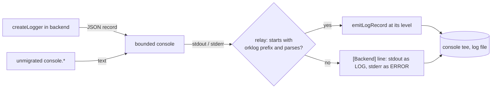

# Application logging

Status: Living. The shared logger, its vocabulary, and how entries reach the log
file. Electron's main process is fully on it. The bridges, backend and renderer
are migrating; `tests/unit/raw-console-ratchet.test.ts` lists what is left.

## Using it

```ts
import { createLogger, formatLogError } from "@orkestrator/protocol/logger";

const log = createLogger("updater");

log.info("downloaded", { version });
log.warn("check.failed", { error: formatLogError(error) });
log.debug("library.message", () => ({ message: expensive() }));
```

Each entry has four parts:

- **An area**, from the fixed list in `packages/protocol/src/log-vocabulary/`.
- **A level:** `error`, `warn`, `info`, `debug` or `trace`.
- **An event:** a static name listed for that area. Never put dynamic text in it.
- **Optional fields:** scalars and formatted errors.

`packages/protocol/src/logger.ts` is browser-safe and has no dependencies.
Node-only setup is in `src/node/logger-environment.ts`.

### Choosing a level

| Level | Means | By default |
| --- | --- | --- |
| `error` | Something failed and nothing recovers it. | Written |
| `warn` | Something failed or looks wrong, and the app carried on or will retry. | Written |
| `info` | A rare, meaningful lifecycle event. | Written |
| `debug` | Detail for investigating one area. | Off |
| `trace` | Per-item detail too heavy for `debug`. | Off |

A site moved to `debug` disappears from normal logs, including from a saved log.
Treat that as a decision to review, not a tidy-up.

### Hot paths

A level check is one integer comparison. To build no arguments when the level is
off, pass a function for the fields; it runs only when the level is on. Use
`log.isEnabled("debug")` to guard other work, which is what `rendererDebugLog`'s
per-frame guard becomes. electron-updater's `debug` method reads as absent while
the level is off, because the library checks for it before serializing its plan.

## Vocabulary

One file per domain in `log-vocabulary/`. Each lists its areas and events, with a
sentence for each, so a review of a new log line is a review of that list.

```ts
export const UPDATER_LOG_AREAS = defineLogAreas({
  updater: {
    description: "Desktop self-update: electron-updater and updates a remote client requested.",
    events: {
      "check.failed": "An update check failed; the next periodic check retries.",
    },
  },
});
```

- A new event touches only its domain's list. A new domain is a new file plus two
  lines in `index.ts`. The logger does not change.
- `createLogger`'s types come from this list, so an unlisted area, or another
  area's event, fails the typecheck.
- At runtime an unlisted event is written as `invalid-event`, without its text.
- `log-vocabulary.test.ts` fails on an unregistered file, an area two files claim,
  an undocumented entry or a name outside the grammar (lowercase, `-` and `.`).
- There is no `legacy` or catch-all area, and the test keeps it that way.
- `tag` keeps a text form that support recipes already search for. Only
  `desktop.startup` (`[DesktopStartup]`) has one. A new area never needs it.

## Restricted fields

A field is a string, number, boolean, null, undefined or the result of
`formatLogError`. Enforced twice:

- **Types:** a raw object, array or `Error` is a type error, and so is a field
  named for content AGENTS.md invariant 12 keeps out of logs (`stdout`, `stderr`,
  `cmd`, `spawnargs`, `prompt`, `token`, `password`, `secret`, `authorization`,
  `apiKey`, `cookie`, `credentials`).
- **Runtime:** for code the types do not reach, a raw object becomes
  `[rejected:object]`, a raw `Error` goes through `formatLogError`, and a value
  under a forbidden name (in any case, ignoring `-`, `_` and `.`) becomes
  `[forbidden]`.

Bounds: 2 KiB per string, 32 fields per entry, field names of at most 64
characters. Fields over the count, or with an invalid name, are counted in
`droppedFields`.

The logger cannot tell what a string means, so a string field can still hold
content. Reviewing the call site is what keeps it out. Static events and small
scalar fields make that review easy.

## Error formatting

`formatLogError(error, { stack? })` returns the name, `code`, `errno`, `syscall`,
`exitCode`, `signal`, a bounded redacted message of at most 1 KiB (cut first, then
redacted with `redactSecrets`), up to 8 stack frames, up to 2 levels of `cause`,
and for an `AggregateError` its size and first member.

It never returns an error's other enumerable fields, and never `stdout`, `stderr`,
`cmd` or `spawnargs`. For a failed child process the message goes too, because
that is where the output is: `CommandFailedError`'s message is the child's stderr,
and `exec`'s is `Command failed: <cmd>\n<stderr>`. Such an entry carries
`outputOmitted=true` plus the exit code and signal. Stack frames are `at ...`
lines only, taken after the message, so a multi-line message cannot come along.

Stacks are on by default so that moving a site onto the logger keeps them. Pass
`{ stack: false }` on a hot path or for an expected failure.

The wider recommendation for error formatting (paths relative to the app, a
redacted stderr tail at `debug`) is undecided and not built.

## Output

Text is the default: one line per entry, in the old `[tag] message` shape.

```text
[updater] check.failed error.name=Error error.message="net::ERR_FAILED" error.stack="at a | at b"
```

`ORKESTRATOR_LOG_FORMAT=json` writes JSON lines:

```json
{"orklog":1,"ts":"2026-11-01T10:00:00.000Z","level":"warn","area":"updater","event":"check.failed","fields":{"attempt":2}}
```

- Every entry is one line in either format. Newlines, control characters and
  U+2028/9 in a value are escaped, because Node's readline ends a line at those.
- In JSON mode the saved log file is JSON lines throughout. A console call that
  did not come from the logger is wrapped as `{"orklog":1,"ts","level","message"}`
  with no area or event, and an entry over the 64 KiB bound becomes a shortened
  one with `"truncated":true` rather than a line that does not parse.
- In text mode `trace` shows as `DEBUG` in the file: it goes out through
  `console.debug`, because `console.trace` prints a stack of its own and neither
  the bounded console nor the file tee wraps it.

### Levels at startup

`ORKESTRATOR_LOG_LEVEL` takes a default, areas, or both: `warn`,
`updater=debug` or `warn,updater=debug,bridge=trace`. An area covers its children
unless a child has its own entry. The default is `info`.

This is read once at startup and is the only control. Live settings and a settings
screen are undecided. **Save Logs for Debugging** still decides whether anything is
saved, and `ORKESTRATOR_BRIDGE_DEBUG` still follows it; neither changed.

## The Electron relay

The desktop reads the Local backend's stdout and stderr and writes them into its
own log. It used to write all of stdout as `LOG` and all of stderr as `ERROR`.

**A logger in a supervised backend writes JSON records, and the desktop re-emits
each one at the level it carries.**



- **Who turns it on.** The backend's `main.ts` passes `relayToSupervisor` when
  `ORKESTRATOR_DESKTOP_SUPERVISED=1`, before standalone logging clears that flag.
  So only the desktop's direct child uses it, not the bridges it launches or a
  standalone backend.
- **The wire format is the JSON-lines format.** There is one record shape, not a
  second grammar, and it is versioned by its `{"orklog":1,` prefix. Fields survive
  the crossing as well as the level, so the desktop renders them in its own format.
- **Nothing is lost.** Anything that is not a valid record stays ordinary output:
  an unmigrated `console.*`, a native crash, a runtime panic, or a record from
  another build naming an area or event this one does not list. A JSON object on
  stdout, which the relay used to drop silently, is now captured too.
- **The cost is small.** The prefix check rejects a non-record without parsing.
  The startup listener's `JSON.parse` now only runs on lines starting with `{`.
- **The relay never filters.** The source has already applied its level.
- **Spoofing.** Any output can imitate a record, for example the second line of a
  bridge's multi-line chunk. Parsing validates the level, area, event and every
  field as a local call would, and since nothing filters afterwards, an imitation
  can only change a line's label. It cannot hide output.
- **Backpressure is unchanged.** Records go through the same `console` calls, so
  `bounded-console.ts` and the file writer's byte bounds and drop markers apply.

Two alternatives were rejected. A one-character level prefix needs a second grammar
and loses the fields. A separate pipe avoids any parsing but adds a stream with its
own backpressure and no ordering against stdout and stderr.

The rest of the relay and writer work (batching, a line length bound, skipping the
relay when nothing consumes it) is undecided and not built.

`writeProcessOutputLine` is how raw text enters the log. Only a stdio relay may
call it: it bypasses levels because such text has none.

## electron-updater

`createUpdaterLibraryLogger` (`apps/desktop/electron/updater-log.ts`) replaces the
library's default `console` logger. Its lines become `updater` `library.message`
entries at the library's own level, with credential shapes redacted, so a signed
download URL loses its signature.

The differential download plan is the library's `debug` output. It made up most of
the lines in a sampled log. It is now off by default, and neither built nor written.
To see it, set `ORKESTRATOR_LOG_LEVEL=updater=debug`; it appears as one line cut at
2 KiB.

`library.message` is the one event whose field is vendor text rather than ours.

## What stays out of the persistent log

The renderer's console does not reach the log. Only the seven allowlisted
`[DesktopStartup]` markers cross, matched exactly in the main frame, as
[bridge-diagnostics.md](bridge-diagnostics.md) describes. A renderer using the logger
does not change that: `isDesktopStartupMessage` only accepts those exact strings.

## The lint rule

`no-restricted-globals` refuses `console`, used directly or passed as a value.
[linting.md](../development/linting.md#raw-console) covers the exclusions and the
ratchet. Inside a migrated path, inject a logger or use a capture in tests:

```ts
import { captureLogs } from "@orkestrator/protocol/testing/log-capture";
```

## Older references

Some todos and flaky-test records quote lines from before this migration. They
record what was observed at the time and are left as they are.

| Old tag | Now |
| --- | --- |
| `[Desktop]` | `[desktop]` |
| `[Dialog]` | `[desktop.dialog]` |
| `[Updater]` | `[updater]` |
| `[Previews]`, `[BrowserPreview]` | `[preview]` |
| `[Connections]` | `[connections]` |
| `[Workspaces]` | `[workspaces]` |
| `[Toolchains]` | `[toolchain]` |
| `[BackendClient]` | `[backend.client]` |
| `[RemoteGateway]` (the desktop's own two lines) | `[gateway]` |
| `[ArtifactHost]` | `[artifact-host]` |
| `[Clipboard]` | `[desktop] clipboard.write-failed` |
| `[ApplicationLogging]` | `[logging]` |
| `[Backend]` (unmigrated backend output) | Unchanged until the backend migrates |
| `[DesktopStartup]` | Unchanged |

## Adding to later processes

- **Entry point:** call `configureLoggerFromEnvironment(process.env)` once, before
  anything logs. The backend already does.
- **Bridges** do not set `relayToSupervisor`, and their stdout and stderr reach the
  backend through `forwardBridgeOutput`, which collapses levels at that boundary
  just as the relay did. To carry a bridge's levels, that hop can use
  `parseLogRecordLine` and `emitLogRecord` as `relayBackendLine` does.
- **`[bridge-diagnostics]` payloads** carry nested JSON, which is not a field.
  Keep the allowlist and hashing in `bridge-diagnostics.ts`, and pass the result on
  as one string field. Check it fits: strings are cut at 2 KiB, and
  `MAX_ENTRY_BYTES` there is the existing limit to reconcile.
- **Command failures** lose their message. A backend site that needs stderr to be
  diagnosable has to log a classified reason, because a raw tail is not available.
