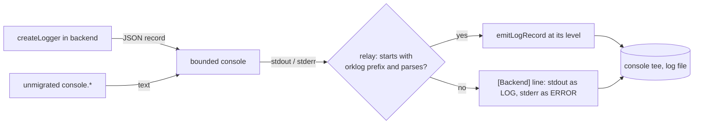

# Application logging

Status: Living. The shared logger, its vocabulary, and how entries reach the log
file. Electron's main process is fully on it. The bridges, backend and renderer
are migrating; `tests/unit/raw-console-ratchet.test.ts` lists what is left.

## Using it

```ts
import { createLogger, formatLogError } from "@orkestrator/protocol/logger";

const log = createLogger("updater");

log.info("downloaded", { version });
log.warn("check.failed", { error: formatLogError(error) });
log.debug("library.message", () => ({ message: expensive() }));
```

Each entry has four parts:

- **An area**, from the fixed list in `packages/protocol/src/log-vocabulary/`.
- **A level:** `error`, `warn`, `info`, `debug` or `trace`.
- **An event:** a static name listed for that area. Never put dynamic text in it.
- **Optional fields:** scalars and formatted errors.

`packages/protocol/src/logger.ts` is browser-safe and has no dependencies.
Node-only setup is in `src/node/logger-environment.ts`.

### Choosing a level

| Level | Means | By default |
| --- | --- | --- |
| `error` | Something failed and nothing recovers it. | Written |
| `warn` | Something failed or looks wrong, and the app carried on or will retry. | Written |
| `info` | A rare, meaningful lifecycle event. | Written |
| `debug` | Detail for investigating one area. | Off |
| `trace` | Per-item detail too heavy for `debug`. | Off |

A site moved to `debug` disappears from normal logs, including from a saved log.
Treat that as a decision to review, not a tidy-up.

### Hot paths

A level check is one integer comparison. To build no arguments when the level is
off, pass a function for the fields; it runs only when the level is on. Use
`log.isEnabled("debug")` to guard other work, which is what `rendererDebugLog`'s
per-frame guard becomes. electron-updater's `debug` method reads as absent while
the level is off, because the library checks for it before serializing its plan.

## Repeating faults

A loop that retries while a fault lasts would write the same line for as long as
the fault lasts. Use `log.throttled`, and report each success with `log.recovered`:

```ts
const log = createLogger("tmux");

try {
  snapshot = await poll();
  log.recovered("poll.snapshot-failed", tabId);
} catch (error) {
  log.throttled("warn", "poll.snapshot-failed", {
    scope: tabId,
    error,
    fields: () => ({ error: formatLogError(error) }),
  });
}
```

```text
[tmux] poll.snapshot-failed scope=tab-1 kind=EACCES error.name=Error error.code=EACCES ...
[tmux] throttle.suppressed site=poll.snapshot-failed scope=tab-1 kind=EACCES suppressed=240 windowSeconds=60
[tmux] throttle.recovered site=poll.snapshot-failed scope=tab-1 failures=251 kinds=1 suppressed=10 faultSeconds=63
```

- **First occurrence:** written in full, with `kind` and your `fields`. Repeats do
  not build `fields`, so detail only ever appears on this line.
- **Idle keys:** after five minutes without that kind failing, its next failure
  is written in full as a new incident. A replacement tmux poller has its own
  lifetime scope, even when it reuses the same tab.
- **Repeats:** only counted. One `throttle.suppressed` line per 60-second window,
  written by the next call after the window ends.
- **A new kind of error** on the same site is a new key, and is written at once
  with its own count and window.
- **Recovery:** one `throttle.recovered` line for the site and scope, whatever
  number of kinds it had, with the count no summary has reported yet.
  A later failure is a first occurrence again.
- All three lines use the level of the call, so a fault you can see always has a
  summary and a recovery you can see. A `warn` fault does not recover at `info`.

An area spreads `THROTTLE_LOG_EVENTS` into its events to use it, and the types
refuse `throttled` otherwise. The lines carry the event as a `site` field, so one
short list serves every site, and area levels apply to them as to anything else.

**Use it** for a recurring loop's failure that repeats while a fault lasts. **Do
not use it** for a one-off failure or for a state that is not a fault:
`[agent-mail]` waiting is one line per change of reason, and a line a minute per
waiting message would be noise. A retry that backs off to minutes also suits it
badly, since every retry falls in a new window: see `PendingRenameFailureLog`,
which keeps its powers of two. Its count also sets the retry delay, so it must
exist whatever the level is. The event-loop stall monitor keeps its own rule too,
because stalls of 10 seconds or more must always be logged.

### Keys

A key is the area, the event, the `scope` and the kind.

- **Kind:** `logErrorKind(error)`, the error's code or else its type, or a static
  `kind` for a failure with no error object. Never the message, which varies and
  can hold content. A `kind` that is not a short name becomes `invalid-kind`.
- **Scope:** pass one when a site runs for several tabs, jobs or bridges. Without
  it, a success in one tab would report a recovery for another's fault, and the
  two would alternate full lines for ever. It is an identifier, reaches every
  line, and is cut at 128 characters.

### The limit

At most `LOG_THROTTLE_MAX_KEYS` (512) keys are tracked in a process. A new key at
the limit is still written, and takes the place of the key that has gone longest
without failing, which is most likely a loop that stopped without succeeding. That
key writes `throttle.evicted` with its count, because its recovered line is lost
with it. If it fails again it is a first occurrence, so the limit can cost extra
lines but never hides a failure.

### While a level is off

The level is read on every call, never captured.

- A call while the level is off costs one comparison. **It does not count**, and
  builds nothing, so a summary never claims evidence from time nobody could read.
- A site already tracked when its level goes off is dropped, on the next throttled
  or recovered call by any site. **Its unreported count is lost**, and so is the
  recovered line if the fault clears before the level returns.
- When the level returns, the next failure is a first occurrence, written in full.

Dropping is what makes this safe: a tracked key left in place would treat the first
failure the reader can see as a repeat. `configureLogger` replaces levels at
runtime; nothing outside tests calls it after startup yet, so this mostly matters
for the live settings that may come later.

### Limits

- Summaries come from calls, with no timer. A loop that stops calling reports its
  count at the next throttled or recovered call of any site in the process.
- A site that alternates between failing and succeeding writes two lines per cycle.
  First occurrences and recoveries always reach the log, so this is not collapsed.
- `kind` comes from the type or code, so failures with different messages and the
  same type are collapsed. Only the first one's detail is written.

## Vocabulary

One file per domain in `log-vocabulary/`. Each lists its areas and events, with a
sentence for each, so a review of a new log line is a review of that list.

```ts
export const UPDATER_LOG_AREAS = defineLogAreas({
  updater: {
    description: "Desktop self-update: electron-updater and updates a remote client requested.",
    events: {
      "check.failed": "An update check failed; the next periodic check retries.",
    },
  },
});
```

- A new event touches only its domain's list. A new domain is a new file plus two
  lines in `index.ts`. The logger does not change.
- `createLogger`'s types come from this list, so an unlisted area, or another
  area's event, fails the typecheck.
- At runtime an unlisted event is written as `invalid-event`, without its text.
- `log-vocabulary.test.ts` fails on an unregistered file, an area two files claim,
  an undocumented entry or a name outside the grammar (lowercase, `-` and `.`).
- There is no `legacy` or catch-all area, and the test keeps it that way.
- `tag` keeps a text form that support recipes already search for. Only
  `desktop.startup` (`[DesktopStartup]`) has one. A new area never needs it.

## Restricted fields

A field is a string, number, boolean, null, undefined or the result of
`formatLogError`. Enforced twice:

- **Types:** a raw object, array or `Error` is a type error, and so is a field
  named for content AGENTS.md invariant 12 keeps out of logs (`stdout`, `stderr`,
  `cmd`, `spawnargs`, `prompt`, `token`, `password`, `secret`, `authorization`,
  `apiKey`, `cookie`, `credentials`).
- **Runtime:** for code the types do not reach, a raw object becomes
  `[rejected:object]`, a raw `Error` goes through `formatLogError`, and a value
  under a forbidden name (in any case, ignoring `-`, `_` and `.`) becomes
  `[forbidden]`.

Bounds: 2 KiB per string, 32 fields per entry, field names of at most 64
characters. Fields over the count, or with an invalid name, are counted in
`droppedFields`.

The logger cannot tell what a string means, so a string field can still hold
content. Reviewing the call site is what keeps it out. Static events and small
scalar fields make that review easy.

## Error formatting

`formatLogError(error, { stack? })` returns the name, `code`, `errno`, `syscall`,
`exitCode`, `signal`, a bounded redacted message of at most 1 KiB (cut first, then
redacted with `redactSecrets`), up to 8 stack frames, up to 2 levels of `cause`,
and for an `AggregateError` its size and first member.

It never returns an error's other enumerable fields, and never `stdout`, `stderr`,
`cmd` or `spawnargs`. For a failed child process the message goes too, because
that is where the output is: `CommandFailedError`'s message is the child's stderr,
and `exec`'s is `Command failed: <cmd>\n<stderr>`. Such an entry carries
`outputOmitted=true` plus the exit code and signal. Stack frames are `at ...`
lines only, taken after the message, so a multi-line message cannot come along.

Stacks are on by default so that moving a site onto the logger keeps them. Pass
`{ stack: false }` on a hot path or for an expected failure.

The wider recommendation for error formatting (paths relative to the app, a
redacted stderr tail at `debug`) is undecided and not built.

## Output

Text is the default: one line per entry, in the old `[tag] message` shape.

```text
[updater] check.failed error.name=Error error.message="net::ERR_FAILED" error.stack="at a | at b"
```

`ORKESTRATOR_LOG_FORMAT=json` writes JSON lines:

```json
{"orklog":1,"ts":"2026-11-01T10:00:00.000Z","level":"warn","area":"updater","event":"check.failed","fields":{"attempt":2}}
```

- Every entry is one line in either format. Newlines, control characters and
  U+2028/9 in a value are escaped, because Node's readline ends a line at those.
- In JSON mode the saved log file is JSON lines throughout. A console call that
  did not come from the logger is wrapped as `{"orklog":1,"ts","level","message"}`
  with no area or event, and an entry over the 64 KiB bound becomes a shortened
  one with `"truncated":true` rather than a line that does not parse.
- Text files end in `.log`, and JSON files in `.jsonl`, with separate numbered
  rolls. Changing format between launches on the same day keeps each file in
  one format.
- In text mode `trace` shows as `DEBUG` in the file: it goes out through
  `console.debug`, because `console.trace` prints a stack of its own and neither
  the bounded console nor the file tee wraps it.

### Levels at startup

`ORKESTRATOR_LOG_LEVEL` takes a default, areas, or both: `warn`,
`updater=debug` or `warn,updater=debug,desktop.dialog=trace`. An area covers its
children unless a child has its own entry: `desktop=debug` also covers
`desktop.dialog`. The default is `info`.

This is read once at startup and is the only control. Live settings and a settings
screen are undecided. **Save Logs for Debugging** still decides whether anything is
saved, and `ORKESTRATOR_BRIDGE_DEBUG` still follows it; neither changed.

## The Electron relay

The desktop reads the Local backend's stdout and stderr and writes them into its
own log. It used to write all of stdout as `LOG` and all of stderr as `ERROR`.

**A logger in a supervised backend writes JSON records, and the desktop re-emits
each one at the level it carries.**



- **Who turns it on.** The backend's `main.ts` passes `relayToSupervisor` when
  `ORKESTRATOR_DESKTOP_SUPERVISED=1`, before standalone logging clears that flag.
  So only the desktop's direct child uses it, not the bridges it launches or a
  standalone backend.
- **The wire format is the JSON-lines format.** There is one record shape, not a
  second grammar, and it is versioned by its `{"orklog":1,` prefix. Fields survive
  the crossing as well as the level, so the desktop renders them in its own format.
- **Nothing is lost.** Anything that is not a valid record stays ordinary output:
  an unmigrated `console.*`, a native crash, a runtime panic, or a record from
  another build naming an area or event this one does not list. A JSON object on
  stdout, which the relay used to drop silently, is now captured too.
- **The cost is small.** The prefix check rejects a non-record without parsing.
  The startup listener's `JSON.parse` now only runs on lines starting with `{`.
- **The relay never filters.** The source has already applied its level.
- **Spoofing.** Any output can imitate a record, for example the second line of a
  bridge's multi-line chunk. Parsing validates the level, area, event and every
  field as a local call would, and since nothing filters afterwards, an imitation
  can only change a line's label. It cannot hide output.
- **Backpressure is unchanged.** Records go through the same `console` calls, so
  `bounded-console.ts` and the file writer's byte bounds and drop markers apply.

Two alternatives were rejected. A one-character level prefix needs a second grammar
and loses the fields. A separate pipe avoids any parsing but adds a stream with its
own backpressure and no ordering against stdout and stderr.

The rest of the relay and writer work (batching, a line length bound, skipping the
relay when nothing consumes it) is undecided and not built.

`writeProcessOutputLine` is how raw text enters the log. Only a stdio relay may
call it: it bypasses levels because such text has none.

## electron-updater

`createUpdaterLibraryLogger` (`apps/desktop/electron/updater-log.ts`) replaces the
library's default `console` logger. Its lines become `updater` `library.message`
entries at the library's own level, with credential shapes redacted, so a signed
download URL loses its signature.

The differential download plan is the library's `debug` output. It made up most of
the lines in a sampled log. It is now off by default, and neither built nor written.
To see it, set `ORKESTRATOR_LOG_LEVEL=updater=debug`; it appears as one line cut at
2 KiB.

`library.message` is the one event whose field is vendor text rather than ours.

## What stays out of the persistent log

The renderer's console does not reach the log. Only the seven allowlisted
`[DesktopStartup]` markers cross, matched exactly in the main frame, as
[bridge-diagnostics.md](bridge-diagnostics.md) describes. A renderer using the logger
does not change that: `isDesktopStartupMessage` only accepts those exact strings. So
the terminal's `input.undelivered` line stays in the browser console.

## The lint rule

`no-restricted-globals` refuses `console`, used directly or passed as a value.
[linting.md](../development/linting.md#raw-console) covers the exclusions and the
ratchet. Inside a migrated path, inject a logger or use a capture in tests:

```ts
import { captureLogs } from "@orkestrator/protocol/testing/log-capture";
```

## Older references

Some todos and flaky-test records quote lines from before this migration. They
record what was observed at the time and are left as they are.

| Old tag | Now |
| --- | --- |
| `[Desktop]` | `[desktop]` |
| `[Dialog]` | `[desktop.dialog]` |
| `[Updater]` | `[updater]` |
| `[Previews]`, `[BrowserPreview]` | `[preview]` |
| `[Connections]` | `[connections]` |
| `[Workspaces]` | `[workspaces]` |
| `[Toolchains]` | `[toolchain]` |
| `[BackendClient]` | `[backend.client]` |
| `[RemoteGateway]` (the desktop's own two lines) | `[gateway]` |
| `[ArtifactHost]` | `[artifact-host]` |
| `[Clipboard]` | `[desktop] clipboard.write-failed` |
| `[ApplicationLogging]` | `[logging]` |
| `[tmux] transcript discovery failed`, `poll snapshot failed`, `drainPending failed`, `drainTimeouts failed`, `transcript tail failed` | `[tmux] poll.*-failed` |
| `[backend] Failed to <job>` (keyed activity jobs) | `[backend.activity] job.failed scope=<job name>` |
| `[web-annotations] Reconcile pass failed` | `[web-annotations] reconcile.failed` |
| `[previews] Certificate refresh failed`, `Ignoring a renewed certificate` | `[preview] certificate.refresh-failed`, `certificate.renewal-refused` |
| `[local-server] ... is not answering health checks` | `[local-server] bridge.not-answering` |
| `[useTerminal] write called but no sessionId`, `Terminal input was not delivered` | `[terminal] input.undelivered` (browser console only) |
| `[ElectronBackend] ... pending prompt` | `[environment] rename.failed`, `rename.still-failing`, `rename.recovered` |
| `[backend] Kept the local branch of deleted environment` | `[environment] cleanup.branch-kept` |
| `[agent-mail] waiting` | `[agent-mail] delivery.waiting` |
| `[native-agent] ... older than the command catalogue` | `[native-agent] catalogue.outdated-bridge` |
| `[Backend]` (unmigrated backend output) | Unchanged until the backend migrates |
| `[DesktopStartup]` | Unchanged |

## Adding to later processes

- **Entry point:** call `configureLoggerFromEnvironment(process.env)` once, before
  anything logs. The backend already does.
- **Bridges** do not set `relayToSupervisor`, and their stdout and stderr reach the
  backend through `forwardBridgeOutput`, which collapses levels at that boundary
  just as the relay did. To carry a bridge's levels, that hop can use
  `parseLogRecordLine` and `emitLogRecord` as `relayBackendLine` does.
- **`[bridge-diagnostics]` payloads** carry nested JSON, which is not a field.
  Keep the allowlist and hashing in `bridge-diagnostics.ts`, and pass the result on
  as one string field. Check it fits: strings are cut at 2 KiB, and
  `MAX_ENTRY_BYTES` there is the existing limit to reconcile.
- **Command failures** lose their message. A backend site that needs stderr to be
  diagnosable has to log a classified reason, because a raw tail is not available.

Backend jobs, annotation reconciliation and certificate refresh scopes include a
content-free owner UUID so separate backend instances cannot clear each other.
Kept-branch notices use a bounded per-storage deduplication set and plain info
logging; they consume no shared fault keys.
