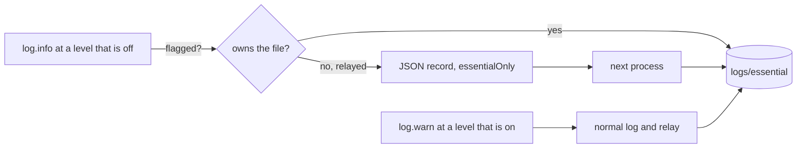
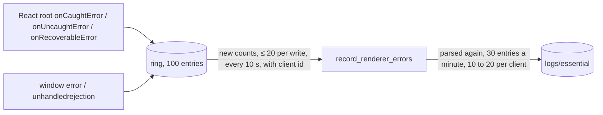
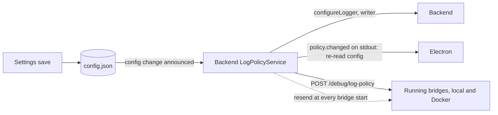
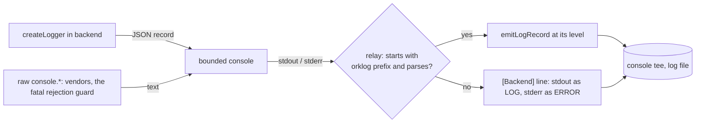
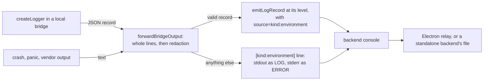
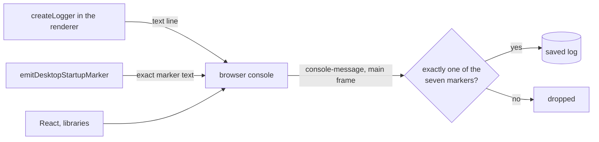

# Application logging

Status: Living. The shared logger, its vocabulary, how entries reach the log file,
and the live settings that control them. Electron's main process, all five bridges,
the renderer and the backend use it.

**The migration is finished.** No application path writes to the raw `console`.
The only sites left are the permanent exclusions [the lint rule](#the-lint-rule)
names, whose console is their product or which wrap the console themselves.
[What is left in the backend](#what-is-left-in-the-backend) lists the one open
decision.

## Using it

```ts
import { createLogger, formatLogError } from "@orkestrator/protocol/logger";

const log = createLogger("updater");

log.info("downloaded", { version });
log.warn("check.failed", { error: formatLogError(error) });
log.debug("library.message", () => ({ message: expensive() }));
```

Each entry has four parts:

- **An area**, from the fixed list in `packages/protocol/src/log-vocabulary/`.
- **A level:** `error`, `warn`, `info`, `debug` or `trace`.
- **An event:** a static name listed for that area. Never put dynamic text in it.
- **Optional fields:** scalars and formatted errors.

`packages/protocol/src/logger.ts` is browser-safe and has no dependencies.
Node-only setup is in `src/node/logger-environment.ts`.

Stateful diagnostics that advance a baseline only after writing use
`tryWriteLog(level, area, event, fields)`. It applies the same levels, vocabulary,
sanitization and formatting as `createLogger`, returning false when filtered or
when the synchronous sink throws. Acceptance does not prove that an asynchronous
file writer has persisted the entry. Ordinary logging calls still return void
and contain sink failures.

### Choosing a level

| Level | Means | By default |
| --- | --- | --- |
| `error` | Something failed and nothing recovers it. | Written |
| `warn` | Something failed or looks wrong, and the app carried on or will retry. | Written |
| `info` | A rare, meaningful lifecycle event. | Written |
| `debug` | Detail for investigating one area. | Off |
| `trace` | Per-item detail too heavy for `debug`. | Off |

A site moved to `debug` disappears from normal logs, including from a saved log,
until someone turns on **Log Detail**. Treat that as a decision to review, not a
tidy-up.

### Hot paths

A level check is one integer comparison. To build no arguments when the level is
off, pass a function for the fields; it runs only when the level is on. Use
`log.isEnabled("debug")` to guard other work, as a renderer site on a per-frame
path does. electron-updater's `debug` method reads as absent while
the level is off, because the library checks for it before serializing its plan.

## Repeating faults

A loop that retries while a fault lasts would write the same line for as long as
the fault lasts. Use `log.throttled`, and report each success with `log.recovered`:

```ts
const log = createLogger("tmux");

try {
  snapshot = await poll();
  log.recovered("poll.snapshot-failed", tabId);
} catch (error) {
  log.throttled("warn", "poll.snapshot-failed", {
    scope: tabId,
    error,
    fields: () => ({ error: formatLogError(error) }),
  });
}
```

```text
[tmux] poll.snapshot-failed scope=tab-1 kind=EACCES error.name=Error error.code=EACCES ...
[tmux] throttle.suppressed site=poll.snapshot-failed scope=tab-1 kind=EACCES suppressed=240 windowSeconds=60
[tmux] throttle.recovered site=poll.snapshot-failed scope=tab-1 failures=251 kinds=1 suppressed=10 faultSeconds=63
```

- **First occurrence:** written in full, with `kind` and your `fields`. Repeats do
  not build `fields`, so detail only ever appears on this line.
- **Idle keys:** after five minutes without that kind failing, its next failure
  is written in full as a new incident. A replacement tmux poller has its own
  lifetime scope, even when it reuses the same tab.
- **Repeats:** only counted. One `throttle.suppressed` line per 60-second window,
  written by the next call after the window ends.
- **A new kind of error** on the same site is a new key, and is written at once
  with its own count and window.
- **Recovery:** one `throttle.recovered` line for the site and scope, whatever
  number of kinds it had, with the count no summary has reported yet.
  A later failure is a first occurrence again.
- All three lines use the level of the call, so a fault you can see always has a
  summary and a recovery you can see. A `warn` fault does not recover at `info`.

An area spreads `THROTTLE_LOG_EVENTS` into its events to use it, and the types
refuse `throttled` otherwise. The lines carry the event as a `site` field, so one
short list serves every site, and area levels apply to them as to anything else.

**Use it** for a recurring loop's failure that repeats while a fault lasts. **Do
not use it** for a one-off failure or for a state that is not a fault:
`[agent-mail]` waiting is one line per change of reason, and a line a minute per
waiting message would be noise. A retry that backs off to minutes also suits it
badly, since every retry falls in a new window: see `PendingRenameFailureLog`,
which keeps its powers of two. Its count also sets the retry delay, so it must
exist whatever the level is. The event-loop stall monitor keeps its own rule too,
because stalls of 10 seconds or more must always be logged.

### Keys

A key is the area, the event, the `scope` and the kind.

- **Kind:** `logErrorKind(error)`, the error's code or else its type, or a static
  `kind` for a failure with no error object. Never the message, which varies and
  can hold content. A `kind` that is not a short name becomes `invalid-kind`.
- **Scope:** pass one when a site runs for several tabs, jobs or bridges. Without
  it, a success in one tab would report a recovery for another's fault, and the
  two would alternate full lines for ever. It is an identifier, reaches every
  line, and is cut at 128 characters.

### The limit

At most `LOG_THROTTLE_MAX_KEYS` (512) keys are tracked in a process. A new key at
the limit is still written, and takes the place of the key that has gone longest
without failing, which is most likely a loop that stopped without succeeding. That
key writes `throttle.evicted` with its count, because its recovered line is lost
with it. If it fails again it is a first occurrence, so the limit can cost extra
lines but never hides a failure.

### While a level is off

The level is read on every call, never captured.

- A call while the level is off costs one comparison. **It does not count**, and
  builds nothing, so a summary never claims evidence from time nobody could read.
- A site already tracked when its level goes off is dropped, on the next throttled
  or recovered call by any site. **Its unreported count is lost**, and so is the
  recovered line if the fault clears before the level returns.
- When the level returns, the next failure is a first occurrence, written in full.

Dropping is what makes this safe: a tracked key left in place would treat the first
failure the reader can see as a repeat. `configureLogger` replaces levels at
runtime when live logging settings change.

### Limits

- Summaries come from calls, with no timer. A loop that stops calling reports its
  count at the next throttled or recovered call of any site in the process.
- A site that alternates between failing and succeeding writes two lines per cycle.
  First occurrences and recoveries always reach the log, so this is not collapsed.
- `kind` comes from the type or code, so failures with different messages and the
  same type are collapsed. Only the first one's detail is written.

## Vocabulary

One file per domain in `log-vocabulary/`. Each lists its areas and events, with a
sentence for each, so a review of a new log line is a review of that list.

```ts
export const UPDATER_LOG_AREAS = defineLogAreas({
  updater: {
    description: "Desktop self-update: electron-updater and updates a remote client requested.",
    events: {
      "check.failed": "An update check failed; the next periodic check retries.",
    },
  },
});
```

- A new event touches only its domain's list. A new domain is a new file plus two
  lines in `index.ts`. The logger does not change.
- `createLogger`'s types come from this list, so an unlisted area, or another
  area's event, fails the typecheck.
- At runtime an unlisted event is written as `invalid-event`, without its text.
- `log-vocabulary.test.ts` fails on an unregistered file, an area two files claim,
  an undocumented entry or a name outside the grammar (lowercase, `-` and `.`).
- There is no `legacy` or catch-all area, and the test keeps it that way.
- `tag` keeps a text form that support recipes already search for. Only
  `desktop.startup` (`[DesktopStartup]`) and `bridge.diagnostics`
  (`[bridge-diagnostics]`) have one. A new area never needs it.

## Restricted fields

A field is a string, number, boolean, null, undefined or the result of
`formatLogError`. Enforced twice:

- **Types:** a raw object, array or `Error` is a type error, and so is a field
  named for content AGENTS.md invariant 12 keeps out of logs (`stdout`, `stderr`,
  `cmd`, `spawnargs`, `prompt`, `token`, `password`, `secret`, `authorization`,
  `apiKey`, `cookie`, `credentials`).
- **Runtime:** for code the types do not reach, a raw object becomes
  `[rejected:object]`, a raw `Error` goes through `formatLogError`, and a value
  under a forbidden name (in any case, ignoring `-`, `_` and `.`) becomes
  `[forbidden]`.

Bounds: 2 KiB per string, 32 fields per entry, field names of at most 64
characters. Fields over the count, or with an invalid name, are counted in
`droppedFields`. An area may widen the string bound with `maxStringChars`, and the
vocabulary test allows exactly one: `bridge.diagnostics`, whose single string field
is a snapshot allowlisted and bounded to 8 KiB where it is built.

The logger cannot tell what a string means, so a string field can still hold
content. Reviewing the call site is what keeps it out. Static events and small
scalar fields make that review easy.

## Error formatting

`formatLogError(error, { stack? })` returns the name, `code`, `errno`, `syscall`,
`exitCode`, `signal`, a bounded redacted message of at most 1 KiB (cut first, then
redacted with `redactSecrets`), up to 8 stack frames, up to 2 levels of `cause`,
and for an `AggregateError` its size and first member.

It never returns an error's other enumerable fields, and never `stdout`, `stderr`,
`cmd` or `spawnargs`. For a failed child process the message goes too, because
that is where the output is: `CommandFailedError`'s message is the child's stderr,
and `exec`'s is `Command failed: <cmd>\n<stderr>`. Such an entry carries
`outputOmitted=true` plus the exit code and signal. Stack frames are `at ...`
lines only, taken after the message, so a multi-line message cannot come along.

Stacks are on by default so that moving a site onto the logger keeps them. Pass
`{ stack: false }` on a hot path or for an expected failure.

Pass `{ message: false }` where a message can quote content the logger cannot
recognise, such as a provider error repeating a prompt. It keeps the name, code and
frames, and drops the message of every `cause` too. Sites that logged only
`error.name` for that reason use it, so moving them onto the logger added no text.

### Paths in stack frames

Frames show paths relative to the app, so a home directory name stays out of the
log. This works from what the path contains rather than from a configured root,
because it runs in every process, the browser included, and before any setup:

| The path contains | The frame shows |
| --- | --- |
| `/node_modules/` | `node_modules/...` from the last one |
| A workspace, such as `apps/backend/` or `bridges/claude-bridge/` | The path from there |
| A deployed bridge, such as `/opt/codex-bridge/` | `codex-bridge/...` |
| `app.asar/` or `resources/` in a packaged app | The path from there |
| A web URL | Its path, without the origin or query |
| Anything else | `.../file.ts`, the file name alone |

Only stack frames are rewritten. An error's *message* keeps any path it holds, such
as `ENOENT: no such file or directory, open '/Users/...'`. A frame relayed from
another process goes through the same rewrite.

## Failures that would otherwise leave no trace

These fail without any visible error at the point they happen, so each has a line of
its own. All carry scalars and formatted errors only. Where an error can quote a
provider, a path or a prompt it goes through `formatLogError(error, { message: false })`,
and no site logs a stderr tail.

| Area | Event | Level | Written when |
| --- | --- | --- | --- |
| `docker` | `writer-lease.lost` | `warn` | The one held-to-lost transition, with `reason` (`reclaimed`, `unreadable`). Schedules stop and container changes are refused; Settings → Schedules says so ([scheduled jobs](scheduled-jobs.md#exactly-once)). A lost lease is final for the process; the backend that takes it over writes `writer-lease.regained`. |
| `docker` | `writer-lease.regained` | `info` | A backend took the lease over from a holder that stopped refreshing it (crashed, killed or stalled), with `staleForMs` since that holder's last refresh. A lease a clean shutdown released is acquired silently. |
| `storage` | `migration.failed` | `error` | The database could not reach this build's schema and did not open, with `fromVersion`, `toVersion` and `step` (`snapshot` for the safety copy, `migrate`). |
| `process` | `rejection.unhandled` | `error`, throttled | A rejection reached the fatal rejection guard, beside the guard's own line. |
| `process` | `uncaught-exception` | `error` | An exception reached the top of the backend, which then dies. See [the handler](#the-uncaught-exception-handler). |
| `process` | `child.reaped`, `child.reap-abandoned`, `child.reap-unavailable` | `info`, `warn`, `warn` | macOS under Bun: a child whose exit Bun lost was reaped after its command settled, with `pid` and `waitedMs`; or was left a zombie, with `reason` (`not-a-zombie`, `capacity`, `waitpid-failed`); or `waitpid` could not be loaded. See [backend runtime](backend-runtime.md#one-shot-commands). |
| `docker` | `writer-lease.not-acquired` | `info` | A backend starts without the lease, with `reason` (`busy`, `schema-incompatible`). A second backend on one directory is normal. |
| `local-server` | `bridge.exited` | `warn`, or `info` if the backend asked | Every exit of a local bridge, with `code`, `signal` and `requested`. A clean exit 0 nothing asked for warns. Read it with `server.stopping`. |
| `local-server` | `bridge.orphans-reaped` | `warn`, or `error` if one survived | A bridge that exited on its own left processes in its group (its agent CLI, mid-turn), and the backend stopped them. `result` is `stopped` or `survived`. |
| `bridge.pi`, `bridge.cursor` | `session.resume-fell-back` | `warn` | A saved conversation could not be resumed and a new one started. |
| `bridge.pi`, `bridge.cursor` | `turn.failed` | `warn` | A turn ended in failure. A turn someone stopped stays out, even if stopping it made the run reject. |
| `bridge.pi` | `turn.startup-timed-out`, `turn.refused` | `warn` | Pi did not start a turn in time, or refused it before any run. |
| `bridge.pi` | `session.write-lost` | `warn` | Pi could not write its session file; once per session, beside the transcript's lost-write advisory. |
| `bridge.cursor` | `turn.timed-out`, `turn.send-failed`, `turn.recovery-failed` | `warn` | A turn outlived its budget; `send` rejected, so the outcome is unknown; a run recovered after a restart failed. |
| `bridge.acp` | `agent.exited` | `warn` | An agent process exited, with `code`, `signal` and `requested` (true when the bridge closed it normally). |
| `bridge.acp` | `http.route-failed` | `warn` | A route answered 500. A deliberate `HttpError` of another status and a client that hung up stay out. |
| `native-agent` | `steer.qualification-failed` | `warn`, throttled per bridge connection | A bridge's steer qualification request failed or answered non-OK, so steering is not offered. Carries `agent` and `status` or the error class, never a session id or message. [To-do 4700](../todo/coordinator-and-multi-review/4700-coordinator-steer-missing-on-long-lived-coordinator.md#current-state) says how to read it. |
| `storage` | `lease.heartbeat-failed` | `warn`, throttled by lease name | A lease heartbeat failed, which only shortens the lease. |
| `storage` | `scrub.checkpoint-failed` | `warn`, throttled under `scrub` | The truncating checkpoint threw, or SQLite reported it blocked (`kind=busy`), which it does in a result row rather than as an error. Scrubbing is a [privacy step](storage.md#durability-and-deletion). |

The lines the [essential log](#the-essential-event-log) lists are always kept there;
the rest reach disk only while **Save Logs to Disk** is on. A normal agent close
also writes `agent.exited` at `warn`, on every session close, so filter on
`requested=false` to find the exits nothing asked for. Stopping a turn sends
`session/cancel` and keeps the process, so it writes no such line.

## What ran during a stall

The backend's event loop serves everything at once, so a stall shows as
timeouts everywhere and, on its own, says nothing about its cause. Three
records name what ran. All are content-free: names, kinds and times, never SQL
text, parameters, rows, command arguments or results.

| Area | Event | Level | Written when | Code |
| --- | --- | --- | --- | --- |
| `storage` | `operation.slow` | `warn`, essential | A synchronous SQLite call or outermost transaction took 250 ms or more | `storage-slow-operations.ts` |
| `backend` | `command.slow` | `info`; `warn` when its synchronous part took 250 ms or more | A registered command took 2 s or more to settle | `command-timing.ts` |
| `event-loop` | `stalled` | as before | The stall line gains the backend's context fields | `event-loop-stall-monitor.ts` |
| `storage` | `upkeep.finished` | `info` | Every periodic upkeep pass (every five minutes) | `storage-backups.ts` |

What the lines look like (values illustrative, except the second, which a
migration commit on a loaded Mac wrote during this work's tests):

```text
[storage] operation.slow database=main op=transaction table=stores store=environments mode=immediate durationMs=9811 beginMs=9811 sqlMs=0 busy=true
[storage] operation.slow database=ledger op=transaction table=change_ledger_meta mode=exclusive durationMs=374 beginMs=0 sqlMs=1 commitMs=372 busy=false
[backend] command.slow command=get_projects durationMs=9902 syncMs=0 outcome=ok
[event-loop] stalled lagMs=9800 endedAt=2026-11-06T09:14:03.120Z intervalMs=500 cpuMs=240 storageMs=9811 storageDatabase=main storageOp=transaction storageTable=stores storageStore=environments storageLongestMs=9811 storageBusy=true commandsInFlight=3 commands=get_projects,get_environments,create_client_grant jobsInWindow=2 jobs=diff-scan,file-tree-read
[storage] upkeep.finished durationMs=1840 optimizeMs=12 releasable=5120 released=4096 left=1024 releaseMs=1828 stop=budget
```

**`operation.slow`.** `StorageDatabase` instruments its connection when it opens
(`instrumentSqliteConnection`), so every statement (`query`, `prepare`, `run`,
`exec`) and outermost transaction on `orkestrator.sqlite` (`database=main`) and
`change-tracking.sqlite` (`database=ledger`) is timed, including the ledger's
own raw statements and migrations. `op` is the statement's leading keyword
(`select`, `insert`, `update`, `delete`, `pragma`, `schema`, `vacuum`, `other`)
or `transaction`. `table` is parsed from the SQL only for a slow call, and only
a lowercase name with no digits is kept; for a transaction it is its slowest
statement's table. The essential log keeps a `table` only when it is one of the
store schema's tables, a pragma the backend runs or a `change_` ledger table
(`log-essential-labels.ts`). `store` is the store family a store method named (ids folded
away, as for [lease families](storage.md)); it is in the normal log, not the
essential one. A transaction splits its time: `beginMs` is the wait before its
body ran (the write lock, for `immediate`: a busy wait of up to the 10 s
`busy_timeout` on the event-loop thread), `sqlMs` its statements, `commitMs`
the commit and its WAL sync. `beginMs` equal to `durationMs` with `busy=true`
means another connection held the lock for the whole timeout. Lines are spaced
per series (`database:op:table`) at one per 10 s, with the ones between folded
into `folded` and `foldedMaxMs`; a call of 5 s or more is always written. The
same records, without the spacing, are in `get_database_stats` and
`database.json` as `slowOperations`: counts, total and longest per series (64
series at most, then `overflowed`) and the last 32 operations. Below the
threshold a call costs two `performance.now()` reads:
`apps/backend/scripts/storage-timing-overhead.ts` measured about 55–80 ns per
statement and 250–290 ns per transaction on an in-memory database.

**`command.slow`.** The command registry wraps every registered command
(`createCommandRegistry`'s `register`), so it covers every caller: the
renderer and CLI through the gateway's `/__orkestrator/invoke`, a node link
(a remote `create_client_grant`, `get_projects` or `get_environments` arrives
there), the control MCP and commands calling commands. `durationMs` runs to
settle, `syncMs` until the handler returned, which is the part that held the
event loop. One line per command per minute; the rest are folded in. Per-command
counts and summed durations of gateway invokes were already in
`/__orkestrator/metrics`.

**The stall line.** The backend registers three stall context sources
(`addEventLoopStallContext`, in `main.ts`). A source is asked only for a stall
that is reported, with the window from the last on-time tick to the late one.
The storage source adds the slow SQLite operations overlapping the window:
`storageMs` in total and the longest one's `storageDatabase`, `storageOp`,
`storageTable`, `storageStore`, `storageLongestMs` and `storageBusy`. The command
source adds `commandsInFlight`, the names of up to three of the most recently
started (`commands`), and `blockingCommand` with `blockingCommandMs` when a
command's synchronous part of 250 ms or more overlapped the window. The
recurring-work source (`recurringWorkMetrics.stallContext`) adds `jobsInWindow`,
the attempts of recurring jobs (diff scans, file-tree reads, sweeps; the kinds in
`@orkestrator/protocol/recurring-work`) that were running during the window or
settled inside it, and `jobs`, up to three of their kinds, newest first. Each
attempt counts once; one started while the tracked table was full counts while
it is in flight and, once settled, only for windows it overlapped, but its kind
is not named. An
attempt's span includes its awaits, so a named job ran around the stall rather
than necessarily causing it; a kind that keeps coming back is the lead. A stall
with no storage fields was not SQLite holding the loop for 250 ms at a time.

The backend and the desktop also pass the monitor a CPU reader
(`process.cpuUsage()`, one `getrusage` per tick), so both stall lines carry
`cpuMs`: the CPU time the whole process used in the window. Close to `lagMs`
means its own thread was busy (JavaScript or a synchronous call that computes);
far below it means the thread waited (a synchronous call blocked on disk or a
lock, or the host did not schedule the process). Self-improvement's conversation
scan was a busy one: it read every recent Claude and Codex history file in one
synchronous loop, about 7 s on a Mac with nine thousand of them, and now yields
between files (`event-loop-slice.ts`;
`apps/backend/scripts/self-improvement-scan-stall.ts` measures it).

**`upkeep.finished`.** `stop` is `done` (no free pages left), `budget` (1 GiB
per pass), `busy` (another connection held the database), `no-progress`,
`slow-step` (a step took over 100 ms, so the disk is busy; the next check
carries on), `not-incremental` (the file has no incremental auto-vacuum), `no-free-pages`
(nothing to release, so no child ran) or `failed` (beside `upkeep.vacuum-failed`).
`optimizeMs` is the part on the backend's own connection; `releaseMs` is the
child's run, which does not hold the event loop.

Thresholds live beside the code that applies them: `SLOW_STORAGE_OPERATION_MS`
and its spacing constants in `storage-slow-operations.ts`, `SLOW_COMMAND_MS` and
`SLOW_COMMAND_SYNC_MS` in `command-timing.ts`.

## The essential event log

With **Save Logs to Disk** off, which is the default, the saved log keeps nothing, so
the first occurrence of a crash or a silent fallback would be lost. So a small event
log is written **whatever that setting says**. This is a deliberate change from
"nothing persisted unless enabled", and Settings says so.

**The privacy rule is the point of the design.** Nobody chose to save this, so every
entry is an event name and scalar fields. It holds no error message, no stack, no
path, no prompt, no file content and no token (AGENTS.md invariant 12). That is not
left to call sites: `packages/protocol/src/log-essential.ts` builds each entry field
by field, and anything it does not recognise stays out.

```json
{"orklog":1,"ts":"2026-11-04T10:00:00.000Z","level":"warn","area":"local-server","event":"bridge.exited","fields":{"key":"codex:6e0a6a7e","pid":4242,"code":null,"signal":"SIGKILL","requested":false}}
```

### Where it is

`logs/essential/` under the data directory, always JSON lines whatever
`ORKESTRATOR_LOG_FORMAT` says, mode `0600`.

| Bound | Value |
| --- | --- |
| Files | `essential.jsonl` plus 3 rotated (`essential.1.jsonl` is the newest of those) |
| Per file | 1 MiB; a write that would pass it rotates first |
| **Total** | **4 MiB, a hard cap** |
| Per entry | 4 KiB; a larger entry loses its fields |
| Queue | 256 KiB in memory |
| One event | A burst of 10 entries, then one per 10 minutes |

A file rather than a database table, because it has to work when the database is the
failing part, and adds no writes to a busy database. It is not queryable.

It is **outside retention**. The sweep, the directory budget and **Clean up logs** all
skip the directory (only that name, at the top of `logs/`, as a real directory), and
`debugLogRetentionDays` does not apply. `get_log_storage_stats` reports it apart, as
`essentialBytes` and `essentialFileCount`, and its `totalBytes` and `fileCount` are
what cleaning removes.

### Who writes it

One process, the one that owns the log file today:

| Setup | Writer | How the others reach it |
| --- | --- | --- |
| The app | The desktop main process, in every runtime flavor | The backend's lines over the [Electron relay](#the-electron-relay), a local bridge's over [the hop](#the-bridge-hop) first |
| A standalone backend | That backend | A local bridge's over the hop |

So a backend crash in the app is still captured, by the desktop, which is what the
choice is for. Three limits follow from it:

- **A desktop crash cannot write its own entry.** A JavaScript exception is logged by
  the existing handler (`native-dialogs.ts`) and the process carries on. A native crash
  writes nothing, and only its next start can show it: `essential.started` with no
  `essential.stopped` before it means the last writer died. A process ended by a kill
  rather than a quit reads the same way, as `dev:stop`'s does.
- **A container bridge has no hop**, so nothing in it reaches this file: its
  `session.resume-fell-back` stays in `/tmp/<provider>-bridge.log`. The backend's own
  `docker` `bridge.launched` is what records a container bridge's start or relaunch.
- **A second standalone backend on one data directory** shares the files under a
  cross-process lock covering size inspection, rotation and append. The lock is
  published as a nonempty directory; only a dead owner's unique empty child can
  be reclaimed. A slow live process never loses ownership to a timeout. Contention
  waits asynchronously for up to two seconds, then reports a counted write loss.
- **A rejected desktop launch** installs no writer or shutdown marker: ownership
  starts only after winning Electron's single-instance lock.

### What it holds

Two kinds of entry: every `error`, and each event flagged `essential: true` in
`log-vocabulary/`. The flag is the only way in, so it is reviewed where the event is
defined. Each definition lists its fields, and only those are written:

```ts
"writer-lease.lost": {
  description: "This backend lost the registry writer lease...",
  essential: true,
  fields: { reason: "label" },
},
```

A field's kind is `number`, `boolean` or `label`. Strings pass only the explicit
sets or field-specific classifiers in `log-essential-labels.ts`: known providers,
lease reasons, built-in error names, common OS error codes, syscalls and signals;
version numbers, timestamps, and provider-prefixed environment UUIDs. Unknown names
and token-shaped strings are dropped even when they look like identifiers. `null`
fits any kind. There is deliberately no kind for an object or for text. A value that does
not fit is dropped and counted in `droppedFields`. `ESSENTIAL_ERROR_FIELDS` declares
what an error may keep: `error.name`, `.code`, `.errno`, `.syscall`, `.exitCode`,
`.signal`, `.outputOmitted` and `.errorCount`. Its message, stack and cause never come
along. The `source` a relay adds is kept only as a known provider plus an environment UUID.

| Area | Event | Fields | Written when |
| --- | --- | --- | --- |
| `backend` | `starting` | `version` | The backend process is starting. |
| `backend` | `shutdown.signal-received` | `signal` | A signal started shutdown. |
| `backend` | `shutdown.finished` | `code` | Shutdown finished; the process exits with `code`. |
| `process` | `uncaught-exception` | `origin`, error | An exception reached the top of the backend. |
| `process` | `rejection.unhandled` | `kind`, error | A rejection reached the guard, in the backend or a local bridge. |
| `desktop` | `backend.exited` | error (`exitCode`, `signal`) | The Local backend exited unexpectedly. |
| `desktop` | `backend.exited-recovering` | error (`exitCode`, `signal`) | The same, just after a remote update. |
| `desktop` | `backend.start-failed` | error | The Local backend did not start. |
| `desktop` | `uncaught-exception` | error | The main process hit an uncaught exception. |
| `local-server` | `bridge.started` | `key`, `pid` | A local bridge was spawned. `key` is `kind:environmentId`. |
| `local-server` | `bridge.exited` | `key`, `pid`, `code`, `signal`, `requested` | A local bridge exited. |
| `local-server` | `bridge.orphans-reaped` | `key`, `pid`, `result` | What a bridge left in its group after exiting on its own was stopped. |
| `docker` | `bridge.launched` | `provider`, `containerPort` | A bridge was launched in a container, for the first time there or as a relaunch. |
| `docker` | `bridge.listener-refused` | `provider`, `reason` | The socket on a container bridge's port is not the one recorded for the bridge the backend started, so its token was not handed out. See [agent-approvals.md](agent-approvals.md#a-replaced-bridge-is-refused). |
| `docker` | `bridge.listener-unrecorded` | `provider`, `reason` | A bridge just launched could not be recorded as its port's listener; what listened was stopped and the start failed. |
| `docker` | `writer-lease.lost` | `reason` | This backend lost the registry writer lease. |
| `docker` | `writer-lease.regained` | `staleForMs` | This backend took it over from a holder that stopped refreshing it. |
| `docker` | `writer-lease.not-acquired` | `reason` | This backend started without it. |
| `bridge.pi` | `session.resume-fell-back` | error | A saved conversation could not be reopened, so a new one started. |
| `bridge.cursor` | `session.resume-fell-back` | error | The same. |
| `storage` | `migration.failed` | `fromVersion`, `toVersion`, `step`, error | The database did not reach this build's schema. |
| `storage` | `snapshot.failed` | `retryAt`, error | The hourly database snapshot failed. |
| `storage` | `snapshot.integrity-failed` | none | A snapshot failed its integrity check. |
| `storage` | `operation.slow` | `database`, `op`, `table`, `mode`, `durationMs`, `beginMs`, `sqlMs`, `commitMs`, `busy`, `folded`, `foldedMaxMs` | A synchronous SQLite call held the event loop for 250 ms or more; see [what ran during a stall](#what-ran-during-a-stall). |
| `event-loop` | `stalled` | `lagMs`, `intervalMs`, `cpuMs`, `storageMs`, `storageDatabase`, `storageOp`, `storageTable`, `storageLongestMs`, `storageBusy`, `commandsInFlight`, `blockingCommandMs`, `jobsInWindow` | A stall of 10 seconds or more: only at `error`, not the routine `warn`. The `storage*` and command fields are the backend's [stall context](#what-ran-during-a-stall). |
| `desktop` | `main-thread.stalled` | `lagMs`, `intervalMs`, `cpuMs` | The same, for the main process. |
| `backend` | `previous-run` | `outcome`, `ranForMs`, `lastSeenAgoMs` | This start read how the previous run ended, from the [health summary](#health-summary-and-the-clean-exit-marker). |
| `logging` | `essential.started` | `owner` | This process began writing the file. |
| `logging` | `essential.stopped` | `owner` | It stopped, in an orderly exit. |
| `logging` | `entries.dropped` | `entries`, `bytes`, `reason` | Entries were lost; see below. |
| `renderer-errors` | `error.recorded` | `errorClass`, `boundary`, `route`, `fingerprint`, `count` | A desktop window reported new occurrences of a renderer failure; see [Renderer failures in the essential log](#renderer-failures-in-the-essential-log). |

A lease is **regained** by the next backend, not by the one that lost it: a lost lease
is final until that process restarts, so `writer-lease.regained` is written by whichever
backend removes the stale lease and takes it. Read with the previous holder's
`writer-lease.lost` (`reason=reclaimed`), or with a `backend.exited` and no lost line
when the holder crashed. `snapshot.skipped-low-disk` stays out as a skip
rather than a failure, and the transcript artifact warnings stay silent.

An `error` that is not flagged was not reviewed for this file, so it keeps less: its
numbers and booleans under the fixed names `attempts`, `retried`, `exitCode`,
`errno`, `suppressed`, `windowSeconds` and `droppedFields`, an error's identity
only under the `error` prefix, and a string only under `site`, `kind`, `step`,
`reason`, `signal` or `code`, and only if its value passes the same explicit classifier. Everything else is dropped and
counted. This is what makes `error` safe to include by default, and a throttle's
summary at `error` keeps which site it is about.

`log-vocabulary.test.ts` holds the list above to the code in both directions: the flagged
events must be exactly the curated list, every field a scalar kind, no field named for
content, and this table must name every one.

### Levels cannot switch it off

An `error` is never filtered. A flagged event below the threshold is still offered to
this log and to no other. Where the process owns the file it goes straight in.
Otherwise it crosses the relay marked `"essentialOnly":true`, so the desktop keeps it
without writing it to the normal log, which levels still decide.



An unflagged call in a level that is off still costs one comparison and builds nothing,
and an area with no essential event adds one boolean. `log.isEnabled` still answers for
the normal log, so do not guard an essential event's call with it.

The marker is honoured only for an entry the essential log takes, so an imitation on
stdout can hide nothing else from the normal log. Beyond that, an imitation can add a
false line here, but no content: it passes the same projection, and its fields must
still fit. Its timestamp is replaced unless it looks like one.

### Writes with saving on and off

| Save Logs to Disk | Normal log | Essential log |
| --- | --- | --- |
| Off | Not written | Written |
| On | Written, unchanged | Written as well |

Switching takes effect at once and does not touch this file. The two share nothing:
the saved log is a tee on `console`, and this log is a `configureLogger` sink that
takes records.

### When it cannot write

Logging calls enqueue without doing filesystem work. One deferred loop drains the
bounded queue, sending one transaction at a time to a dedicated worker. Lock
acquisition, directory reads, size checks, rotation and append all run off the
owning event loop. The worker and exit fallback share the same lock and transaction
implementation. A shared atomic completion word lets an exit cancel an unstarted
write or acknowledge a committed one without replaying it. An executing write gets
a bounded 100 ms wait; an ambiguous append is never replayed. A physically stalled
disk can still lose exit records, but routine I/O cannot stall the application.

- **A write that fails** (a full disk, a read-only directory) loses its entry. The loss
  is counted, reported once as `logging` `essential.write-failed` at `warn`, throttled
  and with no message, and a marker reaches the file at the next write that works:
  `entries.dropped` with `reason=write-failed`. A `queue-full` loss works the same way.
- **That report cannot recurse.** The event is refused by the essential log at any
  level, so reporting a failed write can never queue another.
- **A rotation that fails** drops the entry rather than passing the cap.
- **An exit** has no event loop left to drain the queue, so an `exit` listener writes
  what is left synchronously, one bounded entry at a time under the same lock.
  Immediate `app.exit()` explicitly drains first because Electron skips `will-quit`.
  A crash or immediate exit emits no orderly `essential.stopped` marker.
  Standalone ownership is installed before startup awaits, so toolchain lease
  failures are captured too.

### A repeating fault

A flood of one event must not evict everything else, so there are two limits.
**Use `log.throttled`** for a loop that repeats: the first occurrence is written and the
rest are counted, as [Repeating faults](#repeating-faults) describes, and
`rejection.unhandled` does. Separately, this log gives each event and level its own
budget (a routine `info` exit cannot consume a crash's `warn` allowance), whatever the
call site does: a burst of 10, then one entry per 10 minutes, or about 36 KB a day from
one event at most. The next entry that fits carries `suppressed=N`, and a stop or exit
turns any count nothing reported into `entries.dropped` with `reason=rate-limited`.

### The uncaught exception handler

`process` `uncaught-exception` is written from an `uncaughtExceptionMonitor` listener
(`node/process-failure-log.ts`), not an `uncaughtException` one, because of what Bun
1.4.4 does. All of this comes from real runs, and
`apps/backend/src/uncaught-exception.integration.test.ts` keeps pinning it:

| Listener | What happens |
| --- | --- |
| None | Bun prints its dump to stderr, fires `exit` with code 1, and exits 1. |
| `uncaughtException` that returns | **The process keeps running**, with no dump, in an unknown state. Not usable. |
| `uncaughtException` that rethrows | Exits 7. Not usable. |
| `uncaughtExceptionMonitor` | Runs first, then exactly as with none: the same dump, `exit` with code 1, exit 1. |
| `uncaughtExceptionMonitor` that throws | Exits 7, so the listener lets nothing escape. |

A rejected top-level await reaches the monitor too, with `origin=unhandledRejection`,
and still exits 1, which covers a startup failure in `main.ts`. An ordinary unhandled
rejection does not reach the monitor: it goes to the fatal rejection guard as before.
A line written during the monitor reaches a draining stdout pipe before the process is
gone, so the desktop gets it. If the desktop's reader has stalled, it can be lost.

### No `crashReporter`

Electron's `crashReporter` stays off, on purpose. Minidumps hold process memory, so
they are not content-free, even with uploads off. The cost is that a native crash stays
unexplained beyond its exit signal.

### Reading it

Each line is a record `parseLogRecordLine` reads, so `jq` works on the file. **Open log
folder** in Settings → Debug shows it, as `essential/`. The bug report prompt points
agents at it first, and [the diagnostics bundle](#the-diagnostics-bundle) carries it.
Renderer lines do not reach it; only the content-free entries of the renderer error
ring below do.

### Renderer failures in the essential log

A renderer failure used to leave nothing behind: its console stays in the browser
(see [What stays out of the persistent log](#what-stays-out-of-the-persistent-log)).
Each renderer now keeps an error ring (`apps/web/src/lib/renderer-error-ring.ts`). A
desktop window sends its new counts to the backend it drives, and a browser tab (the iOS
app's web view included) to the backend it is signed in to, which writes them here as
`renderer-errors` `error.recorded`.

An entry is five fields and nothing else, defined in
`packages/protocol/src/renderer-errors.ts`:

| Field | Holds |
| --- | --- |
| `errorClass` | A built-in error class, `ChunkLoadError`, or `NonErrorThrow`. A custom class name is application text, so it becomes `Error`. |
| `boundary` | Where it was caught: `lazy-view`, `message-row` or `rich-block` (the boundaries that name themselves), `boundary` (any other), `root` (no boundary caught it), `recoverable` (React recovered), `window` or `rejection` (the window's own error and unhandled-rejection events). |
| `route` | Which renderer: `window` (a desktop window's) or `browser` (the web client, in a browser tab or the iOS app). A page with no desktop API, served over HTTP to something other than Electron, counts as `browser` even before its gateway is installed. The app has no URL router, so the surface stands in for a route pattern. `realm` named the separate per-node workspace documents of earlier releases; this client never sends it, and the list keeps it so older renderers' reports still parse. |
| `fingerprint` | Eight hex digits of FNV-1a over the class, stack and component stack, the same one the boundaries already log. It tells failures apart without keeping what it was computed from. |
| `count` | Occurrences since the last report, capped at 1,000,000. |

The error is used only to compute the class and fingerprint; **no message and no
stack** is kept, in the ring or anywhere after it.



Pending metadata (including in-flight counts) is bounded to 100 entries in per-window
session storage and removed after acknowledgement. Reloads can recover it; pagehide
also attempts a flush. Blocked storage falls back to memory. A lost acknowledgement
can cause a duplicate count after reload; this is best-effort diagnostic delivery.

- **Recorded once, at the root.** Every boundary's catch passes through React's root
  `onCaughtError`, which receives the boundary instance; a boundary names itself with a
  static `diagnosticBoundary`. Nothing is added to each boundary's `componentDidCatch`.
- **Bounded in the renderer.** At most 100 distinct entries, the least recently seen
  dropped first. A repeat only raises a count.
- **Sent by every renderer, to its own backend.** A desktop window's renderer and a
  browser tab both start the upload (`renderer-error-upload.ts`, started by
  `renderer-diagnostics.ts`): promptly for the first failure, then every 10 seconds, up
  to 20 entries a write. A failed send puts the counts back and waits twice as long, up
  to five minutes. A backend that predates the command answers "Unknown backend
  command", which stops the upload for that load. Errors in another node's workspace
  shown in the window are the window renderer's, so they go to the window's own
  backend. A browser tab sends to the backend it is signed in to (its command node).
  Its gateway is installed only once the application modules load, so a failure before
  then is retried on the next send, and one the tab never recovers from (its own
  application chunk failing to load) is kept in session storage for the tab's next
  load. A tab that is closed first loses it.
- **Each renderer names itself.** Every write carries `client`, a random id the
  renderer keeps in its session storage (`renderer-error-client.ts`), so a reload keeps
  the same share. The stored id is reused only when the document is a reload
  (Navigation Timing's `type`): a tab opened from another (`window.open`, "Duplicate
  tab") starts with a copy of its opener's session storage, and takes a fresh id
  instead of sharing the opener's allowance. It identifies no user, device or session
  and is never logged. A
  backend from v2.36.5-beta or v2.36.6-beta, whose handler refused any argument but
  `entries`, gets the batch again without it.
- **Validated and rate-bound in the backend.** `record_renderer_errors`
  (`renderer-error-recorder.ts`) parses every entry against the fixed lists again: any
  other key (a `message`, a `stack`) or any value outside its list refuses the whole
  write, as does a `client` that is not 8 to 64 letters, digits, `-` or `_`. Across
  every client it writes at most 30 entries a minute. Each `client` is sure of 10 of
  them, and may take up to 20 (one full batch) while 10 more stay free for another
  renderer, so a lone window's full batch is logged and one noisy tab cannot use the
  minute a desktop window needs. A lone renderer therefore writes at most 20 a minute
  where an older one (no `client`) could write 30; what is dropped is counted, not
  resent. The first 64 client ids in a minute are tracked; later ones share one more
  slot, which bounds the backend's memory, not fairness. The id is self-declared, so a
  sender that mints ids, or omits `client`, can still use the whole total: the share
  protects other renderers from a noisy one, not from a hostile client, which already
  holds admin access. A write without `client` (an older renderer) is bounded by the
  total alone. The rest are counted in one `report.rate-limited` line per minute. The
  essential log's own per-event budget applies after that. A workspace client may not
  call it (`workspace-grant-scope.ts`): this machine's log is its own.
- **Not the startup markers.** The ring never writes to the console and never uses the
  `desktop.startup` area, so the [exact-marker rule](#what-stays-out-of-the-persistent-log)
  is unchanged. It is also separate from `recentRendererErrors`, the bug report's
  in-memory list, which does hold messages and is redacted by the agent.

## Health summary and the clean exit marker

Every in-memory metric resets when the backend restarts, so "is it leaking?", "why did
it restart?" and "which job burns CPU?" had no answer afterwards.
`apps/backend/src/core/health-summary.ts` keeps a rolling record in the `health-summary`
store, one row each:

| Row | When | Holds |
| --- | --- | --- |
| `sample` | Every 5 minutes, from one plain timer | Memory, CPU, event-loop stalls, database and backup sizes, the 8 recurring job kinds with the most run time, and bridge starts per provider (`bridges`) |
| `started` | When the backend's background work starts | Pid and start time |
| `clean-exit` | The last shutdown step, before the database closes, and only if the drain succeeded | Pid and start time |

Rows hold numbers, job kinds and bridge provider names only. A backend's identity is its pid and start time, so
a row needs no string to say whose it is. The store keeps the newest 2,016 rows (seven
days at one backend), pruned in the write's own transaction. Backends sharing a directory
each write their own rows under that one bound, so two halve the history. The sample is
not a recurring job, so it does not appear in the figures it reports, and health rows do
not count as content for [the hourly snapshot](storage.md#snapshots): an idle machine does
not take a copy because a sample landed.
An older backend after a downgrade neither reads nor writes the store, so the rows stay
until a later backend prunes them.

**Bridge restarts.** `bridges` answers "did a bridge keep restarting?" with three
counts per provider, cumulative in the process and left out while zero:
`localStarts` (host bridges spawned, `bridge.started`), `localUnrequestedExits` (host
bridges that stopped without being asked, `bridge.exited` with `requested: false`) and
`containerLaunches` (container bridges launched, `bridge.launched`; a container
relaunch is seen only on the host's launch path). `bridge-restarts.ts` counts them in
memory beside those log lines, so the sample reads numbers and asks no bridge
anything. Providers are a fixed list (`opencode`, `opencode2`, `claude`, `codex`,
`cursor`, `grok`, `pi`); anything else is not counted. A first start counts too: a
restart is a start beyond the first, which two samples tell apart, and the essential
log still holds each event with its environment.

The next start reads the rows and writes one `backend` `previous-run` line, which the
[essential log](#the-essential-event-log) keeps: `outcome` is `clean` or `crashed`, at
`info` and `warn`, with `ranForMs` and `lastSeenAgoMs`. No earlier run means no line.
A run with no `clean-exit` reads as crashed, which is right for a kill or a power loss and
is also what a shutdown failing late looks like. Another backend still running in the
directory is skipped rather than reported: its pid answers and its last row is under ten
minutes old, and the two together cover a reused pid.

**What `process.memoryUsage` says under Bun 1.4.4.** Measured with 2 million objects, a
200 MiB `Buffer` and 100 MiB in an in-memory SQLite database:

| Field | Behaviour | Kept? |
| --- | --- | --- |
| `rss` | Follows objects, `Buffer`s and SQLite's own memory. The one a leak shows in | Yes |
| `heapUsed`, `heapTotal` | From JavaScriptCore. `heapUsed` can exceed `heapTotal`, and it includes `Buffer` bytes after a collection | Yes, as trends |
| `external` | Followed the `Buffer` only after a garbage collection | Yes, as a trend |
| `arrayBuffers` | Stayed 0 with 200 MiB held in a `Buffer` | No |

SQLite's memory appears only in `rss`. This was measured on Linux; macOS was not run.

## The diagnostics bundle

A local `.tar.gz` someone can read and then attach to a report, from **Settings → Debug →
Export diagnostics** or `orkestrator diagnostics export`. Nothing uploads it. The code is
`apps/backend/src/core/diagnostics-bundle.ts` (building and holding it),
`diagnostics-redaction.ts` (the pass every file goes through) and `diagnostics-sources.ts`
(what it holds).

| File | Holds |
| --- | --- |
| `manifest.json` | Every file with its size, SHA-256, description and redaction count; what is absent and why; the notice below |
| `metrics.json` | What `/__orkestrator/metrics` answers, read in-process |
| `health-summary.json` | The rows above |
| `database.json` | Size, free pages, backups, retention, top tables and the largest store families in `store_rows` of both databases; lease waits; slow SQLite operations (`slowOperations`, see [what ran during a stall](#what-ran-during-a-stall)) |
| `change-tracking.json`, `progressive-reads.json`, `artifact-metrics.json` | Those services' counters |
| `log-policy.json` | Whether logs are saved and the levels in force: names and levels only |
| `log-storage.json` | Log sizes and counts |
| `logs/essential/*` | The essential log |
| `logs/debug/*` | With **Save Logs to Disk** on: the newest 8 MiB across the daily log files, from a line start |
| `logs/containers/<environmentId>/*` | Only for the environments the user chose: each container server's log and the run before its last relaunch (`*.prev.log`), the newest 64 KiB and 200 lines of each |

**The manifest is what is written.** A plan builds the whole archive in the backend's
memory and answers with the same `manifest.json` that is inside it. Reading a plan returns
those bytes, piece by piece, and the client checks they add up before saving. A plan lasts
15 minutes, at most two are held, and nothing reaches the backend's disk. Both steps are
reads, on the commands `plan_diagnostics_bundle` (or
`plan_diagnostics_bundle_with_container_logs`)/`read_diagnostics_bundle` and the public
actions `diagnostics.plan`/`diagnostics.read`; a workspace client is refused them.

**The bundle must not carry a credential, and redaction is not a proof.** Assume a log can
hold one: a real GitHub token has been found in validation logs. Every file goes through
`DiagnosticsRedactor`, built on the rules in `bridge-output-redaction.ts`, which removes:

- GitHub, Anthropic, OpenAI, GitLab, npm, Slack, AWS and Google keys by shape, and JWTs,
  without the word boundary those rules otherwise use, so a prefix cannot hide one;
- `Bearer`, `Basic` and `Token` values of any length, and `Cookie` headers;
- values after a secret-looking key, including JSON-escaped ones. A log record is also
  decoded and redacted field by field, so its escaping hides nothing;
- private key blocks, URL userinfo and query credentials, and email addresses;
- any run of 40 or more letters, digits and `_+=-` with both a letter and a digit, which
  also removes a long hash on purpose;
- home directories on Linux, macOS and Windows, this machine's data directory, user name
  and host name.

A file that still matches `containsCredentialShape` after that is left out and named as
absent, never written. A line is cut only after redaction, and a tail starts at a line
start, so no cut can halve a credential into something the rules miss. What remains can
still include file names under a home directory, project names and anything with no
recognisable shape, so the manifest's notice says redaction is not a proof and to read the
files before sharing them. `diagnostics-bundle.test.ts` holds this to fixture logs with
tokens in each format, a `Bearer` header and home paths, reading the written archive.

**Container server logs are opt-in, per environment.** The plan answers with the
machine's container environments (`containerLogs`: id, name, stored status and
whether this plan holds them; at most 64, by name). Ticking some in the Export dialog
and choosing **Rebuild with these logs** plans again with
`plan_diagnostics_bundle_with_container_logs` (at most 8 environments), so the manifest
on screen is always the plan that will be saved. It is a command of its own rather
than an argument to `plan_diagnostics_bundle`, whose empty arguments accepted any value;
a backend without it answers `unknown-command`, which the dialog shows as the
machine's update notice. Nothing reads a container for a bundle that chose none, and
the manifest then names "container server logs" as not chosen. For a chosen
environment, `diagnostics-container-logs.ts` runs one `docker exec` to list which
servers have written a log, then one bounded tail per log (`boundedTailCommand`, as
every container tail), scrubs it with `boundDiagnosticTail`, and the bundle redacts and
checks it like a log file. An environment that is gone, has no container, is not
running, or whose Docker does not answer is named as absent with that reason. These
are raw provider lines, the riskiest content a bundle can hold, which is why they are
never read by default and the dialog says so. A container bridge has no relay to the
essential log, so this is also how its essential events (`session.resume-fell-back`)
reach the evidence: on request, until the log rotates past them. The public
`diagnostics.plan` action and the CLI do not offer the choice.

## Command failures

`formatLogError` leaves a failed command with an exit code, which is rarely enough
to diagnose it. **The output itself is never logged**, not even a redacted tail of
stderr at `debug`: the user decided against it. Instead, a site logs a short fixed
label saying what went wrong.

```ts
import { createLogger, formatLogError } from "@orkestrator/protocol/logger";
import { classifyCommandFailure } from "@orkestrator/protocol/node/command-failure-reason";

log.warn("branch.rename-failed", () => ({
  ...classifyCommandFailure(error, { tools: ["git"] }),
  error: formatLogError(error),
}));
```

```text
[git] branch.rename-failed reason=branch-exists exitCode=128 signal=null environmentId=... runtime=local error.name=CommandFailedError error.outputOmitted=true error.exitCode=128 error.stack="at runCommandBytes (apps/backend/src/core/shell.ts:345:13)"
```

`renameLiveGitBranch` in `apps/backend/src/core/commands-agent-support.ts` is the
worked example.

`classifyCommandFailure(error, options)` returns exactly `{ reason, exitCode, signal }`.
It reads the output to choose the label, and the output goes no further. It never
throws, and it never looks at `stdout` directly: `CommandFailedError`'s message is
already stderr, or stdout when stderr was empty. A message beginning with
`Command failed: <argv>` is skipped, so a branch named after an error cannot read
as that error.

- **`tools`** names who produced the output, in reading order. Inside a container
  use `["docker", "git"]`, because git's output and exit code come through the exec.
  Without `tools`, every tool's text rules apply and no tool's exit codes do, because
  those mean different things per tool. `CommandFailedError`'s print backstop runs
  that way.
- **`exitCodes`** is for what one command's exit code means, such as `gh pr checks`
  exiting 8. It is typed to the reason list.

It decides in this order: how the process ended (`timed-out`, `aborted`,
`output-too-large`, `executable-missing`), the call site's `exitCodes`, a signal
(`killed`), the named tools' text rules, the shared text rules, the named tools' exit
codes, the shared exit codes, then `unclassified`.

**A reason is a diagnostic hint, so never branch on one.** It matches text that
changes with locale and tool version. Under another locale a failure reads as
`unclassified`, which is correct and still carries its exit code and signal. Control
flow reads `CommandFailedError`'s structured fields.

### When to add a reason

A migration slice adds a reason wherever a bare exit code is not enough to diagnose
the failure. When moving a site that logs a failed command:

1. Call `classifyCommandFailure` and name the `tools` the command runs.
2. If it would report `unclassified` for a failure you can name, add a rule. A new
   reason is a line in `log-vocabulary/command-failure-reasons.ts`, a rule in
   `TOOL_RULES` or `SHARED_RULES`, a row below and a sample in
   `command-failure-reason.test.ts`, which fails until a reason can be produced.
   `log-vocabulary.test.ts` fails on a malformed or undocumented one, or one missing
   from this page.
3. Keep the label static. Never build one from output, and never log output in
   another field because the label was not enough.
4. Leave it out for an expected failure a site already handles, where the event says
   everything. Use `{ stack: false }` there as well.

`reason` is also an ordinary field name: Electron's `renderer.gone-reloading` uses it
for Chromium's own value. The logger does not enforce this list, so a reviewer of a
command-failure site checks that `reason` comes from the classifier.

### The reasons

| Reason | Means | Matches |
| --- | --- | --- |
| `timed-out` | Ran past its deadline. | `timedOut`; exit 124 from `timeout(1)` |
| `aborted` | Stopped on request. | `aborted` (the caller's abort signal); `gh` exit 2 |
| `killed` | A signal ended it. | `signal` set; exit 137 or 143 |
| `executable-missing` | The program or its working directory does not exist. | `executableMissing`; a raw `spawn` ENOENT |
| `output-too-large` | Wrote past the capture limit. | `outputLimitExceeded` |
| `command-not-found` | A shell could not find the program. | `command not found`; exit 127 |
| `not-executable` | A shell could not run the program. | Exit 126 |
| `auth-failed` | No credentials, or they were refused. | `authentication failed` or `required`, `could not read username`, `terminal prompts disabled`, `bad credentials`, `permission denied (publickey)`, `host key verification failed`, `gh auth login`, `HTTP 401`, `returned error: 401` or `403`; `gh` exit 4 |
| `network-failed` | Could not reach a host. | `could not resolve host`, `connection timed out`, `operation timed out` (macOS's wording for an SSH connect timeout), `connection refused` or `reset`, `network is unreachable`, `early eof`, `remote end hung up`, `unable to access` an HTTP(S) URL, `i/o timeout` |
| `disk-full` | No room to write. | `no space left`, `ENOSPC`, `disk quota exceeded` |
| `permission-denied` | The OS refused access. | `permission denied`, `operation not permitted`, `read-only file system` |
| `path-not-found` | A needed path does not exist. | `no such file or directory` |
| `port-in-use` | The port is taken. | `port is already allocated`, `address already in use` |
| `invalid-usage` | The tool rejected its arguments. | `usage:` at a line start, `unknown option` or `flag`; `git` exit 129 |
| `branch-exists` | The target branch is taken. | `a branch named ... already exists` |
| `branch-not-merged` | Deleting would lose unmerged commits. | `is not fully merged` |
| `worktree-has-changes` | The worktree holds changes. | `contains modified or untracked files` |
| `not-a-worktree` | Not a registered worktree. | `is not a working tree` |
| `branch-not-found` | The branch does not exist. | `no branch named`, `refname ... not found`, `did not match any file(s) known to git` |
| `invalid-ref` | A name or revision is bad. | `not a valid branch name` or `object name`, `bad revision`, `unknown revision`, `ambiguous argument` |
| `ref-conflict` | An existing ref occupies the path. | `exists; cannot create`, `cannot lock ref ... is at ... but expected` |
| `lock-held` | A git lock is held. | `unable to create '....lock'` or `cannot lock ref` with `File exists`, `another git process`, `could not lock config file ...: File exists` |
| `not-a-repository` | Not inside a repository. | `not a git repository` |
| `worktree-conflict` | Checked out in another worktree. | `already checked out`, `used by worktree` |
| `merge-conflict` | Stopped on conflicts. | `CONFLICT (`, `merge conflict`, `could not apply`, `unmerged files` |
| `dirty-worktree` | Changes would be overwritten. | `local changes ... would be overwritten`, `commit your changes or stash` |
| `nothing-to-commit` | Nothing staged. | `nothing to commit`, `no changes added to commit` |
| `push-rejected` | The remote refused the push. | `[rejected]`, `[remote rejected]`, `non-fast-forward` |
| `remote-ref-missing` | The ref is not on the remote. | `couldn't find remote ref`, `not our ref` |
| `no-remote` | No such remote or repository. | `does not appear to be a git repository`, `no such remote`, `repository ... not found` |
| `dubious-ownership` | Owned by another user. | `detected dubious ownership` |
| `identity-unknown` | No commit identity. | `please tell me who you are`, `unable to auto-detect email` |
| `rate-limited` | A GitHub rate limit. | `rate limit`, `HTTP 429` |
| `forbidden` | The token lacks access. | `HTTP 403`, `resource not accessible` |
| `resource-not-found` | No such GitHub resource. | `HTTP 404`, `could not resolve to a` |
| `no-pull-request` | No pull request matched. | `no pull requests found`, `no open pull requests` |
| `pull-request-exists` | The branch already has one. | `a pull request for branch ... already exists` |
| `server-error` | A GitHub server error. | `HTTP 5xx` |
| `daemon-unavailable` | Docker is not reachable. | `cannot connect to the docker daemon`, `error during connect`, `is the docker daemon running`, `docker desktop is not running` |
| `daemon-error` | Docker itself failed. | `docker` exit 125 |
| `container-not-found` | The container is gone. | `no such container` |
| `container-not-running` | Stopped, paused or restarting. | `container ... is not running`, `paused`, `restarting` |
| `container-name-conflict` | The name is taken. | `name ... is already in use` |
| `removal-in-progress` | Already being removed. | `removal of container ... is already in progress` |
| `image-in-use` | A container uses the image. | `image is being used` or `referenced`, `unable to remove ... must be forced` |
| `volume-in-use` | A container uses the volume. | `volume is in use` |
| `volume-not-found` | No such volume. | `no such volume` |
| `network-in-use` | Containers are attached. | `has active endpoints` |
| `network-not-found` | No such network. | `network ... not found` |
| `image-not-found` | No such image. | `no such image`, `pull access denied`, `manifest ... not found`, `manifest unknown` |
| `server-not-running` | No tmux server. | `no server running`, `failed to connect to server`, `no sessions`, socket missing/refused errors, `server exited`, `lost server` |
| `session-not-found` | No such tmux target. | `can't find session`, `window` or `pane`, `session not found` |
| `session-exists` | The session name is taken. | `duplicate session` |
| `unclassified` | Nothing above matched. | The fallback, with the exit code and signal as the evidence |

The list and each sentence are in `log-vocabulary/command-failure-reasons.ts`, and
the patterns are in `node/command-failure-reason.ts`. Text matching is case-insensitive.

## Backstops for raw `console`

Every application site is on the logger, but raw console output still exists: a
script or fixture, a vendor library's own printing, and the files that wrap the
console. Two backstops bound what such output can carry.

**`CommandFailedError` prints safely.** Its `toJSON` and `util.inspect.custom` give
the classified fields and bounded frames, so a raw `console.warn("...", error)` writes
one line and never `stdout`, `stderr`, `cmd` or `spawnargs`:

```text
[Backend] Failed: CommandFailedError reason=branch-exists exitCode=128 signal=null outputOmitted=true | at runCommandBytes (apps/backend/src/core/shell.ts:345:13)
```

This covers `%s`, `%o`, `%j`, a nested field, an array member and, through the
backend's bounded console, a wrapper's `cause`. `GitRemoteTimeoutError` inherits it.

It does not cover reading the text directly. `error.message`, `String(error)` and a
template literal still give the output, because callers build user-facing text from
them, so a log line must go through `formatLogError` instead. Under Bun's own console, a
`CommandFailedError` held as a `cause` also prints in full. Bun's native error printer
ignores `inspect.custom` there, and the backend avoids it by installing the bounded
console first.

Other classes were checked. `SshTunnelError.detail` is one redacted line and
`ProviderSessionFailedError.detail` is bridge text cut at 4,000 characters, both
bounded, and neither is child output, so neither has a backstop. A raw error from
`promisify(execFile)` (`tailscale-serve.ts`, `ssh-agent-socket.ts`) and a plain
`new Error(out.stderr)` (`tmux-*.ts`, `path-safety.ts`) have no class to add one to:
their log sites go through `formatLogError`, which is what covers them.

**The fatal rejection guard is bounded.** `packages/protocol/src/fatal-rejections.ts`
is serialized into workers, so it imports nothing and keeps its raw `console`. Its
`onRejection` option is how the backend and bridges add a logger entry beside that line,
for the essential log. It writes one line of at most about 5 KiB: a message cut at 1 KiB, up to 16 frames of 240
characters with the same relative paths, and any `code`, `exitCode` and `signal` that
look like identifiers. It drops a command failure's message and output. An arbitrary
rejected object is described by shape (`[object Object] code=E_NOPE keys=3`), never by
its contents, and a function by `[function]`. It redacts common credential shapes with
a local copy of the shared credential rules, because it cannot load `secret-redaction.ts`.
Its metadata and names are redacted too; common fixtures enforce parity.
`fatal-rejections.test.ts` holds its paths to the same results as `formatLogError`.
`scripts/recurring-live-ab.ts` counts `Unhandled promise rejection (continuing)` by its
exact text, so that prefix does not change.

The R5 addendum (`git show 413bd6219:docs/reports/2026-10-29-logging-and-database-efficiency.md`)
lists every site these backstops shortened and the evidence each loses.

## Output

Text is the default: one line per entry, in the old `[tag] message` shape.

```text
[updater] check.failed error.name=Error error.message="net::ERR_FAILED" error.stack="at a | at b"
```

`ORKESTRATOR_LOG_FORMAT=json` writes JSON lines:

```json
{"orklog":1,"ts":"2026-11-01T10:00:00.000Z","level":"warn","area":"updater","event":"check.failed","fields":{"attempt":2}}
```

- Every entry is one line in either format. Newlines, control characters and
  U+2028/9 in a value are escaped, because Bun's readline ends a line at those (Node's does not).
- In JSON mode the saved log file is JSON lines throughout. A console call that
  did not come from the logger is wrapped as `{"orklog":1,"ts","level","message"}`
  with no area or event, and an entry over the 64 KiB bound becomes a shortened
  one with `"truncated":true` rather than a line that does not parse.
- Text files end in `.log`, and JSON files in `.jsonl`, with separate numbered
  rolls. Changing format between launches on the same day keeps each file in
  one format.
- In text mode `trace` shows as `DEBUG` in the file: it goes out through
  `console.debug`, because `console.trace` prints a stack of its own and neither
  the bounded console nor the file tee wraps it.

## The file writer

`installProductionApplicationLogging` tees each console call into a queue, and one
serialized chain moves the queue to the daily file. A burst costs one `appendFile`,
however many lines it holds.

- **When it writes.** On the next event-loop turn after a line arrives, or after the
  append in flight finishes. Lines logged during an append share the next one. There
  is no timer, so a lone line waits for nothing else. A blocked main thread still
  delays it.
- **How much at once.** Everything queued, in appends of at most 256 KiB
  (`maxBatchBytes`), or more for a single larger entry. A batch splits where the file
  rolls, so one line is never cut across two appends by the writer.
- **Order and completion.** Lines reach the file in the order they were logged.
  `flush` and `stop` wait for every line accepted before the call, which is how a
  quit or a standalone backend's shutdown keeps them. A process that exits without
  calling them can lose what is queued.
- **The directory.** `mkdir` runs before the first write and again only after a failed
  write. When the log folder is removed while running, the failed append's `ENOENT`
  makes the writer create it, recount the file sizes and retry those lines once.
- **A failed write.** Any other failure loses that batch and writes one `logging`
  `write.failed` line, with `entries` and `bytes`, to the console. The file has no
  marker for it. It never reaches the code that logged, and the next batch tries again.
- **Bounds.** The queue holds at most 4 MiB (`maxPendingBytes`) and 65,536 entries
  (`maxPendingEntries`), counting what is being written. A line past either is
  dropped, and the next line that fits writes `entries.dropped` first.

## Live settings

**Settings → Debug** has two controls. Neither needs a restart, and neither
interrupts a running agent.

| Control | Config keys | Decides |
| --- | --- | --- |
| **Save Logs to Disk**, with retention | `debugLogging`, `debugLogRetentionDays` | Whether what is written reaches the log file, and for how long it stays. The [essential log](#the-essential-event-log) follows neither. |
| **Log Detail** | `logDetail` (`level`, `areaLevels`), `logDetailKeepRaised`; `logDetailExpiresAt` is the backend's | What each process writes: a preset, a default level and levels by area. Raised detail goes back to `info` after 24 hours unless kept on. It cannot switch off an essential event. |

An area covers its children unless a child has its own entry: `desktop=debug` also
covers `desktop.dialog`. The default is `info`. Bridge snapshots
([bridge-diagnostics.md](bridge-diagnostics.md#when-a-snapshot-is-written)) are
stall-driven at `info`: each scope's lifecycle, a snapshot when a turn stalls (no
delta for 2 minutes, a tool pending for 10, or a diagnostic timer 10 seconds late)
or stops stalling, a snapshot for a change while a turn is silent, and a keepalive
every 10 minutes. A healthy turn writes only its lifecycle and the keepalive. When
the level in force for `bridge.diagnostics` is `debug` (`bridge=debug` or a global
`debug` also does it) they add the per-minute stream: one snapshot every minute,
changed or not, as before. At `trace` each change of phase, pending tools or a
counter past its threshold is also written as it happens (`event=change`).
`bridge.diagnostics=warn` silences them all.

Renderer-only areas (`web.*` and `terminal.setup`) stay registered in
the vocabulary but are absent from these live override choices. They follow the
renderer startup preference described [below](#the-renderer). The shared `terminal`
area stays available because its backend sites follow live policy.



- **The backend owns the change.** `LogPolicyService` watches the config's change
  announcements, so every writer counts: the settings screen, an older client, the
  CLI. A write that leaves logging alone does nothing. Levels go to a bridge only
  when they changed, so a saving change does not touch one.
- **One audit line per change:** `logging` `policy.changed`, with `saving`,
  `retentionDays`, `level` and `areaLevels` (names and levels only). It goes
  straight to the sink because a change to `error` would otherwise filter it.
- **Electron re-reads `config.json`.** The audit line reaches it on the relay and
  only prompts the read, so an imitation of it costs one read and changes nothing.
  The order keeps the line in the saved log: turning saving on starts the writer
  first, and turning it off writes the line first. A config resource event, two
  seconds later so it cannot overtake the line, and every backend start also prompt
  a read, in case the bounded console dropped the line. A file that cannot be read
  leaves the settings as they are.
- **The file writer is always installed.** It writes only while saving is on, and
  off costs one comparison per console call. Off announces any drop not yet
  reported. The byte bounds and drop markers do not change. A retention change
  while saving is on sweeps at once. While saving is off nothing sweeps, as before,
  and files already on disk stay until saving returns or someone uses **Clean up
  logs**, which leaves `logs/essential/` alone.
- **Upgrading.** Before the split, `debugLogging` meant saving and bridge snapshots.
  A config without `logDetail` is upgraded once by `normalizePersistedConfig`: on
  maps to `level: info`, `areaLevels: { bridge: debug }`, off to the defaults.
  `bridge.diagnostics` inherits `debug` from `bridge`, so someone upgrading with it
  on initially keeps the per-minute snapshot stream. This raised bridge detail
  expires after 24 hours unless **Keep raised detail on** is enabled. The
  key names stay, so a downgrade still reads them. `resolveLogDetail` applies the
  same mapping for a reader that gets there first (Electron starts before its
  backend). A save from a client that predates `logDetail` keeps the stored value.
- **`ORKESTRATOR_LOG_LEVEL` stays on top.** It takes a default, areas, or both:
  `warn`, `updater=debug` or `warn,updater=debug,desktop.dialog=trace`. Whoever set
  it asked for those levels, so a settings save does not undo them. The backend
  sends stored settings to bridges; each process applies its own override locally.
  A bridge the backend launches inherits the backend's value at launch, so the
  override sits on top there too; a bridge already running keeps what it started
  with. Unset, the settings are the whole answer.
- **Presets are a shortcut, not a setting.** **Log Detail** offers Normal, Quiet,
  Agent sessions (`bridge=debug`), Crashes and stopped processes (`backend`, `desktop`
  and `local-server` at `debug`, the lines
  [the crash guide](../debugging/process-crashes-and-kills.md) reads), Updates
  (`updater=debug`) and Everything (`debug`). Choosing one writes ordinary `level` and
  `areaLevels`, so nothing new is stored and an older client sees plain values. The
  current preset is found by comparison (`log-detail-presets.ts`); a level changed by
  hand shows **Custom**. A preset's meaning is the one in the client that applied it.
- **Raised detail expires.** Any level above `info`, the default or an area's, is
  raised. Every write of the global config recomputes the backend-owned
  `logDetailExpiresAt` (`nextLogDetailExpiresAt`): the same raised levels keep their
  expiry, changed ones get 24 hours from now, and detail at `info` stores none. A value
  a client sends is ignored, so an older client that raises detail still gets one. The
  backend checks at start and every minute (`LogPolicyService`,
  `reconcileLogDetailExpiry`); when it is due, raised levels go back to `info` (a
  lowered area such as `updater=warn` stays) through an ordinary config write, so the
  audit line, this process and every bridge follow, and `logging` `policy.detail-expired`
  is written. **Save Logs to Disk** is never touched. A raised setting with no expiry,
  written by hand, by an older backend or by the upgrade from `debugLogging`, gets one
  at the next check. The expiry is in `config.json`, so it survives a restart, and an
  expiry that passed while the backend was stopped is honoured at its next start.
- **Keeping it raised.** `logDetailKeepRaised`, the **Keep raised detail on** switch,
  stores no expiry for a long investigation. Turning it off starts a fresh 24 hours. It
  is dropped when detail goes back to `info`, so it applies to one investigation. A save
  that omits it (a client that predates it) keeps the stored value; the settings form
  sends `false` rather than unsetting it. A downgraded backend ignores both keys and
  keeps raised detail until it is changed; upgrading again restores the expiry or
  stamps a new one.
- **What logs leave out.** Settings says logs are designed to leave out prompts,
  terminal output, file contents and credentials. It does not say "never": a string
  field and output that is not a logger call cannot be proved clean
  ([Restricted fields](#restricted-fields), [the bridge hop](#the-bridge-hop)).
- **`orkestrator serve` has no log flags.** `ORKESTRATOR_LOG_LEVEL` is the way to set a
  service's levels at start ([public-cli.md](public-cli.md#log-levels-for-serve)); it is
  read before flags are parsed and reaches the bridges the backend launches.
- **Renderer logs are not part of this.** See [What stays out of the persistent
  log](#what-stays-out-of-the-persistent-log) and [The renderer](#the-renderer).

Live bridge delivery sends stored levels; each receiving process applies its own
`ORKESTRATOR_LOG_LEVEL` override, which the settings do not replace. Local targets are delivered before Docker discovery completes;
each container lookup shares a three-second deadline across port and token reads and
publishes its target as it finishes. Failed lookups retry twice with fresh deadlines;
successful absence does not retry. Exhausted lookups produce a content-free failure count. HTTP requests are limited to eight at once, with
retry sleeps outside that limit. Each new policy gets a fresh retry budget,
including when it supersedes a failed final attempt.

### The bridge route

`POST /debug/log-policy` on all five bridges, behind each bridge's existing token.
OpenCode is not one of ours and has no route.

```json
{ "seq": 1793000000000, "level": "info", "areaLevels": { "bridge": "debug" } }
```

| Answer | Means |
| --- | --- |
| 200 `{ "applied": true, "seq", "diagnostics" }` | In force now. |
| 200 `{ "applied": false, "stale": true, "seq" }` | The bridge holds a newer `seq`. The backend retries once past it for this bridge only, within a one-day clock-skew bound. |
| 400 `{ "error" }` | The body does not parse. Nothing changed. |
| 404 or 405 | An older bridge. It keeps working and applies the setting at its next start, through `ORKESTRATOR_BRIDGE_DEBUG`. Never an error for the session. |

It is metadata only, by the same rule as `/activity`: it reads no session, touches
no liveness, hydrates nothing and re-attaches nothing. `seq` rises with each policy,
seeded from the clock, so a delayed request cannot undo a newer one and a restarted
backend still counts as newer.

Bridge answers are limited to 4 KiB. Sequence recovery is per bridge, so an invalid or
continually rising stale answer cannot advance other bridges or retry forever.

Delivery is best-effort. A failure is retried twice and then logged once as
`policy.push-failed`, without the bridge's address or token. The listing skips health
probes, because a bridge whose event loop is busy is the one whose detail matters
most. Every bridge start resends if that bridge has not taken the current policy, and
a backend start sends to whatever is running, because Docker bridges outlive it.
`ORKESTRATOR_BRIDGE_DEBUG` is still set at launch, as the startup default until the
first request arrives.

A level on a bridge applies to its next log call, turns already running included:
every bridge line is on the logger, in `bridge.claude`, `bridge.codex`,
`bridge.cursor`, `bridge.pi`, `bridge.acp` and `bridge.diagnostics`, so `bridge=debug`
covers them all. [The bridge hop](#the-bridge-hop) never filters, so a local bridge's
line keeps the level it was written at whatever the backend's own levels are. Output
that is not a logger call (a native crash, a runtime panic, a vendor's own printing)
is captured as text whatever the level is. That is why a local bridge does not
inherit vendor debug switches from the shell that launched Orkestrator
([the bridge hop](#the-bridge-hop)).

`error` cannot be filtered, because no level is below it. A stall of 10 seconds or
more uses that: `event-loop` `stalled`, and the desktop's `main-thread.stalled`, are
written at `error` whatever the configured level, and at `warn` below 10 seconds.

## The Electron relay

The desktop reads the Local backend's stdout and stderr and writes them into its
own log. It used to write all of stdout as `LOG` and all of stderr as `ERROR`.

**A logger in a supervised backend writes JSON records, and the desktop re-emits
each one at the level it carries.**



- **Who turns it on.** The backend's `main.ts` passes `relayToSupervisor` when
  `ORKESTRATOR_DESKTOP_SUPERVISED=1`, before standalone logging clears that flag.
  So only the desktop's direct child uses it, not the bridges it launches or a
  standalone backend. An agent-test profile's backend sets it too, so a real-stack
  test sees what production does.
- **The wire format is the JSON-lines format.** There is one record shape, not a
  second grammar, and it is versioned by its `{"orklog":1,` prefix. Fields survive
  the crossing as well as the level, so the desktop renders them in its own format.
- **Nothing is lost.** Anything that is not a valid record stays ordinary output:
  a raw `console.*` (a vendor's, or the fatal rejection guard's), a native crash, a runtime panic, or a record from
  another build naming an area or event this one does not list. A JSON object on
  stdout, which the relay used to drop silently, is now captured too.
- **The cost is small.** The prefix check rejects a non-record without parsing.
  The startup listener's `JSON.parse` now only runs on lines starting with `{`.
- **The relay never filters.** The source has already applied its level.
- **Spoofing.** Any output can imitate a record, for example the second line of a
  bridge's multi-line chunk. Parsing validates the level, area, event and every
  field as a local call would, and since nothing filters afterwards, an imitation
  can only change a line's label. It cannot hide output.
- **Backpressure is unchanged.** Records go through the same `console` calls, so
  `bounded-console.ts` and the file writer's byte bounds and drop markers apply.

Two alternatives were rejected. A one-character level prefix needs a second grammar
and loses the fields. A separate pipe avoids any parsing but adds a stream with its
own backpressure and no ordering against stdout and stderr.

The relay carries the [essential log](#the-essential-event-log) too, and its
`essentialOnly` entries are the one thing it does not write to the normal log.

**Lines are bounded.** The relay reads stdout and stderr through
`forEachBoundedLine` (`packages/protocol/src/node/bounded-line-splitter.ts`), the
same splitter the [bridge hop](#the-bridge-hop) uses, in place of `readline`, which
held a whole line however long it grew. A line over 64 KiB (the file writer's
per-entry bound) is passed on in 64 KiB pieces rather than held or dropped; a record
cut that way stays as `[Backend]` text. Lines end where Node's `readline` ended them:
at `\n`, `\r\n` and a lone `\r`. UTF-8 is decoded across chunk boundaries.

**The relay runs even when nothing reads it.** With Save Logs to Disk off in a
packaged app, every backend line is still parsed and written to a stdout nobody
reads. It stays that way: it costs about 1–2.5 µs of CPU a line under Node
(measured 2026-11-05 on macOS, 100,000 relayed record and raw lines with stdout at
`/dev/null`), so the 12.5k lines a day one machine logged cost tens of milliseconds
a day. The policy hint and the ready message arrive on the same lines, so a skip
would not be a one-line change either.

`writeProcessOutputLine` is how raw text enters the log. Only a stdio relay may
call it: it bypasses levels because such text has none.

## The bridge hop

A local bridge's stdout and stderr reach the backend through `forwardBridgeOutput`.
It works like the Electron relay, and one record can cross both:



- **Who turns it on.** The backend sets `ORKESTRATOR_BRIDGE_LOG_RELAY=1` on a bridge
  it spawns and reads. `configureBridgeLogger`, which every bridge entrypoint calls,
  makes that bridge write JSON lines and consumes the relay, format and level
  variables, so agent commands cannot inherit those bridge startup settings.
  The bridge retains its level override privately so live policy updates still
  respect the value supplied at launch.
  OpenCode runs its own server and receives no relay flag, including an inherited one.
- **Vendor debug switches are dropped.** `DEBUG`, `RUST_LOG` and
  `DEBUG_CLAUDE_AGENT_SDK` turn on a vendor's own printing, which is not a logger
  call: the hop captures it whatever the level is, and it can quote prompts and tool
  content. A local launch removes them from the bridge's environment, and so from the
  vendor CLI and the commands it runs (`bridge-vendor-debug-env.ts`). To keep them,
  start the backend with `ORKESTRATOR_KEEP_VENDOR_DEBUG=1`. A project command that
  sets its own `DEBUG` is unaffected, and container bridges never inherit the host
  environment.
  A bridge whose output nobody reads as records (one started by hand, or a model
  catalogue probe) stays on the format its environment asks for.
- **Redaction runs before and after decoding.** Raw output is scrubbed per bounded
  line. A constant-size continuation flag carries a pending credential introducer (such as `password:` or `Bearer`)
  across line endings and blank lines. The next value is scrubbed using the
  shared assignment rule, conservatively including values of six or seven
  characters after an auth scheme.
  Recognized records then have every decoded string scrubbed, including formatted
  errors, stack frames and causes, because JSON escaping can hide credential syntax.
  If the raw pass breaks a record's JSON, the line is kept as plain output.
- **`source` replaces the old `[kind:environment]` prefix on records.** The hop sets
  it, overriding anything the bridge claimed, and puts it first so a record already
  at the field limit keeps it through the next relay.
- **Each line is its own entry.** A chunk used to be one call, so only its first
  line carried the prefix. Every line of a stack now has it. Lines are split by
  the bounded splitter the Electron relay uses, so a line over 64 KiB arrives in
  64 KiB pieces, and a token cut at that boundary is not redacted.
- **Nothing is lost.** Unstructured output, and a record from another build naming an
  area or event this one does not list, stay captured as text. The hop never filters.
- **Ordering.** stdout and stderr are read separately, as before, so an `info` and a
  `warn` can swap. A record keeps its own `ts`, which the JSON format shows; the text
  file stamps the time it was written.

**A container bridge has no hop.** Nothing reads its stdio: `/tmp/<provider>-bridge.log`
is written straight from it through `orkestrator-log-writer`, with no tee to add a
time or level. So the launch scripts set `ORKESTRATOR_LOG_FORMAT=json` and pass the
backend's `ORKESTRATOR_LOG_LEVEL`, and each line of that file is a record holding
its own level and time. Unstructured output sits between them as plain text. An
older image's bridge ignores both variables and keeps its plain lines.

A relaunch keeps the run before it in `/tmp/<provider>-bridge.prev.log`, read with
`previous: true` on the `get_*_server_log` commands
([container-lifecycle.md](container-lifecycle.md#the-previous-run)). Lines the
writer could not write (a full disk, a failed rotation) are counted and reported
by an `[orkestrator-log-writer] dropped N lines` line at its next successful write
([container-lifecycle.md](container-lifecycle.md#bounded-logs-bounded-logs1)).

### A level replaced at runtime

Levels are replaced through `configureLogger`, and a site never caches whether one
is on: a logger reads its threshold on each call, and `bridgeDiagnosticsActive()` is
read per snapshot. Whether a scope's periodic look is written is decided at each look
too, from `bridgeDiagnosticsStreamEnabled()`: the per-minute stream starts or stops
for a turn already running. The diagnostics switch follows too. `POST /debug/log-policy` sets
it with `setLiveBridgeDiagnostics`, which replaces `ORKESTRATOR_BRIDGE_DEBUG` from
then on, and `createBridgeDiagnostics`, the buffered debug logger and the Claude
bridge's `isDebugLoggingEnabled` read it per call.
[bridge-diagnostics.md](bridge-diagnostics.md#turning-detail-on-during-a-turn) says
what each bridge's running turn picks up.

## electron-updater

`createUpdaterLibraryLogger` (`apps/desktop/electron/updater-log.ts`) replaces the
library's default `console` logger. Its lines become `updater` `library.message`
entries at the library's own level, with credential shapes redacted, so a signed
download URL loses its signature.

The differential download plan is the library's `debug` output. It made up most of
the lines in a sampled log. It is now off by default, and neither built nor written.
To see it, set `updater` to Debug in **Log Detail**, or
`ORKESTRATOR_LOG_LEVEL=updater=debug`; it appears as one line cut at 2 KiB.

`library.message` is the one event whose field is vendor text rather than ours.

## What stays out of the persistent log

The renderer's console does not reach the log. Only the seven allowlisted
`[DesktopStartup]` markers cross, matched exactly in the main frame, as
[bridge-diagnostics.md](bridge-diagnostics.md) describes. A renderer using the logger
does not change that: `isDesktopStartupMessage` only accepts those exact strings. So
every renderer `web.*` and `terminal` line stays in the browser console.



- **The markers are not logger lines.** `apps/web/src/lib/desktop-startup-marker.ts`
  writes them with the raw console, the only renderer module that does, because the
  text is a contract with the main process and must not depend on a level, sink or
  format. The lint exclusion names that one file.
- **The one way round the exact match.** A field-less logger line in the
  `desktop.startup` area renders exactly as a marker, because that area's tag is
  `DesktopStartup`. So the renderer never uses that area, and
  `apps/desktop/tests/renderer-diagnostics.test.ts` scans for it, along with feeding
  every other area's every event through the real listener.
- **The real path.** `e2e/agent-testing/renderer-log-boundary-electron.spec.ts` runs
  a real window with the renderer's level raised, and checks the main process's
  console holds the markers and no logger line. That console is what the saved log
  is made of, and `application-logging.test.ts` covers the file: the tee is installed
  only for the production flavor, which no test may run against real data.

Recommendation R8 in the review (`git show 413bd6219:docs/reports/2026-10-29-logging-and-database-efficiency.md`)
asked whether more may be saved. The answer is the content-free error ring:
[Renderer failures in the essential log](#renderer-failures-in-the-essential-log). The
console itself still stays in the browser.

## The renderer

Everything renderer-only is in a `web.*` area, or `terminal` and `terminal.setup`,
with one vocabulary file per domain (`web-kanban.ts`, `web-sync.ts`, and so on).

- **Its level.** The renderer has no environment, so `ORKESTRATOR_LOG_LEVEL` does not
  reach it, and the live log detail setting does not either. Its default is `info`. Setting `localStorage["orkestrator:debug"]` and
  reloading raises every area to `debug`: `applyRendererLogLevel`
  (`apps/web/src/lib/debug-log.ts`) reads it once at startup. This is the old
  `rendererDebugLog` gate, which every `debug` site now goes through, including those
  that were plain `console.debug` and always wrote. `trace` stays off.
- **Its switch.** Settings → Debug → **Renderer Debug Logging**
  (`RendererDebugSettings.tsx`) sets or clears the key for this window and reloads. It
  is per window by design: the key is in the window's own storage, so a browser tab or a
  window on another machine sets its own, and a host setting never changes another
  client's console. Renderer areas stay out of live policy.
- **Developer Tools.** The packaged app opens DevTools only from **Help → Open Developer
  Tools**, and that item exists only while a renderer has debug logging on. Each
  renderer reports its state to the main process at start
  (`orkestrator:window:set-renderer-debug`, on or off), and `renderer-debug-tools.ts`
  rebuilds the menu when whether any renderer has it on changes. The item opens the
  focused renderer, or its window's own, and only one that reported it on. Help is on
  every platform; on macOS it is the system Help menu, with its search field. DevTools
  shows what the renderer holds in memory, tokens included, which is why it is opt-in
  and the switch says so. The artifact host and browser previews keep their own rules
  (`artifact-host-session.ts`, `browser-preview-manager.ts`); the menu never targets
  them. `native-application-menu.yml` qualifies the item on real Electron on Linux,
  macOS and Windows and in the packaged app on Linux and macOS.
- **Safari's Web Inspector in the iOS app.** The app's web view is inspectable from a
  connected Mac only while this switch is on in the page: the renderer reports its state
  at start (`reportWebInspectable`, `debug-log.ts`) through the shell's bridge
  (`orkestratorNativeShell.setWebInspectable`, the `set-inspectable` action in
  `RemoteWebView.swift`), and the shell sets `isInspectable` back to false on every new
  document. The shell has no native log of its own; its renderer's failures reach the
  backend through the error ring above.
- **What a line now looks like.** One text line, not a console object: `error.name`,
  `error.message` and up to 8 relative frames, with no expandable object or
  source-mapped links in DevTools. Where a site logged an entity or a name, it now
  logs its id.
- **Bug reports.** `installRendererErrorRecorder` still wraps `console.error`, so it
  sees whatever the logger writes at `error`, and a site moved below `error` leaves
  bug reports. It classifies the two `web.window` lines by their text, which is why
  that area's description names them.
- **Other readers.** `e2e/agent-testing/dev-startup-retry.ts` and
  `event-stream-outage.ts` read console text, and match the new lines.

The addendum to the review (`git show 413bd6219:docs/reports/2026-10-29-logging-and-database-efficiency.md`)
lists every level this migration changed.

## The lint rule

`no-restricted-globals` refuses `console`, used directly or passed as a value,
everywhere except one permanent list of exclusions: tests, scripts, the CLI,
`docker/`, a bridge's `scripts/` and `*.live-probe.ts` files, the logger, the
application log writer, the fatal rejection guard, `bounded-console.ts`, the
renderer's startup marker module and the bug-report error recorder.
[linting.md](../development/linting.md#raw-console) says why each stays.
`tests/unit/raw-console.test.ts` pins that list and the lint ignore patterns. It
scans other sources for the six common console methods and rejects directives
that disable `no-restricted-globals` (including blanket disables), so lint still
checks other methods, optional or bracket access, and aliases. To log from a test
or harness without the console, inject a logger or use a capture:

```ts
import { captureLogs } from "@orkestrator/protocol/testing/log-capture";
```

## Older references

Some todos and flaky-test records quote lines from before this migration. They
record what was observed at the time and are left as they are.

| Old tag | Now |
| --- | --- |
| `[Desktop]` | `[desktop]` |
| `[Dialog]` | `[desktop.dialog]` |
| `[Updater]` | `[updater]` |
| `[Previews]`, `[BrowserPreview]` | `[preview]` |
| `[Connections]` | `[connections]` |
| `[Workspaces]` | `[workspaces]` |
| `[Toolchains]` | `[toolchain]` |
| `[BackendClient]` | `[backend.client]` |
| `[RemoteGateway]` (the desktop's own two lines) | `[gateway]` |
| `[ArtifactHost]` | `[artifact-host]` |
| `[Clipboard]` | `[desktop] clipboard.write-failed` |
| `[ApplicationLogging]` | `[logging]` |
| `[tmux] transcript discovery failed`, `poll snapshot failed`, `drainPending failed`, `drainTimeouts failed`, `transcript tail failed` | `[tmux] poll.*-failed` |
| `[backend] Failed to <job>` (keyed activity jobs) | `[backend.activity] job.failed scope=<job name>` |
| `[web-annotations] Reconcile pass failed` | `[web-annotations] reconcile.failed` |
| `[previews] Certificate refresh failed`, `Ignoring a renewed certificate` | `[preview] certificate.refresh-failed`, `certificate.renewal-refused` |
| `[local-server] ... is not answering health checks` | `[local-server] bridge.not-answering` |
| `[useTerminal] write called but no sessionId`, `Terminal input was not delivered` | `[terminal] input.undelivered` (browser console only) |
| `[ElectronBackend] ... pending prompt` | `[environment] rename.failed`, `rename.still-failing`, `rename.recovered` |
| `[backend] Kept the local branch of deleted environment` | `[environment] cleanup.branch-kept` |
| `[agent-mail] waiting` | `[agent-mail] delivery.waiting` |
| `[native-agent] ... older than the command catalogue` | `[native-agent] catalogue.outdated-bridge` |
| `[ElectronBackend] Failed to rename ... git branch`, and the push and rollback lines | `[git] branch.rename-failed`, `branch.push-config-failed`, `branch.rollback-failed` |
| `[Backend]` (raw process output the relay labels, and the fatal rejection guard) | Unchanged: such text has no level |
| `[Backend]`, `[backend]`, `[ElectronBackend]` startup and shutdown lines | `[backend] starting`, `startup.step-failed step=<part>`, `notice.failed step=<part>`, `shutdown.step-failed step=<part>`, `shutdown.signal-received`, `shutdown.finished` |
| `[backend]` environment deletion and cleanup, `[environment-status]`, `[environment-lifecycle]`, `[setup]` | `[environment] delete.step-failed step=<part>`, `cleanup.*`, `status.*`, `lifecycle.failed`, `setup.*` |
| `[setup-terminal] <text>` | `[terminal] setup.*` |
| `[build-pipeline]`, `[BuildPipeline]` | `[build-pipeline] <event>` |
| `[FeatureBuild]`, `[feature-planning]` | `[feature] naming.fallback`, `planning.*` |
| `[review-fanout]`, `[graph-agent]`, `[graph-describe]`, `[goal-verifier]` on an agent branch line | `[agent-branch] <event> owner=<name>` |
| `[multi-review]` | `[review] <event>` |
| `[pr]`, `[pr-monitor]`, `[pr-auto-merge]`, the `gh pr list` dump | `[pull-request] <event>`, `gh.pr-list-unparseable` with sizes only |
| `[pull-request] monitor.warning detail=...`, `auto-merge.warning detail=...` | `[pull-request] monitor.<step>`, `auto-merge.<step>` with `environmentId` |
| `[diff-stats] scan.warning detail=...` | `[diff-stats] scan.<step>`, `emit.<step>` with `environmentId` |
| `[scheduled-jobs] <text>`, `[scheduler] service.warning detail=...` | `[scheduler] tick.failed`, `job.claim-failed jobId=<id>`, `fire.heartbeat-failed`, `fire.outcome-record-failed fireId=<id>` |
| `[gateway] browser.unavailable detail=...`, `loopback.unavailable detail=...` | The same events with `error.*`; `browser.unavailable-degraded reason=no-tailscale-address` |
| `[Storage]`, `[storage]` | `[storage] <event>` |
| `[Tooling]`, `[Backend] Host executable discovery ready` | `[host] tool.available`, `tool.missing`, `path.discovered` |
| `[Docker]`, `[container-start]`, `[container-lifecycle]`, `[claude-login-keeper]`, `[container-login-watcher]`, `[portable-inputs]`, `[github-ranges]` | `[docker] <event>` |
| `[container-host-reachability]` | `[docker.reachability] <event>` |
| `[graphs]`, `[graph-runs]`, `[graph-system]`, `[graph-describe]` | `[graph] launch.*`, `run.*`, `rewind.*`, `system.*`, `describe.*` |
| `[goals]`, `[goal-verifier]` | `[native-agent.goal] <event>` |
| `[opencode-provider]` | `[native-agent.opencode] <event>` (provider sign-in); the OpenCode provider itself logs as `[native-agent.opencode2] <event>` since OpenCode 1.x was retired (2026-11-11) |
| `[native-agent-job]`, `[NativeAgentService]`, `[human-prompts]`, `[agent-handoffs]` | `[native-agent] <event>` |
| `[ElectronBackend]` model catalogue lines | `[models] <event>` |
| `[ElectronBackend] Installing ... support` | `[local-server] bridge-runtime.*` |
| `[prompt-queue]`, `[pty]` | `[tmux] queue.*`, `[terminal] pty.*` |
| `[backend]` design lines, `[design-renderer]` | `[design] <event>` |
| `[backend]` reaper lines | `[local-server] reaper.*` |
| `[RemoteGateway]`, `[BackendControl]` | `[gateway] <event>` |
| `[TerminalWebSocket]` | `[gateway.terminal] <event>` |
| `[TailscaleServe]` | `[gateway.tailscale] <event>`, `[backend] shutdown.step-failed` |
| `[previews]` | `[preview] publication.*`, `access.*`, `registry.*`, `certificate.reloaded` |
| `[Updater] Restarting into` | `[updater] standalone.restarting` |
| `[RemoteGateway]` (the renderer's lines) | `[web.gateway]` |
| `[WindowError]` | `[web.window] error.unhandled`, `rejection.unhandled` |
| `[ReactRoot]`, `[LazyLoadBoundary]` | `[web.react]` |
| `[DesktopStartup] Renderer failed to load` (the rich line, not the marker) | `[web.startup] renderer.load-failed` |
| `[App]`, `[ActionBar]`, untagged session store lines | `[web.app]`, `[web.action-bar]`, `[web.session]` |
| `[PaneLayout]`, `[paneLayoutStore]`, `[DraggableTabBar]` | `[web.pane-layout]` |
| `[useEnvironments]`, `[HierarchicalSidebar]`, `[DockerSettings]` and the environment dialogs | `[web.environment]`, `[web.sidebar]`, `[web.docker]` |
| `[setup-terminal]` (the renderer's lines) | `[terminal.setup]` |
| `[useTerminal]`, `[TerminalContainer]`, `[PersistentTerminal]`, `[ComposeBar]`, `[InitializationLogs]` | `[terminal]` |
| `[ClaudeTmux...]`, `[ResumeTmuxSessionDialog]` | `[web.claude-tmux]` |
| `[resource-sync]`, `[store-resource-sync]`, `[events]`, `[native-observation]` | `[web.resource-sync]` |
| `[read-coordinator]`, `[node-events]`, `[Workspace]` | `[web.read-coordinator]`, `[web.federation]` |
| `[KanbanStore]`, `[KanbanTaskDialog]`, `[ProjectNotesView]` | `[web.kanban]` |
| `[FeaturePlanStore]`, `[FeaturesView]` | `[web.feature-plan]` |
| `[BuildPipeline]`, `[feature-build-activation]`, `[BuildChatTab]`, `[PipelineReviewTab]` | `[web.build-pipeline]` |
| `[settings]`, `[settings-page]` | `[web.settings]` |
| `[MessageShell]`, `[NativeMessage]`, `[QuestionCard]` and other transcript components | `[web.chat]` |
| `[AgentNativeTab]`, `[AgentModelPicker]` and the composer drafts | `[web.native-agent]` |
| `[FileViewerTab]`, `[files-panel]`, `[useFileSearch]` | `[web.files]` |
| `[GitHubIssueDetail]`, `[GitHubComment]`, `[pull-requests]`, `[LinearTicketsView]` | `[web.github]`, `[web.linear]` |
| `[Backend] Event loop stalled for N ms` | `[event-loop] stalled lagMs=N` |
| `[claude-bridge]`, `[session-manager]`, `[session]`, `[events]`, `[config]`, `[mcp]`, `[plugins]`, `[plugin-config]`, `[mcp-config]`, `[event-emitter]` | `[bridge.claude]` |
| `[codex-bridge]`, `[codex-bridge][app-server:N]` | `[bridge.codex]`, with `generation=N` for the second |
| `[cursor-bridge]` | `[bridge.cursor]` |
| `[pi-bridge]` | `[bridge.pi]` |
| `[acp-bridge]` | `[bridge.acp]` |
| `[kind:environment]` on a bridge's logger entry | `source=kind:environment` |
| `[kind:environment]` on a bridge's raw output | Unchanged |
| `[bridge-diagnostics] {json}` | `[bridge-diagnostics] <event> bridge=<name> payload="{json}"` |
| `[DesktopStartup]` | Unchanged |

## What is left in the backend

- **An optional `logger`** remains on `core/transcript-artifacts/` (`runtime.ts`,
  `preview-runner.ts`, `content-server.ts`). Nothing in production passes one, so those
  warnings are silent today. Moving them onto the logger would add lines rather than move
  them, and whether to is undecided, so they stay silent.
- `apps/backend/**` is not excluded from the lint rule. `bounded-console.ts` and
  `scripts/` stay excluded for good, as their console is the product. Fixture processes
  write to `process.stdout` directly.
- **Service warnings are static events.** The PR monitor, auto-merge, diff stats and
  scheduled job services report a failed step through a callback that names the
  step's event and its identifiers (`environmentId`, `jobId`, `fireId`, and a PR
  `state`), never a message. The runtime logs that event as it stands, so each step is
  listed in its area's vocabulary.
- **Most remaining `detail` fields hold our own text.** `[docker.reachability]
  firewall.detected` names the active host firewall, with ufw's default input policy
  (one word from its config). In the Codex bridge, `app-server.protocol-violation` and
  `app-server.invariant-violation` describe the rule broken. An unknown-response
  protocol violation includes the peer-supplied response ID, which can be any
  string; this detail is not guaranteed content-free. `app-server.stderr` carries a
  summary of identifier-shaped tokens and a byte count, never the line. `recorder.notice` is dynamic and ours: it warns that notification recording is
  on or refused, naming the directory the developer set in
  `CODEX_BRIDGE_RECORD_NOTIFICATIONS`. It is loud on purpose, and a recording's content
  never reaches it. That recorder is the only capture of raw Codex events, and it is a
  developer's tool with no Settings control.

## Adding to later processes

- **Entry point:** call `configureLoggerFromEnvironment(process.env)` once, before
  anything logs. The backend already does, and bridges use `configureBridgeLogger`.
- **Command failures** lose their message. A site that needs more than the exit code
  logs a classified reason; see [When to add a reason](#when-to-add-a-reason).

Backend jobs, annotation reconciliation and certificate refresh scopes include a
content-free owner UUID so separate backend instances cannot clear each other.
Kept-branch notices use a bounded per-storage deduplication set and plain info
logging; they consume no shared fault keys.
