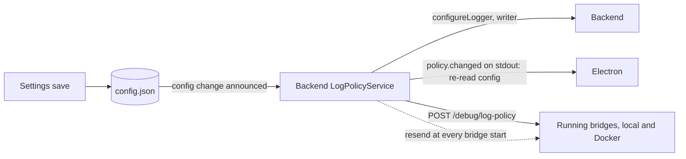
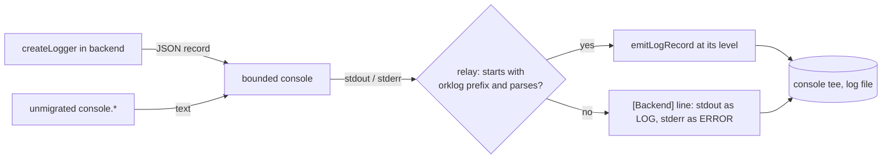
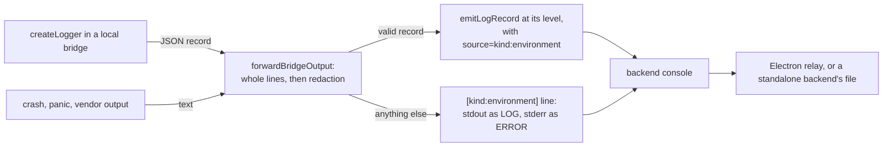
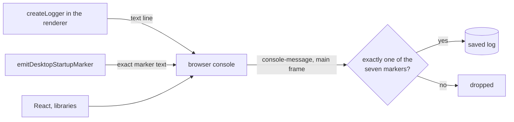

# Application logging

Status: Living. The shared logger, its vocabulary, how entries reach the log file,
and the live settings that control them. Electron's main process, all five bridges
and the renderer are fully on it. The backend is migrating;
`tests/unit/raw-console-ratchet.test.ts` lists what is left.

## Using it

```ts
import { createLogger, formatLogError } from "@orkestrator/protocol/logger";

const log = createLogger("updater");

log.info("downloaded", { version });
log.warn("check.failed", { error: formatLogError(error) });
log.debug("library.message", () => ({ message: expensive() }));
```

Each entry has four parts:

- **An area**, from the fixed list in `packages/protocol/src/log-vocabulary/`.
- **A level:** `error`, `warn`, `info`, `debug` or `trace`.
- **An event:** a static name listed for that area. Never put dynamic text in it.
- **Optional fields:** scalars and formatted errors.

`packages/protocol/src/logger.ts` is browser-safe and has no dependencies.
Node-only setup is in `src/node/logger-environment.ts`.

### Choosing a level

| Level | Means | By default |
| --- | --- | --- |
| `error` | Something failed and nothing recovers it. | Written |
| `warn` | Something failed or looks wrong, and the app carried on or will retry. | Written |
| `info` | A rare, meaningful lifecycle event. | Written |
| `debug` | Detail for investigating one area. | Off |
| `trace` | Per-item detail too heavy for `debug`. | Off |

A site moved to `debug` disappears from normal logs, including from a saved log,
until someone turns on **Log Detail**. Treat that as a decision to review, not a
tidy-up.

### Hot paths

A level check is one integer comparison. To build no arguments when the level is
off, pass a function for the fields; it runs only when the level is on. Use
`log.isEnabled("debug")` to guard other work, as a renderer site on a per-frame
path does. electron-updater's `debug` method reads as absent while
the level is off, because the library checks for it before serializing its plan.

## Repeating faults

A loop that retries while a fault lasts would write the same line for as long as
the fault lasts. Use `log.throttled`, and report each success with `log.recovered`:

```ts
const log = createLogger("tmux");

try {
  snapshot = await poll();
  log.recovered("poll.snapshot-failed", tabId);
} catch (error) {
  log.throttled("warn", "poll.snapshot-failed", {
    scope: tabId,
    error,
    fields: () => ({ error: formatLogError(error) }),
  });
}
```

```text
[tmux] poll.snapshot-failed scope=tab-1 kind=EACCES error.name=Error error.code=EACCES ...
[tmux] throttle.suppressed site=poll.snapshot-failed scope=tab-1 kind=EACCES suppressed=240 windowSeconds=60
[tmux] throttle.recovered site=poll.snapshot-failed scope=tab-1 failures=251 kinds=1 suppressed=10 faultSeconds=63
```

- **First occurrence:** written in full, with `kind` and your `fields`. Repeats do
  not build `fields`, so detail only ever appears on this line.
- **Idle keys:** after five minutes without that kind failing, its next failure
  is written in full as a new incident. A replacement tmux poller has its own
  lifetime scope, even when it reuses the same tab.
- **Repeats:** only counted. One `throttle.suppressed` line per 60-second window,
  written by the next call after the window ends.
- **A new kind of error** on the same site is a new key, and is written at once
  with its own count and window.
- **Recovery:** one `throttle.recovered` line for the site and scope, whatever
  number of kinds it had, with the count no summary has reported yet.
  A later failure is a first occurrence again.
- All three lines use the level of the call, so a fault you can see always has a
  summary and a recovery you can see. A `warn` fault does not recover at `info`.

An area spreads `THROTTLE_LOG_EVENTS` into its events to use it, and the types
refuse `throttled` otherwise. The lines carry the event as a `site` field, so one
short list serves every site, and area levels apply to them as to anything else.

**Use it** for a recurring loop's failure that repeats while a fault lasts. **Do
not use it** for a one-off failure or for a state that is not a fault:
`[agent-mail]` waiting is one line per change of reason, and a line a minute per
waiting message would be noise. A retry that backs off to minutes also suits it
badly, since every retry falls in a new window: see `PendingRenameFailureLog`,
which keeps its powers of two. Its count also sets the retry delay, so it must
exist whatever the level is. The event-loop stall monitor keeps its own rule too,
because stalls of 10 seconds or more must always be logged.

### Keys

A key is the area, the event, the `scope` and the kind.

- **Kind:** `logErrorKind(error)`, the error's code or else its type, or a static
  `kind` for a failure with no error object. Never the message, which varies and
  can hold content. A `kind` that is not a short name becomes `invalid-kind`.
- **Scope:** pass one when a site runs for several tabs, jobs or bridges. Without
  it, a success in one tab would report a recovery for another's fault, and the
  two would alternate full lines for ever. It is an identifier, reaches every
  line, and is cut at 128 characters.

### The limit

At most `LOG_THROTTLE_MAX_KEYS` (512) keys are tracked in a process. A new key at
the limit is still written, and takes the place of the key that has gone longest
without failing, which is most likely a loop that stopped without succeeding. That
key writes `throttle.evicted` with its count, because its recovered line is lost
with it. If it fails again it is a first occurrence, so the limit can cost extra
lines but never hides a failure.

### While a level is off

The level is read on every call, never captured.

- A call while the level is off costs one comparison. **It does not count**, and
  builds nothing, so a summary never claims evidence from time nobody could read.
- A site already tracked when its level goes off is dropped, on the next throttled
  or recovered call by any site. **Its unreported count is lost**, and so is the
  recovered line if the fault clears before the level returns.
- When the level returns, the next failure is a first occurrence, written in full.

Dropping is what makes this safe: a tracked key left in place would treat the first
failure the reader can see as a repeat. `configureLogger` replaces levels at
runtime when live logging settings change.

### Limits

- Summaries come from calls, with no timer. A loop that stops calling reports its
  count at the next throttled or recovered call of any site in the process.
- A site that alternates between failing and succeeding writes two lines per cycle.
  First occurrences and recoveries always reach the log, so this is not collapsed.
- `kind` comes from the type or code, so failures with different messages and the
  same type are collapsed. Only the first one's detail is written.

## Vocabulary

One file per domain in `log-vocabulary/`. Each lists its areas and events, with a
sentence for each, so a review of a new log line is a review of that list.

```ts
export const UPDATER_LOG_AREAS = defineLogAreas({
  updater: {
    description: "Desktop self-update: electron-updater and updates a remote client requested.",
    events: {
      "check.failed": "An update check failed; the next periodic check retries.",
    },
  },
});
```

- A new event touches only its domain's list. A new domain is a new file plus two
  lines in `index.ts`. The logger does not change.
- `createLogger`'s types come from this list, so an unlisted area, or another
  area's event, fails the typecheck.
- At runtime an unlisted event is written as `invalid-event`, without its text.
- `log-vocabulary.test.ts` fails on an unregistered file, an area two files claim,
  an undocumented entry or a name outside the grammar (lowercase, `-` and `.`).
- There is no `legacy` or catch-all area, and the test keeps it that way.
- `tag` keeps a text form that support recipes already search for. Only
  `desktop.startup` (`[DesktopStartup]`) and `bridge.diagnostics`
  (`[bridge-diagnostics]`) have one. A new area never needs it.

## Restricted fields

A field is a string, number, boolean, null, undefined or the result of
`formatLogError`. Enforced twice:

- **Types:** a raw object, array or `Error` is a type error, and so is a field
  named for content AGENTS.md invariant 12 keeps out of logs (`stdout`, `stderr`,
  `cmd`, `spawnargs`, `prompt`, `token`, `password`, `secret`, `authorization`,
  `apiKey`, `cookie`, `credentials`).
- **Runtime:** for code the types do not reach, a raw object becomes
  `[rejected:object]`, a raw `Error` goes through `formatLogError`, and a value
  under a forbidden name (in any case, ignoring `-`, `_` and `.`) becomes
  `[forbidden]`.

Bounds: 2 KiB per string, 32 fields per entry, field names of at most 64
characters. Fields over the count, or with an invalid name, are counted in
`droppedFields`. An area may widen the string bound with `maxStringChars`, and the
vocabulary test allows exactly one: `bridge.diagnostics`, whose single string field
is a snapshot allowlisted and bounded to 8 KiB where it is built.

The logger cannot tell what a string means, so a string field can still hold
content. Reviewing the call site is what keeps it out. Static events and small
scalar fields make that review easy.

## Error formatting

`formatLogError(error, { stack? })` returns the name, `code`, `errno`, `syscall`,
`exitCode`, `signal`, a bounded redacted message of at most 1 KiB (cut first, then
redacted with `redactSecrets`), up to 8 stack frames, up to 2 levels of `cause`,
and for an `AggregateError` its size and first member.

It never returns an error's other enumerable fields, and never `stdout`, `stderr`,
`cmd` or `spawnargs`. For a failed child process the message goes too, because
that is where the output is: `CommandFailedError`'s message is the child's stderr,
and `exec`'s is `Command failed: <cmd>\n<stderr>`. Such an entry carries
`outputOmitted=true` plus the exit code and signal. Stack frames are `at ...`
lines only, taken after the message, so a multi-line message cannot come along.

Stacks are on by default so that moving a site onto the logger keeps them. Pass
`{ stack: false }` on a hot path or for an expected failure.

### Paths in stack frames

Frames show paths relative to the app, so a home directory name stays out of the
log. This works from what the path contains rather than from a configured root,
because it runs in every process, the browser included, and before any setup:

| The path contains | The frame shows |
| --- | --- |
| `/node_modules/` | `node_modules/...` from the last one |
| A workspace, such as `apps/backend/` or `bridges/claude-bridge/` | The path from there |
| A deployed bridge, such as `/opt/codex-bridge/` | `codex-bridge/...` |
| `app.asar/` or `resources/` in a packaged app | The path from there |
| A web URL | Its path, without the origin or query |
| Anything else | `.../file.ts`, the file name alone |

Only stack frames are rewritten. An error's *message* keeps any path it holds, such
as `ENOENT: no such file or directory, open '/Users/...'`. A frame relayed from
another process goes through the same rewrite.

## Command failures

`formatLogError` leaves a failed command with an exit code, which is rarely enough
to diagnose it. **The output itself is never logged**, not even a redacted tail of
stderr at `debug`: the user decided against it. Instead, a site logs a short fixed
label saying what went wrong.

```ts
import { createLogger, formatLogError } from "@orkestrator/protocol/logger";
import { classifyCommandFailure } from "@orkestrator/protocol/node/command-failure-reason";

log.warn("branch.rename-failed", () => ({
  ...classifyCommandFailure(error, { tools: ["git"] }),
  error: formatLogError(error),
}));
```

```text
[git] branch.rename-failed reason=branch-exists exitCode=128 signal=null environmentId=... runtime=local error.name=CommandFailedError error.outputOmitted=true error.exitCode=128 error.stack="at runCommandBytes (apps/backend/src/core/shell.ts:345:13)"
```

`renameLiveGitBranch` in `apps/backend/src/core/commands-agent-support.ts` is the
worked example.

`classifyCommandFailure(error, options)` returns exactly `{ reason, exitCode, signal }`.
It reads the output to choose the label, and the output goes no further. It never
throws, and it never looks at `stdout` directly: `CommandFailedError`'s message is
already stderr, or stdout when stderr was empty. A message beginning with
`Command failed: <argv>` is skipped, so a branch named after an error cannot read
as that error.

- **`tools`** names who produced the output, in reading order. Inside a container
  use `["docker", "git"]`, because git's output and exit code come through the exec.
  Without `tools`, every tool's text rules apply and no tool's exit codes do, because
  those mean different things per tool. `CommandFailedError`'s print backstop runs
  that way.
- **`exitCodes`** is for what one command's exit code means, such as `gh pr checks`
  exiting 8. It is typed to the reason list.

It decides in this order: how the process ended (`timed-out`, `aborted`,
`output-too-large`, `executable-missing`), the call site's `exitCodes`, a signal
(`killed`), the named tools' text rules, the shared text rules, the named tools' exit
codes, the shared exit codes, then `unclassified`.

**A reason is a diagnostic hint, so never branch on one.** It matches text that
changes with locale and tool version. Under another locale a failure reads as
`unclassified`, which is correct and still carries its exit code and signal. Control
flow reads `CommandFailedError`'s structured fields.

### When to add a reason

A migration slice adds a reason wherever a bare exit code is not enough to diagnose
the failure. When moving a site that logs a failed command:

1. Call `classifyCommandFailure` and name the `tools` the command runs.
2. If it would report `unclassified` for a failure you can name, add a rule. A new
   reason is a line in `log-vocabulary/command-failure-reasons.ts`, a rule in
   `TOOL_RULES` or `SHARED_RULES`, a row below and a sample in
   `command-failure-reason.test.ts`, which fails until a reason can be produced.
   `log-vocabulary.test.ts` fails on a malformed or undocumented one, or one missing
   from this page.
3. Keep the label static. Never build one from output, and never log output in
   another field because the label was not enough.
4. Leave it out for an expected failure a site already handles, where the event says
   everything. Use `{ stack: false }` there as well.

`reason` is also an ordinary field name: Electron's `renderer.gone-reloading` uses it
for Chromium's own value. The logger does not enforce this list, so a reviewer of a
command-failure site checks that `reason` comes from the classifier.

### The reasons

| Reason | Means | Matches |
| --- | --- | --- |
| `timed-out` | Ran past its deadline. | `timedOut`; exit 124 from `timeout(1)` |
| `aborted` | Stopped on request. | `aborted` (the caller's abort signal); `gh` exit 2 |
| `killed` | A signal ended it. | `signal` set; exit 137 or 143 |
| `executable-missing` | The program or its working directory does not exist. | `executableMissing`; a raw `spawn` ENOENT |
| `output-too-large` | Wrote past the capture limit. | `outputLimitExceeded` |
| `command-not-found` | A shell could not find the program. | `command not found`; exit 127 |
| `not-executable` | A shell could not run the program. | Exit 126 |
| `auth-failed` | No credentials, or they were refused. | `authentication failed` or `required`, `could not read username`, `terminal prompts disabled`, `bad credentials`, `permission denied (publickey)`, `host key verification failed`, `gh auth login`, `HTTP 401`, `returned error: 401` or `403`; `gh` exit 4 |
| `network-failed` | Could not reach a host. | `could not resolve host`, `connection refused` or `reset`, `network is unreachable`, `early eof`, `remote end hung up`, `unable to access` an HTTP(S) URL, `i/o timeout` |
| `disk-full` | No room to write. | `no space left`, `ENOSPC`, `disk quota exceeded` |
| `permission-denied` | The OS refused access. | `permission denied`, `operation not permitted`, `read-only file system` |
| `path-not-found` | A needed path does not exist. | `no such file or directory` |
| `port-in-use` | The port is taken. | `port is already allocated`, `address already in use` |
| `invalid-usage` | The tool rejected its arguments. | `usage:` at a line start, `unknown option` or `flag`; `git` exit 129 |
| `branch-exists` | The target branch is taken. | `a branch named ... already exists` |
| `branch-not-found` | The branch does not exist. | `no branch named`, `refname ... not found`, `did not match any file(s) known to git` |
| `invalid-ref` | A name or revision is bad. | `not a valid branch name` or `object name`, `bad revision`, `unknown revision`, `ambiguous argument` |
| `ref-conflict` | An existing ref occupies the path. | `exists; cannot create`, `cannot lock ref ... is at ... but expected` |
| `lock-held` | A git lock is held. | `unable to create '....lock'` or `cannot lock ref` with `File exists`, `another git process`, `could not lock config file ...: File exists` |
| `not-a-repository` | Not inside a repository. | `not a git repository` |
| `worktree-conflict` | Checked out in another worktree. | `already checked out`, `used by worktree` |
| `merge-conflict` | Stopped on conflicts. | `CONFLICT (`, `merge conflict`, `could not apply`, `unmerged files` |
| `dirty-worktree` | Changes would be overwritten. | `local changes ... would be overwritten`, `commit your changes or stash` |
| `nothing-to-commit` | Nothing staged. | `nothing to commit`, `no changes added to commit` |
| `push-rejected` | The remote refused the push. | `[rejected]`, `[remote rejected]`, `non-fast-forward` |
| `remote-ref-missing` | The ref is not on the remote. | `couldn't find remote ref`, `not our ref` |
| `no-remote` | No such remote or repository. | `does not appear to be a git repository`, `no such remote`, `repository ... not found` |
| `dubious-ownership` | Owned by another user. | `detected dubious ownership` |
| `identity-unknown` | No commit identity. | `please tell me who you are`, `unable to auto-detect email` |
| `rate-limited` | A GitHub rate limit. | `rate limit`, `HTTP 429` |
| `forbidden` | The token lacks access. | `HTTP 403`, `resource not accessible` |
| `resource-not-found` | No such GitHub resource. | `HTTP 404`, `could not resolve to a` |
| `no-pull-request` | No pull request matched. | `no pull requests found`, `no open pull requests` |
| `pull-request-exists` | The branch already has one. | `a pull request for branch ... already exists` |
| `server-error` | A GitHub server error. | `HTTP 5xx` |
| `daemon-unavailable` | Docker is not reachable. | `cannot connect to the docker daemon`, `error during connect`, `is the docker daemon running`, `docker desktop is not running` |
| `daemon-error` | Docker itself failed. | `docker` exit 125 |
| `container-not-found` | The container is gone. | `no such container` |
| `container-not-running` | Stopped, paused or restarting. | `container ... is not running`, `paused`, `restarting` |
| `container-name-conflict` | The name is taken. | `name ... is already in use` |
| `image-not-found` | No such image. | `no such image`, `pull access denied`, `manifest ... not found`, `manifest unknown` |
| `server-not-running` | No tmux server. | `no server running`, `failed to connect to server`, `no sessions`, socket missing/refused errors, `server exited`, `lost server` |
| `session-not-found` | No such tmux target. | `can't find session`, `window` or `pane`, `session not found` |
| `session-exists` | The session name is taken. | `duplicate session` |
| `unclassified` | Nothing above matched. | The fallback, with the exit code and signal as the evidence |

The list and each sentence are in `log-vocabulary/command-failure-reasons.ts`, and
the patterns are in `node/command-failure-reason.ts`. Text matching is case-insensitive.

## Raw `console` until a site migrates

Two backstops apply before a site moves to the logger.

**`CommandFailedError` prints safely.** Its `toJSON` and `util.inspect.custom` give
the classified fields and bounded frames, so a raw `console.warn("...", error)` writes
one line and never `stdout`, `stderr`, `cmd` or `spawnargs`:

```text
[Backend] Failed: CommandFailedError reason=branch-exists exitCode=128 signal=null outputOmitted=true | at runCommandBytes (apps/backend/src/core/shell.ts:345:13)
```

This covers `%s`, `%o`, `%j`, a nested field, an array member and, through the
backend's bounded console, a wrapper's `cause`. `GitRemoteTimeoutError` inherits it.

It does not cover reading the text directly. `error.message`, `String(error)` and a
template literal still give the output, because callers build user-facing text from
them, so such a site stays unprotected until it migrates. Under Bun's own console, a
`CommandFailedError` held as a `cause` also prints in full. Bun's native error printer
ignores `inspect.custom` there, and the backend avoids it by installing the bounded
console first.

Other classes were checked. `SshTunnelError.detail` is one redacted line and
`ProviderSessionFailedError.detail` is bridge text cut at 4,000 characters, both
bounded, and neither is child output, so neither has a backstop. A raw error from
`promisify(execFile)` (`tailscale-serve.ts`, `ssh-agent-socket.ts`) and a plain
`new Error(out.stderr)` (`tmux-*.ts`, `path-safety.ts`) have no class to add one to:
migrating the site through `formatLogError` is what covers them.

**The fatal rejection guard is bounded.** `packages/protocol/src/fatal-rejections.ts`
is serialized into workers, so it imports nothing and keeps its raw `console`. It
writes one line of at most about 5 KiB: a message cut at 1 KiB, up to 16 frames of 240
characters with the same relative paths, and any `code`, `exitCode` and `signal` that
look like identifiers. It drops a command failure's message and output. An arbitrary
rejected object is described by shape (`[object Object] code=E_NOPE keys=3`), never by
its contents, and a function by `[function]`. It redacts common credential shapes with
a local copy of the shared credential rules, because it cannot load `secret-redaction.ts`.
Its metadata and names are redacted too; common fixtures enforce parity.
`fatal-rejections.test.ts` holds its paths to the same results as `formatLogError`.
`scripts/recurring-live-ab.ts` counts `Unhandled promise rejection (continuing)` by its
exact text, so that prefix does not change.

The [R5 addendum](../reports/2026-10-29-logging-and-database-efficiency.md#addendum-log-output-shortened-by-r5)
lists every site these backstops shortened and the evidence each loses.

## Output

Text is the default: one line per entry, in the old `[tag] message` shape.

```text
[updater] check.failed error.name=Error error.message="net::ERR_FAILED" error.stack="at a | at b"
```

`ORKESTRATOR_LOG_FORMAT=json` writes JSON lines:

```json
{"orklog":1,"ts":"2026-11-01T10:00:00.000Z","level":"warn","area":"updater","event":"check.failed","fields":{"attempt":2}}
```

- Every entry is one line in either format. Newlines, control characters and
  U+2028/9 in a value are escaped, because Node's readline ends a line at those.
- In JSON mode the saved log file is JSON lines throughout. A console call that
  did not come from the logger is wrapped as `{"orklog":1,"ts","level","message"}`
  with no area or event, and an entry over the 64 KiB bound becomes a shortened
  one with `"truncated":true` rather than a line that does not parse.
- Text files end in `.log`, and JSON files in `.jsonl`, with separate numbered
  rolls. Changing format between launches on the same day keeps each file in
  one format.
- In text mode `trace` shows as `DEBUG` in the file: it goes out through
  `console.debug`, because `console.trace` prints a stack of its own and neither
  the bounded console nor the file tee wraps it.

## Live settings

**Settings → Debug** has two controls. Neither needs a restart, and neither
interrupts a running agent.

| Control | Config keys | Decides |
| --- | --- | --- |
| **Save Logs to Disk**, with retention | `debugLogging`, `debugLogRetentionDays` | Whether what is written reaches the log file, and for how long it stays. |
| **Log Detail** | `logDetail` (`level`, `areaLevels`) | What each process writes: a default level and levels by area. |

An area covers its children unless a child has its own entry: `desktop=debug` also
covers `desktop.dialog`. The default is `info`. Bridge snapshots
([bridge-diagnostics.md](bridge-diagnostics.md)) run when the level in force for
`bridge.diagnostics` is `debug` or `trace`, so `bridge=debug` or a global `debug`
turns them on.



- **The backend owns the change.** `LogPolicyService` watches the config's change
  announcements, so every writer counts: the settings screen, an older client, the
  CLI. A write that leaves logging alone does nothing. Levels go to a bridge only
  when they changed, so a saving change does not touch one.
- **One audit line per change:** `logging` `policy.changed`, with `saving`,
  `retentionDays`, `level` and `areaLevels` (names and levels only). It goes
  straight to the sink because a change to `error` would otherwise filter it.
- **Electron re-reads `config.json`.** The audit line reaches it on the relay and
  only prompts the read, so an imitation of it costs one read and changes nothing.
  The order keeps the line in the saved log: turning saving on starts the writer
  first, and turning it off writes the line first. A config resource event, two
  seconds later so it cannot overtake the line, and every backend start also prompt
  a read, in case the bounded console dropped the line. A file that cannot be read
  leaves the settings as they are.
- **The file writer is always installed.** It writes only while saving is on, and
  off costs one comparison per console call. Off announces any drop not yet
  reported. The byte bounds and drop markers do not change. A retention change
  while saving is on sweeps at once. While saving is off nothing sweeps, as before,
  and files already on disk stay until saving returns or someone uses **Clean up
  logs**.
- **Upgrading.** Before the split, `debugLogging` meant saving and bridge snapshots.
  A config without `logDetail` is upgraded once by `normalizePersistedConfig`: on
  maps to `level: info`, `areaLevels: { bridge: debug }`, off to the defaults. The
  key names stay, so a downgrade still reads them. `resolveLogDetail` applies the
  same mapping for a reader that gets there first (Electron starts before its
  backend). A save from a client that predates `logDetail` keeps the stored value.
- **`ORKESTRATOR_LOG_LEVEL` stays on top.** It takes a default, areas, or both:
  `warn`, `updater=debug` or `warn,updater=debug,desktop.dialog=trace`. Whoever set
  it asked for those levels, so a settings save does not undo them. The backend
  sends stored settings to bridges; each process applies its own override locally.
  A bridge the backend launches inherits the backend's value at launch, so the
  override sits on top there too; a bridge already running keeps what it started
  with. Unset, the settings are the whole answer.
- **Renderer logs are not part of this.** See [What stays out of the persistent
  log](#what-stays-out-of-the-persistent-log).

Live bridge delivery sends stored levels; each receiving process applies its own
`ORKESTRATOR_LOG_LEVEL` override, which the settings do not replace. Local targets are delivered before Docker discovery completes;
each container lookup shares a three-second deadline across port and token reads and
publishes its target as it finishes. Failed lookups retry twice with fresh deadlines;
successful absence does not retry. Exhausted lookups produce a content-free failure count. HTTP requests are limited to eight at once, with
retry sleeps outside that limit. Each new policy gets a fresh retry budget,
including when it supersedes a failed final attempt.

### The bridge route

`POST /debug/log-policy` on all five bridges, behind each bridge's existing token.
OpenCode is not one of ours and has no route.

```json
{ "seq": 1793000000000, "level": "info", "areaLevels": { "bridge": "debug" } }
```

| Answer | Means |
| --- | --- |
| 200 `{ "applied": true, "seq", "diagnostics" }` | In force now. |
| 200 `{ "applied": false, "stale": true, "seq" }` | The bridge holds a newer `seq`. The backend retries once past it for this bridge only, within a one-day clock-skew bound. |
| 400 `{ "error" }` | The body does not parse. Nothing changed. |
| 404 or 405 | An older bridge. It keeps working and applies the setting at its next start, through `ORKESTRATOR_BRIDGE_DEBUG`. Never an error for the session. |

It is metadata only, by the same rule as `/activity`: it reads no session, touches
no liveness, hydrates nothing and re-attaches nothing. `seq` rises with each policy,
seeded from the clock, so a delayed request cannot undo a newer one and a restarted
backend still counts as newer.

Bridge answers are limited to 4 KiB. Sequence recovery is per bridge, so an invalid or
continually rising stale answer cannot advance other bridges or retry forever.

Delivery is best-effort. A failure is retried twice and then logged once as
`policy.push-failed`, without the bridge's address or token. The listing skips health
probes, because a bridge whose event loop is busy is the one whose detail matters
most. Every bridge start resends if that bridge has not taken the current policy, and
a backend start sends to whatever is running, because Docker bridges outlive it.
`ORKESTRATOR_BRIDGE_DEBUG` is still set at launch, as the startup default until the
first request arrives.

A level on a bridge applies to its next log call, turns already running included:
every bridge line is on the logger, in `bridge.claude`, `bridge.codex`,
`bridge.cursor`, `bridge.pi`, `bridge.acp` and `bridge.diagnostics`, so `bridge=debug`
covers them all. [The bridge hop](#the-bridge-hop) never filters, so a local bridge's
line keeps the level it was written at whatever the backend's own levels are. Output
that is not a logger call (a native crash, a runtime panic, a vendor's own printing)
is captured as text whatever the level is.

`error` cannot be filtered, because no level is below it. A stall of 10 seconds or
more uses that: `event-loop` `stalled`, and the desktop's `main-thread.stalled`, are
written at `error` whatever the configured level, and at `warn` below 10 seconds.

## The Electron relay

The desktop reads the Local backend's stdout and stderr and writes them into its
own log. It used to write all of stdout as `LOG` and all of stderr as `ERROR`.

**A logger in a supervised backend writes JSON records, and the desktop re-emits
each one at the level it carries.**



- **Who turns it on.** The backend's `main.ts` passes `relayToSupervisor` when
  `ORKESTRATOR_DESKTOP_SUPERVISED=1`, before standalone logging clears that flag.
  So only the desktop's direct child uses it, not the bridges it launches or a
  standalone backend.
- **The wire format is the JSON-lines format.** There is one record shape, not a
  second grammar, and it is versioned by its `{"orklog":1,` prefix. Fields survive
  the crossing as well as the level, so the desktop renders them in its own format.
- **Nothing is lost.** Anything that is not a valid record stays ordinary output:
  an unmigrated `console.*`, a native crash, a runtime panic, or a record from
  another build naming an area or event this one does not list. A JSON object on
  stdout, which the relay used to drop silently, is now captured too.
- **The cost is small.** The prefix check rejects a non-record without parsing.
  The startup listener's `JSON.parse` now only runs on lines starting with `{`.
- **The relay never filters.** The source has already applied its level.
- **Spoofing.** Any output can imitate a record, for example the second line of a
  bridge's multi-line chunk. Parsing validates the level, area, event and every
  field as a local call would, and since nothing filters afterwards, an imitation
  can only change a line's label. It cannot hide output.
- **Backpressure is unchanged.** Records go through the same `console` calls, so
  `bounded-console.ts` and the file writer's byte bounds and drop markers apply.

Two alternatives were rejected. A one-character level prefix needs a second grammar
and loses the fields. A separate pipe avoids any parsing but adds a stream with its
own backpressure and no ordering against stdout and stderr.

The rest of the relay and writer work (batching, a line length bound, skipping the
relay when nothing consumes it) is undecided and not built.

`writeProcessOutputLine` is how raw text enters the log. Only a stdio relay may
call it: it bypasses levels because such text has none.

## The bridge hop

A local bridge's stdout and stderr reach the backend through `forwardBridgeOutput`.
It works like the Electron relay, and one record can cross both:



- **Who turns it on.** The backend sets `ORKESTRATOR_BRIDGE_LOG_RELAY=1` on a bridge
  it spawns and reads. `configureBridgeLogger`, which every bridge entrypoint calls,
  makes that bridge write JSON lines and consumes the relay, format and level
  variables, so agent commands cannot inherit those bridge startup settings.
  The bridge retains its level override privately so live policy updates still
  respect the value supplied at launch.
  OpenCode runs its own server and receives no relay flag, including an inherited one.
  A bridge whose output nobody reads as records (one started by hand, or a model
  catalogue probe) stays on the format its environment asks for.
- **Redaction runs before and after decoding.** Raw output is scrubbed per chunk.
  Recognized records then have every decoded string scrubbed, including formatted
  errors, stack frames and causes, because JSON escaping can hide credential syntax.
  If the raw pass breaks a record's JSON, the line is kept as plain output.
- **`source` replaces the old `[kind:environment]` prefix on records.** The hop sets
  it, overriding anything the bridge claimed, and puts it first so a record already
  at the field limit keeps it through the next relay.
- **Each line is its own entry.** A chunk used to be one call, so only its first
  line carried the prefix. Every line of a stack now has it.
- **Nothing is lost.** Unstructured output, and a record from another build naming an
  area or event this one does not list, stay captured as text. The hop never filters.
- **Ordering.** stdout and stderr are read separately, as before, so an `info` and a
  `warn` can swap. A record keeps its own `ts`, which the JSON format shows; the text
  file stamps the time it was written.

**A container bridge has no hop.** Nothing reads its stdio: `/tmp/<provider>-bridge.log`
is written straight from it through `orkestrator-log-writer`, with no tee to add a
time or level. So the launch scripts set `ORKESTRATOR_LOG_FORMAT=json` and pass the
backend's `ORKESTRATOR_LOG_LEVEL`, and each line of that file is a record holding
its own level and time. Unstructured output sits between them as plain text. An
older image's bridge ignores both variables and keeps its plain lines.

### A level replaced at runtime

Levels are replaced through `configureLogger`, and a site never caches whether one
is on: a logger reads its threshold on each call, and `bridgeDiagnosticsActive()` is
read per snapshot. The diagnostics switch follows too. `POST /debug/log-policy` sets
it with `setLiveBridgeDiagnostics`, which replaces `ORKESTRATOR_BRIDGE_DEBUG` from
then on, and `createBridgeDiagnostics`, the buffered debug logger and the Claude
bridge's `isDebugLoggingEnabled` read it per call.
[bridge-diagnostics.md](bridge-diagnostics.md#turning-detail-on-during-a-turn) says
what each bridge's running turn picks up.

## electron-updater

`createUpdaterLibraryLogger` (`apps/desktop/electron/updater-log.ts`) replaces the
library's default `console` logger. Its lines become `updater` `library.message`
entries at the library's own level, with credential shapes redacted, so a signed
download URL loses its signature.

The differential download plan is the library's `debug` output. It made up most of
the lines in a sampled log. It is now off by default, and neither built nor written.
To see it, set `updater` to Debug in **Log Detail**, or
`ORKESTRATOR_LOG_LEVEL=updater=debug`; it appears as one line cut at 2 KiB.

`library.message` is the one event whose field is vendor text rather than ours.

## What stays out of the persistent log

The renderer's console does not reach the log. Only the seven allowlisted
`[DesktopStartup]` markers cross, matched exactly in the main frame, as
[bridge-diagnostics.md](bridge-diagnostics.md) describes. A renderer using the logger
does not change that: `isDesktopStartupMessage` only accepts those exact strings. So
every `web.*` and `terminal` line stays in the browser console.



- **The markers are not logger lines.** `apps/web/src/lib/desktop-startup-marker.ts`
  writes them with the raw console, the only renderer module that does, because the
  text is a contract with the main process and must not depend on a level, sink or
  format. The lint exclusion names that one file.
- **The one way round the exact match.** A field-less logger line in the
  `desktop.startup` area renders exactly as a marker, because that area's tag is
  `DesktopStartup`. So the renderer never uses that area, and
  `apps/desktop/tests/renderer-diagnostics.test.ts` scans for it, along with feeding
  every other area's every event through the real listener.
- **The real path.** `e2e/agent-testing/renderer-log-boundary-electron.spec.ts` runs
  a real window with the renderer's level raised, and checks the main process's
  console holds the markers and no logger line. That console is what the saved log
  is made of, and `application-logging.test.ts` covers the file: the tee is installed
  only for the production flavor, which no test may run against real data.

Whether more may be saved is undecided (recommendation R8 in the
[review](../reports/2026-10-29-logging-and-database-efficiency.md)).

## The renderer

Everything renderer-only is in a `web.*` area, or `terminal` and `terminal.setup`,
with one vocabulary file per domain (`web-kanban.ts`, `web-sync.ts`, and so on).

- **Its level.** The renderer has no environment, so `ORKESTRATOR_LOG_LEVEL` does not
  reach it, and the live log detail setting does not either. Its default is `info`. Setting `localStorage["orkestrator:debug"]` and
  reloading raises every area to `debug`: `applyRendererLogLevel`
  (`apps/web/src/lib/debug-log.ts`) reads it once at startup. This is the old
  `rendererDebugLog` gate, which every `debug` site now goes through, including those
  that were plain `console.debug` and always wrote. It has no setting or UI, and
  `trace` stays off.
- **What a line now looks like.** One text line, not a console object: `error.name`,
  `error.message` and up to 8 relative frames, with no expandable object or
  source-mapped links in DevTools. Where a site logged an entity or a name, it now
  logs its id.
- **Bug reports.** `installRendererErrorRecorder` still wraps `console.error`, so it
  sees whatever the logger writes at `error`, and a site moved below `error` leaves
  bug reports. It classifies the two `web.window` lines by their text, which is why
  that area's description names them.
- **Other readers.** `e2e/agent-testing/dev-startup-retry.ts` and
  `event-stream-outage.ts` read console text, and match the new lines.

The [addendum to the review](../reports/2026-10-29-logging-and-database-efficiency.md#addendum-renderer-levels-changed-by-r1)
lists every level this migration changed.

## The lint rule

`no-restricted-globals` refuses `console`, used directly or passed as a value.
[linting.md](../development/linting.md#raw-console) covers the exclusions and the
ratchet. A bridge's `scripts/` and its `*.live-probe.ts` files keep the console, as
their output is the point. Inside a migrated path, inject a logger or use a capture in tests:

```ts
import { captureLogs } from "@orkestrator/protocol/testing/log-capture";
```

## Older references

Some todos and flaky-test records quote lines from before this migration. They
record what was observed at the time and are left as they are.

| Old tag | Now |
| --- | --- |
| `[Desktop]` | `[desktop]` |
| `[Dialog]` | `[desktop.dialog]` |
| `[Updater]` | `[updater]` |
| `[Previews]`, `[BrowserPreview]` | `[preview]` |
| `[Connections]` | `[connections]` |
| `[Workspaces]` | `[workspaces]` |
| `[Toolchains]` | `[toolchain]` |
| `[BackendClient]` | `[backend.client]` |
| `[RemoteGateway]` (the desktop's own two lines) | `[gateway]` |
| `[ArtifactHost]` | `[artifact-host]` |
| `[Clipboard]` | `[desktop] clipboard.write-failed` |
| `[ApplicationLogging]` | `[logging]` |
| `[tmux] transcript discovery failed`, `poll snapshot failed`, `drainPending failed`, `drainTimeouts failed`, `transcript tail failed` | `[tmux] poll.*-failed` |
| `[backend] Failed to <job>` (keyed activity jobs) | `[backend.activity] job.failed scope=<job name>` |
| `[web-annotations] Reconcile pass failed` | `[web-annotations] reconcile.failed` |
| `[previews] Certificate refresh failed`, `Ignoring a renewed certificate` | `[preview] certificate.refresh-failed`, `certificate.renewal-refused` |
| `[local-server] ... is not answering health checks` | `[local-server] bridge.not-answering` |
| `[useTerminal] write called but no sessionId`, `Terminal input was not delivered` | `[terminal] input.undelivered` (browser console only) |
| `[ElectronBackend] ... pending prompt` | `[environment] rename.failed`, `rename.still-failing`, `rename.recovered` |
| `[backend] Kept the local branch of deleted environment` | `[environment] cleanup.branch-kept` |
| `[agent-mail] waiting` | `[agent-mail] delivery.waiting` |
| `[native-agent] ... older than the command catalogue` | `[native-agent] catalogue.outdated-bridge` |
| `[ElectronBackend] Failed to rename ... git branch`, and the push and rollback lines | `[git] branch.rename-failed`, `branch.push-config-failed`, `branch.rollback-failed` |
| `[RemoteGateway]` (the renderer's lines) | `[web.gateway]` |
| `[WindowError]` | `[web.window] error.unhandled`, `rejection.unhandled` |
| `[ReactRoot]`, `[LazyLoadBoundary]` | `[web.react]` |
| `[DesktopStartup] Renderer failed to load` (the rich line, not the marker) | `[web.startup] renderer.load-failed` |
| `[App]`, `[ActionBar]`, untagged session store lines | `[web.app]`, `[web.action-bar]`, `[web.session]` |
| `[PaneLayout]`, `[paneLayoutStore]`, `[DraggableTabBar]` | `[web.pane-layout]` |
| `[useEnvironments]`, `[HierarchicalSidebar]`, `[DockerSettings]` and the environment dialogs | `[web.environment]`, `[web.sidebar]`, `[web.docker]` |
| `[setup-terminal]` | `[terminal.setup]` |
| `[useTerminal]`, `[TerminalContainer]`, `[PersistentTerminal]`, `[ComposeBar]`, `[InitializationLogs]` | `[terminal]` |
| `[ClaudeTmux...]`, `[ResumeTmuxSessionDialog]` | `[web.claude-tmux]` |
| `[resource-sync]`, `[store-resource-sync]`, `[events]`, `[native-observation]` | `[web.resource-sync]` |
| `[read-coordinator]`, `[node-events]`, `[Workspace]` | `[web.read-coordinator]`, `[web.federation]` |
| `[KanbanStore]`, `[KanbanTaskDialog]`, `[ProjectNotesView]` | `[web.kanban]` |
| `[FeaturePlanStore]`, `[FeaturesView]` | `[web.feature-plan]` |
| `[BuildPipeline]`, `[feature-build-activation]`, `[BuildChatTab]`, `[PipelineReviewTab]` | `[web.build-pipeline]` |
| `[settings]`, `[settings-page]` | `[web.settings]` |
| `[MessageShell]`, `[NativeMessage]`, `[QuestionCard]` and other transcript components | `[web.chat]` |
| `[AgentNativeTab]`, `[AgentModelPicker]` and the composer drafts | `[web.native-agent]` |
| `[FileViewerTab]`, `[files-panel]`, `[useFileSearch]` | `[web.files]` |
| `[GitHubIssueDetail]`, `[GitHubComment]`, `[pull-requests]`, `[LinearTicketsView]` | `[web.github]`, `[web.linear]` |
| `[Backend]` (unmigrated backend output) | Unchanged until the backend migrates |
| `[Backend] Event loop stalled for N ms` | `[event-loop] stalled lagMs=N` |
| `[claude-bridge]`, `[session-manager]`, `[session]`, `[events]`, `[config]`, `[mcp]`, `[plugins]`, `[plugin-config]`, `[mcp-config]`, `[event-emitter]` | `[bridge.claude]` |
| `[codex-bridge]`, `[codex-bridge][app-server:N]` | `[bridge.codex]`, with `generation=N` for the second |
| `[cursor-bridge]` | `[bridge.cursor]` |
| `[pi-bridge]` | `[bridge.pi]` |
| `[acp-bridge]` | `[bridge.acp]` |
| `[kind:environment]` on a bridge's logger entry | `source=kind:environment` |
| `[kind:environment]` on a bridge's raw output | Unchanged |
| `[bridge-diagnostics] {json}` | `[bridge-diagnostics] <event> bridge=<name> payload="{json}"` |
| `[DesktopStartup]` | Unchanged |

## Adding to later processes

- **Entry point:** call `configureLoggerFromEnvironment(process.env)` once, before
  anything logs. The backend already does, and bridges use `configureBridgeLogger`.
- **Command failures** lose their message. A site that needs more than the exit code
  logs a classified reason; see [When to add a reason](#when-to-add-a-reason).

Backend jobs, annotation reconciliation and certificate refresh scopes include a
content-free owner UUID so separate backend instances cannot clear each other.
Kept-branch notices use a bounded per-storage deduplication set and plain info
logging; they consume no shared fault keys.
