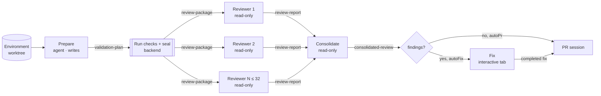
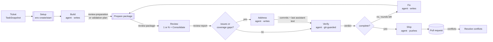
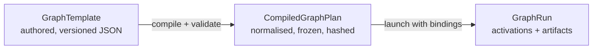

# Composable agent graphs: design report

Date: 2026-10-28. Reviewed against `main` at `79f3bc97e` (branch
`composable-graphs-fdcaf45451d4-r1`).

Scope: whether, and how, the fixed graphs behind Multi Review and the Build
Pipeline could become user-designed graphs. The report covers templates, a graph
designer, nodes and edges, prompts, fan-out and consolidation, the data passed
along edges, and what each node is allowed to do.

Method: I read the living docs
([`review-preparation.md`](../architecture/review-preparation.md),
[`build-pipeline-view.md`](../architecture/build-pipeline-view.md),
[`tickets.md`](../architecture/tickets.md), and the delegation part of
[`coordinator.md`](../architecture/coordinator.md)). Three parallel code
surveys followed: the Build Pipeline state machine and its handoffs, Multi
Review and the result contracts, and the per-provider permission and tool
controls. I re-read the code behind every claim that the design depends on.
Nothing was run. This is a proposal, not a description of shipped behaviour.

Follow-up: the plan that adopts these suggestions is
[`plans/composable-graphs.md`](../../plans/composable-graphs.md).

---

## 1. Summary

Orkestrator already contains most of a graph engine, but it is spread across
two hand-written state machines. Multi Review and the Build Pipeline share:

- a fan-out runner;
- typed, validated result slots that agents fill through MCP submit tools;
- a sealed, content-addressed artifact (the review package) handed between
  stages by reference;
- a keyed, durable supervisor;
- a shared flow-graph renderer;
- a provider-neutral execution policy.

What is fixed is the **topology** (a `switch` in each supervisor), the
**prompts** (TypeScript template functions), the **result kinds** (a closed
enum) and the **capabilities** (decided per code path, not per node).

Recommendations:

1. **Model a graph as a versioned template, compiled into a frozen plan, run as
   activations.** A template is JSON authored in a designer. Launching compiles
   it into a validated plan that is snapshotted into the run record, so editing
   a template never changes a running graph.
2. **Make every edge typed.** An edge carries an *artifact*: a validated payload
   of a named, versioned type, wrapped in an envelope that records lineage and
   the code state it describes. Agents produce artifacts only through
   per-output-port submit tools, which generalise today's `submit_review_report`
   and its validator. There are no untyped "then" edges. An ordering dependency
   is a `workspace` edge carrying a git snapshot. That makes code state explicit,
   and with it rewinds and concurrency rules.
3. **Fan-out is a property of a node; fan-in is a property of an input port.**
   A node can be replicated over a model panel, a list of lenses, or the items
   of a list artifact. Its output then becomes `list<T>`. A downstream port that
   accepts `list<T>` declares how long to wait and how many successes it needs.
   Consolidation is then just an agent node with a list input and a provenance
   contract, which generalises today's `reviewSourceIds` validation. It can also
   be a deterministic merge (concatenate, dedupe, vote) that costs no tokens.
4. **Agents produce data; the graph decides control flow.** Gates and loops
   branch on fields of typed artifacts using a small declarative predicate
   language. No agent can add nodes or branches at run time. This keeps graphs
   bounded, auditable, restartable and costable before launch.
5. **Give each node a capability profile, and say honestly how it is enforced.**
   Profiles build on the existing `capabilityPolicy` (`file.write`, `shell`,
   `network`, …). The vocabulary needs extending (`git.commit`, `git.push`,
   `github.write`, `mcp:<server>`, `subagents`). The designer should show each
   node's enforcement tier per provider (*enforced*, *provider-configured*,
   *advisory*), reusing the coordinator's qualification model. Nodes can demand
   a minimum tier. Post-hoc git guards, which today exist only for Verify, cover
   the providers that cannot enforce.
6. **Separate ambient capabilities from granted actions.** Ambient capabilities
   are what the agent's own tools can do in its sandbox. Granted actions are
   Orkestrator MCP tools minted per node: submit, progress, read an upstream
   artifact, tickets, mail, human input. Side effects that need idempotency and
   recovery (push, open PR, move a ticket) work best as **system nodes** run by
   the backend.
7. **Build it in phases, and do not rewrite the Build Pipeline first.** Start
   by parameterising today's flows (per-reviewer lenses, per-stage
   instructions). Then ship the schema, compiler and a read-only designer that
   *describes* the built-in flows. Then a new runtime for user graphs. Port
   Multi Review, and much later the Build Pipeline, only once the runtime has
   matched their robustness.

---

## 2. What exists today

### 2.1 The product, briefly

Orkestrator is an Electron desktop app with a standalone Bun backend. It runs
isolated environments (Docker containers or local git worktrees) for six agent
engines: Claude, Codex, OpenCode, Cursor, Grok and Pi. Each engine is driven
through a per-provider bridge. Above single agent tabs it has three orchestration
layers:

- the **Coordinator**, a long-lived agent that delegates to worker environments
  over MCP and is woken by mail;
- **Multi Review**, a reviewer panel over one environment;
- the **Build Pipeline**, which takes a Kanban ticket to a pull request.

Long-running state lives in the backend, never in React. A big part of the
codebase exists to make that state survive restarts, missed events and
provider quirks.

### 2.2 Multi Review as a graph



| Node | Runs as | Input | Output (result kind) | Capability today |
| --- | --- | --- | --- | --- |
| Prepare | agent turn | worktree, instructions | `validation-plan` | build mode, writable (it commits safe changes) |
| Validate + seal | backend worker | plan | `ReviewPackage` file (format 2, SHA-256) | runs project commands, no agent |
| Reviewer ×N | agent session each | package path, via prompt text | `review-report` | `plan` mode + `readOnly` when a package exists (`review-fanout.ts:1072-1086`) |
| Consolidate | agent turn | compacted evidence from N reports (≤ 640 KiB) | `consolidated-review` | `readOnly` report turn (`multi-review-service.ts:210`) |
| Fix | ordinary interactive tab | consolidated report | `fix-result` / turn end | writable |
| PR | agent session | git state | PR on GitHub | writable, pushes |

Things worth knowing for a generalisation:

- **Per-reviewer configuration is only a model.** `ReviewerModelSelection` is
  `{agent, model, reasoningEffort?, fastMode?}` (`packages/protocol/src/review-fanout.ts:43-49`).
  There is one shared `reviewInstruction`. The only text that differs per
  reviewer is a trailing "You are independent reviewer N of M" line, placed last
  so that every reviewer shares a byte-identical, cacheable prompt prefix
  (`apps/backend/src/core/multi-review-prompts.ts:53-61`).
- **Fan-in tolerates failure.** Consolidation starts once every reviewer has
  settled and at least one usable report exists. Failed reviewers are carried
  as a summary, not as a blocker.
- **Consolidation has a provenance contract.** Every source finding gets an ID
  (`reviewer-{pos}/{issue|coverage-gap}-{n}`). The consolidator must cite
  supporting IDs, and the submit-time validator rejects IDs that do not exist
  (`validateConsolidationContext`, `workflow-result-contracts.ts:258-305`).
  Overlap statistics (`ReviewPanelOverlapV1`) measure what each reviewer
  contributed.
- **Evidence is compacted before fan-in.** `buildConsolidationEvidence` hoists
  facts every reviewer agrees on into `shared`, strips per-finding labels, and
  drops detail in a fixed order to fit the 640 KiB budget. It fails before
  dispatch rather than truncating silently.

### 2.3 The Build Pipeline as a graph



The supervisor (`build-pipeline-service-supervisor.ts`, `advance()`) is one
long ordered check: rewinds, outbox, provisioning, control requests, fan-out,
validation, then a `switch` on phase. The handoffs use five different carriers:

| Edge | Carrier today |
| --- | --- |
| Ticket → every stage | `TaskSnapshot` inlined by `ticketContext()`; images to Build, Review, Verify and Fix only |
| Build/Fix → Review | structured `review-preparation` or `validation-plan` result → backend-sealed **package file** referenced by path and SHA-256 |
| Review → Address | `structuredReview` issues and gaps as an untrusted **JSON frame**, *plus* a **transcript handoff** of the review session (up to 180,000 characters, `build-pipeline-handoff.ts`) |
| Address → Verify | **commits**, plus the Address session's **last assistant text**, at most 16k characters (`latestAddressReport`). This is the only edge with no structured result. |
| Verify → Fix | `VerificationVerdict {complete, rationale, acceptanceCriteria[]}` → `verificationFeedback` text in the Fix prompt; criteria results are also written to the Kanban ticket |
| Verify → Ship → Conflicts | git state only, plus the existing PR URL |

The loop is Fix → Prepare → Review → (Address) → Verify, bounded by
`maxIterations`. The default is 3 and the protocol maximum is 10
(`MAX_BUILD_PIPELINE_ITERATIONS`). The UI draws each repeat as a new node to the
right rather than a back edge. Restarts rewind to a step's round and mark later
sessions `supersededBy`. A separate confirmed action resets the code to the
step's `headAtStart`.

### 2.4 Two smaller graphs

- **Looped review** (`looped-review-service.ts`): one model running sequential
  discovery passes. A reconciliation step merges each pass into a persistent
  finding pool (`review-reconciliation` result, with pool IDs validated at submit
  time). It stops when a pass adds nothing, then fixes, halves the pass
  allowance, and repeats. This is the "loop until convergence" pattern.
- **Feature planning** (`feature-planning.ts`): a conversational planner that
  submits `feature-plan-state` and `story-refinement` results. Its output (a
  feature with stories) is a natural *list artifact* to fan out over.

### 2.5 Machinery a graph runtime would reuse

| Primitive | Where | What it gives a graph runtime |
| --- | --- | --- |
| Workflow-result slots | `workflow-result-service.ts`, `workflow-result-tools.ts`, `packages/protocol/src/workflow-results.ts` | Per-attempt typed output: `submit_<kind>`, `validate_workflow_result` dry run, status, canonical-digest dedupe, `open → accepted → consumed` lifecycle, 384 KiB cap, commit by validated digest, an `onAccepted` wake |
| Result contracts | `workflow-result-contracts.ts` | A bounded JSON-Schema-subset validator (`type`, `properties`, `required`, `additionalProperties`, `items`, `enum`, `const`, `anyOf`, min/max length, items and value). It already falls through to a caller-supplied schema (`return schema ?? {}`). Placeholder rejection and context validators |
| Result transports | `WorkflowResultRollout` | `tool-v1` (MCP), `structured-output-v1` (provider-enforced schema) and `planner-block-v1`, chosen per provider and kind |
| Repair and reminders | `build-pipeline-service-recovery.ts`, `review-fanout.ts` | Up to 3 repair turns with the schema and errors framed. One missing-result reminder after 2 minutes idle. A continuation after a provider restart |
| Fan-out runner | `review-fanout.ts` (`ReviewFanoutRunner`, `ReviewFanoutHost`) | Bounded admission (4 setups, 8 observations, 4 per provider, cap 16), a dispatch journal (`prepared → dispatching → sent`) with proof-based recovery, retry of one branch, provisional findings |
| Sealed artifacts | `review-package.ts`, `review-artifacts.ts` | Content-addressed files under `.orkestrator/review-artifacts/<id>/`, hash-verified before each consumer. Works inside containers |
| Keyed supervisor | `workflow-supervisor.ts` | Per-key obligations, scoped wakeups, safety discovery, bounded admission. Domains are an enum (`KEYED_SCHEDULING_DOMAINS`), so adding `graph-run` is one entry |
| Execution policy | `packages/protocol/src/native-agent.ts:1468` | `NativeAgentExecutionPolicy` with provider-neutral `capabilityPolicy`, which every bridge translates |
| Unattended interactions | `agent-interactions.ts` | Input requests declined and the agent continues; authorization denied and the step fails; timeout denies |
| Flow-graph renderer | `apps/web/src/components/flow-graph/` | Node and edge state vocabulary, hand-drawn SVG edges, zoom, pan, Fit, inspector frame, keyboard navigation. Each workflow supplies a projection and a layout |
| Rewinds | `build-pipeline-rewind.ts`, `build-pipeline-code-rewind.ts` | Supersede-not-delete history, per-round report copies, `headAtStart`, a backup ref before `git reset --hard` |
| Structured tickets | `ticket-sections.ts` | Criteria with stable IDs and per-criterion results: a ready-made typed input and output |

### 2.6 What is hard-coded

- **Topology.** Phase enums plus `switch` statements in two supervisors, and two
  projections in the UI (`pipeline-flow.ts`, `multi-review-flow.ts`) that
  hard-code the placeholder route.
- **Prompts.** Every stage prompt is a TypeScript function
  (`build-pipeline-prompts.ts`, `multi-review-prompts.ts`,
  `looped-review-prompts.ts`). The only user-editable text is the global review
  instruction, project notes and mid-run messages.
- **Result kinds.** A closed `WORKFLOW_RESULT_KINDS` enum. Adding one means
  editing the enum, the tool-name map, two `switch` statements and a typed
  context union.
- **Capabilities.** Decided by code path. `executionModeForSessionPhase` returns
  `"build"` for every pipeline phase. Multi Review reviewers get `plan` +
  `readOnly`, but Build Pipeline reviewers, fan-out included, do not (see §2.7).
- **Configuration.** Per stage: agent, model, effort and fast mode. Per pipeline:
  reviewer count and `maxIterations`. There is no per-stage enable, prompt or
  output shape.

### 2.7 Findings along the way

These are independent of the graph work and worth fixing on their own:

1. **Build Pipeline reviewers are writable, and the launcher says they are
   guarded.** `BuildLaunchDialog.tsx:571-574` tells the user, for both Review
   and Verify, that "the backend rejects results with source edits or commits
   detected by its Git check". But the baseline is captured only for Verify
   (`build-pipeline-service-supervisor.ts`, `validationBaseline` is called only
   when `sessionPhase === "verify"`). The only acceptance check is registered for
   `verification-result` (`build-pipeline-service.ts:96`). The pipeline's fan-out
   host does not set `reviewerMode`, so its reviewers default to `"build"`
   (`review-fanout.ts:1077`). The same reviewer role is therefore read-only in
   Multi Review and writable in the pipeline.
2. **The two `maxIterations` limits disagree.** The coordinator's
   `launch_build` tool schema accepts up to 20
   (`control-mcp-coordinator-tools.ts:300`), while the protocol guard rejects
   anything above 10 (`build-pipeline.ts:1075`, checked at `:2105`).
3. **Routing after review is asymmetric.** A single-review pipeline goes to
   Address only when the report has issues or coverage gaps, and otherwise
   straight to Verify (`finishReview`). The fan-out path always opens Address
   (`advanceReviewFanout`).
4. **Address → Verify is the only untyped edge.** Verify reads the Address
   session's last assistant text. A `fix-result` kind exists and validates, but
   the pipeline does not use it.

---

## 3. Goals and non-goals

**Goals**

- Users can create, save, share and launch graphs of agent and system steps,
  with typed handoffs, fan-out and consolidation, conditions and bounded loops.
- Each node has an explicit prompt, explicit inputs and outputs, and an explicit
  capability profile, and the user can see how strongly that profile is
  enforced on the chosen provider.
- Runs keep every invariant in `AGENTS.md`: backend-owned state, rehydration
  from snapshots, bounded queues, deny on timeout, and no prompt or file
  contents in logs.
- The built-in flows can be expressed in the same model, even if they keep their
  own engines for a long time.

**Non-goals (for the first versions)**

- Agents changing the graph at run time.
- Arbitrary user code (JavaScript transforms or expressions) running in the
  backend.
- Parallel writers on one worktree.
- Graphs that span several environments or machines. That is the
  Coordinator's job, and a graph can be one of its tools.

---

## 4. The core model

### 4.1 Three layers



- **Template.** What the user designs: nodes, ports, edges, prompts, roles,
  parameters and limits. It is saved with a revision number. Templates live in
  three scopes: *built-in* (shipped, read-only, cloneable), *user* (app data) and
  *project* (`.orkestrator/graphs/*.graph.json` in the repository, reviewable in
  pull requests; see §6.9 for the trust rule).
- **Compiled plan.** The compiler is a pure function in `packages/protocol`. It
  resolves types, inlines sub-graphs with namespaced IDs, checks every rule in
  §7.4, computes topological order and loop regions, and estimates worst-case
  cost. The plan is hashed and **snapshotted into the run**, so a run never sees
  later template edits. This is the same discipline as `TaskSnapshot`.
- **Run.** One execution. It records bindings (which models fill which roles,
  parameter values, inputs), *activations* (one per node execution: node ×
  iteration × branch × attempt) and the artifacts they produced.

### 4.2 Node kinds

| Kind | Who executes it | Examples | Today's equivalent |
| --- | --- | --- | --- |
| `agent` | an agent session on a provider | build, review, judge, write a spec | every stage session |
| `system` | the backend, deterministically | run validation and seal a package, open a PR, wait for CI, update a ticket, send mail, set up the environment | validation worker, `generate_looped_review_package`, `detect_pr`, Kanban lifecycle |
| `gate` | the backend, by evaluating a predicate | "has findings?", "verdict complete?" | the `if` statements in `finishReview` and `finishVerification` |
| `merge` | the backend, deterministically | concatenate, dedupe by key, majority vote, pick the highest score | none (consolidation is always an agent today) |
| `human` | the user | approve, edit an artifact, choose a branch | none in unattended flows; Fix is an interactive tab |
| `subgraph` | the inlined template | "Multi Review" as one block in a custom pipeline | the pipeline's embedded review fan-out |

There is deliberately no separate "fan-out node" or "join node":

- **Fan-out is a property** (`replicate`) on an `agent` or `subgraph` node. It
  runs once per model in a panel role, once per lens, or once per item of a list
  input. A replicated node's outputs become lists.
- **Fan-in is a property of an input port.** Any port typed `list<T>` that is fed
  by a replicated node declares its wait policy.

This matches how users already read the existing graphs: a column of reviewers
feeding one consolidation node. In the designer, a replicated node draws as a
stacked card with a "×N" badge.

### 4.3 Ports and edges

Every node declares named, typed input and output ports. An edge connects one
output port to one input port. Edges carry data only. **There are no untyped
"then" edges.** "Ship after Verify" is a `workspace` edge: Verify passes on the
git snapshot it approved, and Ship consumes that snapshot. Making code state a
typed value gives three things:

- The compiler can see which nodes read or write the worktree, and so detect
  unsafe concurrency (§6.8).
- Every activation records exactly which commit it saw. That is today's
  `headAtStart`, made universal.
- "Restart from here" and "rewind code to here" become the same operation on
  any node: reset to the input snapshot (§8.5).

### 4.4 Control flow

**Conditions.** Use a declarative predicate over artifact fields, stored as
JSON so that a form can build it and the compiler can check it against the
producer's schema:

```json
{ "any": [
  { "path": "report.issues", "op": "nonEmpty" },
  { "path": "report.testCoverageGaps", "op": "nonEmpty" }
] }
```

Operators: `eq`, `neq`, `lt`, `lte`, `gt`, `gte`, `in`, `exists`, `empty`,
`nonEmpty`, `count` (with a comparison), plus `all`, `any` and `not`. Paths may
also reference `params.*` (launch parameters) and `run.iteration`. CEL would be
more expressive, but a hand-rolled JSON form is easier to edit in a form,
easier to type-check, and has no evaluator to sandbox. Conditions appear in
three places:

- a node's `when` (skip unless true; a skipped node emits a `skipped` marker);
- a `gate` node's branches;
- a loop's `until`.

**LLM-decided routing** is just data. A judge node's output schema has an enum
field (`decision: "ship" | "rework" | "escalate"`) and a gate routes on it. The
model decides *what*; the graph decides *where*.

**Loops.** A loop is a *region*: a set of nodes with one entry, an `until`
condition evaluated on an artifact produced inside the region, a hard
`maxIterations`, and *carried ports* (back edges that pass, for example, the
verdict into the next Fix). Unbounded loops do not compile. The run view
unrolls iterations to the right, as the pipeline does now. The designer shows
the region as a box with a "↻ ≤ 3" badge.

**Fan-out sources.**

| Source | Count known at | Use |
| --- | --- | --- |
| `panel` — one branch per model bound to a panel role | launch | Multi Review reviewers |
| `lenses` — one branch per configured instruction, each optionally with its own role | design | "security reviewer, performance reviewer, API reviewer" |
| `items` — one branch per element of a list input, with a `maxBranches` cap | run time, bounded | per-story implementation, per-failing-test diagnosis, per-finding fix |
| `samples` — the same prompt N times | launch | best-of-N with a judge |

Panel and lenses can combine: two models × three lenses gives six branches.
The compiler multiplies the bounds and refuses graphs whose worst case exceeds
the template's limits.

**Fan-in wait policy** (on the receiving `list<T>` port):

```ts
interface CollectPolicy {
  wait: "all-settled" | "quorum" | "first";   // first: cancel the rest
  count?: number;                              // for quorum and first
  minSuccessful: number;                       // otherwise the port fails
  includeFailures: boolean;                    // pass failure markers downstream
}
```

`all-settled` with `minSuccessful: 1, includeFailures: true` is exactly today's
consolidation rule, including the "sessionless reviewer" summaries.

### 4.5 Template schema sketch

```ts
interface GraphTemplateV1 {
  format: "orkestrator.graph";
  formatVersion: 1;
  id: string;                      // stable slug: "multi-review", "design-bake-off"
  revision: number;
  name: string;
  description?: string;
  parameters: GraphParameter[];    // launch-time knobs: autoFix, maxRounds, …
  roles: GraphRole[];              // model slots bound at launch
  types?: ArtifactTypeDef[];       // custom payload types (§5.3)
  inputs: PortSpec[];              // run inputs: ticket, workspace, brief, files
  workspace: { kind: "environment"; create?: EnvironmentTemplate } | { kind: "none" };
  nodes: NodeSpec[];
  edges: EdgeSpec[];
  loops?: LoopRegion[];
  limits: {
    maxAgentSessions: number;      // compile-time worst case must fit
    maxConcurrentAgents: number;   // runtime admission, ≤ the fan-out cap
    maxTokens?: number;            // soft runtime meter (tokenCount already exists)
    maxWallClockMs?: number;
  };
  layout?: Record<string, { x: number; y: number }>;   // designer only
}

interface GraphRole {
  key: string;                     // "builder", "reviewer", "judge"
  label: string;
  multiplicity: "one" | "panel";
  maxPanel?: number;               // ≤ 32, today's reviewer cap
  defaultsFrom?: ActionDefaultKey[];  // reuse saved defaults: review, review2, …
}

type NodeSpec = AgentNode | SystemNode | GateNode | MergeNode | HumanNode | SubgraphNode;

interface NodeBase {
  id: string;
  label: string;
  inputs: PortSpec[];
  outputs: PortSpec[];
  when?: Condition;
  retry?: { attempts: number; on: Array<"provider-error" | "invalid-result" | "timeout"> };
  onFailure?: "fail-run" | "skip" | "route";   // route: emit on the `error` port
  timeoutMs?: number;
}

interface AgentNode extends NodeBase {
  kind: "agent";
  role: string;
  prompt: PromptTemplate;          // §5.6
  capabilities: CapabilityProfileRef;   // §6
  workspaceAccess: "none" | "read" | "write";
  minEnforcement?: "enforced" | "provider-configured" | "advisory";
  session?: { mode: "fresh" } | { mode: "continue"; from: string };
  replicate?: Replicate;
}

type Replicate =
  | { over: "panel"; role: string }
  | { over: "lenses"; lenses: Array<{ key: string; label: string; instruction: string; role?: string }> }
  | { over: "items"; input: string; maxBranches: number }
  | { over: "samples"; count: number };

interface PortSpec {
  name: string;
  type: TypeRef;                   // "review-report@1", "list<finding@1>", "workspace"
  required?: boolean;
  description?: string;            // shown to the model in the submit tool's description
  render?: RenderMode;             // input ports: how it reaches the prompt (§5.6)
  collect?: CollectPolicy;         // list inputs fed by a replicated node
  provenance?: "cite" | "accountForAll";   // outputs of a consolidating node (§5.9)
}

interface EdgeSpec {
  id: string;
  from: { node: string; port: string };
  to: { node: string; port: string };
  transform?: EdgeTransform[];     // §5.7
}

interface LoopRegion {
  id: string;
  nodes: string[];
  until: Condition;
  maxIterations: number;
  carry: Array<{ from: { node: string; port: string }; to: { node: string; port: string } }>;
}
```

---

## 5. Handoffs: the data on the edges

This is the part to get right. Most of the value, and most of the long-term
pain, is here.

### 5.1 Principles

1. **Edges carry artifacts, not conversations.** A downstream node starts a
   fresh session and receives typed inputs. Transcript handoffs (today's
   Review → Address) are expensive (up to 180,000 characters), tie the consumer
   to the producer's model and context window, and make rewinds murky. Keep
   them as an explicit, advanced option (§5.2, "conversation").
2. **Every artifact is validated when it is produced, not when it is consumed.**
   This is today's submit-time contract. A bad payload is rejected while the
   producing agent is still there to repair it, never discovered later by a
   consumer.
3. **Artifacts are immutable and content-addressed.** A retry or rewind
   produces a new artifact and supersedes the old one. Nothing is overwritten.
4. **Every artifact records what it describes.** That means its lineage (input
   artifact IDs) and the code state (`headRef`) it was produced against.
5. **Everything from upstream is untrusted.** It reaches a prompt inside a
   fenced evidence frame (today's `review-evidence-frames.ts`), never as
   instructions.
6. **Bounded everywhere.** Every type has byte, string and item budgets. Every
   list port has a branch cap. Every prompt render has a ceiling.

### 5.2 Four kinds of payload

| Kind | What | Size | Storage | Today |
| --- | --- | --- | --- | --- |
| **Value** | Structured JSON: reports, verdicts, plans, lists, decisions | ≤ 384 KiB (the current result cap) | inline in the run's artifact table | `review-report`, `verification-result`, `validation-plan` |
| **Reference** | Sealed files: packages, logs, large documents, generated assets | up to the type's budget (the package is 16 MiB; logs 32 MiB per stream) | `.orkestrator/graph-artifacts/<run>/<sha>.…`, hash-verified before each consumer | review package, validation artifacts |
| **Workspace** | A git snapshot: `{branch, headRef, baseRef?}` | tiny | inline; the code itself lives in git | implicit: commits, `headAtStart` |
| **Conversation** | "Continue the provider session of node X" | provider-held | provider | Address's transcript handoff, Fix in an interactive tab |

Conversation edges should carry strict compile-time constraints: the same agent
and model as the source; the source must be a direct predecessor; no
replication; and a restart of the source supersedes the consumer. They are the
right tool for "keep going with what you know", for example a Fix in the tab
that did the build. They are the wrong tool for passing results.

### 5.3 Artifact types

A type is a named, versioned JSON Schema with budgets, a storage class and
optional renderers:

```ts
interface ArtifactTypeDef {
  name: string;                    // "design-brief"
  version: number;                 // major; a breaking change is a new version
  schema: JsonSchema;              // the subset validateWorkflowJsonSchema supports
  storage: "value" | "reference";
  budgets: { maxBytes: number; maxStringBytes?: number; maxItems?: number };
  items?: { path: string; idPrefix: string };   // the list that carries provenance (§5.9)
  render?: {
    markdown?: string;             // logic-less template for UI and prompt rendering
    summary?: string[];            // fields shown on the node face and in "summary" renders
  };
  example?: unknown;               // used for prompt preview and mock runs
  validator?: BuiltInValidatorId;  // built-in types only: extra domain checks
}
```

**Built-in type library**, mapped from what exists:

| Type | Source | Domain validator |
| --- | --- | --- |
| `text@1`, `markdown@1` | new | length budgets only |
| `ticket@1` | `TaskSnapshot` + criteria with IDs | `ticket-sections` |
| `workspace@1` | new; `{branch, headRef, baseRef?}` | the commit must exist and be reachable |
| `validation-plan@1` | `ReviewValidationPlan` | `parseReviewValidationPlan` (DAG, ≤ 32 commands, 24,000 bytes) |
| `review-package@2` | `ReviewPackageReference` | hash + identity checks |
| `review-report@1` | `StructuredReviewReport` | `safeParseStructuredReviewReport`, budgets, placeholders |
| `finding@1` | `ReviewIssue` | the `report_finding` validator |
| `verification-verdict@1` | `VerificationVerdict` | `isVerificationVerdict`, criteria IDs |
| `fix-result@1`, `pr-result@1` | existing schemas | existing parsers |
| `decision@1` | new; `{choice, rationale}`, with the choice enum supplied by the node | enum membership |
| `file-list@1` | new; paths with reasons | paths inside the worktree |

**Custom types** are user schemas restricted to the subset the backend
validates. The compiler must also check them against the **intersection of
provider structured-output subsets**. Some providers require every property to
be listed in `required`, with nullable types standing in for optional ones. The
review schema already follows that rule ("providers must return null"). So:

- the designer's type editor offers only constructs that work everywhere;
- a "schema from example" helper produces a first draft from a sample JSON
  object;
- unknown keywords such as `pattern`, `$ref` and `oneOf` are compile errors,
  not silently ignored.

**What to build in the backend.** Turn the closed result-kind `switch` into a
registry: `kind → {schema, validator?, contextValidator?, acceptanceCheck?}`.
Built-in kinds register their domain validators. Graph ports register a
generic `graph-output` kind whose schema comes from the compiled plan
(`WorkflowResultSlotInput.schema` already exists for this). The tool name
becomes per-port (`submit_design_brief`), so the model sees one meaningful tool
per output.

### 5.4 The artifact envelope

```ts
interface GraphArtifact {
  id: string;                      // sha256(type + canonical payload)
  type: TypeRef;
  runId: string;
  producer: { nodeId: string; activation: string; port: string };
  inputs: string[];                // artifact IDs the producer consumed: lineage
  workspace?: { headRef: string; baseRef?: string };   // code state it describes
  createdAt: string;
  bytes: number;
  body:
    | { value: unknown }
    | { file: { path: string; sha256: string; bytes: number } };
  itemIds?: string[];              // stable per-item source IDs (§5.9)
  state: "live" | "superseded";
  supersededBy?: string;           // rewind ID
}
```

Lineage makes three things cheap:

- "Why did Fix do this?" Follow the edges back to the reviewer findings it was
  given.
- Restart invalidation. Every artifact transitively derived from a superseded
  one is superseded.
- The run view's inspector, which can show the exact inputs and outputs of any
  activation.

### 5.5 Producing an output

When an agent activation is dispatched, the runtime opens one result slot per
output port. It mints a per-activation MCP credential (today's
`workflowResultConnection` capability token) that exposes:

- `submit_<port>` for each output port, with the port description and the type's
  schema in the tool description;
- `validate_<port>` as a dry run (today's `validate_workflow_result`), and the
  status tool;
- `report_progress` when the output type has `items`: provisional items shown
  live, never consumed downstream (today's `report_finding`, generalised);
- `read_artifact` (§5.6, "on-demand").

A node is complete when every **required** output port has an accepted
artifact. Optional ports can stay empty, and downstream ports that need them are
skipped. The existing reminder, repair, continuation and dispatch-recovery
paths apply per slot without change. Providers on `structured-output-v1` get
one combined schema (an object with one property per port) and the runtime
splits it.

Nodes with no meaningful structured output (an implementation step) still have
one: at least a `workspace` artifact (the commit they leave) and a short typed
report. The Address → Verify gap in §2.7 is exactly what happens without one.

### 5.6 Consuming inputs: prompts and render modes

A node's prompt has two parts:

1. **System contract**, generated and not editable: the unattended-interaction
   policy, the capability statement ("you cannot push; your shell is read-only"),
   the result-submission instruction, and the framing for untrusted evidence.
2. **User template**, logic-less (Mustache-style: variables, sections over
   lists, no code):

```text
You are reviewing the change described in the package below with a focus on
{{lens.label}}.

{{> input.package}}

Acceptance criteria:
{{#input.ticket.criteria}}- {{id}}: {{text}}
{{/input.ticket.criteria}}

{{lens.instruction}}
```

Each input port has a **render mode** that controls how `{{> input.x}}`
expands:

| Mode | Expands to | Use for |
| --- | --- | --- |
| `json-frame` | the payload as fenced, untrusted JSON | small structured inputs (today's Address prompt) |
| `markdown` | the type's markdown renderer inside an evidence frame | reports for a human-style reader |
| `summary` | the type's summary fields only | large reports where the node needs a gist |
| `file` | a path plus SHA-256, with the artifact written into the worktree's artifact directory | packages, logs, anything large (today's review package) |
| `on-demand` | a list of available artifacts and fields; the agent calls `read_artifact(id, path?)` | inputs that are rarely needed in full |

The compiler estimates each node's rendered prompt size from type budgets and
warns over a ceiling. A replicated node's per-branch variables (`lens`, `item`,
`branch.index`) should appear **late** in the template. The linter warns when
they come before large shared inputs, because that breaks the cache-friendly
shared prefix Multi Review relies on today.

### 5.7 Edge transforms

Small, declarative, bounded, and checked against the source type at design
time:

| Transform | Example | Result type |
| --- | --- | --- |
| `pick` | `pick: [issues, testCoverageGaps]` | a projection of the source type |
| `filter` | `filter: { path: severity, op: in, value: [P0, P1] }` on a list | same list type |
| `limit` | `limit: 20` | same list type |
| `flatten` | `list<review-report>` → `list<finding>` via `issues` | list of the item type |
| `adapt` | a named, built-in adapter: `review-report → finding-list` | the adapter's target |

There is no user code. Anything more complex is a node: a cheap agent node, or a
future `transform` system node with a vetted operation set.

### 5.8 Fan-out data

Each branch of a replicated node has a **branch key**: `reviewer-3`,
`lens-security`, `item-7`, or a composite like `reviewer-2.lens-api`. Branch
keys are stable across retries (a retried branch keeps its key; today's
`…:attempt-2` session suffix becomes the attempt index). They appear in:

- the activation key: `review#iter=1#branch=reviewer-3#attempt=2`;
- every artifact the branch produces;
- the item IDs of those artifacts, which generalises
  `reviewer-{pos}/issue-{n}`.

For `items` fan-out, the branch receives `{{item}}` (the element) and
`{{item.index}}`. The source list's item IDs carry through, so a per-finding fix
can say which finding it fixed.

**Chained replication.** When a replicated node feeds another replicated node
over the same branch keys (per-story build → per-story test), the edge is a
*zip*: branch k feeds branch k, with no fan-in between. The compiler allows this
only when both sides have the same replication source.

### 5.9 Fan-in and consolidation

A consolidating node receives `list<T>` and must say what it did with each
source item. Generalise today's contract:

- A type with `items` gives every item a stable source ID when it is accepted.
- An output schema can mark a field as a provenance field with a builder
  annotation (an `x-orkestrator-sources` keyword on an array of strings). The
  compiler strips the annotation before the schema reaches a provider and
  records it in the plan.
- At submit time, the generic context validator checks that every cited ID
  exists in the node's inputs. Optionally (`accountForAll`) it also checks that
  every source item is either cited or listed in a `dropped` field with a
  reason. This is `validateConsolidationContext` without the review-specific
  types.
- Evidence compaction: a type may declare `sharedFields`, fields hoisted into a
  `shared` block when every source agrees. This generalises
  `buildConsolidationEvidence`. Compaction also needs a byte budget with a
  declared drop order. If the evidence still does not fit, the node fails
  before dispatch, as today.
- Overlap statistics (`ReviewPanelOverlapV1`) are then computable for any
  consolidation node: sources, cited, dropped, single-source, and novel per
  position.

**Deterministic merges** (`merge` nodes) are often enough and cost nothing:

| Strategy | Input | Output |
| --- | --- | --- |
| `concat` | `list<T>` where T has `items` | one T with all items, IDs kept |
| `dedupe` | as above, plus a key path (`file`, `line`, `title`) | items with the same key folded, all source IDs kept |
| `vote` | `list<decision>` | the majority choice, with tie policy and counts |
| `best` | `list<T>` with a numeric score path | the highest-scoring T |
| `collect` | `list<T>` | the list unchanged (default when no merge is configured) |

A good default for user graphs is `dedupe` followed by an optional LLM
consolidator, so users pay for model consolidation only when they want it.

### 5.10 Type checking in the designer

When an edge is drawn, the designer checks:

- **Assignability.** The same type and major version, or a structural subtype,
  or a transform or adapter that makes it fit. Port colours encode type
  families, so incompatible ports visibly refuse to connect.
- **Cardinality.** One → one, many → list port (fan-in), many → many over the
  same branch keys (zip). One → many is not an edge: that is `replicate` over
  `items`.
- **Required inputs.** Every required input on a reachable path has exactly one
  producer per activation. Several producers into one non-list port are allowed
  only on mutually exclusive branches of a gate.
- **Condition paths.** Every path used in a condition exists in the producer's
  schema and has a type compatible with the operator.

### 5.11 Budgets

| Budget | Proposal | Reason |
| --- | --- | --- |
| Value artifact | ≤ 384 KiB | the existing workflow-result cap |
| Reference artifact | per type, ≤ 32 MiB default | the existing per-stream log cap |
| Per run, artifacts total | 256 MiB on disk, 32 MiB inline | matches the validation-run total and the pipeline snapshot limit |
| Rendered prompt | per node, default 160 KiB of inputs | room inside a 200k-token context, as the consolidation budget is reasoned |
| Fan-out | ≤ 32 branches per node; admission caps 4/8/4/16 | existing reviewer limits and scheduler budgets |
| Activations per run | from `limits.maxAgentSessions`; hard cap, e.g. 200 | the worst case of fan-out × loops is visible at compile time |
| Run record | bounded activation history, as `rewinds ≤ 50` | supersede-not-delete grows; keep bounds explicit |

### 5.12 Versioning

- Types are `name@major`. Minor, additive changes keep the major version. A
  change that would reject previously valid payloads takes a new major version.
- Templates reference types by major version. A template is valid only while
  all its types resolve.
- Runs store the compiled plan and every custom type's schema, so a run stays
  readable after the template or type is edited or deleted.
- Built-in types evolve with the backend under the existing version-compatibility
  rules (`docs/architecture/version-compatibility.md`): readers accept older
  shapes, as the verification verdict already does.

### 5.13 Trust on edges

Upstream artifacts may contain text that came from untrusted places: a web
page, an issue body, a repository file written by an attacker, or a model that
was itself steered. Rules:

- Inputs are rendered in evidence frames with `<` and `>` escaped (as
  consolidation evidence is today). The system contract tells the agent that
  framed content is data.
- The compiler computes **taint**. A node is tainted if it has `network` or
  `web.search`, or reads an external input type (issue bodies, web pages), or
  consumes a tainted artifact. If a tainted artifact can reach a node with
  `git.push`, `github.write`, or `shell` plus `network`, the designer shows a
  warning that the user must acknowledge. This is the "untrusted content plus
  side effects" pattern. The graph makes it visible before anything runs.

---

## 6. What nodes can do: capabilities and actions

### 6.1 Two different things

- **Ambient capabilities**: what the agent's own tools can do in its sandbox.
  Read and write files, run shell commands, reach the network, search the web,
  commit, push, spawn sub-agents. These are enforced (or not) by the provider
  and bridge, through `NativeAgentExecutionPolicy`.
- **Granted actions**: Orkestrator tools minted for this activation through its
  MCP credential: submit outputs, report progress, read artifacts, tickets,
  mail, artifacts, human input. These are enforced by the backend, because the
  tool either exists for that credential or it does not. That is far stronger
  than any provider-side control.

Prefer moving a capability from the first group to the second whenever a
side effect matters. For example, a node that should open a PR gets a
`propose_pull_request` action that the backend executes, instead of `gh` in
its shell.

### 6.2 Capability profiles

Named presets that a node references, with a "custom" escape hatch. Each maps
onto today's policy fields:

| Profile | Files | Shell | Network | Git | Today's equivalent |
| --- | --- | --- | --- | --- | --- |
| `observer` | read | none | none | none | consolidation (`READ_ONLY_REPORT_TURN`) |
| `reviewer` | read | read-only allowlist (`git diff/show/log`, read artifacts) | none | none | Multi Review reviewer: `plan` + `readOnly`, OpenCode `reviewShellPolicy` |
| `verifier` | read sources; build outputs allowed | full, may run checks | environment policy | none (post-hoc guarded) | Verify with its git baseline |
| `researcher` | read | none | `web.search` only, or full | none | coordinator web research (`allow: [web.search]` under a `network` denial) |
| `builder` | write | full | environment policy | commit | Build, Fix, Address, Prepare |
| `shipper` | read | git and `gh` | GitHub | commit, push | Ship, conflict resolution |
| `custom` | any combination | | | | |

Each profile compiles to a `NativeAgentExecutionPolicy` (sandbox, approvals,
`capabilityPolicy`, `toolPolicy`, `networkAccess`) plus a granted-action set.
The node's `workspaceAccess` must agree with the profile, or the compiler
reports an error. Today the policy for workflow sessions is chosen per
environment and origin (`resolveEnvironmentExecutionPolicy(env, "pipeline")`).
The graph runtime would instead derive it per activation and pass it as
`ProviderCreateSessionOptions.policy`, which already accepts any constructed
policy.

### 6.3 Extending the capability vocabulary

`NATIVE_AGENT_CAPABILITIES` today: `file.write`, `file.patch`, `shell`,
`shell.mutate`, `network`, `web.search`. Proposed additions:

| Capability | Meaning | How a bridge could enforce it |
| --- | --- | --- |
| `git.commit` | create commits | shell allowlist / post-hoc HEAD check |
| `git.push` | update any remote | shell allowlist; post-hoc remote-ref check; better as a system node |
| `github.write` | PRs, comments, labels | withhold the `gh` credential from the session environment; system node |
| `subagents` | spawn sub-agents (Claude `Task`, OpenCode `task`, Grok `Agent`) | tool denial (OpenCode already masks `task` on read-only turns) |
| `mcp:<server>` | use a named user MCP server | today only reserved servers can be attached per session (see §6.4) |
| `orkestrator:<group>` | `tickets.read`, `tickets.write`, `mail`, `artifacts`, `schedules` | per-credential tool registration, backend-enforced |

As today, each bridge translates a capability into its own tool names. The
"`allow` only carves exceptions out of a denial" rule should stay: profiles
only ever narrow a session.

### 6.4 Enforcement varies by provider

The same profile is enforced with different strength on each provider. Today's
levers, condensed from the bridges:

| Provider | Read-only | Shell denial | Network / web denial | Tool allow and deny lists | Gaps |
| --- | --- | --- | --- | --- | --- |
| Claude | **enforced** with its OS sandbox (macOS, Linux with bwrap); otherwise provider-configured | `disallowedTools` + `PreToolUse` command allowlist | capability map | `allowedTools` / `disallowedTools` | sandbox needs platform support |
| Codex | **enforced**: sandbox `read-only` | none beyond the sandbox; commands still run | sandbox network off; `web_search` disabled | **ignores `toolPolicy`** | no per-tool removal |
| Pi | **enforced** by the bridge gate (`read`, `grep`, `find`, `ls`) | bridge gate | **none** | `setActiveToolsByName` | no sandbox or network control |
| OpenCode | provider-configured: permission rules | permission rules | tool mask | permission rules | always loads the project config; no sandbox |
| Cursor | provider-configured | `disallowedTools` | capability → tool map | alias table | `ask` becomes auto-approve; `deny` refused unless read-only |
| Grok | **advisory** | read-only profile under `deny` | hosted X search cannot be removed | deny by name | tools that never ask still run |

Design consequences:

1. **Every node shows its enforcement tier per provider.** Reuse the
   coordinator's tiers and its qualification logic
   (`coordinator-providers.ts`). The node inspector says, for example,
   "reviewer profile: enforced on Claude (macOS) and Codex, configured on
   OpenCode, advisory on Grok".
2. **`minEnforcement` filters the model pickers.** A node that must not write
   can require `provider-configured`. Grok is then not offered for it, the same
   way the coordinator safety setting filters coordinator platforms today.
3. **Post-hoc guards are the backstop.** For every node with
   `workspaceAccess: read` or `none`, capture the baseline before dispatch
   (HEAD plus git-visible paths, `build-pipeline-validation-worktree.ts`) and
   check it at submit time through an acceptance check. Make this generic
   instead of Verify-only. For `git.push` denials, compare remote refs before and
   after. Guards detect; they do not prevent. A violation fails the activation
   and keeps the evidence.
4. **Per-node user MCP servers need bridge work.** User MCP servers come from
   each provider's own config files and cannot be attached to one session
   today. Only reserved Orkestrator servers can (`agentMcp`). Until bridges
   support per-session user servers, `mcp:<server>` can only *deny* (with
   `projectResources: false`, or by tool-name denial where the provider honours
   it), not grant.

### 6.5 Granted actions

Minted per activation and scoped by its credential. The node's profile decides
which ones it gets:

| Action | Default | Notes |
| --- | --- | --- |
| `submit_<port>`, `validate_<port>`, status | always | §5.5 |
| `report_progress` | when an output type has `items` | provisional, never consumed downstream |
| `read_artifact(id, path?)` | when any input renders `on-demand` | bounded reads; only artifacts this activation was given |
| `ask_human(question)` | only on nodes with `interaction: human` | otherwise the unattended policy declines input; the run shows "waiting for you" |
| `create_ticket`, `update_ticket` | opt-in | through the existing agent MCP |
| `send_message` | opt-in | e.g. notify the coordinator |
| `create_artifact` (transcript artifacts) | opt-in | reuses the artifact grant model (verbs, turn, expiry) |
| `propose_pull_request(title, body)` | opt-in | the backend pushes and opens the PR (§6.6) |

There is deliberately no `spawn_branch` or `add_node` action. Dynamic fan-out
happens through `replicate: items` over a list the agent submitted, so it stays
bounded by `maxBranches` and visible in the plan.

### 6.6 System nodes for side effects

Today Ship is an agent session that pushes and opens the PR, and Multi Review's
auto-PR needs an outbox (`autoPrLaunch`) with attempts, identity and
deduplication. In a user-designed graph, side effects should be **system
nodes** that the backend runs with idempotency keys:

- `open-pull-request`: input `workspace` plus `pr-description@1`; idempotent per
  run and branch; updates or reopens an existing PR, as Ship does today.
- `push-branch`: force-with-lease only after a code rewind, as today.
- `update-ticket`: move a column or record criteria results
  (`record_kanban_criteria_checks`).
- `run-validation`: the review validation worker, with no agent.
- `wait-for-checks`: the PR monitor's `checkSummary`.
- `notify`: mail the coordinator or a tab.

An agent node writes the PR description; the system node acts on it. Conflict
resolution stays an agent node with the `shipper` profile, because it really
does need judgement.

### 6.7 Workspace access and concurrency

Rules the compiler enforces, version 1:

1. At most one `write` activation per workspace at a time.
2. No `read` activation runs concurrently with a `write` activation on the same
   workspace. A reviewer reading while a builder edits sees an inconsistent tree.
3. A `read` node consumes a specific `workspace` artifact (a pinned commit), as
   reviewers consume a package with an immutable `headRef` today.
4. Replicated nodes must be `read` or `none`.

Version 2 could allow **isolated branches**: each branch of a replicated writer
gets its own worktree from the input snapshot (Orkestrator already creates
worktrees cheaply for local environments). A `select` or `merge` node then
chooses one branch's commits, or asks an agent to merge them. That unlocks
"three competing implementations, judge picks one", at the cost of worktree
lifecycle, disk and container complexity.

### 6.8 Approvals inside graphs

Graph nodes run unattended: input requests are declined, authorisation
requests are denied, and the activation fails, as pipeline stages do now. A
graph that needs a person says so with a `human` node (approve, edit, choose),
not by letting an agent block on a permission prompt. "Always allow" rules stay
interactive-only, as today.

### 6.9 Trusting project templates

A project template in `.orkestrator/graphs/` comes from the repository. A
cloned repository could ship a graph that grants `git.push`, network and
`github.write`. Treat project templates like an untrusted MCP config:

- show them as "not trusted" until the user approves them;
- record trust against the plan's digest;
- re-prompt when the digest changes;
- never let a project template raise a capability above the user's
  per-project ceiling.

---

## 7. The designer and the user's process

### 7.1 Where users start

1. **Library.** Built-in templates (Multi Review, Build Pipeline, Looped
   Review) are shown read-only, plus "Duplicate to edit". User and project
   templates sit beside them. Starting from a duplicate of a familiar flow is the
   main on-ramp.
2. **"Describe a graph".** The user writes what they want. A designer agent
   submits a `graph-template` artifact through the result tools, with the
   template schema as its contract and compiler errors fed back as repair
   prompts. The existing repair loop does this today for review reports.
3. **Blank canvas.** For power users.

### 7.2 Canvas and inspector

- **Palette**: Agent, System (with a submenu of actions), Gate, Merge, Human,
  Subgraph (any saved template), Loop region.
- **Ports** are coloured by type family. Dragging from a port shows only
  compatible targets.
- **Node faces** follow the existing flow-graph rows: title, then
  `{role} · {profile}`, then an enforcement badge and a replication badge
  ("×N").
- **Inspector tabs** for an agent node:
  - *Prompt*: editor plus live preview with example inputs.
  - *Inputs/Outputs*: ports, types, render modes, collect policy.
  - *Capabilities*: profile, custom toggles, a per-provider enforcement matrix,
    `minEnforcement`.
  - *Execution*: role, replicate, retry, timeout, `onFailure`, session mode.

### 7.3 Prompt editor

- Variables come from the node's input ports and the run (`params`, `ticket`,
  `iteration`, `lens`, `item`). Autocomplete is driven by the input types'
  schemas.
- **Preview** renders the full prompt, the locked system contract included,
  with each input type's `example` or a fixture the user pastes. It shows
  estimated size against the node's ceiling.
- Lints:
  - a variable that is not bound;
  - per-branch variables placed before large shared content (cache);
  - an instruction that contradicts the profile ("push the branch" on a
    `reviewer` node) — a simple keyword lint, advisory only;
  - asking for output in prose when an output port exists.

### 7.4 Compile and validation panel

Live, with errors pinned to nodes and edges:

| Check | Severity |
| --- | --- |
| Cycle outside a loop region; loop without `maxIterations` | error |
| Type or cardinality mismatch on an edge; unknown schema keyword | error |
| Required input unbound; output never consumed (unless terminal) | error / warning |
| Two writers, or a reader and a writer, concurrent on one workspace | error |
| Replicated node with `write` access (version 1) | error |
| Condition path missing from the producer schema | error |
| Worst-case agent sessions over `limits.maxAgentSessions` | error |
| Tainted artifact reaches a side-effecting node (§5.13) | warning, acknowledgement required |
| Node's `minEnforcement` unmet by every provider the user has enabled | error |
| Rendered prompt estimate over the ceiling | warning |

**Cost estimate**: best-case and worst-case agent sessions, maximum
parallelism, and a token range if per-role historical averages are available.
The pipeline already meters `tokenCount` per session, so averages can come from
real runs.

### 7.5 Testing a graph before spending money

1. **Mock run.** A fake provider (the backend tests already have them) answers
   every agent node with its output type's `example`, or with a value generated
   from the schema. This tests gates, loops, merges and the run view at zero
   cost. Users can pin mock outputs per node ("Verify fails twice, then passes")
   to exercise loops.
2. **Single-node run.** Run one node on a real model with fixture inputs, in a
   scratch environment.
3. **Replay.** Re-run a downstream part of an earlier run against its stored
   artifacts (restart from here, without the code changes).

### 7.6 Launching

The launch form is generated from the template:

- **Inputs**: ticket, target branch or environment, brief, files and images.
- **Roles**: model pickers, panel editors for panel roles, prefilled from saved
  defaults (`defaultsFrom` → `ActionDefaults`). Pickers are filtered by each
  node's `minEnforcement` and the providers' structured-result support.
- **Parameters**: toggles and numbers (`autoFix`, `maxRounds`).
- **Environment**: new container or worktree, or an existing environment, as
  the pipeline offers today.

Launch surfaces: the environment action bar (like Multi Review), the Kanban
card (like the pipeline), the coordinator (`list_graph_templates`,
`launch_graph`, `get_graph_run` on Control MCP, with a status wake when the
run ends, as Multi Review notices work), the CLI, and scheduled jobs (a nightly
review graph).

### 7.7 Watching a run

Reuse `flow-graph/` with one generic projection, `graphRunFlowModel(plan, run)`,
in place of the per-workflow projections:

- Replicated activations share a column. Loop iterations unroll to the right.
  Superseded activations collapse into "Previous attempt" nodes, as in the
  pipeline today. Nodes not yet reached draw faded.
- The inspector shows the transcript (`PipelineSessionTranscript`), **the
  input and output artifacts** rendered by their types, the enforcement summary
  and any guard result.
- Actions: retry an activation, restart from here, rewind code to here, skip,
  open the session, approve or edit (human nodes), pause, resume, cancel.

### 7.8 The canvas component

The existing `FlowGraph` is a projection renderer: hand-drawn SVG, fixed column
layouts, no editing. A designer needs dragging, connection handles, selection,
grouping (loop regions) and undo. A node-editor library such as React Flow
(`@xyflow/react`) provides those. It is not a dependency today; evaluate it
against extending the in-house renderer. Two practical points either way:

- keep the **run view** on the existing renderer, so the two products (run
  observation and design) evolve independently;
- store layout in the template (`layout`), but let the run view compute its own
  unrolled layout.

---

## 8. Runtime

### 8.1 The run record

```ts
interface GraphRun {
  id: string;
  template: { id: string; revision: number; digest: string };
  plan: CompiledGraphPlan;                 // frozen at launch
  bindings: {
    roles: Record<string, ModelBinding | ModelBinding[]>;
    params: Record<string, unknown>;
    inputs: Record<string, string>;        // artifact IDs
  };
  environmentId?: string;
  status: "provisioning" | "running" | "paused" | "complete" | "failed" | "cancelling" | "cancelled";
  activations: NodeActivation[];           // bounded history
  rewinds: GraphRewind[];                  // ≤ 50
  usage: { agentSessions: number; tokens: number };
  revision: number;                        // CAS on save, as build pipelines do
}

interface NodeActivation {
  key: string;                             // node#iter=…#branch=…#attempt=…
  nodeId: string;
  iteration: number;
  branchKey?: string;
  attempt: number;
  state: "waiting" | "ready" | "admitting" | "running" | "complete"
       | "failed" | "skipped" | "cancelled" | "superseded";
  inputs: Record<string, string | string[]>;    // artifact IDs
  outputs: Record<string, string>;
  session?: {
    agent: string; model?: string; effort?: string;
    providerSessionId?: string;
    requestId: string;
    dispatchState: "prepared" | "dispatching" | "sent";
    resultTransport: string;
    tokenCount?: number; cacheReadTokens?: number;
    transcript?: PipelineTranscriptReference;
  };
  policy: NativeAgentExecutionPolicy;      // what was actually applied
  enforcement: "enforced" | "provider-configured" | "advisory";
  baseline?: { headRef: string; pathsDigest: string };   // for guards
  error?: string;                          // bounded, as today (2,000 chars)
  supersededBy?: string;
}
```

This is `PipelineSession` and `ReviewerRecord` merged and generalised. Storage
follows the existing pattern: a `graph-runs` record store with revision CAS; a
`graph-artifacts` table for value artifacts, keyed by digest; reference
artifacts on disk under the environment; transcripts in the existing
content-addressed transcript store.

### 8.2 Scheduling

- Add `graph-run` to `KEYED_SCHEDULING_DOMAINS`. Each pass, under the run's
  lock, does the following:
  1. Compute the **ready set**: activations whose required inputs are live and
     whose `when` holds.
  2. Apply workspace locks (§6.7).
  3. Admit through the existing admission pool and per-provider caps.
- Wakeups come from the existing reasons (`result-accepted`,
  `provider-transition`, `explicit`, …). Running activations are observed at the
  fan-out runner's cadence (3 s plus jitter). A run is one key; fan-out
  activations within it share the pass's lease, as reviewer fan-outs do now.

### 8.3 Dispatch and results

Reuse without change:

- the dispatch journal (`prepared → dispatching → sent`) and
  `provider-dispatch-recovery.ts`;
- result slots, repair (3), reminders (one, after 2 minutes), continuations, and
  the consumption outbox (`pendingResultConsumptions`).

The one new part is mapping *slot accepted* to *artifact created*, then to
*downstream ports satisfied*.

### 8.4 Failure

Per node: `retry` (attempts and which failures count), then `onFailure`:

- `fail-run` stops the run (the default for writers);
- `skip` emits a `skipped` marker, and downstream nodes with that input required
  are skipped too;
- `route` emits a typed `error@1` artifact on an `error` port, so a graph can
  have a recovery branch.

For replicated nodes, failures are handled by the receiving port's
`CollectPolicy` (`minSuccessful`, `includeFailures`). The user can retry one
branch, as with today's single reviewer.

### 8.5 Restart and rewind become graph operations

With dataflow and lineage, "what comes after" is precise. It is the set of
activations that transitively consumed an artifact of the restarted activation.
It is not "everything with a later index", which the pipeline's order table
approximates.

- **Restart node X**: supersede X's live activation and every descendant
  activation and artifact. Rerun X with the same inputs. Activations outside
  that set are kept: an independent branch stays done.
- **Restart inside a loop**: the iteration counter rewinds to X's iteration, as
  the pipeline does today. Carried artifacts come from the previous iteration's
  live artifacts.
- **Rewind code to X**: X's input `workspace` artifact names the commit. Reuse
  the existing preview, the refusals (running, dirty, merged PR), the backup
  ref and `git reset --hard`, then restart X.
- **Per-round copies** (`roundReviewReports`) become unnecessary. Artifacts are
  immutable, and the previous iteration's are still there unless superseded.

### 8.6 Invariants to keep

From `AGENTS.md`, applied to graphs:

- State lives in the run record and artifacts. The designer and run view
  rehydrate from snapshots. Closing the tab never cancels anything.
- Every live event is incremental over a revisioned snapshot.
- Approval timeout, disconnect and malformed answers deny.
- Every queue, artifact, render and history has byte and count bounds.
- Metrics and logs never contain prompts, artifact payloads or file contents.
  Count activations, bytes and states, as the overlap statistics do.
- Closing a node's tab never deletes its provider session.
- Transcript rows stay one model response each.

---

## 9. Worked examples

YAML for readability; stored as JSON.

### 9.1 Multi Review expressed as a template

```yaml
id: multi-review
roles:
  - { key: preparer,     multiplicity: one,   defaultsFrom: [reviewPreparation] }
  - { key: reviewer,     multiplicity: panel, maxPanel: 32,
      defaultsFrom: [review, review2, additionalReviewers] }
  - { key: consolidator, multiplicity: one,   defaultsFrom: [reviewPreparation] }
  - { key: fixer,        multiplicity: one,   defaultsFrom: [fixReviewIssues] }
parameters:
  - { key: autoFix, type: boolean, default: true }
  - { key: autoPr,  type: boolean, default: false }
inputs:
  - { name: target, type: workspace@1 }
nodes:
  - id: plan
    kind: agent
    role: preparer
    capabilities: builder          # commits safe changes first
    workspaceAccess: write
    prompt: { builtIn: review-package-preparation }
    inputs:  [{ name: code, type: workspace@1 }]
    outputs: [{ name: plan, type: validation-plan@1 }, { name: code, type: workspace@1 }]
  - id: package
    kind: system
    action: run-validation-and-seal
    inputs:  [{ name: plan, type: validation-plan@1 }, { name: code, type: workspace@1 }]
    outputs: [{ name: package, type: review-package@2 }]
  - id: review
    kind: agent
    role: reviewer
    replicate: { over: panel, role: reviewer }
    capabilities: reviewer
    workspaceAccess: read
    minEnforcement: provider-configured
    prompt: { builtIn: discovery-review }
    inputs:  [{ name: package, type: review-package@2, render: file }]
    outputs: [{ name: report, type: review-report@1 }]
  - id: consolidate
    kind: agent
    role: consolidator
    capabilities: observer
    workspaceAccess: none
    prompt: { builtIn: consolidation }
    inputs:
      - name: reports
        type: list<review-report@1>
        render: json-frame
        collect: { wait: all-settled, minSuccessful: 1, includeFailures: true }
    outputs: [{ name: report, type: review-report@1, provenance: accountForAll }]
  - id: has-findings
    kind: gate
    inputs: [{ name: report, type: review-report@1 }]
    branches:
      - when: { any: [ { path: report.issues, op: nonEmpty },
                       { path: report.testCoverageGaps, op: nonEmpty } ] }
        to: findings
    otherwise: clean
  - id: fix
    kind: agent
    role: fixer
    when: { path: params.autoFix, op: eq, value: true }
    capabilities: builder
    workspaceAccess: write
    session: { mode: fresh }       # today: an ordinary interactive tab
    inputs:  [{ name: report, type: review-report@1, render: json-frame },
              { name: code, type: workspace@1 }]
    outputs: [{ name: result, type: fix-result@1 }, { name: code, type: workspace@1 }]
  - id: pr
    kind: system
    action: open-pull-request
    when: { path: params.autoPr, op: eq, value: true }
    inputs: [{ name: code, type: workspace@1 }, { name: description, type: pr-description@1 }]
# edges omitted: package→review, review→consolidate (fan-in), consolidate→gate, …
```

Two things this exposes. First, the Fix → PR rule today ("only proof that a
Fix completed queues the PR") is a typed dependency: `pr` needs Fix's
`workspace` artifact, which only exists when Fix submitted a result. Second,
the PR description needs a producer, either a small agent node or a system
default.

### 9.2 The Build Pipeline's loop

```yaml
loops:
  - id: rounds
    nodes: [fix, prepare, package, review, has-issues, address, verify]
    until: { path: verify.verdict.complete, op: eq, value: true }
    maxIterations: 3                # today's default; protocol max 10
    carry:                          # previous iteration → next iteration
      - { from: { node: verify, port: verdict }, to: { node: fix, port: feedback } }
      - { from: { node: verify, port: code },    to: { node: fix, port: code } }
# fix has `when: { path: run.iteration, op: gt, value: 1 }`.
# prepare takes `code` from build on iteration 1 and from fix afterwards.
```

Build sits before the region. Iteration 1 enters at Prepare with Build's
commit, and later iterations enter through Fix with the carried verdict. That
"first iteration from node A, later iterations from node B" input is the one
pattern where the designer needs a shortcut. Without one, the user wires two
mutually exclusive producers into Prepare's `code` port, which §5.10 allows
only behind a gate.

### 9.3 A user graph: design bake-off

```mermaid
flowchart LR
  T[Ticket] --> D1[Design · simplicity lens]
  T --> D2[Design · performance lens]
  T --> D3[Design · security lens]
  D1 -- design-brief --> J[Judge<br/>decision@1]
  D2 -- design-brief --> J
  D3 -- design-brief --> J
  J --> H{{Human approval}}
  H -- approved brief --> B[Build<br/>builder]
  B -- workspace --> MR[[Subgraph: Multi Review]]
  MR --> PR[[open-pull-request]]
```

- The design nodes are one agent node with `replicate: lenses`, profile
  `researcher` (read the code, search the web), and output `design-brief@1`, a
  custom type with `summary`, `approach`, `risks[]` and `filesTouched[]`.
- The judge has `list<design-brief@1>` in and `decision@1` out
  (`choice ∈ {lens keys}`, plus rationale). The output is validated so the
  choice must be one of the input branch keys.
- The human node shows the chosen brief and lets the user edit it before Build.
- Taint: the design nodes have `web.search`, so their briefs are tainted. They
  reach Build (`builder`, shell) and then `open-pull-request`. The designer asks
  the user to acknowledge this. The human approval node is the natural
  mitigation, and the designer can say so.

### 9.4 A user graph: map over failures

`run-validation` (system) produces `validation-results@1` with a `failures[]`
list. `diagnose` is replicated over `items` (`maxBranches: 12`), with profile
`reviewer` and output `diagnosis@1`. A `dedupe` merge on `rootCause` follows,
then a single `builder` node fixes, then `run-validation` again inside a loop
until `failures` is empty (`maxIterations: 3`). Diagnosis fans out because it is
read-only. The fix is serial because it writes.

---

## 10. Phased plan

| Phase | Scope | Value | Risk |
| --- | --- | --- | --- |
| **0. Parameterise today's flows** | Per-reviewer *lens* (an instruction appended after the shared prefix) in Multi Review and the pipeline panel. Per-stage extra instructions. Fix the findings in §2.7 (pipeline reviewers read-only plus a generic git guard, the `maxIterations` limit, routing symmetry, a typed Address report). | Answers "do users want custom prompts and lenses?" quickly. Fixes a real safety discrepancy. | Low. Contained in existing code. |
| **1. Model, compiler, read-only designer** | `packages/protocol/src/graphs/`: template schema, type library, compiler, predicate evaluator, linter, cost estimator. Built-in flows *described* as templates and rendered in a read-only designer. A result-kind registry in place of the closed `switch`. | Proves the model expresses the real flows. Gives users a map of what they run. | Low. Pure code with heavy unit tests, no runtime change. |
| **2. Graph runtime for user templates** | `graph-run` domain: agent, system, gate, merge and human nodes; replicate over panel and lenses; list ports; bounded loops; artifacts and envelopes; per-node profiles with generic guards; restart and rewind by lineage; the editable designer with mock runs; Control MCP and CLI launch. One workspace, one writer. | The feature. | Medium-high. Must reach the robustness of the existing engines. Reuse their primitives rather than copy them. |
| **3. Port Multi Review** | Run the built-in Multi Review template on the graph runtime behind a flag. Compare with the evaluation corpus, the efficiency benchmark and the interleaving tests. Retire the bespoke service when they match. | One engine for review. Custom review graphs become variants. | Medium. The tests that exist make this measurable. |
| **4. Extend** | `items` fan-out, sub-graphs, isolated per-branch worktrees with select or merge, per-node user MCP servers (bridge work), template sharing and import, scheduled graphs, coordinator-authored graphs. | Power features. | Varies. Per-session MCP and isolated worktrees are the expensive ones. |
| **5. Port the Build Pipeline (optional)** | Only if Phase 3 went well. Kanban lifecycle, PR monitor, code rewinds and per-round semantics all need parity. | One engine overall. | High. Leaving it on its own engine, described by a template, is a fine end state. |

If work proceeds, it should go into numbered todo files under
`docs/todo/coordinator-and-multi-review/` (or a new `graphs/` folder with its
own index), following the rules in `docs/README.md`.

---

## 11. Questions for you

Answered on 2026-10-29. The answers are recorded as decisions D1–D21 in
[`plans/composable-graphs.md`](../../plans/composable-graphs.md#decisions). The
plan supersedes this report wherever they differ: for example, there is no
`shipper` profile, because agent nodes never push (D12).

1. **Who designs graphs?** If it is mainly you and other power users,
   JSON-backed templates with a good inspector and a "describe a graph" agent
   may be enough before investing in a full drag-and-drop canvas.
2. **Where should templates live by default:** the app (private) or the
   repository (`.orkestrator/graphs/`, shared and reviewable, but needing the
   trust rule in §6.9)?
3. **Parallel writers.** Do competing implementations (isolated worktrees per
   branch) matter enough to plan for in version 1, or can they wait?
4. **Enforcement floor.** Should write-restricted nodes refuse advisory
   providers by default (today, Grok), as the coordinator's safety setting
   does?
5. **Built-ins.** Should Multi Review and the Build Pipeline stay locked on their
   engines with "duplicate to customise" running on the new runtime, or should
   the goal be one engine?
6. **Coordinator.** Should the coordinator be able to author and launch graphs,
   or only launch saved ones? Authoring raises the same capability-escalation
   questions as project templates.
7. **Scope of a run.** Is one environment per run the right boundary, leaving
   multi-environment orchestration to the coordinator?

---

## Appendix: code references

| Topic | Files |
| --- | --- |
| Pipeline state machine | `apps/backend/src/core/build-pipeline-service-supervisor.ts` (`advance`, `finishReview`, `advanceReviewFanout`, `promptFor`), `build-pipeline-service-recovery.ts` (`finishVerification`, repair), `build-pipeline-service-lifecycle.ts` (pause, skip, restart) |
| Pipeline types | `packages/protocol/src/build-pipeline.ts` (`BuildPhase`, `PipelineSession`, `BuildStepConfig`, `StartBuildPipelineInput`, `executionModeForSessionPhase`, `MAX_BUILD_PIPELINE_ITERATIONS`) |
| Pipeline prompts and handoffs | `build-pipeline-prompts.ts`, `build-pipeline-handoff.ts`, `build-pipeline-context.ts` (`workflowResultKind`) |
| Multi Review | `apps/backend/src/core/multi-review-service.ts`, `multi-review-prompts.ts`, `packages/protocol/src/multi-review.ts`, `packages/protocol/src/review-fanout.ts` |
| Fan-out | `review-fanout.ts`, `review-fanout-scheduler.ts`, `review-fanout-provenance.ts`, `review-consolidation-evidence.ts`, `build-pipeline-review-fanout.ts` |
| Result contracts | `packages/protocol/src/workflow-results.ts`, `apps/backend/src/core/workflow-result-contracts.ts`, `workflow-result-service.ts`, `workflow-result-tools.ts`, `workflow-result-rollout.ts`, `agent-tools.ts` (`workflowResultConnection`) |
| Review report schema | `packages/protocol/src/structured-review/` (`types.ts`, `schema.ts`, `validation.ts`, `budgets.ts`) |
| Review package | `packages/protocol/src/review-workflow.ts`, `review-artifacts.ts`, `apps/backend/src/core/review-package.ts`, `review-validation-service.ts` |
| Supervisor | `apps/backend/src/core/workflow-supervisor.ts` |
| Execution policy | `packages/protocol/src/native-agent.ts` (`NativeAgentExecutionPolicy`, `NATIVE_AGENT_CAPABILITIES`), `apps/backend/src/core/native-agent-execution-policy.ts`, `coordinator-providers.ts` |
| Bridge enforcement | `bridges/claude-bridge/src/services/read-only-policy.ts`, `claude-query-config.ts`; `bridges/codex-bridge/src/app-server-runtime-prompt.ts`; `bridges/acp-bridge/src/acp-readonly-profile.ts`; `bridges/pi-bridge/src/interactions.ts`; `bridges/cursor-bridge/src/agent-session.ts`; `apps/backend/src/core/opencode-provider-helpers.ts` |
| Git guard | `apps/backend/src/core/build-pipeline-validation-worktree.ts` |
| Flow graph UI | `apps/web/src/components/flow-graph/`, `components/build-pipeline/pipeline-flow.ts`, `components/review/multi-review-flow.ts` |
| Launch UI | `apps/web/src/components/build/BuildLaunchDialog.tsx`, `components/review/MultiReviewLaunchDialog.tsx` |
| Tickets | `packages/protocol/src/ticket-sections.ts`, `docs/architecture/tickets.md` |
