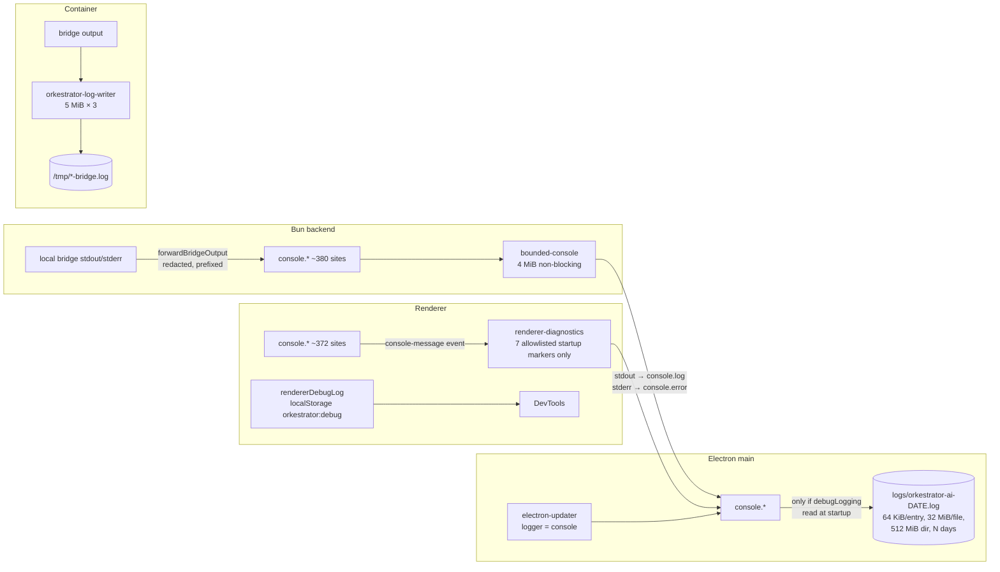

# Logging and database efficiency review

Date: 2026-10-29. Checked against `codebase-efficiency-review-ffd94f9611fa-r1`
at `79f3bc97e` (same tree as `main`).

## Contents

1. [Scope and method](#scope-and-method)
2. [Executive summary](#executive-summary)
3. [How logging works today](#how-logging-works-today)
4. [Logging findings](#logging-findings)
5. [Metrics and diagnostics findings](#metrics-and-diagnostics-findings)
6. [Database findings](#database-findings)
7. [Recommendations](#recommendations), each with benefits, trade-offs and
   other considerations
8. [Proposed user controls](#proposed-user-controls)
9. [Suggested order of work](#suggested-order-of-work)
10. [Appendix: evidence and limits](#appendix-evidence-and-limits)

## Scope and method

The question was whether Orkestrator records **the right amount** of
operational data: enough to diagnose problems, without writing so much that
it costs disk, I/O, CPU or privacy, and with the user able to control it.
Two areas were in scope:

- **Logging and diagnostics.** Backend, Electron main process, renderer, the
  five bridges, Docker containers, the CLI, metrics modules and diagnostics
  endpoints.
- **The database.** `orkestrator.sqlite`: schema, PRAGMAs, write volume, read
  cost, growth and retention, backups, and observability. Other on-disk
  stores were looked at briefly.

Five areas were reviewed in parallel: backend logging, bridges and Docker,
desktop/renderer/CLI and settings, metrics and diagnostics, and the
database. I re-checked the highest-impact claim from each area against the
code by hand. Two claims were corrected as a result:

- The backend *does* handle unhandled rejections (`installFatalRejectionGuard`,
  `apps/backend/src/main.ts:40`).
- Old logs *are* pruned automatically every 6 hours by retention. The
  "cleanup" button is an extra, manual action.

**Real data, read without content.** Unlike the
[2026-10-27 efficiency review](2026-10-27-efficiency.md), this review looked
at the maintainer's live data directory, read-only:

- Aggregate SQLite queries (`dbstat` page sizes, row counts and group-bys)
  against the newest hourly snapshot,
  `backups/hourly-2026-10-28T23-39-05-770Z.sqlite`.
- Line and byte counts per log tag in `logs/orkestrator-ai-2026-10-28.log`.

No prompt, path, message or other content is reproduced here. The
installation has **Save Logs for Debugging on** with 7-day retention.

Nothing was benchmarked. Numbers marked *(est.)* are reasoned from the code;
numbers marked *(obs.)* were observed in the data above.

## Executive summary

**Logging is cheap but blunt.** The infrastructure is careful about bounds
and privacy:

- A non-blocking console with a 4 MiB backlog cap.
- 64 KiB entry, 32 MiB file and 512 MiB directory caps.
- Bridge diagnostics are allowlisted and their ids are hashed.
- Drop markers are written whenever lines are lost.

On a busy day the debug log was only **2 MB / 12.5k lines** *(obs.)*, so
volume is not a problem today. The problems are control and coverage:

1. **One switch, no levels, restart required.** "Save Logs for Debugging"
   both persists *everything* and turns on bridge debug. There are no levels,
   categories, CLI flags or runtime changes. With it off, nothing is
   persisted at all, so the first occurrence of a problem is never captured.
2. **What fills the log is not what helps.**
   - 85% of the log's bytes are once-a-minute `[bridge-diagnostics]`
     heartbeats *(obs.: 1.74 MB of 2.05 MB)*. Most of them report a healthy
     turn.
   - Three electron-updater "differential download" dumps produced about
     7,900 of the 12,500 lines *(obs.)*.
   - Meanwhile, important failures are silent:
     - Losing the registry writer lease, which silently stops all scheduled
       jobs.
     - A local bridge process exiting.
     - Pi and Cursor quietly starting a fresh conversation when resume fails.
     - Every Docker bridge relaunch running `rm -f` on the previous bridge's
       log, deleting exactly the log needed to explain the crash.
3. **A few loops can flood under a persistent fault.** The 250 ms tmux poll
   loop and the 2 s activity jobs warn on every failure with no throttle.
   There are already five one-off throttle helpers, but none of these loops
   uses one.
4. **Raw error objects (~72 backend sites) can carry unbounded command
   output** into the log, through `CommandFailedError`'s `stdout`/`stderr`.
   That is at odds with the AGENTS.md rule that logs never hold file or
   terminal contents.
5. **Renderer diagnostics are unreachable in the packaged app.** There are no
   DevTools, no UI for the `orkestrator:debug` flag, and renderer errors are
   deliberately not persisted.
6. **One setting is a no-op.** "Codex Raw Event Logging" defaults to on, but
   nothing has passed its environment variable to the bridge since the
   Tauri→Electron migration (#34).

**The database is dominated by one feature.** The app's own stores are tiny:
**130 rows, about 0.6 MB** *(obs.)*. The 870 MB database is about **90%
change-tracking measurement file rows**: 1.8M rows, 691 MiB plus a 95 MiB
index *(obs.)*.

- Most of these rows come from "net" measurements that list up to **58,000
  files each**. About 95% of them come from a single top-level directory in
  one project.
- Superseded measurements are pruned **256 rows per publish** while up to
  28,000 are inserted. The database swung from **408 MB → 1.36 GB → 870 MB
  in one day** *(obs.)*, and each swing goes through `secure_delete` zeroing
  and `synchronous=FULL` fsyncs.
- Hourly `VACUUM INTO` snapshots copy all of it: **6.2 GB of backups on disk**
  *(obs.)*.
- The rest of the change ledger (frames, evidence, operations, turns)
  **never shrinks** and is not cleaned up when an environment is deleted.

The highest-value changes, in order:

1. Bound measurement file rows, and prune superseded measurements fully.
2. Move the ledger out of the hourly snapshot.
3. Add log levels and categories with live reload.
4. Close the silent-failure gaps with a small always-on "essential" tier.
5. Add an "Export diagnostics" bundle.

## How logging works today

| Control | Where | Takes effect |
| --- | --- | --- |
| **Save Logs for Debugging** (`global.debugLogging`) | Settings → Debug (`GlobalSettings.sections.tsx:2128`) | File capture: after app restart. Bridge debug (`ORKESTRATOR_BRIDGE_DEBUG`): on next bridge start |
| Keep logs for N days (1–3650, default 7) | Same | After restart |
| Log storage size, open folder, clean up | Same (`:2190-2262`) | Immediately |
| Codex Raw Event Logging | Settings → Experimental (`:2275`) | **Never** (see L8) |
| `orkestrator:debug` in localStorage | No UI; needs DevTools | Next reload |
| `ORKESTRATOR_RECURRING_METRICS=0` | Environment only | Startup |
| `<NAME>_BRIDGE_DEBUG` legacy flags | Environment only | Bridge start |
| `orkestrator --fix <agent>` | CLI (`packages/cli/src/client/fix.ts`) | Hands log files to an agent to draft an issue |

Not available anywhere:

- log levels or per-area categories;
- `--verbose`, `--debug` or `--log-level` flags (`apps/backend/src/server-flags.ts`,
  `packages/cli/src/client/argv.ts`);
- runtime reload of logging settings;
- "export diagnostics";
- crash reporting. Nothing leaves the machine, which is a deliberate and good
  default.

## Logging findings

Severity: **High** means it loses evidence needed to diagnose real failures,
or can write unbounded or sensitive content. **Medium** means it is wasteful
or misleading. **Low** is hygiene.

### L1. One coarse switch, and a restart to change it (High)

`installProductionApplicationLogging` reads `config.json` once at startup
(`packages/protocol/src/node/application-logging.ts:79-96,326-327`) and
tees every `console.*` call into the file. The same boolean also becomes
`ORKESTRATOR_BRIDGE_DEBUG=1|0` on every bridge launch
(`apps/backend/src/core/commands-servers.ts:833`,
`commands-registry-servers.ts:244,407,561,698`, `commands-containers.ts:874,942`).

Consequences:

- **Two meanings, two activation rules.** "Persist what is already printed"
  and "make bridges print more" are bundled. Toggling the switch changes
  bridge verbosity at the next bridge start but file capture only after an
  app restart. The UI says "requires an app restart" but doesn't offer one.
- **Off means nothing is kept.** With the default `false`, a packaged app's
  stdout goes to `/dev/null` (launchd), so even `console.error` from a
  backend crash is lost. Users have to reproduce the problem after turning
  logging on.
- **No levels.** `console.debug` and `info` always print (`bounded-console.ts:79`).
  The backend has no `LOG_LEVEL`. Bridge stdout is forwarded as
  `console.debug` but is always emitted.

### L2. What actually fills the log (Medium)

From the live log for 2026-10-28 *(obs.)*:

| Source | Lines | Bytes | Share of bytes |
| --- | ---: | ---: | ---: |
| `[bridge-diagnostics]` heartbeats and lifecycle events (mostly Claude) | 2,805 | 1.74 MB | **85%** |
| electron-updater differential-download plans (3 entries, about 2,600 lines each, unprefixed) | ~7,900 | 0.11 MB | 5% |
| Everything else: bridge lifecycle, errors, startup, `[diff-stats]`, `[local-server]` … | ~1,800 | ~0.2 MB | 10% |

- **Heartbeats.** `BridgeRunDiagnostics` writes a snapshot every 60 s per
  active scope, whether or not anything changed
  (`packages/protocol/src/node/bridge-diagnostics.ts:221-226`). The snapshot
  is valuable when a turn stalls, which is why it exists. For a healthy turn
  it is about 620 bytes a minute of noise. It is also the one category a
  user would most want to switch on and off independently.
- **Updater dump.** electron-updater uses `console` as its default logger.
  Its block-map plan is a pretty-printed array of `{start,end,kind}`, so it
  lands in the log as thousands of unprefixed lines (first seen at
  `02:08:27.996Z DEBUG [`). This made up most of the line count. It is
  harmless, but it makes the log hard to grep, and it is pure noise.
- **Multi-line entries.** Bridge output is forwarded as one call per chunk,
  so only the first line gets the `[kind:env]` prefix
  (`apps/backend/src/core/bridge-output-redaction.ts:50-54`,
  `commands-servers.ts:1783`). The same applies to stacks and pretty-printed
  objects.

### L3. Hot loops that warn without a throttle (Medium)

None of these produce output in normal operation. Under a *persistent* fault
they repeat for as long as the fault lasts:

| Site | Rate under a fault *(est.)* |
| --- | --- |
| `apps/backend/src/core/tmux-session-manager.ts:607,615,628,649,667`: transcript discovery, poll snapshot, drain, tail. Each logs a raw error | Up to 4 lines/s per Claude-tmux tab (250 ms loop, `tmux-shared.ts:40`) |
| `apps/backend/src/core/index.ts:1739-1781`: the keyed activity jobs (`[backend] Failed to <label>`) | About 2 lines/s during a storage fault (2 s fixed rate) |
| `web-annotation-service-requests.ts:1363`: reconcile pass failed | Every 3 s |
| `preview-publication.ts:349,357`: certificate refresh | Every 60 s indefinitely |
| `commands-servers.ts:768`: "not answering… not restarting it yet" | About 60 lines per incident |
| `apps/web/src/hooks/useTerminal.ts:1118,1130`: write to a dead terminal | **Once per keystroke** |

Five bespoke throttles already exist:

- the event-loop stall monitor's 30 s fold;
- `PendingRenameFailureLog`, which logs at powers of two;
- agent mail's once-per-reason log;
- `warnedOutdatedBridge`;
- `loggedKeptBranches`, which is an unbounded `Set`.

No shared primitive exists, and none of the loops above uses any of these.

### L4. Silent failures: too little logging (High)

The backend has about **731** `.catch(() => undefined|null|…)`, **181** empty
`catch {}` and **196** `catch { return … }` sites *(est., ripgrep)*. Most are
legitimate best-effort cleanup. The ones that hide real incidents:

| What fails silently | Where | Effect |
| --- | --- | --- |
| Registry writer lease lost or unreadable | `apps/backend/src/core/registry-writer-lease.ts:127-150,170-177` | `isWriter()` gates scheduled jobs (`core/index.ts:2015`). **Schedules stop firing with no log line.** |
| SQLite lease heartbeat fails | `storage-database.ts:1227-1236` | The lease can go stale and be taken over with no trace |
| Local bridge process exits | `commands-servers.ts:1154-1176` (exit handler logs neither code nor signal) | An agent "vanishes" mid-turn |
| Pi session restore fails | `bridges/pi-bridge/src/agent-session.ts:980-984` | **Quietly starts a fresh session**, so the user loses model context and nothing records why |
| Cursor resume fails | `bridges/cursor-bridge/src/agent-session.ts:554-562` | Same |
| ACP agent process exits; ACP HTTP 500s | `bridges/acp-bridge/src/acp-context.ts:1136-1143`, `acp-server.ts:33-43` | Shown only in UI state or the HTTP body |
| Cursor/Pi turn failures | `cursor prompt.ts:354,462`, `pi prompt.ts:447,668` | Shown only in UI state |
| Environment deletion side steps | `commands-servers.ts:1424,1481,1572`, `container-replacement.ts:947,961` | Orphaned sessions, layouts, branches |
| WAL scrub checkpoint fails | `storage-database.ts:844-846` | Deleted content may persist in the WAL longer than documented |
| Change-tracking retention report | `change-tracking/service.ts:242` | Computed, then discarded |
| **Docker bridge log deleted on relaunch** | `commands-containers.ts:919`, `commands-registry-servers.ts:391` (and the Pi/OpenCode equivalents) | `rm -f /tmp/<bridge>.log` runs before each start, so **the crashed bridge's log is deleted exactly when it is needed**. The rotated `.1` and `.2` files are left behind |

Two related gaps:

- Cursor and Grok container bridge logs have no retrieval command; only a
  tail is attached to a startup error.
- The backend has no `uncaughtException` handler and Electron has no
  `crashReporter`. Unhandled *rejections* are logged and survived
  (`packages/protocol/src/fatal-rejections.ts`).

### L5. Error formatting can leak or bloat (High for privacy, Low for volume)

Errors are formatted four different ways:

- the raw object, about 72 sites;
- unbounded `error.message`, 81;
- the error name only, 45;
- a bounded helper (`conciseError`, `boundedError`, `redactCleanupError`), 24.

`util.format` prints an error's own enumerable fields.
`CommandFailedError` carries the child process's full `stdout` as a field and
its `stderr` as the message (`apps/backend/src/core/shell.ts:32-56,325-348`).
So for example `console.warn("[ElectronBackend] Failed to rename local git
branch:", error)` (`commands-agent-support.ts:745,787`) can write a whole git
output into the log.

Other dumps:

- the full `gh pr list` output (`commands-review.ts:1460`);
- unbounded stacks or `JSON.stringify` of any rejected object in the fatal
  guard;
- per-request stacks in `gateway-lifecycle.ts:207`.

The bridges print more raw errors that may include the SDK's stderr tail:

- **Claude:** `routes/session.ts` has about 15 sites;
  `session-manager-prompt-handlers/user.ts:107` logs the tool error text;
  `routes/session.ts:239` logs the session title.
- **Codex:** about 7 sites.

These lines are always written in Docker and are persisted locally whenever
debug logging is on. `bridge-diagnostics.md` says raw error messages are
excluded; that holds for the diagnostics channel but not for these direct
`console.error` calls.

The entry cap (64 KiB) bounds the size. The concern is *content*, not volume.

### L6. The Electron relay is always on, lossy and unbatched (Medium)

`apps/desktop/electron/backend-process.ts:805-869` relays backend output.

- **Always on.** It runs whether or not file logging is on, so with logging
  off every backend line is formatted and written to a `/dev/null` stdout on
  the main thread.
- **Levels are collapsed.** stdout becomes `LOG` and stderr becomes `ERROR`.
  Backend warnings therefore appear as `ERROR`, and bridge `console.debug`
  appears as `LOG`. The live log has **no `WARN` lines at all** from the
  backend *(obs.)*.
- **Errors of omission.** After the ready message, every stdout line still
  pays a thrown-and-caught `JSON.parse`, and a line that *is* a JSON object
  is silently dropped. The reader has no line-length bound (readline buffers
  the whole line).
- **Unbatched file writes.** Each entry does `mkdir(recursive)` plus
  `appendFile`, which opens, writes and closes the file, in a strictly serial
  promise chain (`application-logging.ts:354-364`). That is fine at
  12.5k lines a day. Under a burst it caps throughput at filesystem latency,
  and the 4 MiB queue starts dropping.

### L7. Renderer diagnostics are unreachable in the packaged app (High for supportability)

- DevTools open only when `isDev` (`apps/desktop/electron/window.ts:133-135`),
  and the menu has no toggle (`application-menu.ts:97-186`). A user therefore
  cannot set `orkestrator:debug`, and cannot see the errors from
  `MessageRenderBoundary`/`RichBlockFrame`.
- By design (privacy), only seven exact `[DesktopStartup]` markers cross into
  the persistent log (`packages/protocol/src/debug-logging.ts:7-24`). Every
  renderer `console.*` call still raises a cross-process `console-message`
  event in main just to be compared and thrown away.
- `rendererDebugLog` is used at only about 4 call sites. Lifecycle trace logs
  run unconditionally:
  - `paneLayoutStore.ts:544` and others, on each environment switch or tab
    move;
  - `PersistentTerminal.tsx` (30 sites);
  - `useTerminal.ts:292-309`, on each mount and unmount;
  - `TerminalContainer.view.tsx` `[setup-terminal]`, about 9 sites in an
    effect that re-runs on every environment-state change.
- The remote web client and the iOS shell (no logging at all) have no
  persistence path.

### L8. "Codex Raw Event Logging" does nothing (Medium, user-visible)

- The setting defaults to **on** (`storage-shared-config.ts:450`).
- Its help text says it persists extra Codex event payloads under
  `<logs>/codex-raw` (`GlobalSettings.sections.tsx:2275-2330`).
- The bridge reads `ORKESTRATOR_CODEX_RAW_LOG_DIR`
  (`bridges/codex-bridge/src/index.ts:322`), but **no backend code sets it**,
  and `writeCodexRawLog` is reachable only through `__testing`.
- `git log -S` shows the wiring was last touched in the Tauri→Electron
  migration (#34).

As a result, users are told data is being captured when it isn't. In this
case that is the safe direction, because nothing is written.

### L9. Docker container logging (Medium)

Strengths:

- `orkestrator-log-writer.sh` rotates at 5 MiB × 3 and writes files as 0600.
- The Docker log driver is set to `local`, max 10 MB × 3
  (`container-resources.ts:203-221`).

Gaps:

- **Unbounded fallbacks.** The writer falls back to an *unbounded* `cat >>`
  when perl is missing (`orkestrator-log-writer.sh:35-39`). Images that don't
  ship the writer use a plain `>` redirect (`container-log-bounds.ts:54`).
- **Daemon driver may be uncapped.** When `local` is unavailable, no log
  options are passed, so the daemon default applies, which is often an
  unbounded `json-file`.
- **Disk-full writes vanish.** On a full disk the writer silently drops data
  and its size accounting runs ahead of the bytes actually on disk
  (`:53-72,97-99`).
- **Relaunch deletes the log.** See L4.

### L10. Consistency (Low)

- **Tag variants.** `[backend]` (107) / `[Backend]` (6) / legacy
  `[ElectronBackend]` (16); `[build-pipeline]` / `[BuildPipeline]` /
  `[FeatureBuild]`; `[native-agent]` / `[NativeAgentService]`; `[pr]` /
  `[pr-monitor]`; 7 untagged sites.
- **Level misuse.** Expected states are logged at `warn`, for example
  "Interrupted deletion remains pending" at `core/index.ts:1540`. All bridge
  stderr is logged at `error`.
- **Buffered debug logger.** `createBufferedDebugLogger` is used only by the
  Claude bridge. Its metrics are last-write-wins rather than aggregated, all
  sessions share one 16-label budget, and it does not flush on shutdown, so
  up to 60 s is lost on exit (`bridge-diagnostics.ts:402-463`).
- **Dead code.** `cursorDebugEnabled` (`cursor-bridge/src/run-diagnostics.ts:9`)
  has no production caller.
- **Unfiltered environment.** Local bridges inherit `{...process.env}`
  (`commands-servers.ts:823`). A stray `DEBUG`, `RUST_LOG` or
  `DEBUG_CLAUDE_AGENT_SDK` in the shell that launched Orkestrator therefore
  turns on vendor debug output, which then lands in the log.

## Metrics and diagnostics findings

The backend has good in-memory instruments:

- `GatewayMetricsStore`;
- `RecurringWorkMetrics`, with per-job counts, duration histograms and
  storage-read attribution;
- the event-loop stall monitor;
- `PreviewMetrics` and `WebAnnotationMetrics`;
- persisted compatibility-path counters.

| # | Finding | Evidence |
| --- | --- | --- |
| M1 | **All in-memory metrics reset on restart**, and nothing records backend RSS, heap or CPU. "Why did it restart?", "is it leaking?" and "which job burns CPU?" can't be answered after the fact | No `process.memoryUsage` in backend or desktop; recurring metrics are memory-only |
| M2 | **The richest endpoint is not user-reachable.** `GET /__orkestrator/metrics` (stalls, recurring work, gateway/SSE/replay health, console drop counters) has no UI and isn't mentioned in the `--fix` prompt. Several comments call it `/api/metrics` | `gateway-handlers.ts:322-343`, `packages/cli/src/client/fix.ts:418-424` |
| M3 | **Write-only metrics.** `ProgressiveReadMetrics` (allocates per read) and `transcript-artifacts` `ArtifactMetrics` are only read by tests. Artifacts also log the same events with `console.warn`, so the log line is the only record that survives | `native-agent-progressive-metrics.ts`, `transcript-artifacts/metrics.ts` |
| M4 | **Five bespoke bounded-metric stores with incompatible histograms**: cumulative buckets, per-bucket counts, sampled quantiles, and sum/max only | `web-annotation-metrics.ts:62`, `recurring-work-metrics.ts`, `preview-metrics.ts`, `workflow-result-metrics.ts`, `gateway-support-core.ts:299-313` |
| M5 | **Small inefficiencies.** `PreviewMetrics` uses O(n) `Array.shift()` per sample. Every `/metrics` GET does a synchronous SQLite read or write through the compatibility counters | `preview-metrics.ts:41`, `compatibility-path-usage.ts:189` |
| M6 | **No database metrics at all**: size, WAL, freelist, per-table bytes, transaction or lease wait, `SQLITE_BUSY` counts. `livePageBytes()` exists but only backups use it | `storage-database.ts:850` |

## Database findings

### What is already good

The storage layer is carefully engineered:

- Row-diff writes skip unchanged rows (`storage-database.ts:590`) and
  identical single-row values (`:716`).
- Keyed and owner-scoped reads.
- The in-memory change journal costs no DB writes (4,096 entries / 2 MiB).
- Transactions are never held across `await`.
- Leases are cross-process.
- `journal_size_limit` is 8 MiB.
- Hourly snapshots run in a low-priority child process (prior ST-13 is
  fixed).
- Most engines are bounded: usage history, agent mail, public operations,
  web annotations, scheduled jobs, display tails, workflow results, the
  cleanup ledger.

None of the problems below is in the app's own stores, which held **130 rows
/ about 0.6 MB** in the snapshot *(obs.)*.

### D1. Change-tracking measurement rows are about 90% of the database (High)

Snapshot breakdown *(obs., `dbstat`)*:

| Object | Size |
| --- | ---: |
| `change_measurement_files` | 691 MiB |
| its primary-key index | 95 MiB |
| `change_measurements` | 9 MiB |
| `change_frames` | 6 MiB |
| `change_evidence` | 5 MiB |
| everything else | < 10 MiB |
| **Total** | **870 MB** |

File rows by measurement kind *(obs.)*:

| Owner / scope | Measurements | File rows | Largest |
| --- | ---: | ---: | ---: |
| segment / `thread-net` | 94 | 706,393 | 28,224 |
| environment / `environment-net` | 38 | 570,736 | 58,051 |
| turn / `turn-net` | 153 | 527,659 | 28,095 |
| operation (`tool-effect`, `observation-window`, `tool-payload`) | 708 | 1,914 | 50 |

Of all file rows *(obs.)*:

- 940k are `status=unknown, kind=unknown, body=not-retained`;
- about 750k are `deleted`;
- about **1.72M of the 1.81M fall under one top-level directory** of one
  project.

A single bulk change (a large directory added or removed in a worktree) is
re-listed file by file in every net measurement of every turn, segment and
environment that spans it. Operation-scoped measurements are already capped
at 50 files; the net scopes have no cap.

### D2. Insert-then-delete churn (High)

- `MEASUREMENTS_KEPT_PER_OWNER = 2`, but each publish prunes at most **256
  file rows** (`change-tracking/measurement-service.ts:211-218`) while
  inserting up to 28k–58k. The backlog waits for the hourly retention sweep,
  which deletes 256 rows per transaction (`retention.ts:119-132`).
- Measurement ids include a fresh snapshot uuid (`worktree-owner.ts:398`), so
  an unchanged file set still produces a new measurement.
- Provisional capture runs up to once a second per local worktree
  (`policy-registry.ts:76`), at about 6 transactions per capture.

Observed: the hourly snapshots went **408 MB (08:36) → 1.36 GB (18:39) →
870 MB (23:39)**, and `change_measurement_files` went 0.87M → 2.75M → 1.8M
rows. That is **at least about 1 GB a day inserted and then deleted** *(est.)*.

Each delete is zero-written (`secure_delete=ON`) and each commit is fsynced
twice over (`synchronous=FULL`). The estimated total is about 600–1,000
fsynced commits a minute in a busy session with 5 environments and 3 running
agents, dominated by change tracking *(est.)*.

### D3. Backups multiply the ledger (High for disk)

The hourly `VACUUM INTO` copies the whole file, ledger included: **6.2 GB in
`backups/`** for an 870 MB database *(obs.)*. That is about 1 GB written per
active hour.

The trigger fingerprint covers only app-store revisions
(`storage-backups.ts:484-499`), which has two effects:

- any tiny app-store change causes a full ledger copy;
- ledger-only changes never trigger a backup.

The second is fine, because the ledger is rebuildable and observational
data.

### D4. The rest of the ledger never shrinks (Medium, growing)

These are never deleted:

- `change_frames`, `change_operations`, `change_evidence(_chunks/_bodies/_gaps)`;
- `change_capture_attempts`;
- turn boundaries, tool windows, thread segments, bindings;
- restore tokens and operations;
- the `opturn:`/`turnops:` meta keys;
- evidence-body files (`evidence-body-store.ts:74` `remove()` has no caller).

Nothing in change tracking runs when an environment is deleted. Turn and
segment measurements are kept "2 per owner" forever, because the owners
themselves are never retired.

Projection *(est.)*: +70–100 MB a day retained at current usage, so about
2.5–3 GB after a month and 6–9 GB after a quarter, before backups multiply
it.

Elsewhere, Kanban, notes, feature plans and Kanban images survive project
removal. Completion-comment records have no delete path.

### D5. Durability settings are uniform, not tiered (Medium)

`synchronous=FULL`, `secure_delete=ON` and `auto_vacuum=INCREMENTAL` are set
per connection (`storage-database.ts:256-266`) and apply to all data.

- **`synchronous=FULL`.** In WAL mode, `NORMAL` already survives a process
  crash without corruption; FULL adds a WAL fsync per commit, which helps
  only against power loss or an OS crash. On macOS, `fsync` without
  `PRAGMA fullfsync` does not flush the drive cache, so FULL buys less than
  `storage.md` implies. Bun's build was not checked.
- **`secure_delete=ON`.** Zero-writes freed pages. That roughly doubles page
  writes for high-churn rows *(est.)*: measurement files, 512 KB display
  tails, and 40–60 KB native-session rows rewritten whole.
- **Where the privacy case applies.** It is strong for mail, prompts and
  sessions. It is weak for ledger aggregates (counts, object ids, encoded
  paths).

Other PRAGMA gaps:

- `PRAGMA optimize`/`ANALYZE` never runs.
- `cache_size`, `mmap_size` and `temp_store` are defaults.
- `foreign_keys=ON` does nothing, because no foreign keys are declared.
- Each process opens several connections (the review counted nine), each
  with its own small page cache.

### D6. A truncating checkpoint can stall the event loop during a backup (Medium, likely)

`scrubDeletedContent()` runs `PRAGMA wal_checkpoint(TRUNCATE)`
(`storage-database.ts:838-847`) on every delete path. SQLite's TRUNCATE mode
invokes the busy handler until all readers move to the newest snapshot. The
hourly child-process copy holds a read snapshot for minutes. A delete during
that copy can therefore block the backend's event loop for up to
`busy_timeout` (10 s), after which the error is swallowed. The same long
reader also stops `journal_size_limit` from bounding the WAL.

This was not reproduced. It would show up as a ~10 s event-loop stall line
that coincides with an hourly backup.

### D7. Read paths (Medium, scales with history)

The 2026-10-27 report's storage findings were re-checked at this commit:

- **ST-7 still holds.** Keyed getters decode the whole store: `getEnvironment`,
  `getPromptQueue`, `getSession`, `getNativeAgentSession`.
- **ST-8 still holds.** A row write drops the whole-store cache.
- **ST-9 still holds.** Mail presence decodes even when messaging is
  disabled, and sizing uses `JSON.stringify(…, null, 2)`.
- **ST-11 still holds.** An insert scans the whole collection, because there
  is no `position` index.
- **ST-19 is partly fixed.** Pruning exists, but `activeTurns()` still uses
  `NOT IN`.

New:

- **`rows().list({values:false})` and `entry()` compute
  `length(CAST(value AS BLOB))`** (`storage-database.ts:1068,1102`). For a
  TEXT column the CAST forces SQLite to read every value, including overflow
  pages. Display-tail `put` calls this on every write, which may mean up to
  64 MiB read per put *(likely; confirm with a timing test)*.
  `octet_length(value)` (SQLite ≥ 3.43) or a stored byte count avoids it.
- **Usage-history `report()` and the hourly prune parse all rows** (up to
  20k), and the prune writes one transaction per changed row.
- **The change-tracking retention pass** does full scans (`turnsByAge`, a
  `LIKE` over diff identities) and deletes one snapshot per transaction.

### D8. Lease overhead (Low–Medium)

A leased mutation costs 3 fsynced commits (claim, write, release), plus a
heartbeat every `staleMs/3`, at least every 1 s. Waiters retry
`BEGIN IMMEDIATE` every 25 ms (`storage-database.ts:1200-1244`).

Some leases are taken only to *read*:

- `getAgentInteractionResolutionJournal` (`storage-native.ts:281-287`);
- `resetAgentMailInjectBackoff` on every presence flip, even when nothing
  changes (`storage-agent-mail-injects.ts:539-550`).

Each of these costs 2 commits with no data change.

## Recommendations

Each recommendation lists what to do, its **benefits**, its **trade-offs**,
and **other considerations**. IDs refer to the findings above.

### Logging

#### R1. Add levels and categories behind one small logging facade (L1, L2, L10)

Introduce `createLogger(category)` in `packages/protocol` (shared by the
backend, Electron and bridges), returning `error/warn/info/debug/trace`.
Each call has:

- a **category** from a fixed vocabulary: `storage`, `bridge.claude`,
  `bridge.diagnostics`, `tmux`, `docker`, `git`, `scheduler`, `mail`,
  `gateway`, `preview`, `updater`, `change-tracking` and so on;
- a **level**;
- an **event label**: a static string, like the Claude bridge allowlist;
- optional **scalar fields**.

Output is one line per entry. A plain-text form keeps the existing
`[tag] message` readability; an optional JSON-lines form is for tooling. The
effective level per category comes from config, with a global default of
`info`.

Migrate incrementally:

- wrap `console.*` so existing calls map to category `legacy` at their
  level;
- move hot or high-value sites first (bridges, tmux, storage, scheduler,
  updater);
- add a lint rule against new raw `console.*` calls in backend and bridge
  code.

- **Benefits**
  - Users and maintainers can turn on exactly the area under investigation,
    for example `bridge.diagnostics=debug` and everything else at `warn`.
  - Levels survive the Electron relay (see R7).
  - Tags become consistent.
  - Static event labels make logs aggregatable and keep content out.
- **Trade-offs**
  - It touches many files (about 380 backend sites, about 168 in bridges and
    about 40 in Electron), although it can be done gradually.
  - It adds a level check per call. That is negligible if arguments are
    built lazily or the call is guarded.
  - Structured fields are less flexible than free-form messages.
- **Other considerations**
  - Keep it dependency-free. pino and winston would add weight to five
    bridges and the container image, and Bun's console is already wrapped.
  - Category names belong in `packages/protocol` so the settings UI can list
    them.
  - Keep the AGENTS.md privacy rule enforceable: the facade should accept
    scalars and `Error`s (formatted by R5), never arbitrary objects.

#### R2. Make logging settings live, and split "persist" from "verbosity" (L1)

- Have the backend watch `config.json` changes (it already owns config
  writes) and push the effective log policy:
  - to its own facade;
  - to Electron over the existing IPC/SSE;
  - to running bridges, via a small `POST /debug/log-policy` route or a
    policy file each bridge polls cheaply.
- Install the file sink at startup **always**, and gate entries by policy,
  so enabling persistence needs no restart.
- Separate two settings: **"Save logs to disk"** (persistence and retention)
  and **"Log detail"** (levels per category).

- **Benefits**
  - No restart, so users can turn on detail at the moment a problem appears.
  - Bridges can change verbosity without being restarted. That matters
    because restarting a bridge can destroy the state being debugged.
- **Trade-offs**
  - It adds a control path to every bridge, which bridge owners must keep
    authenticated.
  - Policy changes race with in-flight lines. That is acceptable for logs.
- **Other considerations**
  - Docker bridges need the same route. The env var stays as the
    startup default.
  - Record each policy change in the log itself (who, when, new policy), so
    a reader knows why the detail changes.

#### R3. One rate-limit/dedupe primitive, used by every recurring loop (L3)

Add `logThrottled(key, level, …)` to the facade:

- the first occurrence is logged;
- repeats within a window are counted;
- one summary line is written per window ("suppressed N in 60 s");
- one "recovered" line is written when the condition clears.

This is the `PendingRenameFailureLog` behaviour generalised. Apply it to:

- the tmux poll loop;
- the activity jobs;
- annotation reconcile;
- certificate refresh;
- "bridge not answering";
- renderer per-keystroke warnings.

Retire the five bespoke variants, and bound `loggedKeptBranches`.

- **Benefits**
  - A persistent fault costs a few lines a minute instead of thousands an
    hour.
  - The recovery line gives fault duration for free.
- **Trade-offs**
  - Intermediate errors that differ in detail but share a key are
    collapsed.
- **Other considerations**
  - Key by site plus error class or code, not by message. Messages can
    contain content and vary unboundedly.
  - Bound the key map.

#### R4. Make bridge heartbeats change-driven (L2)

- Keep lifecycle events.
- Emit the periodic snapshot only when one of these holds:
  - something changed since the last snapshot (phase, pending tools, the
    counters' deltas cross a threshold); or
  - a stall signal is present (`lastDeltaAgoMs` over N seconds, a tool
    pending over N seconds, `tickDelayMs` high); or
  - every 10 minutes as a keepalive.
- Give `bridge.diagnostics` its own category, so it can run at `info`
  (stall-only) while `debug` keeps today's per-minute stream.

- **Benefits**
  - About 85% of today's log bytes go away.
  - Stalls, the reason these exist, still produce a snapshot at the right
    moment.
- **Trade-offs**
  - A gap with no snapshot is ambiguous: "healthy" or "the diagnostics
    timer died". The keepalive bounds that ambiguity.
- **Other considerations**
  - `docs/architecture/bridge-diagnostics.md` describes "once a minute"
    semantics that support guidance relies on. Update it.
  - Also flush `createBufferedDebugLogger` on shutdown, and aggregate its
    metrics instead of keeping the last value.

#### R5. A single safe error formatter (L5)

Add `describeError(error, { maxBytes })`. It returns:

- name, code and errno;
- a bounded, redacted message;
- the first N stack frames with paths relative to the app.

It never returns enumerable fields, `stdout`, `stderr`, `cmd` or `spawnargs`.
The facade uses it for any `Error` argument. Have `CommandFailedError`
implement `toJSON`/`[util.inspect.custom]` so that even raw `console` calls
stay bounded.

- **Benefits**
  - It closes the main content-leak path.
  - One consistent format is easier to grep.
  - It bounds entry size well below 64 KiB.
- **Trade-offs**
  - Losing child stdout and stderr in the log makes some git or Docker
    failures harder to diagnose.
  - Mitigation: keep a redacted tail of stderr (for example 512 bytes) at
    `debug` in the relevant category only.
- **Other considerations**
  - Apply the same formatter in the bridges, where the Claude SDK error
    carries a stderr tail.
  - The existing `redactSecrets` should run after truncation, not before, so
    a secret split by the cut can't escape it.

#### R6. An always-on "essential" tier that closes the silent gaps (L4)

Even with "Save logs to disk" off, keep a **small, always-on, bounded event
log**:

- for example, a rotating 1–4 MiB file, or a 1,000-row ring table in SQLite;
- holding only `error`, plus a curated set of lifecycle events:
  - backend and bridge start and exit, with code and signal;
  - writer lease lost or regained;
  - resume fallback to a fresh session;
  - migration and snapshot failures;
  - event-loop stalls of 10 s or more;
  - Docker bridge relaunch;
  - unhandled rejections.

Specific fixes:

- Log writer-lease loss at `warn`, and surface "This backend is no longer
  the writer; schedules paused" in the UI.
- Log local bridge `exit` with code and signal (`commands-servers.ts:1154`).
- Log and surface Pi and Cursor resume fallbacks ("could not resume, started
  a new conversation").
- **Rotate instead of `rm -f`** in Docker relaunch scripts (move
  `x.log` → `x.prev.log`), and add log retrieval commands for Cursor and
  Grok.
- Log ACP exits and 500s, and Cursor and Pi turn failures, at `warn` with
  bounded fields.

- **Benefits**
  - The first occurrence of a crash or silent fallback is captured without
    the user having enabled anything.
  - "Schedules silently stopped" becomes visible.
- **Trade-offs**
  - It writes a little to disk by default: about tens of KB a day *(est.)*.
  - It changes the "nothing persisted unless enabled" stance, so the
    contents must be strictly content-free.
- **Other considerations**
  - Store it under `logs/essential/` with a fixed small cap, independent of
    the debug retention, and say so in the Settings text.
  - The SQLite option is queryable and backs up for free, but adds writes to
    a database that is already busy. A file is simpler.

#### R7. Fix the Electron relay and file writer (L6, L2)

- Have the backend emit level-tagged lines, for example a one-character
  prefix, or route JSON lines over a side channel. Electron then re-emits
  each line at the right level and no longer drops JSON objects.
- Detach the startup `JSON.parse` listener after the ready message.
- Bound the readline line length.
- Skip the relay's console write entirely when nothing consumes it (packaged
  app, file logging off).
- Batch file appends: gather the entries pending in each tick or every
  ~100 ms into one `appendFile`, and keep the handle open while the day and
  index are unchanged.
- Give electron-updater a logger that logs only `info` and above to category
  `updater`.

- **Benefits**
  - Correct levels in the file.
  - Roughly 10× fewer syscalls under bursts *(est.)*.
  - Removes about 60% of the lines in today's log (the updater dump).
- **Trade-offs**
  - Batching can lose up to one batch on a hard crash. Flush synchronously
    for `error`.
  - A level prefix is a wire format between the backend and Electron, so it
    must be versioned with the backend.
- **Other considerations**
  - Standalone backends write their own file through the same writer, so
    the batching fix benefits both.

#### R8. Renderer diagnostics a user can actually turn on (L7)

- Add **Settings → Debug → "Renderer debug logging"**, which writes the
  `orkestrator:debug` key and reloads.
- Add **"Open Developer Tools"** to the Help menu, enabled while debug
  logging is on.
- Persist a **bounded, content-free renderer error ring** (error class,
  component boundary name, route, count; about 100 entries) to the backend.
  It goes into the essential tier and the diagnostics export.
- Move the lifecycle trace logs to `rendererDebugLog`.
- Throttle the per-keystroke warnings.

- **Benefits**
  - Renderer bugs reported by users leave a trace.
  - Less console traffic crossing into the main process.
- **Trade-offs**
  - DevTools in production lets a user see in-memory content. It is their
    own data, but it should be explicit and opt-in.
  - The error ring must not include messages or stacks if it is to stay
    within the current privacy rule.
- **Other considerations**
  - The remote web client could use the same ring through its gateway.
  - iOS would need `os_log` plus `isInspectable` behind a debug toggle.

#### R9. Remove or reconnect "Codex Raw Event Logging" (L8)

**Recommendation: remove it** (the toggle, the default and the `writeCodexRawLog`
path), unless subagent transcript validation is still active. If it is,
re-wire `ORKESTRATOR_CODEX_RAW_LOG_DIR` from the setting, **default it to
off**, give it a byte cap and retention, and move it under the new
categories.

- **Benefits**
  - The UI becomes honest again.
  - If re-wired, there is a working capture tool.
- **Trade-offs**
  - Raw provider events contain prompts and tool content. Re-wiring it
    creates a deliberate exception to the privacy rule.
- **Other considerations**
  - Defaulting a raw-payload capture to on would be a privacy regression the
    day it is re-wired. That is the main reason to fix this now.

#### R10. Docker log hygiene (L9)

- Make the writer's no-perl fallback bounded, using `head -c` or a simple
  size check.
- Emit a marker line when writes fail or rotation drops data.
- Fail container creation loudly, or warn once, when the `local` log driver
  is unavailable. Alternatively pass `json-file` with `max-size` and
  `max-file`, which every daemon supports.
- Filter the inherited environment for known vendor debug variables before
  spawning bridges, unless the user set them in an explicit "advanced
  environment" field.

- **Benefits**: bounded disk use in every configuration, and visible data
  loss.
- **Trade-offs**: filtering the environment can surprise a developer who
  deliberately exports `DEBUG=…`. Document the escape hatch.

### Metrics and diagnostics

#### R11. "Export diagnostics" bundle (M2, L7)

Add a Settings → Debug button and a CLI command
(`orkestrator diagnostics export`) that write a zip containing:

- the `/__orkestrator/metrics` snapshot;
- recurring-work diagnostics;
- bounded-console and log-drop stats;
- the event-loop stall history;
- the essential log (R6);
- the last N MB of debug logs, if enabled;
- DB size metrics (R17);
- app, Bun, Electron and OS versions;
- the effective log policy.

Show a manifest before saving. Reference it from the `--fix` prompt.

- **Benefits**
  - One artifact per bug report, so there's no need to talk users through
    finding files.
  - The existing, unused instruments start paying off.
- **Trade-offs**
  - It is a new surface that can leak. It must reuse the content-free rules,
    and ideally run a redaction pass over the log portion.
- **Other considerations**
  - Keep it local. There is no upload. That matches the current
    "nothing leaves the machine" stance.

#### R12. Persist a small rolling health summary (M1)

Every 5 minutes, append one content-free row to a bounded SQLite store (for
example 2,016 rows, 7 days) holding:

- RSS and heap;
- event-loop lateness percentiles;
- per-kind recurring-work duration and storage-read totals since the last
  row;
- DB, WAL and freelist bytes;
- bridge restarts;
- console and log drop counts.

Write a "clean shutdown" marker on exit, so the next start can tell "crashed"
from "quit".

- **Benefits**
  - Leaks, slow growth, restart causes and costly jobs become answerable
    after the fact.
- **Trade-offs**
  - About 300 small writes a day, which is trivial.
  - It is one more store to keep under the writer guards.
- **Other considerations**
  - It feeds R11 and could later back a "Health" settings page.

#### R13. Consolidate metric primitives (M3, M4, M5)

- Introduce one `BoundedSeries` (entry and byte caps, overflow key) and one
  histogram type (fixed buckets, per-bucket counts, plus count, sum and max).
- Port the five stores to them.
- Either expose `ProgressiveReadMetrics` and `ArtifactMetrics` through a
  diagnostics command, or delete them.
- Replace `PreviewMetrics.shift()` with a ring buffer.
- Make `/metrics` read the compatibility counters from memory.

- **Benefits**: less code, comparable snapshots, and no per-event work
  for data nobody reads.
- **Trade-offs**: churn in tests that assert exact snapshot shapes, and
  web-annotation histograms change meaning from cumulative to per-bucket.

### Database

#### R14. Bound measurement file rows (D1). Highest value

For `turn-net`, `thread-net` and `environment-net` measurements:

- store at most N file rows (for example 2,000, matching what a diff UI can
  usefully show);
- keep totals (`fileCount`, additions, deletions) and an `omittedFileCount`
  on the measurement;
- **collapse bulk directory changes** into one row per top-level directory
  when more than M files under it share a status;
- consider excluding paths that are ignored or `not-retained` from the
  per-file list altogether, since they carry no body and no line counts.

- **Benefits**
  - The database shrinks by an order of magnitude on this installation
    *(est.: about 870 MB → under 100 MB)*.
  - Backups, churn and checkpoint costs fall with it.
- **Trade-offs**
  - Per-file detail beyond the cap would have to be recomputed on demand
    (from snapshots or git) when a user expands a huge diff.
  - Totals for collapsed directories become approximate if the line counts
    were per-file.
- **Other considerations**
  - Check the change-tracking UI and restore flows for any that assume the
    measurement's file list is complete. Restore should use snapshots, not
    measurements.
  - Update `docs/architecture/change-tracking.md`.

#### R15. Prune superseded measurements fully, and skip no-change publishes (D2)

- When a measurement is superseded, delete the older one's file rows **in
  the same transaction**, or in a deferred job that deletes it completely
  and promptly, rather than 256 rows at a time.
- Before publishing, compare the new file-set digest with the current
  measurement's. If they are equal, update its `to_snapshot_id` and revision
  instead of inserting a new measurement.
- Reduce provisional capture frequency while a turn is idle.

- **Benefits**
  - Removes the about 1 GB/day insert-then-delete cycle and the 2–3× size
    swings.
- **Trade-offs**
  - A large single-transaction delete can block for tens of milliseconds.
    Combined with R14 that becomes small. Without R14, use the deferred
    variant.
  - "Keep the previous measurement for a reader still paging it" needs a
    short grace period, not a row budget.

#### R16. Retain the rest of the ledger by age and environment (D4)

- Add a retention pass keyed on finalized turns older than the archive
  window (the existing 90-day object policy is a natural anchor). It deletes
  their frames, operations, evidence, chunks and bodies, capture attempts,
  boundaries, windows and meta keys.
- Hook environment deletion so it tombstones and then purges that
  environment's ledger rows and evidence-body files.
- Batch deletes per transaction, by tens of turns rather than one snapshot
  each.

- **Benefits**
  - Bounded growth: the about 3 GB/month projection becomes flat.
  - Deleting an environment actually removes its history, which users
    expect.
- **Trade-offs**
  - "Restore to an old turn" stops working past the window. That is already
    true for objects at 90 days, so align the two windows.

#### R17. Take the ledger out of hourly snapshots (D3)

Two options:

- **Preferred:** move change tracking to its own database file
  (`change-tracking.sqlite`, opened via a separate connection or `ATTACH`).
  It is already its own engine with its own tables and its own object
  store. Back it up daily, or not at all, and treat it as rebuildable
  observational data.
- **Simpler:** keep one file but take hourly snapshots of only the app
  stores, using `VACUUM INTO` on a temporary database built from the core
  tables, plus a daily full copy.

- **Benefits**
  - Hourly backups drop from about 1 GB to about 1 MB each on this
    installation.
  - About 6 GB of disk is reclaimed.
  - The child copy finishes in milliseconds, which also removes most of the
    D6 window.
  - Separate files let each have its own PRAGMAs (R18).
- **Trade-offs**
  - Cross-database consistency between an app store and the ledger is no
    longer one transaction. Check whether any write spans both; the design
    notes suggest they don't.
  - Restore instructions in `storage.md` change.
- **Other considerations**
  - Moving tables requires a migration of up to about 1 GB. Run it after
    R14/R15 have shrunk the ledger, and use the existing pre-migration
    snapshot machinery.

#### R18. Tier durability and maintenance settings (D5, D6)

- **App stores:** keep `secure_delete=ON`. For `synchronous`, choose
  deliberately:
  - `NORMAL`: crash-safe and fsyncs only at checkpoint; or
  - `FULL` **plus `PRAGMA fullfsync=ON` on macOS** if power-loss durability
    is the actual goal, since FULL without fullfsync is the
    worst-of-both middle ground.
- **Ledger and display tails:** `synchronous=NORMAL`, and `secure_delete=FAST`
  or OFF.
- **Maintenance:**
  - Run `PRAGMA optimize` hourly and at close.
  - In `scrubDeletedContent`, use a PASSIVE checkpoint, and retry TRUNCATE
    from the maintenance loop when no backup lease is held.
  - Consider `cache_size` and `mmap_size` for the main connection once the
    ledger is smaller.
  - Remove the inert `foreign_keys=ON`, or declare real keys.

- **Benefits**
  - Fewer fsyncs and zero-writes on the hottest paths.
  - Avoids the 10 s checkpoint stall.
  - Better query plans as tables grow.
- **Trade-offs**
  - `NORMAL` can lose the last few transactions on power loss, though never
    with corruption.
  - `secure_delete=FAST` leaves deleted ledger content in free pages until
    reused, which affects the documented scrub guarantee for that data.
    Document the tiering in `storage.md`.
- **Other considerations**
  - `secure_delete` and `synchronous` are per connection, so tiering is
    easiest once the ledger has its own connection or file (R17).

#### R19. Database observability (M6, D9)

- Add the following to `/metrics`, the health summary (R12) and a small
  **Settings → Storage** panel:
  - file, WAL and freelist bytes;
  - top tables by `dbstat` (computed off the hot path at most hourly, since
    `dbstat` scans);
  - transaction and lease-wait histograms;
  - `SQLITE_BUSY` counts;
  - the last `RetentionReport`;
  - backup count and bytes.
- Log lease timeouts at `warn` with the lease name and the holder's age.

- **Benefits**
  - The D1 problem would have been visible to the user, and to us, without
    manual SQL.
  - Lease contention stops masquerading as generic event-loop stalls.
- **Trade-offs**
  - `dbstat` on a 1 GB file is not free. Sample it, and run it in the
    backup child where possible.

#### R20. Finish the keyed-read work and fix the blob-length query (D7, D8)

- Finish ST-7 and ST-8 from the previous report.
- Replace `length(CAST(value AS BLOB))` with `octet_length(value)`, or with a
  stored size column.
- Remove leases that are taken only to read
  (`getAgentInteractionResolutionJournal`, the no-op
  `resetAgentMailInjectBackoff`).
- Batch the usage-history prune into one transaction.

- **Benefits**: lower steady-state CPU and fsyncs as session counts and
  mail history grow.
- **Trade-offs**: small, well-contained code changes. ST-7 and ST-8 touch
  hot storage paths, so they need the writer-guard tests.

## Proposed user controls

A concrete shape for Settings → Debug, replacing today's two inputs:

| Control | Default | Effect | Live? |
| --- | --- | --- | --- |
| **Essential event log** (read-only note) | Always on, 4 MiB | Errors and lifecycle events only, content-free (R6) | — |
| **Save detailed logs to disk** | Off | Persists entries at or above the chosen detail | Yes (R2) |
| **Keep detailed logs for** | 7 days | Plus the existing 512 MiB cap; also show the size | Yes |
| **Detail level** | `info` | One global level: Errors / Warnings / Info / Debug / Trace | Yes |
| **Per-area overrides** (collapsible) | Inherit | Agent bridges (each provider), Bridge health snapshots, Terminals and tmux, Docker, Git and diffs, Storage, Scheduler, Mail, Gateway, Previews, Change tracking, Updater | Yes |
| **Quick presets** | — | "Normal", "Diagnose an agent stall" (bridge + bridge health = debug), "Diagnose terminals" and so on | Yes |
| **Auto-revert detail after** | 24 h | Returns to Normal so debug is never left on by accident | Yes |
| **Renderer debug logging** | Off | Sets `orkestrator:debug`, reloads, enables Help → Developer Tools (R8) | Reload |
| **Export diagnostics…** | — | R11 bundle, with manifest preview | — |
| **Open log folder / Clean up** | — | As today | — |

The equivalent CLI and environment controls are for headless or standalone
hosts:

- `--log-level`;
- `--log-category bridge.diagnostics=debug`;
- `ORKESTRATOR_LOG=info,bridge.diagnostics=debug`, in a RUST_LOG-style
  syntax that is easy to document.

Design considerations:

- **Defaults should favour less, but never zero.** The essential tier gives
  first-occurrence evidence. Everything else is opt-in.
- **Auto-revert** addresses the most common way debug logging costs disk:
  someone turns it on for one issue and forgets it.
- **Presets** matter more than per-area toggles for most users. They should
  match the support scenarios in `docs/debugging/`.
- **Privacy text.** The UI should state plainly that no level ever records
  prompts, terminal output, file contents or credentials. The only way to
  capture raw payloads is a separately labelled, off-by-default capture
  (R9, if kept).

## Suggested order of work

| Phase | Items | Why first |
| --- | --- | --- |
| 1. Quick wins (days) | R9 (remove the no-op toggle), R6 subset (log writer-lease loss, bridge exit, resume fallbacks; rotate instead of `rm -f`), R7 updater logger, R3 on the tmux and activity loops, R20 `octet_length` | Small, low-risk, fixes misleading or lost evidence |
| 2. Database size (1–2 weeks) | R14, R15, then R16 | Removes about 90% of DB bytes and the daily churn; everything else in the database gets cheaper |
| 3. Backups and tiering | R17, R18, R19 | Easier and safer once the ledger is small |
| 4. Logging model | R1, R2, R5, R4, then the settings UI from [Proposed user controls](#proposed-user-controls) | Larger and cross-cutting; best done once, with the facade first |
| 5. Diagnostics surface | R11, R12, R8, R13, R10 | Builds on the facade and the essential tier |

Validation per phase (from AGENTS.md):

- Code changes need `mise run format:check`, `lint`, `typecheck` and
  `test`.
- Storage changes rely on `storage-writer-guards.test.ts`.
- Phase 2 should add a soak check under `docs/todo/…/0048`'s busy live
  profile to confirm the size curve flattens.

## Appendix: evidence and limits

### Observed data (read-only aggregates)

- **Live data directory:**
  - `orkestrator.sqlite` 862 MB, WAL 4 MB;
  - `backups/` 6.2 GB (7 hourly files, 408 MB–1.36 GB);
  - `change-tracking/` 417 MB;
  - `logs/` 2.1 MB.
- **`dbstat` of the 23:39 snapshot:** 212,564 pages × 4 KiB; freelist 0;
  `auto_vacuum=2`. The top objects are in D1.
- **`change_measurement_files`:**
  - 1,806,730 rows;
  - grouped by owner kind, scope, status, `file_kind` and `body_state`
    (counts only);
  - top-level directory share computed by count, with the directory names
    not reported here.
- **`store_rows`:** 130 rows.
- **Log of 2026-10-28:**
  - 12,509 lines, 2.05 MB;
  - level counts: LOG 3,219, DEBUG 1,156, ERROR 140, INFO 97, the rest
    continuation lines;
  - `[bridge-diagnostics]` 2,805 lines / 1.74 MB;
  - non-timestamped continuation lines 7,897 / 112 KB.

### Not verified

- **No timings.** The CAST overflow-read cost (D7) and the TRUNCATE
  checkpoint stall (D6) are inferred from SQLite semantics.
- **Write rates are estimates.** The "600–1,000 commits/min" figure is
  reasoned from the code paths and intervals, not counted.
- **macOS `fsync`/`fullfsync` behaviour** was not checked against Bun's linked
  SQLite build.
- **Vendor CLI and SDK telemetry** (Claude Code, Codex, Cursor) was not
  examined. Orkestrator itself sends nothing off the machine.

### Related documents

- [2026-10-27 efficiency review](2026-10-27-efficiency.md): transfer and
  processing (ST-* storage findings re-checked in D7).
- [Backend storage](../architecture/storage.md).
- [Bridge debug logging](../architecture/bridge-diagnostics.md).
- [Change tracking](../architecture/change-tracking.md).
- [Process crashes and kills](../debugging/process-crashes-and-kills.md).
