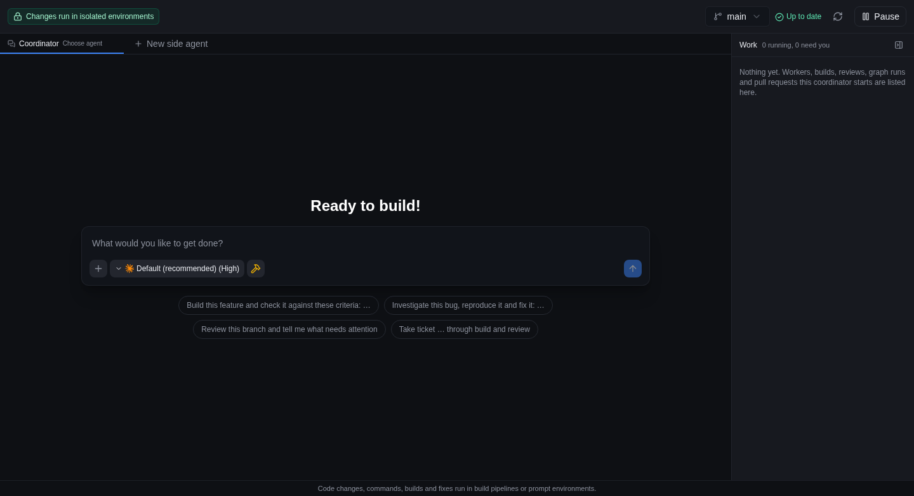
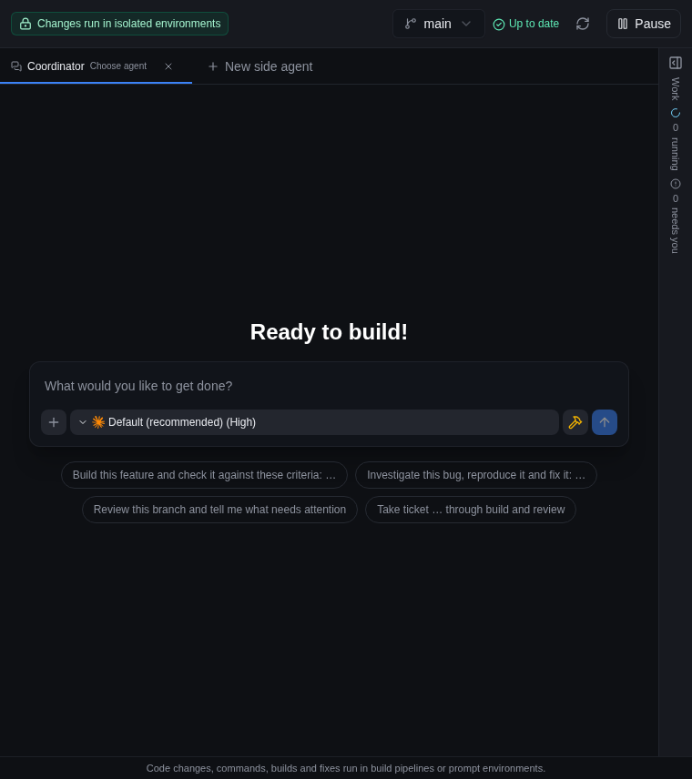
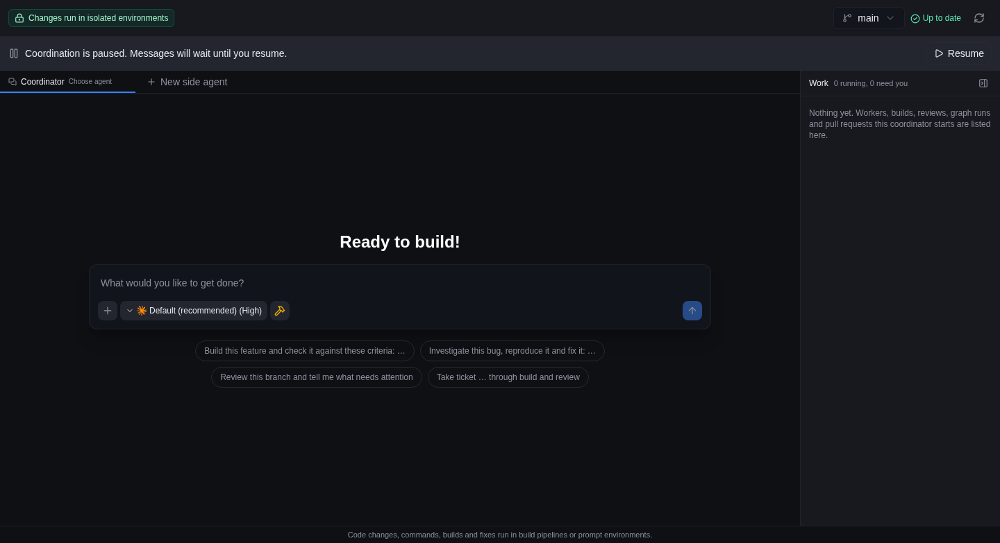
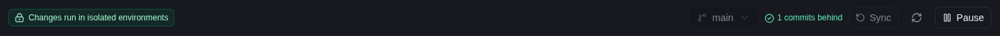

# C9, Panel split: closing report

Ticket "C9: Panel split (coordinator report 0190)", branch
`panel-split-8454ade4670b-r1`. This file checks the work back against the
batch file, item by item. It is the record the ticket asks for: line counts,
a screenshot of the panel, and a closing table of every task.

**Base commit: `48d2ed40c`.** The batch file was deleted on this branch once
the check was complete. To read it as it stood at the base commit:

```bash
git show "48d2ed40c:$(git ls-tree --name-only 48d2ed40c docs/reports/coordinator/ | grep /0190)"
```

Its parts are `0340`, `0220`, `0350` and `0190`. It was analysed on 2026-11-03
against `a2bba9d8`. All four findings still held at the base commit, with their
line numbers moved, so none was dropped as no longer holding. One side remark
in `0340` did no longer apply; it has its own row in the closing table.

No to-do was needed for the batch file: every task in it is implemented. To-do
[5000](../todo/coordinator-and-multi-review/5000-coordinator-tab-groups-collapsed.md)
exists for something else, a tab-group collapse seen once during live testing.
It is not one of the file's tasks.

## Line counts

| File | Lines |
| --- | --- |
| `CoordinatorPanel.tsx` at the base commit | 1,256 |
| `CoordinatorPanel.tsx` now | 600 |
| `CoordinatorToolbar.tsx` (new) | 271 |
| `useCoordinatorGitActions.ts` (new) | 186 |
| `CoordinatorConversationPane.tsx` (new) | 174 |
| `useCoordinatorSelection.ts` (new) | 167 |
| `useCoordinatorLaunches.ts` (new) | 140 |
| `useCoordinatorActiveTurn.ts` (new) | 124 |
| `useCoordinatorActions.ts` (new) | 59 |

All are in `apps/web/src/components/projects/`.

## The panel is unchanged

These two screenshots are the same file, byte for byte. The panel's other two
compared states also match their "before" captures exactly.

**Before** (panel at the base commit):



**After** (panel at `03b3d6be7`, the last code commit on this branch):


| State | Viewport | Before, SHA-256 | After, SHA-256 | Result |
| --- | --- | --- | --- | --- |
| Idle | 1440 x 900 | `05e8c0f610a6…` | `05e8c0f610a6…` | Identical |
| Idle, narrow | 760 x 900 | `ec5bd42e5d4f…` | `ec5bd42e5d4f…` | Identical |
| Paused | 1440 x 900 | `9941e3ce6bb7…` | `9941e3ce6bb7…` | Identical |

The other two "after" images:





How these were taken:

- **After:** captured for this report on a new isolated `dev:test` profile
  (`c9-closing-report`, fixture project, headless, since stopped and reset) from
  a clean checkout at `03b3d6be7`. Each image is a Playwright screenshot of the
  `#project-panel-coordinator` element. The browser loaded
  `CoordinatorToolbar.tsx` and the other split modules, so this is the new panel.
- **Before:** captured by the build stage of this pipeline on 2026-11-04 in the
  same way. Its record says the served module was checked to be the old one. The
  "before" run was not repeated here.

### The intended difference

The fix in `0190` is the one visible change. While any turn runs, the branch
picker and Sync are disabled, and hovering them names who holds the checkout:



The build stage captured this on a live profile with the main coordinator
running behind a focused side agent. Since then the toolbar has changed only
inside the discard confirmation dialog (`03b3d6be7`), which this crop does not
show.

## What was run

Run on this report's commit, with no code changed since `03b3d6be7`:

| Check | Result |
| --- | --- |
| `CoordinatorPanel.test.tsx`, `CoordinatorPanel.concurrency.test.tsx`, `coordinator-active-turn.test.ts` | Pass |
| `coordinator-checkout-turn.test.ts` | Pass |
| Screenshot comparison above | Identical in all three states |

Recorded by earlier stages of this pipeline and not repeated here:

- **Live two first sends:** on the old panel, sends 40 ms apart left the first
  prompt unsent. On the new panel, sends 35 and 47 ms apart were both answered.
- **Live gate:** the controls disabled and named the holder for a coordinator
  turn behind a focused side agent and for a project-home turn, and released on
  their own when the turn ended. Sync then worked.
- **Negative controls:** restoring the single launch slot, a projections-only
  gate, or the retained read on remount each made the matching new tests fail.

Not proven:

- The older-backend fallback has unit tests only.
- The live runs used Claude on Linux only, and multi-window use was not tried.
- The default, browser and Electron suites were recorded as not green on this
  branch. Failure triage called some of those failures unrelated to this work and
  left the browser and Electron ones undetermined, with no link to this ticket
  established.

## Where the work differs from a recommendation

| Part | Recommended | Done | Why |
| --- | --- | --- | --- |
| `0340` | Move launches now; move the toolbar and selection when next touched | All pieces moved in this batch, one move per commit, launches first | `0190` and `0350` both touch the toolbar, and the ticket has this batch go first to reduce later conflicts. Cost: a larger diff overall. The Git actions move goes slightly beyond the task's list. |
| `0190` | One selector over all projections | One walk (`activeCoordinatorTurnLabel`) used by both callers, combined with a new no-touch backend read, `get_coordinator_checkout_turn` | Only mounted tabs write projections, so a selector alone left Sync disabled after a turn ended behind another tab; a negative control showed this. Cost: one more protocol command, with a fallback for an older backend. |

The disabled reason is a native `title`, matching the existing toolbar. A line
under the toolbar would be readable without hovering, but the header would
change height on every turn.

## Every task in the batch file

Tests are in `CoordinatorPanel.concurrency.test.tsx` unless another file is
named.

| Part | Task or item | Outcome | Code | Test or evidence |
| --- | --- | --- | --- | --- |
| `0340` | Task 1: split the component (toolbar, selection, launches, conversation pane move out) | Done | `CoordinatorToolbar.tsx`, `useCoordinatorSelection.ts`, `useCoordinatorLaunches.ts`, `CoordinatorConversationPane.tsx`, also `useCoordinatorGitActions.ts` | Existing `CoordinatorPanel.test.tsx` passes; screenshots above are byte-identical |
| `0340` | Remark: a `CoordinatorStateCard` is mostly no longer needed | No longer holds | None added | Banners in `CoordinatorPanelNotices.tsx` cover it; the name appears only in `docs/reports/2026-10-27-coordinator.md`, not in `apps/` |
| `0220` | Task 1: key pending launches by conversation, each keeping its slot until its turn is observed | Done | `useCoordinatorLaunches.ts` (a map keyed by conversation id) | "each keeps its own prompt until its own turn is observed", "both observed in one update release together", "closing a conversation lets go of the prompt its turn can no longer consume" |
| `0220` | Needs verification: the bug was confirmed only by reading the code | Done | Not applicable | Recorded live runs above: reproduced on the old panel, fixed on the new one |
| `0350` | Task 1: add `runAction` and separate the flags | Done | `useCoordinatorActions.ts` (`runAction`, `gitBusy`, `conversationBusy`), used by `CoordinatorPanel.tsx` and `useCoordinatorGitActions.ts` | "a fetch in flight leaves the conversation controls enabled", "a conversation action in flight leaves the Git controls enabled", "the first of two overlapping actions to finish does not release the other" |
| `0350` | Remark: `closeConversation` does not clear the earlier error | Done | `closeConversation` in `CoordinatorPanel.tsx` goes through `runAction` | "closing a conversation clears the error an earlier action left" |
| `0190` | Task 1: gate on any active turn and say which one | Done | `useCoordinatorActiveTurn.ts`, `CoordinatorToolbar.tsx` (`branchSwitchDisabled`, `activeTurnReason`), `coordinator-checkout-turn.ts` | "a turn in a conversation behind the focused side agent disables both and names it", "a turn that ended behind another tab does not hold the controls", "coming back to the panel sees a turn that started while it was away"; `coordinator-checkout-turn.test.ts`: "names a conversation the observer sees working or waiting" |
| `0190` | Decision: include the project home's turn, naming it "Home" | Done | `coordinator-active-turn.ts`, `coordinator-checkout-turn.ts` | "the project home's turn disables both and is named"; `coordinator-active-turn.test.ts`: "the project home counts, and only this project's"; `coordinator-checkout-turn.test.ts`: "the project home's turn counts as well" |
| `0190` | Decision: one walk used by both the gate and the upstream check | Done | `activeCoordinatorTurnLabel` in `coordinator-active-turn.ts`, called from `useCoordinatorActiveTurn.ts` and `useCoordinatorGitActions.ts` | `coordinator-active-turn.test.ts`: `activeCoordinatorTurnLabel` tests |
