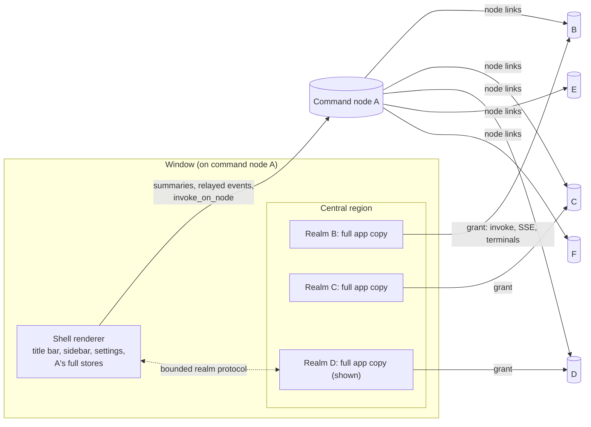
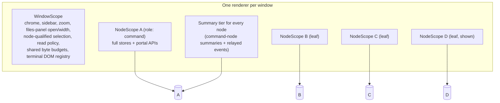

# Unified federation: one renderer for every machine, with versioned interfaces

Analysis and implementation plan, 2026-11-06, against `main` at `f7d345f65`.
Status: **being implemented** in one combined branch from 2026-11-07; progress is
tracked in [`plans/unified/`](../../plans/unified/0000-index.md), which has
the status of each item. As of 2026-11-07, every phase is built: realms are
deleted (6002, 6003) and every other machine renders in the window's own tree.
What remains open is listed on the board: iPad measurements (no iPad was
reachable), 7013's date-gated retirements, and the items added during the work
(3018, 5007). Every
count below was taken from this tree with `grep`/`wc` or by loading the
command registry under Bun; anything inferred rather than read is marked
*(inferred)*, and everything that needs a live run is collected in
[Not done / needs live evidence](#15-not-done--needs-live-evidence). Where the
implementation measured a number differently or chose differently, the section
says so with the item that recorded it (dated 2026-11-07).

## Contents

1. [Summary](#1-summary)
2. [How multi-machine works today](#2-how-multi-machine-works-today)
3. [What is wrong with it](#3-what-is-wrong-with-it)
4. [Goals and non-goals](#4-goals-and-non-goals)
5. [Target architecture](#5-target-architecture)
6. [Transport per node](#6-transport-per-node)
7. [Store and service scoping](#7-store-and-service-scoping)
8. [Data lifecycle, hydration tiers and memory](#8-data-lifecycle-hydration-tiers-and-memory)
9. [Cross-node features](#9-cross-node-features)
10. [Security and failure isolation](#10-security-and-failure-isolation)
11. [Versioned interfaces](#11-versioned-interfaces)
12. [Migration plan](#12-migration-plan)
13. [Decisions](#13-decisions)
14. [Risks](#14-risks)
15. [Not done / needs live evidence](#15-not-done--needs-live-evidence)
16. [Appendices](#16-appendices)

---

## 1. Summary

**Problem.** A window keeps at most three other machines open
(`MAX_OPEN_REALMS = 3`, `apps/web/src/stores/remoteWorkspaceStore.ts:30`),
each as a complete second copy of the client (a *workspace realm*). With six
machines in rotation, least-recently-used eviction means nearly every switch
is a cold reload. On the iPad (browser and iOS app alike) the copies are
same-origin iframes that share one WebContent process and one memory budget,
and hidden ones keep syncing at full rate.

**Why realms exist.** The client is built on module-level singleton stores and
services that each assume one backend. Running the app once per machine gave
per-machine isolation without re-scoping that code. The original plan was the
opposite ("two such scopes must coexist in the same React render tree",
`docs/architecture/federation.md`, "Deviation from the plan"); realms were the
shortcut.

**Proposal.** Replace realms with **one renderer per window holding a
`NodeScope` per machine**: per-node store instances created from factories, a
per-node backend client, per-node services, all inside one React tree. Remote
machines render in-tree under their scope. A three-tier hydration model
(summary / warm / live) with byte budgets replaces the fixed realm count, and
snapshot-first rehydration makes a cold node appear instantly.

**Versions.** Put the client↔backend contract in code: schema-defined
commands and events grouped into **versioned domains**, domain ranges
advertised in the hello, client-side adapters per domain version inside the
per-node client, a tolerant reader with explicit **must-understand** fields,
typed incompatibility errors, and CI contract tests against the manifests of
every release still in the 60-day support window. Separately, make keeping a
fleet current cheap (the bulk "Update app to latest" already exists).

**Size.** This is a large rebuild. About 40 of 61 store files (~11.5k of
~15.1k LOC) become per-node; 639 imperative `getState/setState/subscribe` sites
(383 of them in plain `.ts` modules) need an explicit scope; about 35 `lib`
modules hold per-backend module state; the desktop main process needs
per-(window, node) scopes and node-tagged IPC. Removing realms deletes about
7.4k lines gross and adds back 1.5–2.5k. The command contract has 995
registered commands, 756 referenced by the web client, ~630 of which need
schemas written (the manifest generator later counted 996 at the branch base;
after Phase 7 there are 999, all defined; [Appendix E](#appendix-e-command-surface-by-domain)). The plan below sequences this so the app works after every
step, with realms as the fallback until the in-tree path reaches parity.

**Two things to fix now, independent of the rebuild:**

- A confirmed (by reading) desktop bug: the main-process allowlist that builds
  a realm's URL (`realmSearch`, `apps/desktop/electron/federation-ipc.ts:140-172`)
  has drifted from the web side (`realmSearchParams`,
  `apps/web/src/lib/federation/workspace-realm.ts:316-341`). A **cold** desktop
  realm loses `boardTab: "home"`, the coordinator work target
  (`workType`/`workId`), `bugReport` and `dialog: "environment-rebuild"`, and
  because `restart()` marks the request delivered they are not re-sent after
  `ready`. Report a bug on another machine, opening a coordinator work item,
  and Rebuild silently do the wrong thing on first open.
- Attention events (`ENVIRONMENT_ATTENTION_EVENT`) are not in the node event
  relay *(inferred from the relay code)*, so a machine with no open realm makes
  no sound or desktop notification.

---

## 2. How multi-machine works today

### 2.1 Topology

A window (desktop, browser tab, or iOS app) connects to one **command node**.
The command node keeps the registry of **leaf nodes**, aggregates them into
summaries, routes commands to them (`invoke_on_node`), relays read-model events
(`watch_node_events`), and mints short-lived **workspace grants** for clients.
See `docs/architecture/command-nodes.md`.



### 2.2 Realms

- **Desktop**: a child `WebContentsView` per realm (`apps/desktop/electron/workspace-views.ts`),
  sandboxed, with its own persistent partition
  `persist:orkestrator-realm-<slot>-<hash(nodeId)>` (`desktop-window-lifecycle.ts:75-77`)
  and its own connection scope `realm:<viewId>` bound in main. Main caps views
  at `DEFAULT_MAX_VIEWS = 4` per window ("one more than a window's renderer
  keeps open, for a realm being replaced", `workspace-views.ts:177-178`).
- **Browser and iOS**: a same-origin `<iframe>` per realm (`FrameRealm`,
  `apps/web/src/components/federation/RemoteWorkspaceRegion.tsx:513-631`),
  with its grant in the tab's `sessionStorage` under
  `orkestrator.workspace-realm:<workspaceId>` (`lib/portal/workspace-target-storage.ts`).
  No separate cap; the store's 3 applies.
- **Eviction**: `open()` moves the node to the end of `realms` and keeps the
  last three (`remoteWorkspaceStore.ts:132`). The evicted realm unmounts, its
  view closes and its grant is revoked. Work on the machine continues; only
  this window's view ends.
- **Window ↔ realm**: a bounded message protocol of 5 shell→realm and 9
  realm→shell message types, plus a ready handshake, sequence numbers for
  title-bar popovers and focus handoff (full map in
  [Appendix C](#appendix-c-the-realm-protocol-and-what-replaces-it)).
- **Portal channel**: each realm also has `window.orkestratorPortal` bound to
  the command node, for inherited settings, the node registry, grants, layout,
  project copy and outcomes.

### 2.3 What a realm costs

Each realm is the whole client: its own JS heap, React tree, ~60 store
instances, resource sync, pane-layout persistence, a main event stream (which
on desktop includes terminal output), a shared terminal stream while a
terminal is mounted, and preview tunnels. Hidden realms keep all of it open.
No per-realm memory figure has been measured (see §15).

### 2.4 How other machines appear without a realm

The sidebar, ⌘K search, badges and hover cards for non-command nodes read
command-node **summaries** (`get_node_summaries`) and **relayed events**
(`lib/federation/node-events.ts` leases). The command node's own rows come from
the window's full stores; `sidebar-parity.test.tsx`, `remote-row-parity.test.tsx`
and `environment-row-model.parity.test.ts` keep the two presentations aligned.

---

## 3. What is wrong with it

| # | Problem | Evidence |
|---|---|---|
| P1 | **LRU thrash at 6 machines.** Cycling six machines through three slots misses on every switch; random access misses about half the time. | `remoteWorkspaceStore.ts:30,132` |
| P2 | **The cap is not tied to any constraint.** Introduced with realms in #1166 (2026-10-22) with no stated rationale; renderer (3) and main (4) must be changed together. | `git log -S MAX_OPEN_REALMS` |
| P3 | **iPad: N full clients in one process.** Same-origin iframes share one WebContent process; jetsam kills the whole page, shell included. No iOS memory handling beyond `webViewWebContentProcessDidTerminate`. | `apps/ios/OrkestratorMobile/Views/RemoteWebView.swift:432-435` |
| P4 | **Hidden iframes are not hidden.** Page Visibility is decided by the top-level document, so the hidden-window deferrals added in #1964 never apply to a hidden realm frame. | `RemoteWorkspaceRegion.tsx` uses `hidden` (display:none) |
| P5 | **HTTP/1.1 connection budget on the relay path.** The gateway is Node `http` (HTTP/1.1 unless fronted by HTTP/2 TLS). Window (2–3 long-lived requests) + 3 relayed realms (1–2 each) = 5–9 on one origin, beyond Chromium's ~6 per host, so `/invoke` queues. *Measured 2026-11-07: each relayed realm holds 3 long-lived streams, and 2 relayed realms already stall the window ([measurements](unified-federation-measurements.md)).* | `docs/architecture/remote-gateway.md:474-482`; `web-gateway.ts:976-979` |
| P6 | **Complexity that exists only for the boundary.** Message protocol, ready handshake, popover sequencing and focus handoff, still capture of a native view so page dialogs can draw over it, overlay avoidance, two hand-maintained URL parsers (one already drifted, see §1). | Appendix C |
| P7 | **The isolation is correctness, not authority.** `orkestrator:portal:invoke` gives every realm unrestricted command-node invoke (`main.ts:1446`), and the command node has full control of leaves. A compromised realm can already reach every node. | `docs/architecture/renderer-security.md:113-115` |
| P8 | **Gaps for nodes without a realm.** No attention sounds/notifications *(inferred)*; `openPullRequestInApp` returns false while any realm is active (`lib/pull-request-opener.tsx:77`); a notification click from a hidden realm selects in the window's own store instead of bringing the realm forward *(inferred, `question-desktop-notification.ts:58-69`)*. | |
| P9 | **Version skew is misattributed.** Window and realm always run the same bundle (desktop: both load the packaged `rendererUrl()`; browser: same origin). `realmGroupingFor`'s "an older realm may predate compact" (#1740) protects against a skew that cannot happen. The real skew, client↔leaf backend, is unchanged by realms. | `workspace-realm.ts:81-94` |

---

## 4. Goals and non-goals

### Goals

- G1. Any number of machines can be switched between instantly; the limit is a
  memory budget, not a count.
- G2. One copy of the client code, React tree and shared caches per window, on
  every host (desktop, browser, iOS).
- G3. Per-node correctness by structure: a component inside a node's scope can
  reach only that node's stores and client.
- G4. Every invariant in `AGENTS.md` "Background Work and Transport Invariants"
  holds per node: snapshots are authoritative, events are hints with gap
  detection, unmount is not cancel, every queue is bounded.
- G5. Version differences between the client and each node's backend are
  handled in one place per domain, detected mechanically, and tested in CI.
- G6. The app works after every migration step; realms remain the fallback
  until the in-tree path passes the same suites.

### Non-goals

- Loading a leaf's own client bundle (a realm-only possibility; see
  [Decision 13.1](#131-architecture-realms-vs-one-tree)).
- Changing the command-node model, node links, routing, outcome records, or
  the server-side grant mechanism (other than tightening its command list).
- Cross-tab sharing of node connections in the browser.
- Changing what a leaf does in the background; only what the window keeps.

---

## 5. Target architecture

### 5.1 Scopes



- **`WindowScope`** (one per renderer): what the window owns regardless of
  which node is shown. Sidebar, zoom, theme, files-panel open state and width
  (already shared by window and realms today), the node-qualified selection
  (`{ nodeId, projectId, environmentId }`), the read coordinator's visibility
  and data-saving policy, the window-wide byte budgets for transcripts,
  artifacts and images, and the terminal DOM registry (`terminalPortalStore`,
  keyed by node-qualified terminal key).
- **`NodeScope`** (one per node the window has touched): `nodeId`, `role`
  (`command` | `leaf`), a `NodeClient` (§6), the node's negotiated domain
  versions (§11), lazily created per-node store instances and services (§7),
  a lifecycle tier (§8), and `dispose()`.
- **Command scope**: the `NodeScope` whose role is `command`. Everything a
  realm reaches through `window.orkestratorPortal` today (inherited settings,
  node registry, grants, portal layout, project copy, outcomes, action
  requests, handover) becomes a call on the command scope. Today's
  `portalInvoke`/`portalListen` split disappears.
- **Summary tier**: unchanged in kind. Nodes without a hydrated scope are still
  listed and searched from summaries; nodes with a scope overlay their full
  stores. The parity tests stay.

### 5.2 The React shape

```tsx
<WindowScopeProvider>
  <AppShell>                          {/* title bar, sidebar, settings: window + command scope */}
    <CentralRegion>
      <NodeScopeProvider nodeId={shown.nodeId}>   {/* command node or leaf, same code */}
        <NodeErrorBoundary>
          <Workspace />                {/* toolbar, tabs, panes, files panel */}
        </NodeErrorBoundary>
      </NodeScopeProvider>
    </CentralRegion>
  </AppShell>
</WindowScopeProvider>
```

The command node's own workspace is rendered by exactly the same tree with its
own scope, so there is one workspace implementation, not "local" plus
"remote". Switching nodes swaps which scope the provider supplies; the scopes
of warm nodes stay alive outside React (§8) so switching back is instant.

### 5.3 What disappears

`RemoteWorkspaceRegion`, `WorkspaceRealmHost`, `RealmTitleBar`,
`useOverlayOverRegion`, still capture, `realmShellStore`, most of
`remoteWorkspaceStore` and `workspace-realm.ts`, `workspace-target-storage.ts`,
the realm branches in `App.tsx`/`AppShell.tsx`/`GlobalSettingsHost.tsx`/
`app-shortcuts.ts`/`settings-navigation.ts`/`open-bug-report.ts`/
`open-workspace.ts`, desktop `workspace-views.ts`, `realm-contexts.ts`, the
portal and realm IPC handlers and preload APIs. Line counts in
[Appendix D](#appendix-d-what-gets-deleted).

---

## 6. Transport per node

### 6.1 The `NodeClient` contract

```ts
// packages/protocol/src/node-client.ts (types only; browser-safe)
export interface NodeClient {
  readonly nodeId: BackendId;
  invoke<C extends AnyCommandDef>(def: C, args: ArgsOf<C>): Promise<ResultOf<C>>;
  invokeRaw<T = unknown>(
    command: string,
    args?: Readonly<Record<string, unknown>>,
    options?: NodeInvokeOptions, // { envelope?: { domain, version, critical } }
  ): Promise<T>; // migration only
  listen<E extends AnyEventDef>(def: E, handler: (payload: PayloadOf<E>) => void): Unlisten;
  listenRaw<T = unknown>(event: string, handler: (payload: T) => void): Unlisten; // migration only
  eventStreamReady(event?: string): Promise<void>;
  readonly terminal: NodeTerminalTransport;
  readonly connection: ReadableSignal<NodeConnectionState>; // connecting | live | resyncing | lapsed | failed
  readonly domains: ReadableSignal<NegotiatedDomains | null>; // §11
  readonly capabilities: ReadableSignal<ReadonlySet<string> | null>; // the hello's capability names
  suspend(): void;   // close streams, keep cursor
  resume(): void;    // reopen from cursor; a gap yields a resync frame
  dispose(): void;   // revoke grant, close everything
}
```

This is the interface as built (2026-11-07,
[2001](../../plans/unified/2001-node-scope-core.md),
[2011](../../plans/unified/2011-scope-domain-negotiation.md)): `capabilities`
and the envelope option on `invokeRaw` were added to the sketch, and a new
`domains` object appears exactly when a new connection generation's hello was
read. `nodeId` changes only for the command client (provisional to proven).

Two implementations sit behind it, one per host family.

### 6.2 Browser and iOS

Findings: `createBrowserGatewayApi(options)` (`apps/web/src/lib/native/web-gateway.ts:186`)
is **already a factory** with all stream, backoff, watchdog, terminal and
input-sequencer state in its closure. What makes it a singleton is the
plumbing around it:

- module-load auto-install of one `window.orkestrator`/`window.orkestratorGateway`
  (`web-gateway.ts:1739-1742`);
- `gateway-auth-transport.ts` **monkey-patches global `fetch` and `EventSource`**
  for one origin and token (`:140-158`; deleted on 2026-11-07, step 3);
- `lib/gateway-url.ts` resolves media and preview URLs from the single
  `window.orkestratorGateway` (12 importers);
- `applyGatewayToken` calls the global `clearProtectedRichContent("credentials")`;
- the terminal transport opt-in is one origin-wide `localStorage` key.

Plan:

1. Split `createBrowserGatewayApi` into `createNodeTransport(options)` (invoke,
   listen, streams, terminals; ~1,200 of 1,743 lines, moved not rewritten) and
   a window shell API (clipboard, `webClient`, process, window, connections,
   boot metrics, cookie-session detection).
   *Built (2026-11-07, [2002](../../plans/unified/2002-browser-transport-split.md)):*
   `web-gateway.ts` was 1,771 lines at the split; `createNodeTransport` is in
   `lib/native/node-transport.ts` (1,352 lines then, comments included) and the
   shell is `createWindowShell` in `lib/native/window-shell.ts`.
   `web-gateway.ts` (309 lines) composes the two and re-exports the moved
   names, so no importer changed. The page's own same-origin gateway is a
   distinct endpoint (`baseUrl: null`: an `EventSource` main stream with
   keepalives); every other transport needs a base URL and never reads
   `window.orkestratorGateway`.
2. Add `setCredential(token)` for grant renewal without a reload; scope the
   rich-content clear to the node.
   *Built ([2003](../../plans/unified/2003-browser-credentials-and-auth-transport.md)):*
   a new token reopens the main, shared terminal and relayed streams from
   their cursors and updates the terminal WebSocket, without counting a
   failure; the same token is a no-op. `clearProtectedRichContent(reason,
   { nodeId })` clears one node's protected content. The window's own token
   change stays a window-wide clear.
3. Never install `gateway-auth-transport` for node clients (the factory sends
   the bearer itself and already uses `fetch` readers for bearer streams).
   Audit raw `fetch`/`EventSource` users, then keep it only for a hosted
   single-gateway page or delete it.
   *Deleted ([2003](../../plans/unified/2003-browser-credentials-and-auth-transport.md)):*
   the audit found that only `acp-client.ts` relied on the patch, and it now
   takes its node's transport. Neither node clients nor the hosted page need
   the module, so it and its test are gone.
4. New `apps/web/src/lib/node-scope/node-clients.ts` (~300–400 LOC): the
   per-node registry. It lifts grant open/renew/lapse out of `FrameRealm`
   (`RemoteWorkspaceRegion.tsx:539-575`), keeps `openLeafWorkspace` and its
   direct-then-relay probe (`lib/portal/workspaces.ts:50-104`), keeps the
   grant **in memory** (deleting `workspace-target-storage.ts`), hot-swaps the
   token on renewal, reopens with a new grant on lapse (no document reload),
   and revokes with a keepalive `close_node_workspace` on `pagehide`.
   *Built ([2004](../../plans/unified/2004-browser-node-clients-registry.md),
   about 673 lines):* `createNodeClientRegistry()` with `acquire`, `release`
   and `openLeafScope(windowScope, nodeId)`. Renewal only extends a grant's
   expiry, so there is no token to hot-swap on renewal; a lapse, a credential
   refusal or a back/forward-cache restore opens a new grant and calls
   `setCredential` on the same transport. Grant lifetimes are Effect scopes,
   and opening retries on a `Schedule`. On `pagehide` every grant is closed
   with a keepalive `close_node_workspace` to the page's command gateway. A
   hosted page whose gateway needs a bearer (`apps/web-public`) sends that
   close without one and gets 401, so its grants expire on their 15-minute
   TTL, as before.
5. Per-node URLs: `nodeClient.baseUrl` replaces `getGatewayBaseUrl()` for
   media and loopback preview URLs. Previews of a direct node cannot carry a
   bearer header; route preview iframes through the relay unless a grant
   cookie is introduced *(inferred; no code sets a grant cookie today)*.
   *Built (2004):* media, loopback and preview URLs always use the leaf's
   relay base, even for a direct leaf, because an element load cannot carry
   the bearer. `url(path)` follows the route in use, for `fetch`es that send
   it. Leaf terminals use the WebSocket transport.
6. Add a 401 diagnosis on the relay path: `/status` and `/session` are not in
   `RELAYED_PATHS` (`apps/backend/src/core/nodes/node-relay.ts:27-34`), so a
   relayed client's credential probe 404s *(inferred)*.
   *Built ([2005](../../plans/unified/2005-relay-status-and-session.md)):*
   the relay forwards `/status`. `/session` stays unrelayed (a relayed client
   never holds the leaf's cookie session), and session detection is skipped
   for a relay base. A node transport whose fetch stream fails without a 401
   asks `/status`, and a 401 there counts as a refused credential, not an
   outage.

Direct cross-origin access from one page to several leaves **already works**:
each realm frame already does it from a command-node-origin document; leaves
allow the controller's `portalOrigins` (`gateway-auth.ts:229-242`) and answer
Private Network Access preflights. CORS is not a blocker.

**Connection budget.** Each warm node costs one main stream; a live node adds
a terminal stream (or a WebSocket). On HTTP/1.1 through the relay that runs out
quickly (P5). In order of preference:

Measured by [2013](../../plans/unified/2013-second-scope-proof.md)
(2026-11-07): a browser on the relay with one leaf holds **five** long-lived
requests on the command origin (`/events` ×2, `/session`, `/client-metrics`,
and the leaf's relayed `/events`). That leaves one of HTTP/1.1's six
connections per origin. On a direct route the leaf's stream goes to the
leaf's origin and the command origin keeps four.

- Prefer **direct** routes (each node gets its own per-origin pool).
- Default leaf terminals to the **WebSocket** transport (separate pool, already
  relayed by `relayUpgrade`, `node-relay.ts:261-321`).
- **Suspend** streams of warm-but-hidden nodes after a grace period (§8).
- Optionally (Phase 5b) add a backend **multiplexed relay stream**,
  `/__orkestrator/nodes/events?nodes=a,b`, merging N leaf main streams with a
  per-node cursor (~250–400 LOC backend plus tests). Extending
  `NodeEventRelay` is a poor fit (32 prefixes, 512 KiB ring, no terminals).
- Document HTTP/2 fronting (Tailscale Serve) as the recommended setup.

### 6.3 Desktop

Findings: a renderer's `invoke` is routed in main by **sender webContents id
only** (`ipc.ts:309-336` → `main.ts:1257-1264` → `desktopWindows.forEvent(event).scope`);
the renderer never names a node. Credentials never reach the renderer: main
attaches the bearer per scope (`getRendererRequestAuthorization`,
`connection-manager.ts:1037-1059`). Grants are tracked by
`NodeWorkspaceScopes` (`node-workspaces.ts:137-336`): 5 s tick, 10 min renew,
relay-to-direct upgrade after 5 min of use, revoke on dispose/window
close/command-node change. That machinery is reusable; only its keying
changes.

Plan:

- **A. Per-(window, node) scopes owned by main.** `DesktopWindowContext.nodes:
  Map<nodeId, NodeScopeRecord>` with `{ scope: \`${windowScope}:node:${nodeId}\`,
  target, previewRuntime, opening, lastUsed, holds }`. `ensureNodeScope(context,
  nodeId)` is single-flight and reuses `setDesktopWorkspaceTarget`'s open logic
  without the portal scope (`window-workspace-target.ts:26-152` →
  `node-scopes.ts`). On a committed rebind main emits `node-scope-changed
  { nodeId }` instead of reloading a document. Release on window close,
  command-node change, explicit `nodes.release(nodeId)`, or idle.
- **B. IPC.** `orkestrator:invoke(command, args, { nodeId? })`; absent means
  the command node. `getBackend(event, nodeId)` awaits `ensureNodeScope` and
  calls `noteUse`. Admin commands (`machineAdminScope`, `main.ts:1230-1238`)
  with a leaf `nodeId` are refused. Add `orkestrator:nodes:open|release|gateway`.
  Delete `orkestrator:portal:invoke` and the `workspace-views:*`/
  `workspace-realm:post` handlers (`federation-ipc.ts:320-352`).
  *Built (2026-11-07, [2007](../../plans/unified/2007-desktop-node-ipc-and-events.md)):*
  the third argument is `{ nodeId?, envelope? }`, the envelope bounded to
  4,096 serialised characters. Refusals are coded (`unknown-node`,
  `node-admin-refused`, `node-scope-closed`, `node-unavailable`). Electron
  passes only an error's message over IPC, so the code leads the message as
  `[code] text`, and typed incompatibility errors extend it to
  `[code key=value …] text` ([1005](../../plans/unified/1005-typed-incompatibility-errors.md)).
  The realm handlers stay until Phase 6.
- **C. Events.** Node events are sent as `orkestrator:node-event (nodeId,
  event, payload)`; `orkestrator:event` stays for the command node.
  `DesktopWindowContexts.sendToConnection` (`desktop-window-contexts.ts:284-310`)
  maps connection → `(window, nodeId)`. The `"portal"` relayed-listen channel
  collapses. `native-event-stream-connected` is emitted per node. The preload
  gains `node(nodeId) → { invoke, listen, eventStreamReady }` that demuxes by
  `nodeId`.
- **D. Request auth.** One resolver over the window's command scope plus its
  node scopes, choosing the **longest matching path prefix** (relay node scopes
  live under `/__orkestrator/nodes/<id>/`, which the command scope's
  `/__orkestrator/` also matches). Delete `createRealmRequestAuthInstaller`
  (`remote-gateway-request-auth.ts:204-220`).
  *Built ([2008](../../plans/unified/2008-desktop-request-auth.md)):*
  `resolveWindowRequestAuthorization(manager, context, url)` in
  `window-request-authorization.ts`. On the relay path a node scope's bearer
  is the command node's own token, because the relay sends its own link
  credential to the leaf; the leaf's grant is used only on a direct or
  loopback route. The resolver still picks the node scope for the leaf's
  relay paths, so the right bearer follows if that changes.
- **E. Previews.** One preview runtime per node scope, created on the first
  `attach` that carries `nodeId`; partition key stays `node:<nodeId>` (already
  per node, `main.ts:1180`), so preview site data needs no migration. Main keeps
  `tabId → runtime`; every `browserPreview:*` handler resolves through it.
  *Built ([2009](../../plans/unified/2009-desktop-previews-and-gateway-snapshot.md),
  `node-previews.ts`):* the channels are `orkestrator:browser-preview:*`.
  `nodeId` travels on `attach` and on the two node-named service calls
  (`open-external`, `reset-site-data`). Handlers that name a tab resolve
  through the tab, and handlers keyed by a pending capture stay on the
  window's runtime (the capture spool is shared). A tab main does not know is
  the window's own, so a renderer that sends no `nodeId` behaves as before. A
  runtime holds its node scope while it shows a tab and is disposed by the
  scope's release. Not yet done: on a rebind from relay to direct, an
  address-bar preview keeps the old gateway origin until the renderer
  reattaches.
  `realmChildViewClass`/`RealmLayout` go: bounds are window coordinates.
  Several managers now add views to one window; z-order and focus across them
  need a test *(inferred risk)*.
- **F. Gateway snapshot.** Command-node only, plus `localInstallationId`, so the
  renderer computes `backendOnThisDevice(nodeId) = nodeId === localInstallationId`.
  `isRemoteGatewayConnection`/`isBackendOnAnotherDevice` (6 caller files) take a
  `nodeId` or read it from the scope.
  *Built (2009):* the preload exposes it as
  `window.orkestratorDesktopIdentity.localInstallationId`, not on
  `orkestratorGateway`, because a Local window has no gateway object but
  always has the identity. `lib/gateway-url.ts` takes a scope, a node id or
  nothing (the command node), and every current answer is unchanged.
- **G. Terminal output.** On desktop it reaches renderers only through main's
  per-connection event stream (`relayTerminalOutput`, `backend-process.ts:523`),
  so per-node streams carry it as today, tagged by `nodeId`.

Optional: one grant per node shared across a host's windows, refcounted, to
halve streams when two windows show the same node (§13.5).

### 6.4 Events must carry their node

Event names carry no node id today; which renderer receives an event is the
only discriminator. In one renderer, every listener is registered on a
specific `NodeClient`, so delivery is per node by construction. Global
`listen()` (`lib/native/events.ts:58`, 34 importers) becomes command-scope only
during migration and is then removed for scoped stores. Since
[2010](../../plans/unified/2010-command-scope-wiring.md) (2026-11-07) it is
that command-scope wrapper. Command-node events reach a desktop renderer on
the top-level channel only, so the command scope's client is built over the
top-level API (`createWindowOrkestratorClient`), not over `node(commandNodeId)`. `listenOn(source)` and
`listenAuthoritativeWith(subscribe)` already take an explicit source and are
the pattern to keep.

---

## 7. Store and service scoping

### 7.1 Inventory

Full table in [Appendix A](#appendix-a-store-classification). In short:

| Class | Stores | Examples |
|---|---|---|
| (a) per-node data | ~38 | environment, project, paneLayout (1,852 LOC), session, terminalSession, claudeTmux (1,395), nativeAgentProjection, nativeCompose, config, buildPipeline, multiReview, kanban, pullRequests, githubIssues, graph*, design, webAnnotation, fileDirty, previewService |
| (b) window state | ~12 | bugReport, errorDialog, globalSettings, appDialog*, mergePrRequest*, activeCoordinatorConversation*, conversationScrollTarget*, messagePartExpansion* (* need node-qualified refs) |
| (c) already cross-node | ~10 | machineView, machineBulkUpdate, projectCopy, richContentView, portalStore, nodeChangeProjectionStore |
| (d) mixed, split | 4 | uiStore (selection per node; chrome per window), filesPanelStore (open/width per window; folders, PR tabs per node), artifactLiveHostStore, terminalPortalStore |
| realm-only, delete | 2 | realmShellStore, most of remoteWorkspaceStore |

**IDs are not safe to key alone.** Projects and environments are random UUIDs
(`apps/backend/src/core/storage-shared-core.ts:409-440`) and project copy never
reuses a source id, but Kanban tickets keep the **same id on every node**
(`command-nodes.md:803`), the default pane id is `"default"`
(`paneLayoutStore.ts:337`), tab ids are time-and-counter strings, PR keys are
repo+number, terminal keys use host-local container ids, and the protocol says
ids are node-local (`packages/protocol/src/federation.ts` header). This is why
the plan uses per-node **instances** rather than re-keying (§13.2).

### 7.2 Scoped store definitions

```ts
// apps/web/src/lib/node-scope/scoped-store.ts
export interface ScopedStoreDef<S> {
  readonly name: string;
  create(scope: NodeScope): StateCreator<S>;
}
export function defineScopedStore<S>(
  name: string,
  create: (scope: NodeScope) => StateCreator<S>,
): ScopedStoreDef<S>;

// In components: reads the nearest NodeScopeProvider.
export function useScopedStore<S, U>(def: ScopedStoreDef<S>, selector: (s: S) => U): U;
// Outside React: an explicit scope is required.
// scope.store(def) → StoreApi<S>, created lazily and disposed with the scope.
```

Conversion of one store:

```ts
// before
export const useEnvironmentStore = create<EnvironmentState>()((set, get) => ({ … }));

// after
export const environmentStore = defineScopedStore<EnvironmentState>(
  "environment",
  (scope) => (set, get) => ({
    …,
    load: async (projectId) => {
      const list = await scope.client.invoke(environments.list, { projectId });
      …
    },
  }),
);
export const useEnvironmentStore = <U>(selector: (s: EnvironmentState) => U) =>
  useScopedStore(environmentStore, selector);
```

Hook call sites inside a `NodeScopeProvider` keep compiling unchanged (834
hook-selector calls). Imperative sites change from
`useEnvironmentStore.getState()` to `scope.store(environmentStore).getState()`,
which forces the caller to say which node it means.

### 7.3 The migration shim and its ratchet

To convert incrementally, each converted store keeps a deprecated static
`getState/setState/subscribe` that resolves the **command scope** (today's
behaviour). This lets one store convert at a time without touching all 639
imperative sites at once. The danger is obvious: a shim call made on behalf of
a leaf silently hits the command node. Two guards:

1. A lint rule (oxlint custom rule or a `tests/unit` source scan, matching
   existing practice) that counts static shim uses per store and compares them
   to a committed baseline file. The count may only fall. CI fails on increase.
2. A runtime guard: while an in-tree leaf scope is mounted (Phase 4 flag on),
   a shim call on a store that the leaf's workspace uses throws in development
   and tests and records `node-scope.shim-under-leaf` in production. Phase 4
   cannot enable a leaf in-tree until the baseline for every store the
   workspace subtree touches is zero.

*Built (2026-11-07):* guard 1 is the source guard
`tests/source-guards/scoped-store-shim.ts`, counted against
`tests/source-guards/baseline.json`; a store enters it when its item
registers it in `SHIMMED_STORES` ([3001](../../plans/unified/3001-scoped-store-shim-and-ratchet.md);
the recipe is [node-scopes.md](../development/node-scopes.md)). Guard 2 is
[4004](../../plans/unified/4004-runtime-shim-guard.md), not started.

### 7.4 Services and module state

About 35 `lib` modules hold per-backend module state (`let`, module Maps/Sets,
`start*` singletons): `resource-sync.ts`, `store-resource-sync.ts` (35
`getState/setState` calls), `pane-layout-persistence.ts`,
`pane-layout-authoritative.ts`, `changes/subscriptions.ts`,
`prompt-queue-*`, `build-pipeline-persistence.ts`,
`multi-review-persistence.ts`, `web-annotations/sync.ts`, the draft
persistence modules, `tab-launch.ts`, `coordinator-work-navigation.ts`, the
capability caches (`client-state-capabilities.ts`, `backend/changes.ts:129`,
`design-client.ts:109`, `useNativeAgentSession.ts:129-143`), and
`transport-connectivity.ts`. Full list in [Appendix B](#appendix-b-module-singletons).

Pattern: `defineScopedService(name, (scope) => { start…; return { …, stop } })`.
A service starts when its scope reaches the tier that needs it and stops on
suspend/dispose, satisfying invariant 15 (everything that schedules work has
an explicit stop that tests call). `App.tsx:353-365` (`startResourceSync`,
`startStoreResourceSync`, `startTransportConnectivity`,
`startPaneLayoutPersistence`, `startBuildPipelineCompletionNotes`) becomes
"start these services for the command scope", then "for every warm scope".

*Built (2026-11-07, [3014](../../plans/unified/3014-scoped-services-and-startup.md)):*
`lib/scope-services.ts` holds the service lists: `WARM_SCOPE_SERVICES`
(resource sync, store bindings, connectivity, pane-layout persistence,
completion notes) and `COMMAND_SCOPE_SERVICES`, which adds the window-level
data-saving policy and selection persistence. `App` starts the command
scope's list with `startScopeServices`; starting the warm list for warm
scopes is [4002](../../plans/unified/4002-hydration-tiers-and-budgets.md)'s.
Each running service is a child Effect `Scope` of its node scope.
`lib/store-resource-sync.ts` has one registration per store, marked
`command-scope` or `every-scope`. A store item moves its handler into its
store module, reads `context.scope.store(def)` and marks it `every-scope`
(recipe in [node-scopes.md](../development/node-scopes.md)). Engines that
start only when a view asks for them (change subscriptions, web-annotation
sync, design controllers, draft persistence) are per-scope **slots**
(`defineScopedSlot`, `lib/node-scope-slots.ts`), not services, so a warm
scope that shows nothing runs none of them
([3012](../../plans/unified/3012-workflow-stores-b.md)).

Special cases:

- **`rich-content-reset.ts:127-151`** clears all protected content when it sees
  a different backend identity. With several nodes live it would thrash. Make
  protected content keyed by node and clear per node.
- **`read-coordinator.ts`** stays per window (visibility, data-saving) but its
  reconnect bookkeeping becomes per node. *Built (3014):* the window part is
  `lib/read-window-policy.ts` (visibility, host-hidden, data saving, resume
  hints); `readCoordinatorFor(scope)` is one coordinator per node scope over
  that policy, disposed with the scope, so one node's reconnect cannot reset
  another's backoff.
- **`transport-connectivity.ts`** becomes per node plus an aggregate the title
  bar shows.
- **Byte budgets.** `nativeAgentProjectionStore` holds a process-wide history
  budget (line 93); artifact and image caches are byte-bounded. These must stay
  **window-wide** budgets shared by all node scopes (invariant 11), otherwise
  per-node instances multiply memory. *Built
  ([3009](../../plans/unified/3009-agent-and-transcript-stores.md)):* each
  history entry reserves its bytes, keyed by node and session, in the window's
  `transcripts` budget (`ByteBudget`, 32 MiB), which evicts other nodes'
  least recently shown sessions first and never the shown node. The display
  caches (live tails, progressive pages) are still bounded per instance;
  [4002](../../plans/unified/4002-hydration-tiers-and-budgets.md) decides
  whether warm nodes keep them.
- **`lib/backend/*`** (37 files, ~9.1k LOC, ~681 exports, 249 importers):
  every function gains a client parameter or becomes a method on a typed
  domain client (§11). Since 26 of the 33 `invoke` importers are these files,
  this is where the contract conversion and the scoping meet. *Built
  ([3002](../../plans/unified/3002-lib-backend-client-parameter.md)):* at
  conversion there were 37 source files (36 with commands) and about 11.3k
  lines including the factories. Each file with commands exports a
  `createXApi(client)` factory;
  `createXApi(scopeBackendClient(scope))` or `backendApiForScope` serve a
  scope. The old exports stay as a shim of **647 command-bound names**,
  bound to the command scope. The guard `lib-backend-command-default` counts
  their uses in converted code, and Phase 7 replaced the bodies with domain
  clients.

### 7.5 Persistence keys

`desktopConnectionStorageKey` (`lib/desktop-storage-key.ts:59`) derives its
namespace from the renderer's single identity, so in one renderer every node
would resolve to the same key. It takes a `nodeId`. Affected keys:
`files-panel-storage`, `project-pull-requests`, `web-annotation-preferences`,
`ui-project-storage`, the legacy local-state keys, the four keys in
`lib/pane-selection-storage.ts`, and the un-namespaced
`orkestrator.web-annotations.local-drafts.v1`. `windowStorageKey` and
`machine-view-storage` are already right.

Migration: in the browser and iOS, realms already used
`desktopConnectionStorageKey`'s `:machine:<hash>` form in shared origin
storage, so the new keys read existing data. On desktop the keys match but the
data lives in each realm's partition; see [Decision 13.7](#137-desktop-realm-partition-data).

*Built (2026-11-07, [3015](../../plans/unified/3015-persistence-keys-per-node.md)):*
the key takes a `StorageNode` (`{ nodeId, role }`; a `NodeScope` is one)
rather than a bare id, so no global lookup decides which node is the command
node; stores call `nodeStorageKey(baseKey, node)` (`lib/persistence-keys.ts`).
The command node keeps exactly today's key, whatever its id; a leaf gets
`<base>:machine:<hash>` in every renderer. The local drafts moved to a
per-node `…local-drafts.v2` key, with the v1 value moved once into the
command node's. See [federation.md, "Storage namespacing"](../architecture/federation.md#storage-namespacing).

### 7.6 Lint boundaries

Today `.oxlintrc.json` (about L111-156) bans `@/lib/native/backend`,
`@/lib/backend*`, `@/lib/native/events` and `authoritative-events` in
`lib/federation/**` and `components/federation/**`. Generalise it: outside
`lib/node-scope/**`, transports are obtained only from a scope. Add a rule
against importing a scoped store's static shim in new code (§7.3).

*Built (2026-11-07):* as source guards rather than oxlint rules.
`direct-transport-import` ([2012](../../plans/unified/2012-transport-lint-boundary.md)) counts
imports of the transports (`lib/native/backend`, `events`,
`authoritative-events`, `node-transport`) outside `lib/node-scope/**`,
`lib/backend/**` and `lib/native/**`. `window-orkestrator-direct` (2010)
holds direct use of the window global's transport members at zero.
`lib-backend-command-default` ([3002](../../plans/unified/3002-lib-backend-client-parameter.md))
counts command-bound `lib/backend` uses in scoped code. Each guard has a
baseline that may only fall.

---

## 8. Data lifecycle, hydration tiers and memory

### 8.1 Tiers

| Tier | What exists | Streams | Typical count |
|---|---|---|---|
| **Summary** | Nothing per node; command-node summaries and relayed events | none of its own | every node |
| **Warm** | `NodeScope` with light stores hydrated (projects, environments, config, activity, mail counts, pipelines list) | main stream (desktop: incl. terminal output) | budgeted |
| **Live** | Warm + the shown environment's heavy data (transcripts, terminals, files, diffs, previews) | + terminal transport, previews | 1 (shown) + recently shown within budget |
| **Suspended** | Light store data kept; services stopped | none; cursor kept | any |

Transitions:

- Opening a node: summary → warm → live, reusing a persisted snapshot (§8.3).
- Switching away: live → warm immediately for heavy data the byte budget wants
  back; warm → suspended after `NODE_SUSPEND_AFTER_MS` hidden (default 5 min;
  per-host defaults in §8.2).
- Switching back: suspended → warm resumes the stream from its cursor; a gap
  yields the existing `gateway.reconcile-required`/resync path, so stores
  re-read authoritative snapshots (invariants 3, 4, 7, 8).
- Memory pressure or budget exceeded: drop heavy data from the least recently
  shown live nodes first, then suspend warm nodes, then dispose suspended
  scopes back to summary. Never touch the shown node.

This replaces `MAX_OPEN_REALMS` and `DEFAULT_MAX_VIEWS`. Eviction is at **data**
granularity (one environment's transcript), not whole-app granularity.

### 8.2 Budgets per host

| Host | Warm nodes (default) | Suspend after | Byte budget source |
|---|---|---|---|
| Desktop | unlimited within budget | 15 min | measured heap per scope (§12 Phase 0) |
| Browser | budget-bound | 5 min | `performance.measureUserAgentSpecificMemory` where available, else fixed |
| iOS / iPad | budget-bound, lower | 2 min, and on `visibilitychange` hidden | fixed conservative budget until measured |

These numbers are placeholders until Phase 0 measures per-scope cost.

**Status after the wave 0 measurements (2026-11-07):** kept as placeholders.
[unified-federation-measurements.md](unified-federation-measurements.md)
measured realm cost on one Mac (desktop realm about 340–410 MB per view in a
development build, an upper bound; Chromium iframe realm +60–90 MB each; WebKit
+44–171 MB each in one shared WebContent process). Those are per-realm costs,
not per-scope costs, so they cannot set a per-scope byte budget, and the iPad
and packaged-build numbers are missing. [4002](../../plans/unified/4002-hydration-tiers-and-budgets.md)
uses these placeholders and takes measured values when they exist.

### 8.3 Snapshot-first rehydration

When a scope is disposed or the app restarts, the next open should paint
immediately. Each warm scope periodically writes its light-store snapshot
(projects, environments, config, pane layout ids, last selection) to IndexedDB
under a node-namespaced key, bounded per node and in total. On open, the scope
hydrates from the snapshot, marks itself `resyncing`, and replaces the data
with the authoritative read when it lands. The UI shows the snapshot with a
stale marker until then; actions that mutate wait for `live`. This follows the
existing rule that live state is rehydrated from authoritative snapshots and
events are hints. Snapshots never contain transcripts, terminal contents,
file contents, prompts or credentials (invariant 12): only list metadata that
the sidebar summaries already expose.

### 8.4 Inactive-path behaviour

Unmount is not cancel (invariant 2): switching the shown node never stops work
on any node. Suspending a scope only closes this window's streams; the node's
backend keeps running agents, terminals and pipelines. Pending approvals and
questions for non-live nodes must still surface: `useRemoteHumanPrompts.ts:118`
already watches human prompts through `subscribeNodeEvents`, and attention gets
the same treatment (§9).

---

## 9. Cross-node features

| Feature | Today | Unified design |
|---|---|---|
| Sidebar | Command node from full stores; others from summaries; parity tests | Summaries for every node; full scope stores overlay warm/live nodes; parity tests kept and extended to "same row from summary vs scope" |
| ⌘K search | `ProjectSearchBar.tsx` (764) builds from `useMachineViews()`; realms forward ⌘K to the window | Unchanged sources; forwarding removed |
| Coordinator across nodes | `LeafModeCoordinatorGate.tsx:58-110` uses portal `self` summary and realm grouping | Reads grouping from `machineViewStore` and the command scope directly |
| Attention, sounds, notifications | Each realm sounds for its own node; nodes without a realm are silent *(inferred)* | One window service: subscribe per warm/live scope; add an `attention` prefix to the node event relay for summary-tier nodes (backend change); notification click opens that node's scope |
| PR opener | Disabled while any realm is active | Opens in the active scope's files panel |
| Title-bar meters and agent popover | Realm reports `titleBar`; popovers drawn by the realm under window triggers with seq/inset/focus handoff | `useMachineSystemUsage(nodeId)` (already used by `MachineCpuReadings`) and ordinary popovers fed from the scope |
| Agent accounts / MCP per machine | `machineInvoke`: `null` portal, `undefined` workspace, id → `invokeOnNode` | `scope(nodeId).client.invoke`, or `invoke_on_node` via the command scope for summary-tier nodes |
| Project copy, portal layout, outcomes, action requests, handover | Portal channel | Command scope |
| Settings layering | `command-node-config.ts` (222): `settingsOnCommandNode()` is `workspaceTarget() !== null` | `effectiveConfig(scope) = layer(commandScope.config, scope.config)`; split saves take both scopes explicitly. *Built ([3005](../../plans/unified/3005-config-layering.md)):* `ConfigTargets` and `settingsParent(scope)` / `bindSettingsParent`; a layered scope's store holds the effective config and both layers; split saves are `runScopedConfigCommand({ scope, commandScope }, …)`; `settingsOnCommandNode()` is deleted. The realm portal is the one parent that is not a scope, until Phase 6 |
| Bug report | Must run in the renderer whose backend it targets | `BugReportSheet` takes a scope |
| Dialogs (Add Project, New Environment, Repository Settings, Delete Project, environment Settings, Rebuild) | Opened in the realm with readiness gating | Opened under the node's scope; readiness gating kept as hydration checks |

---

## 10. Security and failure isolation

### 10.1 What changes

| Property | Realms today | Unified |
|---|---|---|
| Who can reach which node | A realm's `window.orkestrator` reaches only its node, but its portal channel has unrestricted command-node invoke, which reaches every node | The renderer can name any node; main (desktop) or the per-node client (browser) routes |
| Credentials in renderer | Desktop: none (main attaches). Browser: each frame's grant in shared `sessionStorage` | Desktop: unchanged, none. Browser: grants in memory in `NodeClient` closures (no longer in storage) |
| Process isolation | Desktop: separate renderer per realm. Browser/iOS: none (same process) | None on any host |
| Storage isolation | Desktop: separate partition per realm. Browser: namespaced keys | Namespaced keys everywhere |
| Correctness isolation | By construction (separate heaps) | By structure (per-node instances + provider), shim ratchet, node-tagged events |

The net change in **authority** is nil: the window renderer already holds full
command-node authority and shows the same untrusted transcripts, and realms
can already reach the command node. The real boundary is server-side and
stays:

- grants are bound to the controller, at most 15 min TTL, hashed in memory,
  revoked with the controller, and revocation closes the sockets they
  authorised (`client-grants.ts`);
- the gateway and the relay refuse excluded commands for grants
  (`gateway-auth.ts:421-425,508`, `node-relay.ts:212`); since 2026-11-07 they
  refuse every command outside the allow-list (§10.2);
- main keeps refusing administration commands for leaves, now keyed by
  `nodeId`.

### 10.2 Tighten the grant command list

The grant list is a **deny-list that fails open**: `NODE_EXCLUDED_COMMANDS`
(98 entries, two of them not registered commands) plus
`WORKSPACE_ADMINISTRATION_COMMANDS` (31) plus ~33 link/controller commands;
the file warns "a new administration command fails open until it is added
here" (`workspace-grant-scope.ts:13-14`). 835 commands are reachable through a
grant or the relay; 692 of them are used by the web client. Once commands are
schema-defined (§11) each declares `access: "workspace" | "admin" | "internal"`
and grants become an **allow-list derived from the manifest**, failing closed.
Live evidence for the current list is still open
(`docs/todo/cross-cutting/5740-workspace-grant-scope-live-evidence.md`) and
must be gathered before realms are removed.

*Built (2026-11-07, [7012](../../plans/unified/7012-allow-listed-grants.md);
the live evidence was gathered by [0006](../../plans/unified/0006-grant-scope-live-evidence.md)
and re-run against the new list):* every command is now defined with its
`access`. Grants and the relay admit exactly the registry's
`access: "workspace"` commands (`admitsWorkspaceCommand` in
`nodes/workspace-grant-scope.ts`, read through `BackendCore.commandAccess`).
They fail closed: a command with no definition, an unknown name, or a
backend that cannot report access gets 403. An equivalence test compared the
new set with the deny-lists' effective set. The final difference is 33
commands the deny-lists admitted and the allow-list refuses; no client sends
any of them, and none differs the other way. For one release a debug-only
cross-check (`nodes/workspace-grant-legacy-check.ts`) logs content-free
disagreements with the old verdict. `WORKSPACE_ADMINISTRATION_COMMANDS`, the
inline list and `isWorkspaceExcludedCommand` are deleted. The
`invoke_on_node` exclusions are kept, renamed `NODE_ROUTING_EXCLUDED_COMMANDS`
(`nodes/node-routing.ts`). They cannot be derived from `access`, because
routing uses the link's full credential and routes most `admin` commands
(Settings on another machine). The relay checks the command node's registry,
so a command that only a newer leaf defines is refused through the relay
until the command node upgrades, although a direct grant reaches it
([command-nodes.md, "Security"](../architecture/command-nodes.md#security)).

### 10.3 Failure isolation

- **Render errors**: a `NodeErrorBoundary` around each node's workspace shows a
  per-node error with retry, as a crashed realm does today.
- **Store/service errors**: services run per scope; an exception in one scope's
  service stops that service, records a content-free log event, and marks the
  scope `failed` (retryable) without touching others.
- **Out of memory**: one renderer means one OOM takes the window. Mitigated by
  the budgets in §8, which matter most on iPad, where today's realms already
  share one process.
- **Unhandled rejections**: renderer code runs in the browser, not under the
  Bun fatal-rejection guard, but per-scope service promises must still be
  handled; the scope owns an `AbortController` per service and every consumer
  of its signal handles rejection.

---

## 11. Versioned interfaces

### 11.1 Where skew actually is

Window and realm always run the same bundle (P9). The skew that matters is
**client ↔ each node's backend**, and it exists identically in both
architectures. Today:

- one global `CLIENT_API_VERSION = 1` (`packages/protocol/src/backend-profile.ts:165`),
  never bumped;
- a hello capability map of 12 names, all node-related, read **only by
  backend-to-backend code**; the web parses the hello only to verify identity
  (`lib/portal/workspaces.ts:61`);
- about ten ad-hoc per-domain capability commands (`design_capabilities`,
  `web_annotations_capabilities`, `get_preview_capabilities`,
  `changes_get_capabilities`, `transcript_artifact_capabilities`,
  `get_native_agent_sync_capabilities`, `get_agent_handoff_capabilities`,
  `get_client_state_capabilities`, …) with no common structure;
- 995 registered commands; handler type `(args: JsonRecord, context) => unknown`
  (`commands-context.ts:140`); hand-written parsers in `commands-validation.ts`
  (941 lines, ~1,409 call sites); Zod is a backend-only dependency, used by
  command handlers only in design and web annotations;
- **mixed strictness**: ~37% of commands reject unknown keys (`assertOnlyKeys`,
  239 call sites, concentrated in nodes/accounts/system/host), ~63% ignore
  them. A strict older peer rejects a new field (hence capabilities such as
  `nodeMailSteer`); a lenient older peer silently ignores one (hence register
  rows like "ignores `page`", "ignores `knownDigest`");
- results are an unchecked `invoke<T>` cast; core models are duplicated in
  `apps/backend/src/core/models.ts` (1,334 lines) and `apps/web/src/types/index.ts`
  (771 lines, "mirrors the backend model");
- errors are `{ error, code? }`; "unknown command" is detected by matching text
  in two different helpers (`lib/backend/shared.ts:51`, `lib/portal/unknown-command.ts`);
- ~45 named backend events, `BackendEmit = (event: string, payload: unknown)`,
  no central map, no versions; `resource-changed` (28 `RESOURCE_KINDS`, revision,
  open-ended `cause`) is already a tolerant reader;
- 54 active rows in the compatibility register, 60-day support window, usage
  counters per path. About 40 releases between 2026-10-16 and 2026-11-06, so the
  window holds ~100 releases; the client-referenced command surface grew from
  ~501 to ~813 `register("…")` sites in three weeks (~16 a day).

Measured later (2026-11-07): the manifest generator counted **996**
registered commands at the branch base
([1006](../../plans/unified/1006-contract-manifest-generator.md)); after
Phase 7 there are 999, all defined. The backend emits **44 events**: 41
named events and 3 families (`terminal-output-*`, `claude-state-*`,
`relayed-node-event:*`), not counting the gateway's own control frames
([7011](../../plans/unified/7011-typed-events.md)). There are 13 hello
capabilities, not 12; 8 capability commands, not "about ten"; and 56 register
rows at the plan's base, not 54 ([corrections](../../plans/unified/0000-index.md#corrections-to-the-report)).

### 11.2 Design

#### Domains

A **domain** groups commands and events that change together: `environments`,
`projects`, `config`, `native-sessions`, `transcripts`, `terminals`, `files`,
`git`, `pull-requests`, `pipelines`, `graphs`, `multi-review`, `kanban`,
`agent-mail`, `accounts`, `docker`, `previews`, `web-annotations`, `design`,
`mcp`, `nodes`, `system`, … (about 25; the grouping in
[Appendix E](#appendix-e-command-surface-by-domain) is the starting point).

Each domain has an integer **version**. A backend supports a range
`[min, max]` of each domain. The version increases only for a change an older
peer cannot handle silently:

- a field removed, renamed, or changed in type or meaning;
- a new **must-understand** field (below);
- a command removed or its semantics changed.

Adding an optional field or a new command does **not** bump the version,
because peers that follow the tolerant-reader rule ignore unknown fields, and
a new command is discoverable from the domain's command list in the manifest.

#### Definitions in `packages/protocol`

```ts
// packages/protocol/src/contract/ (sketch; see the note below for the modules)
export const environments = defineDomain({ name: "environments", version: 4 });

export const listEnvironments = defineCommand({
  domain: environments,
  name: "get_environments",
  since: 1,                         // domain version that introduced it
  access: "workspace",              // workspace | admin | internal → grant allow-list
  read: true,                       // routing classification, replaces the regex
  args: Schema.Struct({ projectId: Schema.String }),   // import * as Schema from "effect/Schema"
  result: Schema.Array(EnvironmentSchema),
  critical: [],                     // must-understand arg fields
});

export const environmentChanged = defineEvent({
  domain: environments,
  name: "environment-changed",
  payload: EnvironmentChangedSchema,
});
```

- *As built (2026-11-07, [1002](../../plans/unified/1002-contract-primitives.md)):*
  the primitives are split by concern in `packages/protocol/src/contract/`:
  `domain.ts` (`defineDomain({ name, version, min? })`, `DOMAIN_NAMES`,
  `pickVersion`), `command.ts`, `event.ts`, `envelope.ts`, `errors.ts`,
  `client.ts` (`createDomainClient`), `client-adapters.ts`
  (`DOMAIN_CLIENTS`) and `ipc-error.ts`, with `index.ts` re-exporting
  them; there is no `define.ts`. Each domain's definitions and client live in
  `contract/domains/<domain>/`. `min` defaults to `version`, so accepting an
  older peer is declared. Version 0 is reserved for the legacy adapter. The
  domain list grew to 29 names, including `node-files` (pilot) and
  `public-api`.
- Schemas live in `packages/protocol` (browser-safe top level), so backend,
  web, desktop and CLI share one definition. `models.ts` and
  `apps/web/src/types/index.ts` converge on the protocol schemas.
- Library: Effect Schema (`effect/Schema`, `effect` 4.1.2), see
  [Decision 13.8](#138-schema-library). Event payloads use `Schema.optional`
  for optional fields rather than command schemas' `Schema.optionalKey`,
  because emitters set absent fields to `undefined`
  ([7011](../../plans/unified/7011-typed-events.md), recorded in `version-compatibility.md`). Its default decode drops unknown keys
  (`onExcessProperty: "ignore"`), which is the tolerant parsing that
  `register` needs (next point).
- The backend registers through `defineCommand`: `register(listEnvironments,
  handler)` parses args with the schema (tolerant: unknown fields stripped,
  not rejected, unless critical), and in development and tests validates the
  result. Results that are spliced as pre-encoded JSON (transcript bodies,
  `gateway-handlers.ts:157-160`) are exempt from result validation on the hot
  path.

#### Negotiation

- The hello gains a **new top-level field** `domains: Record<string, { min: number;
  max: number }>`. It cannot go into `capabilities`: deployed parsers reject
  more than 64 entries (`MAX_CAPABILITIES`) and enforce a name pattern, and
  `schemaVersion` cannot be bumped because old parsers require exactly 1.
  Old parsers ignore unknown top-level keys (that is how `buildCommit` and
  `nodeMode` were added).
- The `NodeClient` reads the hello once per connection generation and exposes
  `domains`. A node whose hello lacks `domains` is a **pre-contract node** and
  gets the legacy path (§11.4). *Built ([1004](../../plans/unified/1004-hello-domains.md),
  [2011](../../plans/unified/2011-scope-domain-negotiation.md)):* a
  generation is identified by the hello's `installationId` plus
  `generation`. A malformed `domains` drops the whole field (the peer is then
  treated as pre-contract) rather than keeping the valid part. A current
  backend always sends `domains`, `{}` when it defines nothing, and only
  domains with at least one defined command are advertised. The domain
  clients' lifetime is the node scope's Effect `Scope`.
- **The support floor has no hello.** v2.21.0 has no hello route at all: the
  hello first shipped in v2.25.0-alpha, and the first Stable release with it
  is v2.36.0. A floor node is therefore detected as pre-contract from a
  missing route, not from a hello without `domains`; 1004's test reproduces
  v2.21.0's behaviour (an unknown `/__orkestrator/*` path falls through to
  static files) and parses the v2.25.0-alpha and v2.36.0 hellos.
- Both directions are covered: a newer client talks to an older backend through
  **client adapters**; an older client (a stale browser tab, the hosted web
  client) talks to a newer backend because the backend keeps accepting every
  domain version in its range.

#### Must-understand

The invoke body gains an envelope:

```json
{ "command": "deliver_node_mail", "args": { … }, "domain": "agent-mail",
  "version": 3, "critical": ["steer"] }
```

A contract-aware backend strips unknown fields except those listed in
`critical`; an unknown critical field is refused with a typed
`unsupported-field` error naming it. As built
([1003](../../plans/unified/1003-backend-register-overload.md), 2026-11-07),
three details settle edge cases. An unknown critical field is refused only
when the arguments carry it; a critical name the call does not carry is
ignored. A string-registered (untyped) command refuses any critical field
its arguments carry, because an untyped handler cannot say it understands
one. The version range check applies to every command of a domain this
backend advertises; a domain with no defined command has no range and is not
checked. A malformed envelope is refused whole (HTTP 400), never
dropped. Senders mark a field critical only when
ignoring it would be unsafe (silently not steering a mail, dropping an
idempotency key, dropping a safety option). This turns most "send the field
only if the capability is advertised" code into nothing at all, and the rest
into a typed refusal instead of a silent downgrade. It never weakens a safety
property: anything that must not be ignored is critical by definition.

#### Typed incompatibility errors

`code: "unknown-command" | "unsupported-version" | "unsupported-field"` with
the domain and the backend's range, replacing text matching. The client maps
them to one UI state: "not available on <machine> (version x); update it".

As built ([1005](../../plans/unified/1005-typed-incompatibility-errors.md)),
the wire form is `{ error, code, details }`. `details` holds `domain`,
`range`, `field` and **`command`**, the refused command. A reader asks
`incompatibility(error, command)`, which answers only for the command it
sent, so a handler's nested in-process miss never reads as the caller's
command being unknown. Over Electron IPC only the message crosses, so the
form there is `[code key=value …] text`. `describeIncompatibility` renders
the UI text, and [5006](../../plans/unified/5006-fleet-currency.md)'s
`incompatibilityNotice` adds the update action.

#### Client adapters

```ts
// apps/web/src/lib/node-scope/domains/environments.ts
export const environmentsClient = domainClient(environments, {
  4: (call) => ({ list: (projectId) => call(listEnvironments, { projectId }) }),
  3: (call) => ({ list: async (projectId) => upgradeV3(await call(listEnvironmentsV3, { projectId })) }),
});
// scope.domain(environmentsClient).list(projectId)
```

As built ([1009](../../plans/unified/1009-domain-clients-and-adapters.md),
2026-11-07), domain clients live in `packages/protocol/src/contract/domains/`
rather than in the web app, so the backend's own node-link calls (the 1010
pilot) use them too and CI can enumerate them from the static
`DOMAIN_CLIENTS` list (one client per domain). The renderer reaches one with
`scope.domain(def)` ([2011](../../plans/unified/2011-scope-domain-negotiation.md)).

The scope picks the highest version both sides support. Components and stores
call the domain client and never see versions. An adapter for version *v* is
deleted when the support floor passes the first Stable release with *v + 1*,
exactly the register's existing retirement rule, and each adapter records a
usage counter (renderer-side counters are added to the client error/metric
ring, content-free). As built (1009), only calls below the current version
are counted (`domain-adapter.<renderer|backend>.<domain>.v<n>`). The renderer
uploads them with a new defined command, `record_domain_adapter_usage`
(`system` v1, `access: "admin"`), because `record_renderer_errors` rejects
unknown keys on older backends.

### 11.3 Manifests and CI

1. **Generator.** `scripts/generate-contract-manifest.ts` loads the registry
   (the same way `commands-secret-sweep-test-support.ts` already enumerates every
   command) and writes `packages/protocol/contracts/manifest.json`: domain →
   version → commands (`args`/`result` JSON Schema digests, `access`,
   `critical`, `since`) and events. `--check` mode fails on drift, like
   `scripts/generate-codex-app-server-protocol.ts`'s committed protocol
   manifest.
   *Built (2026-11-07, [1006](../../plans/unified/1006-contract-manifest-generator.md)):*
   the manifest is **flat by command name**, not nested by domain and
   version: `{ schemaVersion, generatedBy, counts, untypedByDomain, domains,
   commands, events }`, every object key-sorted. Each command entry names its
   `domain`. `domains` holds the ranges separately (`{ version, min }`, only
   for domains with a defined command, as the hello advertises them). Events
   are `{ domain, payloadDigest }`, and a family adds `family`, `prefix` and
   `key` ([7011](../../plans/unified/7011-typed-events.md)). Until a command
   was defined, its domain came from `apps/backend/src/core/contract-domain-map.ts`,
   which Phase 7 emptied. `mise run contract:manifest` also lowers the
   untyped ratchet (`untyped-baseline.json`, checked by
   `scripts/contract-check.ts`, [1011](../../plans/unified/1011-contract-policy-and-docs.md))
   and writes the **argument schema store**,
   `packages/protocol/contracts/schemas/<hex16>.json`, each holding the
   canonical JSON Schema document of one digest
   ([1008](../../plans/unified/1008-contract-ci-job.md); a deviation, since a
   digest alone cannot give stage 2 its old schemas). A stored schema is
   removed only when no command, manifest entry or release blob references
   it, so a release's schemas outlive the code.
2. **Release snapshots.** `release:version` writes
   `packages/protocol/contracts/releases/<version>.json`. Backfill for every
   published tag since v2.21.0 with the same enumeration over `git worktree`
   checkouts (the precedent is `scripts/qualify-backend-upgrade-rollback.ts`).
   Deduplicate by per-domain digest so storage grows with domain changes, not
   releases.
   *Built ([1007](../../plans/unified/1007-release-snapshots-and-backfill.md)):*
   `releases/<version>.json` holds a release's counts and, per domain, a
   reference `{ file, digest, commands, version?, min? }` to a blob
   `domains/<domain>-<hex16>.json`, named by the first 16 hex digits of the
   blob's SHA-256. The reader verifies the full digest, so a prefix collision
   or a hand edit is refused. `releases/index.json` lists every release with
   its channel and publication time. The backfill covers the **31 published
   releases** from v2.21.0 to v2.36.6-beta in 145 blobs (about 970 KB). Not
   published: the drafts v2.24.0-alpha to v2.26.1-alpha and v2.35.2-beta, and
   the tags v2.22.0 to v2.22.2, which have no GitHub release. Every published
   release is pre-contract. Their commands are recorded untyped, with each
   release's own read classification where it had one, and names this tree no
   longer registers go to an `unmapped` blob. `contract:backfill -- --check`
   needs `gh` and the network, so it is not part of CI.
3. **Contract CI job** (on every PR):
   - compute the support floor from tag dates (the Stable rule in
     `version-compatibility.md`);
   - for every (domain, version) in any manifest within the window, assert a
     client adapter exists;
   - for every command in an in-window manifest, generate argument fixtures from
     its old schema and assert the **current backend** accepts them (backward
     compatibility for older clients);
   - assert no command in an in-window manifest disappeared without a domain
     bump and a register row;
   - flag any new field that is required (not optional) without a version bump.

   *Built ([1008](../../plans/unified/1008-contract-ci-job.md),
   `scripts/contract-ci.ts`, `mise run contract:ci`, in `ci.yml`'s Lint job):*
   the floor is the newest Stable release published at least 60 days ago,
   else v2.21.0; it reads `releases/index.json` and does not call GitHub. The
   adapters a domain needs are listed in
   `packages/protocol/contracts/adapters.json` (generated from
   `DOMAIN_CLIENTS` by `mise run contract:adapters`, checked by
   `contract:adapters:check`, [1009](../../plans/unified/1009-domain-clients-and-adapters.md)).
   A domain with no client there is exempt, because it is called untyped,
   which is version 0 for every peer. The argument-fixture check (stage 2,
   `effect/Arbitrary` over the stored schemas, through the real `register(def)`
   parser) was turned on by [7001](../../plans/unified/7001-domain-native-sessions.md).
   A removed command needs a register row (Register or Retired) naming it, and
   its domain at a higher version, unless the domain is unversioned on both
   sides or the snapshot could not place it.
   **Retirements** ([7013](../../plans/unified/7013-retire-legacy-adapters.md)):
   adapters to retire are derived from `adapters.json`. The kept capability
   commands are classified by hand in
   `packages/protocol/contracts/retirements.json` (`{ domain,
   retireAtDomainVersion, why, retired? }`). The job fails once the floor
   passes an adapter's or a command's condition. `mise run contract:ci --
   --retirements [--json]` prints the schedule with dates. A deleted
   capability command keeps its entry with a `"retired": "<date>"` mark while
   an in-window release still has it; that exempts it from the domain-bump
   rule. A `retired` mark before the condition is met, or on a command still
   registered, fails.
4. **Mixed-version qualification** (scheduled, not per PR): run the current
   client against the floor release's backend, extending
   `scripts/qualify-design-mixed-versions.ts` (which already installs a real
   published npm release).
   *Built ([1012](../../plans/unified/1012-mixed-version-qualification.md)):*
   a new runner, `scripts/qualify-contract-mixed-versions.ts`
   (`mise run qualify:mixed-versions`), rather than an extension of the
   design script, which keeps its own single-backend topology. It installs the
   old release from npm and runs two topologies: `current-command` (this
   checkout's command node with the release as leaf) and `old-command` (the
   release as command node with this checkout's leaf). "Floor client to
   current backend" is the second, because the pilot domains are backend to
   backend. npm lacks v2.21.0 and v2.21.1, so while the floor is one of those,
   `--old-version floor` runs the oldest published in-window release npm
   carries (**v2.22.3**) and says so in its report. `latest-stable` and
   `current` (a control run) are the other choices. Domain items add one
   scenario module each (`scripts/mixed-version/scenarios/`; interface in
   `scenario.ts`: `{ domain, title, topologies?, requires?, run(ctx) }`, and
   a missing `requires` name on the release side is `not-applicable`). The
   weekly workflow `.github/workflows/mixed-version-qualification.yml` runs
   `floor` and `latest-stable` (approved by the user on 2026-11-07, in one
   combined PR).
5. **Register integration.** A domain bump without a register row fails CI; a
   register row whose adapter is gone fails CI.
   *Built (1008):* the register is read as data
   (`scripts/contract-ci-register.ts`); a bump needs a row naming the old
   adapter's counter `domain-adapter.<renderer|backend>.<domain>.v<old>`, and
   a Counter cell must name known counter ids or start with "None".

### 11.4 Transition (pre-contract nodes)

Every release currently in the window is a pre-contract node. Until the floor
passes the first Stable release that advertises `domains` (60+ days after it
ships), the client keeps today's capability gating for those nodes, packaged
as a **legacy adapter per domain** (`version: 0`) so the rest of the client is
already version-agnostic. Never switch the lenient 63% of handlers to rejecting
unknown keys; that would break newer clients. Strictness moves the other way:
strict handlers become tolerant-with-critical when they adopt `defineCommand`.

As built (2026-11-07): a defined command only ever strips unknown keys, so
adopting `defineCommand` cannot make a lenient handler strict
([1003](../../plans/unified/1003-backend-register-overload.md)). Phase 7 made
every `assertOnlyKeys` handler tolerant this way. The floor release, v2.21.0,
has no hello at all (§11.2), so the earliest window releases are
pre-contract by a missing route and take the version-0 adapters, which send
today's calls. No release in the window advertises
`domains` yet: the first Stable release that does starts the 60-day clock for
every version-0 adapter, which [7013](../../plans/unified/7013-retire-legacy-adapters.md)
then deletes.

### 11.5 Expected effect on the register

Classification of the 54 active rows (inference): 20 shape skew, 11 missing
command, 12 behaviour/capability, 6 route or transport, 2 persisted data,
3 packaging/security. A tolerant reader with must-understand removes about
4–5 rows outright (they exist only because a strict receiver rejects an extra
key), makes about 27 mechanical (declared default/rename in an adapter;
missing command known from the domain version), makes detection mechanical
for the 12 behaviour rows, and leaves about 11 (bridge routes, transports,
data, packaging) unaffected unless the bridge HTTP contract adopts the same
scheme later.

What the pilot found ([1010](../../plans/unified/1010-pilot-node-mail-and-ticket-sync.md),
2026-11-07): the pilot domains (`node-mail`, `ticket-sync`, `node-files`)
held 7 rows, not the estimated 9. Six became mechanical, each now also
counting `domain-adapter.backend.<domain>.v0`. The seventh (command nodes
without `coordinator-notices`) is detected by the request's shape and did not
change. None retires yet, because every release in the window is a
pre-contract peer. Across Phase 7 the domain items made rows mechanical in the
same way (a version-0 adapter counter beside the row's own) and added rows
for commands kept only for older peers. Rows retire with the version-0
adapters ([7013](../../plans/unified/7013-retire-legacy-adapters.md)).

### 11.6 Operational mitigation: keep the fleet current

For one user's fleet, skew is mostly "not updated yet". "Update app to latest"
across machines already exists (`components/settings/machines/BulkUpdateDialog.tsx`,
`machineBulkUpdateStore`). Add:

- the version of each node beside it in the sidebar's machine header when it
  differs from the command node's, with the domains it lacks;
- an opt-in update policy per channel ("keep leaves on the command node's
  version"), run by the command node through the node link's existing host
  maintenance path;
- the typed incompatibility errors (§11.2) linking to that action.

*Built (2026-11-07, [5006](../../plans/unified/5006-fleet-currency.md)):*
the machine header shows `MachineVersionSkew`: an older node gets an amber
update button listing the domains it lacks, or "predates contracts". The
policy is one switch per update channel; a leaf counts under its own channel.
It is set with `get_fleet_update_policy` / `set_fleet_update_policy` (defined
in `system`, `access: "admin"`, never routed to a node) and run by
`FleetUpdatePolicyRunner` on the command node. **Every channel is off by
default** (the report's "opt-in"). The user approved the recommended default
on 2026-11-07, in one combined PR, but the concrete all-off default still
needs the user's explicit confirmation. The runner's guards: it updates
only an older leaf, never downgrades, and pushes only a version the leaf's
channel ships. It uses `drain: "when-idle"` with the longest wait, sends at
most one request per (leaf, version) every 6 hours, and records the request
before sending it. It skips a leaf whose updater is unavailable or busy and
does nothing in leaf mode. `incompatibilityNotice` adds the "Update" action
to remote-action toasts and the diagnostics error.

---

## 12. Migration plan

Each phase leaves `main` working, keeps realms as the fallback until Phase 6,
and follows the repository's validation rules (`mise run test` for code under
`apps/`, `packages/`, `bridges/`; scenario suites per the testing guide).
Sizes are relative (S < 1 week, M 1–3 weeks, L 3–6 weeks, XL > 6 weeks of one
engineer-equivalent) and are **estimates**.

```mermaid
gantt
  dateFormat X
  axisFormat %s
  section Now
  P0 fixes and measurement        :p0, 0, 1
  section Contract
  P1 contract foundation          :p1, 1, 3
  P7 domain conversion (rolling)  :p7, 3, 12
  section Scopes
  P2 NodeScope and transport      :p2, 1, 4
  P3 store and service factories  :p3, 4, 9
  P4 in-tree workspace behind flag:p4, 8, 10
  P5 cross-node services          :p5, 9, 11
  P6 retire realms                :p6, 11, 12
```



### Phase 0 — fixes and measurement (S)

Independent of the rest; do first.

*Status (2026-11-07):* done apart from live checks. The realm request drift,
hidden-realm visibility, documentation corrections, grant evidence and the
unknown-command helper are done. Attention without a realm
([0002](../../plans/unified/0002-attention-without-realm.md)) still needs the question
notification checked with a provider turn. Measurement
([0004](../../plans/unified/0004-measurement-report.md),
[report](unified-federation-measurements.md)) still needs the iPad, Safari, a
packaged build and real-route `nextHopProtocol` (§8.2).

1. Fix the desktop `realmSearch` drift: make main accept every field
   `realmSearchParams` writes (`boardTab: "home"`, `workType`/`workId`,
   `bugReport`, `dialog: "environment-rebuild"`), and generate both from one
   shared definition in `packages/protocol` so they cannot drift again. Extend
   `apps/desktop/tests/federation-ipc.test.ts:59-131`.
2. Relay attention: add the attention event to the node event relay's
   prefixes and subscribe to it in `useNotificationSoundService` for nodes
   without a realm. Confirm the gap first (§15).
3. Tell hidden realm frames they are hidden (a `visibility` shell→realm
   message honoured by the read coordinator), so #1964's deferrals apply.
   Cheap and useful until Phase 6.
4. **Measure** (the numbers the budgets need): heap and process memory per
   realm on desktop (`app.getAppMetrics()`), idle and with a transcript and a
   terminal open; the iPad WebContent process with 1, 3 and 6 realms and where
   jetsam kills it; request rate from a hidden browser realm; `nextHopProtocol`
   on real routes; cold-open time to first paint. Record in a report under
   `docs/reports/`.
5. Documentation corrections: `docs/architecture/federation.md` still describes
   a removed renderer runtime (`BackendRuntime`, `BackendClientRegistry`,
   `useBoundMachineView`, `BackendPanelViews` no longer exist);
   `version-compatibility.md:253` says there is no handshake, which is true only
   for the renderer.

Exit: bug fixed with a test; measurements recorded.

### Phase 1 — contract foundation (M)

Runs in parallel with Phase 2.

*Status (2026-11-07):* done, items 1001–1012. The pilot covers three domains
(`node-mail`, `ticket-sync`, `node-files`; 24 commands defined in the pilot,
7 register rows, not 9; §11.5). The docs are in
[version-compatibility.md, "Domain contracts"](../architecture/version-compatibility.md#domain-contracts).

1. `packages/protocol/src/contract/`: `defineDomain`, `defineCommand`,
   `defineEvent`, envelope and typed errors. Schemas use Effect Schema
   (§13.8).
2. Backend: `register(def, handler)` overload in `createCommandRegistry`;
   envelope parsing in `gateway-handlers.ts`; `domains` in the hello
   (`gateway-auth.ts:595-611` emits it, `backend-profile.ts` parses it, ignored
   by older parsers).
3. Typed `unknown-command`/`unsupported-version`/`unsupported-field` errors;
   replace both text-matching helpers.
4. Manifest generator with `--check`; release snapshot step in
   `release:version`; backfill script; contract CI job (initially only drift
   and "every in-window domain has an adapter").
5. Convert one small, already-strict domain end to end as the pilot: node mail
   and ticket sync (~20–30 commands, 9 register rows), including its legacy
   adapter.
6. Document in `docs/architecture/version-compatibility.md` (new section
   "Domain contracts") and link from `AGENTS.md`'s table.

Exit: the pilot domain is negotiated, adapted and CI-tested; register rows for
it are retired or made mechanical.

### Phase 2 — NodeScope and transport, behaviour-neutral (L)

*Status (2026-11-07):* built (2001–2013), with the second-scope proof run
live on browser and desktop ([2013](../../plans/unified/2013-second-scope-proof.md)). Still
open: the browser smoke test in the Done-when boxes of 2001, 2002, 2003 and
2010. One smoke failure also fails at the branch base on this host, and two
were spec drift that has been fixed; the rerun is left to the final live
pass.

1. `apps/web/src/lib/node-scope/`: `NodeScope`, `WindowScope`, providers,
   `defineScopedStore`, `defineScopedService`, lifecycle tiers (initially only
   the command scope exists, always live).
2. Browser: `createNodeTransport` split; window shell API; `node-clients.ts`
   registry; stop global install for leaves; keep it for the command scope only.
3. Desktop: per-(window, node) scopes in main (§6.3 A–G), node-tagged IPC and
   events, multi-scope request auth, preview runtime per node, preload
   `node(nodeId)` API. Realm IPC stays alongside until Phase 6.
4. `lib/native/backend.ts` `invoke` and `lib/native/events.ts` `listen` become
   command-scope wrappers (behaviour unchanged).
5. Tests: node-tagged event demux; scope lifecycle (lazy open, renew, idle
   release, window close); longest-prefix auth; tab → node preview routing;
   admin refusal by `nodeId`; grant hot-swap without reload.

Exit: the app runs entirely through the command scope with no visible change;
desktop main can open a second node scope for a test renderer.

### Phase 3 — store and service factories (XL)

*Status (2026-11-07):* every store and service item is done (3001–3017)
except `paneLayoutStore` ([3013](../../plans/unified/3013-pane-layout-store.md)), whose only
open box is the aggregate suite and the browser-agent suite with the command
scope (left to review). Two `[ui]` shim uses remain in
`WorkspaceRealmHost.tsx`, which is realm-only and goes in Phase 6. The shared
test helper is `renderInNodeScope`; the recipe is
[node-scopes.md](../development/node-scopes.md).

Convert in dependency order, smallest blast radius first. For each store:
definition → `defineScopedStore`; hook keeps its name; imperative sites move to
`scope.store(def)` where the scope is known, otherwise remain on the shim; the
shim baseline is committed and must fall.

Suggested order:

1. Leaf-light stores with few imperative sites: `environmentDiffStore`,
   `worktreeSnapshotStore`, `prMonitorStore`, `multiReviewStore`,
   `agentActivityStore`, `agentModelCatalogStore`, `claudeOptionsStore`,
   `tabLaunchStore`.
2. Core lists: `projectStore`, `environmentStore` (45 importers, 56 imperative
   sites), `configStore` with layering (`effectiveConfig(scope)`),
   `previewServiceStore`.
3. Split the mixed stores: `uiStore` (selection → node-qualified window state;
   per-node collapse/recents → node scope), `filesPanelStore`,
   `terminalPortalStore` (node-qualified keys), `artifactLiveHostStore`.
4. Agent and transcript stores: `nativeAgentProjectionStore` (keep the history
   byte budget window-wide), `nativeComposeStore`, `promptDraftStore`,
   `sessionStore`, `terminalSessionStore`, `claudeTmuxStore`, `agentMailStore`.
5. Workflow stores: `buildPipelineStore` (46 imperative sites),
   `coordinator*Store`, `graph*Store`, `designStore`, `webAnnotation*`,
   `kanbanStore`, `featurePlanStore`, `githubIssuesStore`, `pullRequestsStore`,
   `projectPullRequestsStore`, `changeProjectionStore`, `fileDirtyStore`.
6. `paneLayoutStore` last (1,852 LOC, 87 imperative sites, calls four other
   stores), with `pane-layout-persistence.ts` and `pane-layout-authoritative.ts`.
7. Services in the same order as their stores (§7.4), each with an explicit stop.
8. Persistence keys take `nodeId` (§7.5).
9. `rich-content-reset` per node; capability caches per scope.

Each store conversion is a reviewable PR with its tests updated (334 test files
use stores; 110 stub `window.orkestrator`). A shared test helper
`renderInNodeScope(ui, { nodeId, client })` replaces most `window.orkestrator`
stubs.

Exit: shim baseline is zero for every store the workspace subtree touches;
`mise run test` and the browser suites pass with only the command scope.

### Phase 4 — in-tree workspace behind a per-node flag (M)

*Status (2026-11-07):* built (4001–4005, [4007](../../plans/unified/4007-workspace-calls-its-node.md),
added on 2026-11-07). [4006](../../plans/unified/4006-multi-node-qualification.md)'s
multi-node e2e passes on desktop and browser with six leaves; its iPad memory
measurement is not done (no iPad reachable), so 4006 stays open.

1. The seam: `RemoteWorkspaceRegion` already chooses a renderer per node
   (`kind === "desktop" ? <NativeRealm> : <FrameRealm>`). Add `<InTreeWorkspace
   nodeId>` when `inTreeNodes.has(nodeId)` (setting, default off), falling back
   to realms otherwise.
2. First version may reuse `useRealmRequests`' sequencing through an in-memory
   loopback for `send`/`onMessage`, so `WorkspaceRealmHost`'s dialog gating runs
   unchanged under a `NodeScopeProvider`. This needs `isWorkspaceRealm()`,
   `postToShell` and `onShellMessage` to read context instead of URL and
   `window`.
3. Replace protocol messages with direct calls one at a time (Appendix C).
4. Hydration tiers and budgets (§8), snapshot-first rehydration.
5. Runtime shim guard on (§7.3).
6. Tests: parity suites on both paths; a new multi-node window e2e (desktop and
   browser) replacing `workspace-realm-electron.spec.ts` (958 lines); the
   inactive-environment cycle from `AGENTS.md` for a leaf; reload rehydration;
   six-node switching with budget eviction.

Exit: a leaf renders in-tree with feature parity on desktop, browser and iOS;
measured memory with six nodes warm is within budget on the iPad.

### Phase 5 — cross-node services (M)

*Status (2026-11-07):* built (5001–5006). The multiplexed relay
([5005](../../plans/unified/5005-multiplexed-relay-stream.md)) was built because
0004 measured connection pressure; with three relayed leaves it took stalled
requests from 12 to 0. The summary overlay of §9's Sidebar row was not assigned
to an item, so [5007](../../plans/unified/5007-summary-overlay.md) was added on
2026-11-07.

1. Attention, sounds and desktop notifications per scope plus the relayed
   prefix for summary-tier nodes; notification clicks open the node.
2. PR opener in the active scope; title-bar meters and popovers from the scope.
3. Settings, bug report, shortcuts: direct calls.
4. 5b (optional, if Phase 0 shows relay connection pressure): multiplexed relay
   event stream on the backend.

### Phase 6 — retire realms (M)

*Status (2026-11-07):* built. In-tree became the default (6001) and the realm
code was deleted on the web (6002, net −8,047 lines) and the desktop (6003,
including startup removal of `persist:orkestrator-realm-*` partitions). The
user approved deleting realm code without waiting one release after 6001, and
waived the one-release partition wait: approved by the user on 2026-11-07, in
one combined PR. [6004](../../plans/unified/6004-documentation.md) updated the
living docs; archiving this report waits for 7013.

1. Default `inTreeNodes` to all; keep realms one release as a rollback setting
   (a rollback switch, not version skew, per `version-compatibility.md`).
2. Delete realm code (Appendix D), the shell↔realm protocol, still capture,
   overlay avoidance, desktop `workspace-views.ts`/`realm-contexts.ts`, portal
   and realm IPC and preload APIs, `MAX_OPEN_REALMS`, `DEFAULT_MAX_VIEWS`.
3. Desktop realm partitions: see §13.7.
4. Update `command-nodes.md` ("Opening an environment on another node"),
   `federation.md` (mark the realm sections retired), `renderer-security.md`
   (scopes instead of realm views), `docs/README.md`.
5. Prerequisite: the live grant-scope evidence in todo 5740.

### Phase 7 — domain conversion and allow-listed grants (rolling, XL overall)

*Status (2026-11-07):* every command is defined: 999 commands, 0 untyped, an
empty domain map and an untyped baseline of 0. Events are typed (7011),
models converge on protocol types (7010), and grants run the allow-list
(7012, §10.2). The remaining Zod moved to Effect Schema
([7014](../../plans/unified/7014-remaining-zod-to-effect-schema.md), §13.8). Open: 7007 and
7008, whose boxes on handler tests (fakes changed because development and
test result validation refuses impossible shapes) and shared types are to be
decided at the completeness check. 7013 (retiring the version-0 adapters)
waits for its date (§11.4).

Order (from the contract analysis): node mail/outbox, ticket sync and node
files (pilot) → native sessions (87), terminals and files (59), environments
(63), previews, web annotations (already Zod-strict) → projects and config,
git/PR, build and graphs (graphs already strict), Multi Review, Kanban, mail,
accounts, Docker → coordinator/controller, agent servers/tooling, admin last
(mostly not called by the web).

About 630 client-facing commands need schemas (design, web annotations,
transcript artifacts, graphs and the 121 public actions already have some).
The existing Zod schemas (design and web-annotation command guards, and the
backend's MCP tool schemas in about 30 files) are converted to Effect Schema
with their domain, or bridged where conversion is not worth it: both
libraries implement Standard Schema (`Schema.toStandardSchemaV1`), so a
`defineCommand` adapter could accept a Zod schema meanwhile. Zod stays a
backend-only dependency until the last of them is converted.
Fold each domain's existing capability command into its domain version. When
every grant-reachable command has `access`, switch grants to the derived
allow-list (fail closed) and delete the deny-lists.

New commands are added through `defineCommand` from Phase 1 onward, so the
unconverted surface only shrinks.

---

## 13. Decisions

### 13.1 Architecture: realms vs one tree

- **A. Keep realms, tune them** (raise the cap per host, freeze hidden realms,
  snapshot-first cold open). Pros: small; keeps process isolation on desktop;
  could later load each leaf's own bundle and remove workspace skew. Cons: N
  copies of the client remain; on iPad they share one process anyway; the
  boundary machinery (Appendix C) stays; the realm protocol itself is a second
  contract to version.
- **B. One tree, per-node keys in global stores (D1).** Pros: no provider
  plumbing. Cons: every lookup must remember the node; ids collide (Kanban
  tickets, `"default"` pane, PR keys); the leakage surface the original design
  warned about.
- **C. One tree, per-node store instances (D2) (recommended).** Pros: one copy
  of code and caches; correctness by structure; data-granular eviction;
  removes the boundary machinery; works the same on every host. Cons: the
  largest change (Phase 3); loses desktop process isolation (authority
  unchanged, §10.1).

Recommendation: **C**, because the target workload (six machines, iPad) is
exactly where per-copy cost dominates and the isolation realms provide is
correctness rather than authority.

Decision: **C**, confirmed before Phase 3: approved by the user on
2026-11-07, in one combined PR
([3001](../../plans/unified/3001-scoped-store-shim-and-ratchet.md)).

### 13.2 Scoping mechanism

- **A. React context only.** Pros: idiomatic. Cons: 383 imperative sites in
  plain modules have no context.
- **B. Explicit scope handle everywhere plus a context for hooks
  (recommended).** Pros: imperative code must name its node; testable without
  React. Cons: signature churn in `lib/`.
- **C. Ambient "current scope" global.** Pros: least churn. Cons: async code
  interleaves across nodes; reintroduces silent misrouting.

Recommendation: **B**, with the temporary command-scope shim and ratchet
(§7.3) as the migration bridge.

### 13.3 Hydration limit

- **A. Fixed count per host.** Pros: simple. Cons: wrong on every host but one.
- **B. Byte budgets with tiers (recommended).** Pros: matches memory, evicts
  data not apps. Cons: needs measurement and memory APIs that differ per host.
- **C. Unlimited.** Cons: iPad jetsam.

Recommendation: **B**, with fixed conservative fallbacks where memory cannot be
measured (iOS).

### 13.4 Browser path to leaves

- **A. Direct first, relay fallback (today's rule) (recommended).** Pros: per
  origin connection pools; no command-node bandwidth. Cons: needs an https
  route and matching `portalOrigins`.
- **B. Relay only.** Pros: one origin, one cookie, reaches SSH-only leaves.
  Cons: HTTP/1.1 pool exhaustion past ~2 live nodes.
- **C. Relay with a multiplexed stream.** Pros: one long-lived request for N
  nodes. Cons: new backend route and ring per client.

Recommendation: **A**, WebSocket terminals for leaves by default, and **C**
only if Phase 0 measurements show pressure.

### 13.5 Grants per window or per host

- **A. One grant and stream per (window, node) (recommended to start).** Pros:
  matches today's model and revocation semantics. Cons: two windows on one
  node double streams.
- **B. Refcounted per host (desktop main).** Pros: fewer streams. Cons: shared
  revocation and per-window event filtering become more complex.

Recommendation: **A** now, **B** only if measurements justify it.

### 13.6 Where version adaptation lives

- **A. Client adapters only.** Cons: an older client (stale tab, hosted client)
  against a newer backend is uncovered.
- **B. Backend only (accept old versions, answer in old shapes).** Cons: newer
  client against older backend uncovered.
- **C. Both, each within the support window (recommended).** Pros: covers
  every pairing in `version-compatibility.md`'s table. Cons: two places to
  retire, both counted.

### 13.7 Desktop realm partition data

- **A. Abandon it (recommended).** It holds only presentation state (collapsed
  folders, pane selection, PR tab lists). Pros: no migration code. Cons: users
  re-collapse a few folders once.
- **B. One-shot export** through a final realm run that posts its keys to the
  window. Pros: nothing lost. Cons: migration code for low-value data.

Then delete the `persist:orkestrator-realm-*` partitions after one release.

### 13.8 Schema library

Measured on 2026-11-07 by plan item
[1001](../../plans/unified/1001-schema-library-spike.md). Each variant defined
20 representative schemas (args and result of 10 commands) in
`packages/protocol` and was imported by a production `vite build` of
`apps/web`. Sizes are the added bytes in the entry chunk, which matched the
total-JS delta to within about 100 bytes. Compression used the settings of
`apps/web/scripts/precompress.ts` (gzip 9, brotli 11). The baseline entry chunk
is 6.5 KB gzip, the lazily loaded `renderer-entry` chunk is about 457 KB gzip,
and total JS is about 5.97 MB gzip.

| Variant | + raw | + gzip | + brotli |
|---|---:|---:|---:|
| A. Effect Schema | 80,305 | 26,027 | 23,377 |
| B. Zod 4 classic | 88,354 | 25,006 | 21,858 |
| C. `zod/mini` | 25,185 | 7,783 | 7,000 |
| D. Hand-written guards | 5,318 | 1,708 | 1,549 |
| Effect runtime only (`Effect`, `Scope`, `Exit`, `Context`, `Layer`) | 33,018 | 11,509 | 10,434 |
| A + Effect runtime | 87,229 | 28,466 | 25,560 |

No budget had been set. The threshold used was at most 50 KB gzip added to
startup JS for the schema library and the runtime together: about 10% of the
`renderer-entry` chunk, under 1% of total JS, and a one-time cached cost.
Parse time on iPad Safari was not measured, because no iPad was reachable
(§15).

- **A. Effect Schema (`effect/Schema`, `effect` 4.1.2) in `packages/protocol`.**
  Pros: one library for the schemas and for the Effect runtime that later
  items use in the renderer; the two share about 9 KB gzip of core, so both
  together cost +28.5 KB gzip. Static `Type` and `Encoded` types. A
  deterministic draft 2020-12 export (`Schema.toJsonSchemaDocument`) for the
  manifest digests, pinned by `packages/protocol/src/effect-json-schema.test.ts`.
  `Arbitrary.schema` generates the argument fixtures the contract CI job in
  §11.3 needs, without another dependency. Decoding drops unknown keys by
  default, which is the tolerant reading §11.2 wants, and
  `onExcessProperty: "error"` gives strict mode. Standard Schema adapters
  (`Schema.toStandardSchemaV1`, `Schema.toStandardJSONSchemaV1`). Cons: the
  largest of the four for schemas alone (+26.0 KB gzip, about 1 KB more than
  Zod). Version 4 is recent and differs from v3, which most examples still
  show. The backend carries both Effect and Zod until Phase 7 converts or
  bridges the existing Zod code. Export rules contract schemas must follow:
  `Schema.Finite` rather than `Schema.Number` for wire numbers, because
  `Number` exports non-finite string encodings; `Schema.optionalKey` rather
  than `Schema.optional`, because `optional` exports `anyOf [T, null]`; a
  `u` flag on any `isPattern` RegExp, because a pattern without it is not
  exported; and one shared constant per schema with an `identifier`.
  Digests must be taken over a canonical form, with keys and `required`
  sorted, because the output follows declaration order.
- **B. Zod 4 classic.** Pros: already a backend dependency (4.6.7) and used by
  the design and web-annotation command guards and about 30 MCP tool schema
  files; static types; `z.toJSONSchema`. Cons: +25.0 KB gzip with no runtime
  to share it with; method chaining defeats tree-shaking.
- **C. `zod/mini`.** Pros: +7.8 KB gzip, the smallest option that keeps a JSON
  Schema export (`z.toJSONSchema` works on mini schemas). Cons: a functional
  API that is less ergonomic (`z.optional(…)`, `.check(z.maxLength(…))`); no
  runtime; the existing backend code uses classic Zod.
- **D. Hand-written guards** like `public-api-inputs*.ts` and
  `commands-validation.ts` (~3,000 lines). Pros: +1.7 KB gzip; no dependency.
  Cons: no schema export, so manifests need hand-kept schema digests (1006);
  types and guards are written twice; about 630 commands to cover.

JSON Schema or TypeBox was also listed earlier. It was dropped without being
measured: it is a new dependency with less ergonomic types, and A to C already
export JSON Schema.

Decision: **A, Effect Schema.** This is the user's choice, approved by the user
on 2026-11-07, in one combined PR. It replaces the earlier recommendation of
Zod 4. The measured cost (+28.5 KB gzip with the runtime) is within the 50 KB
threshold, and one library serves both the contracts and the renderer's Effect
runtime. D remains the fallback if the bundle cost later proves unacceptable;
taking it changes this decision and needs the user's approval.

- **Zod after Phase 7 (2026-11-07):** [7014](../../plans/unified/7014-remaining-zod-to-effect-schema.md) moved the backend's MCP tool inputs and the design service's parsing to Effect Schema, and `zod` left `apps/backend`. Zod remains only as a third-party dependency: a required peer of `@anthropic-ai/claude-agent-sdk` declared by `bridges/claude-bridge`, and a transitive dependency of the MCP SDK, `@cursor/sdk` and `@agentclientprotocol/sdk`.

### 13.9 Domain granularity

- **A. One global API version.** Cons: any change breaks everyone; what exists
  today and is unused.
- **B. Per command.** Cons: ~1,000 version numbers; adapters per command.
- **C. Per domain, ~25 (recommended).** Pros: matches how code changes and the
  existing per-domain capability commands. Cons: a bump forces adapters for the
  whole domain's changed commands.

---

## 14. Risks

| Risk | Mitigation |
|---|---|
| Misrouting: a call on behalf of a leaf hits the command node through the shim | Ratcheted shim baseline; runtime guard under a leaf; Phase 4 gated on zero baseline for the workspace subtree |
| Memory multiplies per node | Window-wide byte budgets kept shared; tiers; Phase 0 measurements; iPad conservative defaults |
| One renderer crash or OOM takes the window | Per-node error boundaries; budgets; snapshot-first recovery |
| Desktop loses process isolation | Authority unchanged (§10.1); credentials stay in main; grants tightened to an allow-list |
| HTTP/1.1 exhaustion on relay | Direct first; WebSocket terminals; suspend hidden streams; optional multiplexed stream; HTTP/2 guidance |
| Long migration collides with ~16 new commands a day | `defineCommand` mandatory for new commands from Phase 1; per-store PRs; ratchets only fall |
| Contract conversion stalls | Domain-by-domain with legacy adapters; value lands per domain |
| Hot-path cost of validation | No result validation for pre-encoded transcript bodies; production arg parsing only |
| Deployed hello parsers | New top-level `domains` field; never bump `schemaVersion`; stay under 64 capabilities |
| Grant list fails open meanwhile | Live evidence (todo 5740) before Phase 6; allow-list in Phase 7 |
| Tests stub `window.orkestrator` (110 files) | `renderInNodeScope` helper; convert with each store |
| Preview z-order with several managers in one window | Explicit e2e in Phase 4 |

---

## 15. Not done / needs live evidence

Wave 0 measurements (2026-11-07, one Mac; no iPad): [unified-federation-measurements.md](unified-federation-measurements.md).

Observed live on 2026-11-07 (one Mac, loopback, `dev:test` profiles):

- Memory per realm on desktop (development build) and per iframe realm in
  Chromium and WebKit; hidden-realm request rate (13/min before
  [0003](../../plans/unified/0003-hidden-realm-visibility.md), 0 after).
- A hidden desktop `WebContentsView` (`setVisible(false)`) still reports
  `visible` and its timers are not slowed, so the `visibility` message is needed.
- `nextHopProtocol` is `http/1.1` on direct loopback and on the relay. **P5 is
  confirmed and worse than estimated:** each relayed realm holds three
  long-lived streams; two relayed realms stalled 50 requests for over 30 s (13
  of them the window's own) and a third realm never rendered.
- Attention for a leaf with no realm was silent (reproduced with the fix
  reverted) and alerts once with [0002](../../plans/unified/0002-attention-without-realm.md).
- The cold desktop realm request now carries `home`, a work target, `bugReport`
  and `environment-rebuild` ([0001](../../plans/unified/0001-realm-request-drift.md)).
- Grant command scope between two real backends, direct and relayed, and a
  v2.35.1-beta command node against a current leaf (todo 5740, closed).

Still not observed; each is required before the phase that depends on it:

- Memory on the iPad and its jetsam threshold; Safari itself (only Playwright
  WebKit); a packaged desktop build; a realm with a non-empty transcript.
- Needs live evidence: iPad memory under in-tree default. In-tree became the
  default for every node ([6001](../../plans/unified/6001-in-tree-by-default.md))
  with [4006](../../plans/unified/4006-multi-node-qualification.md)'s iPad
  measurement (six warm nodes) still open (no iPad; iOS simulator unavailable),
  approved by the user on 2026-11-07, in one combined PR. iOS relies on
  [4002](../../plans/unified/4002-hydration-tiers-and-budgets.md)'s lower
  budgets, 2-minute suspend, suspend-on-hidden and the memory-warning hook.
- `nextHopProtocol` on a real LAN and over Tailscale Serve (todo 5380 task 2).
- That a notification click from a hidden realm fails to bring it forward
  (inferred from `question-desktop-notification.ts:58-69`); the question
  notification path of 0002 needs an agent that asks, which needs a provider
  turn.
- Parse time of the Effect Schema and runtime code on iPad Safari. The bundle
  size was measured (§13.8); the parse time needs an iPad.
- All effort sizes in §12 are estimates, not measurements.

---

## 16. Appendices

### Appendix A: store classification

Per-node (become `defineScopedStore`): environmentStore 248, projectStore 149,
paneLayoutStore 1,852, sessionStore 458, terminalSessionStore 258,
claudeTmuxStore 1,395, nativeAgentProjectionStore 423 (history budget stays
window-wide; as built, each history entry reserves from the window's
`transcripts` budget, [3009](../../plans/unified/3009-agent-and-transcript-stores.md)), nativeComposeStore 517, promptDraftStore 176, configStore 93
(layered), agentModelCatalogStore 95, agentActivityStore 62, agentMailStore
279, buildPipelineStore 222, multiReviewStore 30, changeProjectionStore 149,
environmentDiffStore 84, worktreeSnapshotStore 121, prMonitorStore 102,
previewServiceStore 283, coordinatorActivityStore 149,
coordinatorLaunchOverrideStore 157, coordinatorPaneLayoutStore 297,
nativeNoticeDismissalStore 221, kanbanStore 305, featurePlanStore 293,
githubIssuesStore 568, pullRequestsStore 558, projectPullRequestsStore 173,
graphDesignerStore 738, graphRunStore 312, graphDescribeStore 127, designStore
150, webAnnotationStore 433, webAnnotationPreferencesStore 57, tabLaunchStore
105, fileDirtyStore 165, claudeOptionsStore 41, `useHostPathPickerStore`
(`lib/host-path-picker.ts`; the request must carry a node).

Window (stay single; * need node-qualified refs or keys): bugReportStore,
errorDialogStore, globalSettingsStore, `useAccountMachineStore`,
`portal-layout`, appDialogStore*, mergePrRequestStore*,
activeCoordinatorConversationStore*, conversationScrollTargetStore*,
messagePartExpansionStore*, flowGraphViewStore*, staticHtmlFrameSlots,
sidebarActionStore.

Cross-node (keep): machineViewStore, machineBulkUpdateStore, projectCopyStore,
richContentViewStore, `portalStore`, `nodeChangeProjectionStore`,
`remote-order-writes`, `remote-project-writes`, `OperationRecovery`.

Mixed (split): uiStore 344, filesPanelStore 445, artifactLiveHostStore 364,
terminalPortalStore 368.

Delete: realmShellStore 14; remoteWorkspaceStore 289 (≈90 survive as the
node-qualified selection and recents).

Imperative-site hot spots (total / in plain `.ts`): paneLayout 87/45,
environment 56/46, ui 52/27, nativeCompose 52/18, buildPipeline 46/24,
remoteWorkspace 25/10, webAnnotation 20/20, filesPanel 20/11, multiReview
19/13, nativeAgentProjection 18/17, agentMail 17/13. Heaviest modules:
`store-resource-sync.ts` (35), `useEnvironments.ts` (21), `useFilesPanel.ts`
(16), `web-annotations/sync.ts` (14), `pane-layout-authoritative.ts` (12),
`useNativeAgentSession.ts` (12), `tab-launch.ts` (11),
`agent-model-catalog-cache.ts` (11), `build-pipeline-persistence.ts` (10).

### Appendix B: module singletons

| Module | Holds | Becomes |
|---|---|---|
| `lib/native/backend.ts` | `invoke` via prefetch cache → `window.orkestrator` | `NodeClient.invoke` |
| `lib/prefetched-command-responses.ts` | module-default `PrefetchedCommandCache` | per scope (class already instanced) |
| `lib/native/events.ts`, `authoritative-events.ts` | `listen` on `window.orkestrator` | `NodeClient.listen`; keep `listenOn`/`listenAuthoritativeWith` |
| `lib/native/web-gateway.ts` | factory + module install | `createNodeTransport` (`node-transport.ts`) + `createWindowShell` (`window-shell.ts`), built in [2002](../../plans/unified/2002-browser-transport-split.md) |
| ~~`lib/native/gateway-auth-transport.ts`~~ | patches global `fetch`/`EventSource` | deleted in [2003](../../plans/unified/2003-browser-credentials-and-auth-transport.md) |
| `lib/gateway-url.ts` | single gateway base URL | `nodeClient.baseUrl` |
| `lib/resource-sync.ts`, `lib/store-resource-sync.ts` | handler maps, transport stops | per-scope services |
| `lib/read-coordinator.ts` | shared coordinator | window policy (`read-window-policy.ts`) + `readCoordinatorFor(scope)` ([3014](../../plans/unified/3014-scoped-services-and-startup.md)) |
| `lib/transport-connectivity.ts` | one connectivity snapshot | per node + aggregate |
| `lib/pane-layout-persistence.ts`, `pane-layout-authoritative.ts` | enqueue/adopt, pending activations | per-scope services |
| `lib/changes/subscriptions.ts`, `native-observation-events.ts` | interest, epochs | per scope; `changes/subscriptions.ts` as a per-scope slot ([3012](../../plans/unified/3012-workflow-stores-b.md)) |
| `lib/prompt-queue-*`, `build-pipeline-*`, `multi-review-persistence.ts`, `feature-build-activation.ts` | generation maps, subscriptions | per scope |
| `lib/web-annotations/sync.ts`, `compose-draft-persistence.ts`, `file-draft-persistence.ts` | engines, write chains | per scope (slots, started on first use; [3012](../../plans/unified/3012-workflow-stores-b.md)) |
| `lib/agent-handoff.ts`, `tab-launch.ts`, `coordinator-work-navigation.ts`, `file-subtree-loads.ts`, `native-session-shared-reads.ts` | caches, timers, claims | per scope |
| capability caches (`client-state-capabilities.ts`, `backend/changes.ts:129`, `design-client.ts:109`, `useNativeAgentSession.ts:129-143`, `useTranscriptArtifactCapabilities.ts`) | one answer per backend | per scope, then folded into domain versions |
| `lib/chat/rich-content-reset.ts:127-151` | clears all on identity change | per-node clear |
| `lib/chat/artifact-requests.ts`, `image-preview-cache.ts`, `rich-markdown/media-resolver.ts`, `useArtifactPublications.ts` | byte-bounded caches | window budget, node-qualified keys |
| `hooks/useEnvironments.ts`, `useProjects.ts`, `useFilesPanel.ts`, `useAgentModelFavorites.ts` | per-project maps, write tails | per scope |
| `lib/federation/node-events.ts`, `node-change-projections.ts`, `node-environment-reads.ts` | keyed by `BackendId` | keep |
| `lib/app-shortcuts.ts`, `settings-navigation.ts`, highlighter, mermaid, `notification-sounds.ts` | window concerns | keep |

### Appendix C: the realm protocol and what replaces it

Shell → realm:

| Message | Serves | Unified |
|---|---|---|
| `select` {projectId, environmentId, boardTab, workTarget, addProject, createEnvironmentProjectId, dialog, bugReport} | sidebar click, dialogs, bug report, work targets | node-qualified selection + `scope.dialogs.open` |
| `sidebar` {open} | realm toolbar shows window sidebar state | read window store |
| `filesPanel` {open} | one open state for all machines | read window store |
| `grouping` {grouping} | coordinator deferral (`realmCoordinatorDefers`) | read `machineViewStore` |
| `panel` {panel, open, inset, seq, restoreFocus} | title-bar popovers under window triggers | ordinary popovers with scope data |

Realm → shell:

| Message | Serves | Unified |
|---|---|---|
| `ready` | handshake, re-send pending state | removed |
| `selection` | sidebar highlight, recents | one selection |
| `open` | cross-node navigation from inside a realm | direct `openMachineWorkspace` |
| `sidebar`, `filesPanel` | toggles from realm toolbar | direct store writes |
| `settings` {section} | settings belong to the command node | `requestGlobalSettings` |
| `bugReport` {nodeId} | report runs where its backend is | `BugReportSheet` with scope |
| `shortcut` {id} | window shortcuts typed in a realm | one key router |
| `panelDismissed` {panel, seq} | focus return on user dismissal | removed |
| `titleBar` {usage, usageStale, panel, requestSeq} | remote meters, popover state | `useMachineSystemUsage(nodeId)` |

Transports: desktop IPC capped at 4 KB per message (`boundedMessage`,
`federation-ipc.ts:187`); browser `postMessage` envelope tagged with the
workspace id (`workspace-realm.ts:493-544`); initial request in the URL.

### Appendix D: what gets deleted

Web source (~2.3k): `RemoteWorkspaceRegion.tsx` 632 (replaced by ~80),
`WorkspaceRealmHost.tsx` 300, `RealmTitleBar.tsx` 269,
`useOverlayOverRegion.ts` 71, `realmShellStore.ts` 14, `workspace-realm.ts` 544
(~60 survive: `realmGroupingFor`, `projectLandingTab`, `realmCoordinatorDefers`),
`remoteWorkspaceStore.ts` 289 (~90 survive), `workspace-target-storage.ts` 72,
realm branches ~250 (`AppShell.tsx`, `App.tsx`, `GlobalSettingsHost.tsx`,
`app-shortcuts.ts`, `settings-navigation.ts`, `open-bug-report.ts`,
`open-workspace.ts`, `renderer-error-ring.ts:151`, `web-gateway.ts:1709-1741`,
`RealmPanelControl` props), `portal-transport.ts` 56 (becomes the command scope).

Web tests (~2.65k): `workspace-realm.test.ts` 309,
`RemoteWorkspaceRegion.test.tsx` 1,237, `WorkspaceRealmHost.test.tsx` 607,
`RealmTitleBar.test.tsx` 300, realm parts of `AppShell.test.tsx`,
`app-shortcuts.test.ts`, `leaf-mode-coordinator-gate.test.tsx` (~200).

Desktop (~1.5k with tests): `workspace-views.ts` 437 + test 438,
`realm-contexts.ts` 76 + test 155, `federation-ipc.ts` ~120 of 375,
`preload-api.ts` ~120 (realm, portal and snapshot target parsing), `main.ts`
~150, `desktop-window-contexts.ts` ~50, `window-workspace-target.ts` ~60,
`remote-gateway-request-auth.ts` 17, `desktop-window-lifecycle.ts` 8.

E2E (~1k rewritten): `workspace-realm-electron.spec.ts` 958;
`relayed-events-electron.spec.ts` and `renderer-permissions-electron.spec.ts`
adjusted; `KeyboardShortcuts.spec.ts` realm references.

Gross ≈ 7.4k lines; the scope and in-tree region add back ≈ 1.5–2.5k.

Desktop tests to rewrite or adjust: `desktop-window-contexts.test.ts` (700),
`federation-ipc.test.ts` (284), `window-workspace-target.test.ts` (310),
`keyboard-shortcuts-routing.test.ts`, `preload-api.test.ts` (783),
`connection-manager-federation.test.ts` (1,344), `remote-gateway-request-auth.test.ts`
(670), `node-workspaces.test.ts` (328, mostly kept), `preview-connection-backend.test.ts`,
`desktop-window-lifecycle.test.ts`. Browser transport tests
(`web-gateway*.test.ts`, ~7k lines) are kept and adapted to the factory rename;
`lib/portal/workspaces.test.ts`, `uiStore.persistence.test.ts` and
`scripts/qa-leaf-workspace-browser.ts` (518) are replaced.
`gateway-auth-transport.test.ts` went with its module in
[2003](../../plans/unified/2003-browser-credentials-and-auth-transport.md), and the gateway
suites were split in [2002](../../plans/unified/2002-browser-transport-split.md)
(`web-gateway.test.ts`, `web-gateway-terminal.test.ts`, `window-shell.test.ts`,
`node-transport.test.ts`).

### Appendix E: command surface by domain

| Domain (registering files) | Registered | Web-referenced | Not web |
|---|---|---|---|
| Coordinator and controller | 104 | 28 | 76 |
| Native agent sessions and prompts | 87 | 79 | 8 |
| Git, GitHub, PR, changes | 81 | 54 | 27 |
| Build pipelines and graphs | 76 | 70 | 6 |
| Nodes and federation | 75 | 35 | 40 |
| Projects, config, settings | 71 | 59 | 12 |
| Environments and container lifecycle | 63 | 55 | 8 |
| Terminals and files | 59 | 54 | 5 |
| Agent servers and CLI tooling | 50 | 21 | 29 |
| System, host, diagnostics, jobs, bug reports | 43 | 37 | 6 |
| Web annotations | 37 | 37 | 0 |
| Design canvas | 35 | 32 | 3 |
| Multi Review | 30 | 27 | 3 |
| Kanban and Linear | 29 | 28 | 1 |
| Docker | 29 | 27 | 2 |
| Claude tmux | 28 | 25 | 3 |
| Agent accounts and usage | 28 | 27 | 1 |
| Agent mail | 23 | 20 | 3 |
| Previews | 17 | 15 | 2 |
| Transcript artifacts and media | 16 | 15 | 1 |
| MCP management | 13 | 11 | 2 |
| Public API (`public_action`) | 1 | 0 | 1 |
| **Total** | **995** | **756** | **239** |

Method: `createCommandRegistry()` loaded under Bun with `Map.set` wrapped to
record each registering file; names matched as quoted strings across apps and
packages, excluding tests. Non-web callers (static grep, inferred): Control MCP
and agent tools 72, node-to-node 56, other backend-internal 32, desktop-only 5,
CLI (`public_action`) 1, no static caller 74 (runtime-built names and
compatibility leftovers). Routable through `invoke_on_node`: 899; reachable by
a grant or the relay: 835; of the web-referenced commands, 692 are
grant-reachable (223 reads, 533 writes by the routing classification).

**As built (2026-11-07).** The manifest generator counted **996** registered
commands at the branch base `148e9ad0a`
([1006](../../plans/unified/1006-contract-manifest-generator.md)). Phase 7 left **999**, all
defined, with 0 untyped, an empty `contract-domain-map.ts` and an untyped
baseline of 0 ([7009](../../plans/unified/7009-domain-coordinator-servers-system.md)). The
rows above became 29 manifest domains, which split some rows: GitHub issues
are in `pull-requests`, and `public-api` holds `public_action`. Counts in
`packages/protocol/contracts/manifest.json`: coordinator 102,
native-sessions 87, agent-servers 77, environments 63, nodes 51, system 50,
pull-requests 42, graphs 39, web-annotations 37, pipelines 35, design 35,
accounts 33, config 31, multi-review 30, kanban 29, docker 29, files 28,
claude-tmux 28, projects 26, terminals 26, agent-mail 23, git 23, previews 17,
transcripts 16, node-mail 13, mcp 13, node-files 8, ticket-sync 7,
public-api 1. "No static caller", recomputed at the base with quoted names
outside the registering file (tests, docs and the classification lists
excluded), is **66**, not 74. The difference is attribution, not new callers.
Of those, 42 are runtime-built per-agent server names; 10 are retired with
counters (still registered and defined, each with a register row; 7009); the
others are defined by their domain items.

### Appendix F: existing versioned protocols to learn from

| Protocol | Negotiation | Lesson |
|---|---|---|
| Hello (`backend-profile.ts:161-365`) | exact `schemaVersion: 1`; `clientApi` range; capabilities map | unknown top-level keys are ignored; 64-capability and name-pattern limits |
| Public CLI (`public-api.ts`) | `public_action` + per-action `{version, available, reason}`; features where missing means false | refuse before sending what the backend does not advertise |
| Design (`design-operations.ts`) | protocol version + feature booleans, cached per backend | floor-based retirement already exercised |
| MCP management | `protocolVersion` in every snapshot | version travels with the response |
| Preview (`preview-services.ts`) | `protocolVersion`, per-surface availability with reason, epoch | unavailable features carry a reason |
| Artifact frame | `v` on every message, ready handshake, exact keys | strict is fine when both ends ship together |
| Terminal WebSocket | subprotocol list + `ready` features | both directions already work |
| Bridge transcript v2 | `?version=2`; old bridge answers v1, detected from the body | learn the version from the answer at no extra round trip; one shared conformance fixture per bridge |
