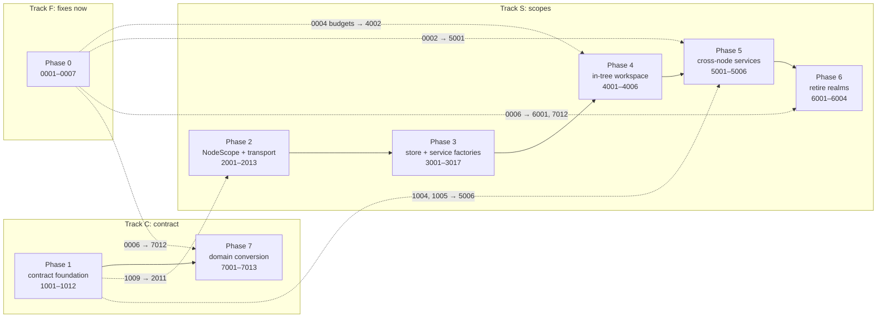

# Unified federation: implementation plan

This board breaks [`docs/reports/unified-federation.md`](../../docs/reports/unified-federation.md)
into work items. The report holds the analysis and the design. Each file here
holds one item: its goal, the verified current state of the code, a checklist,
tests, and a record of the work.

- **Report status:** being implemented in one combined branch (`unified-federation-b4c9ee65814d`), started 2026-11-07. The row statuses below are current.
- **Plan verified against:** `main` at `521f734a9`, on 2026-11-07. Every item has a "Current state" section re-checked against that commit. Where the report has drifted, the item says so; [Corrections to the report](#corrections-to-the-report) lists the material ones.
- **Item count:** 82 items in 8 phases, on 3 tracks (78 planned, plus [3018](3018-retire-command-scope-shim.md), [4007](4007-workspace-calls-its-node.md), [5007](5007-summary-overlay.md) and [7014](7014-remaining-zod-to-effect-schema.md) added on 2026-11-07).

## How to use this board

- **IDs.** Each item has a four-digit ID, and the first digit is its phase: `0xxx` is Phase 0, `1xxx` is Phase 1, and so on. File names are `NNNN-kebab-case.md`.
- **Status.** An item's status lives in its front matter, and this index mirrors it. The front matter keys, the statuses and the meaning of each status follow the earlier `plans/graphs/` convention:
  - `not-started`;
  - `in-progress` (set `owner` and `branch`);
  - `blocked` (set `blocked_by`);
  - `done` (set `pr`, and no open boxes remain);
  - `dropped` (a dated reason in Notes).
- **Ready.** An item is ready when every item in its *Depends on* column is `done` on `main`. An item may start early only on a part its own file calls independent; say so in its Notes.
- **Branches and PRs.** Put the ID in the branch name and the PR title, for example branch `unified-2006-desktop-node-scopes` and title `feat(federation): 2006 desktop node scopes`. Find work in flight with `gh pr list --search "unified 2006"`.
- **Updating status.** A status change reaches `main` with the PR that does the work. The PR that finishes an item sets `status: done` and its row here in the same change.
- **Changing the design.** Change it in the report, never only in an item. Items record deviations in their Notes with a date.
- **Never tick partial work.** If an item turns out larger, split its boxes. Work outside an item's scope gets a new item, numbered with the next free ID in its phase.
- **Validation.** Follow `AGENTS.md` ("Choosing validation for a change"). Documentation-only items need only `mise run format:check`.

## Tracks

| Track | Phases | What it delivers | Can start |
|---|---|---|---|
| **F, fixes now** | 0 | The realm bug, the attention gap, hidden realms, the unknown-command bug, measurements, doc corrections, grant evidence | All of it, today |
| **C, contract** | 1, 7 (and 5006) | Versioned domains, typed errors, manifests, CI against the support window, per-domain conversion, an allow-listed grant scope | Today (1001) |
| **S, scopes** | 2 → 3 → 4 → 5 → 6 | One renderer per window holding a `NodeScope` per machine, hydration tiers, then realms deleted | Today (2001, 2005, 2006) |

The tracks are independent until three join points:

1. **[2011](2011-scope-domain-negotiation.md)** needs [2010](2010-command-scope-wiring.md) (scopes) and [1009](1009-domain-clients-and-adapters.md) (contract). It puts negotiated domains on every `NodeClient`.
2. **Phase 7's web side** is cleaner after [3002](3002-lib-backend-client-parameter.md) and [2011](2011-scope-domain-negotiation.md). It does not have to wait for them: until then a domain's `lib/backend` file uses the domain client bound to the command scope.
3. **[6001](6001-in-tree-by-default.md)** and **[7012](7012-allow-listed-grants.md)** both need [0006](0006-grant-scope-live-evidence.md), the live grant-scope evidence.



## What can run in parallel

### Start immediately (no dependencies)

These 11 items can all start today and share no files with each other in any
meaningful way:

| ID | Item | Track |
|---|---|---|
| [0001](0001-realm-request-drift.md) | Shared realm open request (desktop bug) | F |
| [0002](0002-attention-without-realm.md) | Attention for machines without a realm | F |
| [0003](0003-hidden-realm-visibility.md) | Tell hidden realms they are hidden | F |
| [0004](0004-measurement-report.md) | Measurements (memory, HTTP version, request rate) | F |
| [0005](0005-documentation-corrections.md) | Doc corrections | F |
| [0006](0006-grant-scope-live-evidence.md) | Live grant-scope evidence (todo 5740) | F |
| [0007](0007-unknown-command-helper.md) | Unknown-command helper that never matches | F |
| [1001](1001-schema-library-spike.md) | Schema library measurement and decision | C |
| [2001](2001-node-scope-core.md) | `NodeScope`/`WindowScope` primitives | S (web core) |
| [2005](2005-relay-status-and-session.md) | Relay `/status` for relayed clients | S (backend) |
| [2006](2006-desktop-node-scopes.md) | Desktop main per-(window, node) scopes | S (desktop) |

### Waves

A *wave* is the earliest point an item can start if every dependency finished
as early as possible. Items in the same wave are independent of each other.
These waves are computed from the `depends_on` fields; recompute them if the
fields change.

| Wave | Items |
|---|---|
| 0 | 0001, 0002, 0003, 0004, 0005, 0006, 0007, 1001, 2001, 2005, 2006 |
| 1 | 1002, 2002, 2007, 2008, 3015, 3017 |
| 2 | 1003, 1005, 2003, 2009, 2010 |
| 3 | 1004, 1006, 2004, 2012, 3001, 3002, 3016 |
| 4 | 1007, 1009, 1011, 2013, 3003, 3004, 3005, 3007, 3008, 3014, 5006, 7011 |
| 5 | 1008, 1010, 2011, 3006, 3009, 3011, 3012 |
| 6 | 1012, 3010, 7001–7009 |
| 7 | 3013, 7010, 7012, 7013 (7013 is also date-gated), 7014 |
| 8 | 4001 |
| 9 | 4002, 4003, 4004, 4005, 4007, 5001, 5002, 5003, 5004 |
| 10 | 4006, 5005 (optional) |
| 11 | 6001 |
| 12 | 6002, 6003 (after one release with in-tree as default) |
| 13 | 6004 |

### Lanes inside a phase

- **Phase 1:** after [1002](1002-contract-primitives.md), two lanes run side by side:
  - backend: [1003](1003-backend-register-overload.md) → [1004](1004-hello-domains.md) / [1006](1006-contract-manifest-generator.md) → [1007](1007-release-snapshots-and-backfill.md);
  - errors: [1005](1005-typed-incompatibility-errors.md).
  - [1009](1009-domain-clients-and-adapters.md) joins them before [1008](1008-contract-ci-job.md) and the pilot, [1010](1010-pilot-node-mail-and-ticket-sync.md).
- **Phase 2:** three lanes:
  - browser: [2002](2002-browser-transport-split.md) → [2003](2003-browser-credentials-and-auth-transport.md) → [2004](2004-browser-node-clients-registry.md);
  - desktop: [2006](2006-desktop-node-scopes.md) → [2007](2007-desktop-node-ipc-and-events.md) ‖ [2008](2008-desktop-request-auth.md) → [2009](2009-desktop-previews-and-gateway-snapshot.md);
  - backend: [2005](2005-relay-status-and-session.md).
  - They meet at [2010](2010-command-scope-wiring.md) and [2013](2013-second-scope-proof.md).
- **Phase 3:**
  - [3015](3015-persistence-keys-per-node.md), [3016](3016-rich-content-and-caches.md) and [3017](3017-window-stores-node-qualified.md) are groundwork and can start in Phase 2.
  - After [3001](3001-scoped-store-shim-and-ratchet.md) and [3002](3002-lib-backend-client-parameter.md), these are independent and can run side by side: [3003](3003-stores-batch-a-leaf-light.md), [3004](3004-project-and-environment-stores.md), [3005](3005-config-layering.md), [3007](3007-files-panel-split.md), [3008](3008-terminal-portal-and-artifact-hosts.md) and [3014](3014-scoped-services-and-startup.md).
  - Then [3006](3006-ui-store-split.md), [3009](3009-agent-and-transcript-stores.md), [3011](3011-workflow-stores-a.md) and [3012](3012-workflow-stores-b.md) run side by side.
  - [3010](3010-sessions-terminals-tmux-mail.md) and [3013](3013-pane-layout-store.md) come last.
- **Phase 4:** after [4001](4001-in-tree-workspace-seam.md), [4002](4002-hydration-tiers-and-budgets.md), [4003](4003-snapshot-first-rehydration.md), [4004](4004-runtime-shim-guard.md) and [4005](4005-direct-navigation.md) are independent. Phase 5's [5001](5001-attention-per-scope.md)–[5004](5004-coordinator-and-portal-through-command-scope.md) can run at the same time.
- **Phase 6:** [6002](6002-delete-web-realm-code.md) (web) and [6003](6003-delete-desktop-realm-code.md) (desktop) are independent.
- **Phase 7:** after the pilot, the nine domain items [7001](7001-domain-native-sessions.md)–[7009](7009-domain-coordinator-servers-system.md) are independent of each other. [7011](7011-typed-events.md) can start as early as wave 4. Suggested order when there is only one worker: 7001, 7002, 7003, 7004, 7005, 7006, 7007, 7008, 7009, which is the report's order, with the most client-facing first.

### Critical path

```text
2001 → 2002 → 2010 → 3001 → 3004 → 3009 → 3010 → 3013 → 4001 → 4002 → 4006 → 6001 → 6002 → 6004
```

Phase 3 dominates the critical path. Shortening it means more workers on the store items in parallel; nothing in the contract track shortens it. [3013](3013-pane-layout-store.md) (`paneLayoutStore`) is the single largest serial item.

### Do not run these in parallel (merge hot spots)

These items edit the same files heavily. Sequence them, or have one owner for each file.

- `apps/web/src/App.tsx`: [2001](2001-node-scope-core.md), [3014](3014-scoped-services-and-startup.md), [6002](6002-delete-web-realm-code.md).
- `apps/web/src/lib/native/web-gateway.ts`: [2002](2002-browser-transport-split.md), [2003](2003-browser-credentials-and-auth-transport.md), [1005](1005-typed-incompatibility-errors.md) (the `GatewayHttpError` code). Do 2002 first.
- `apps/desktop/electron/main.ts`, `ipc.ts` and `preload-api.ts`:
  - [2006](2006-desktop-node-scopes.md)–[2009](2009-desktop-previews-and-gateway-snapshot.md), [1003](1003-backend-register-overload.md) (the IPC envelope) and [1005](1005-typed-incompatibility-errors.md) (IPC error code);
  - 1003 and 2007 both add an argument to `orkestrator:invoke`, so agree the shape `{ nodeId?, envelope? }` once.
- `apps/web/src/components/federation/RemoteWorkspaceRegion.tsx`: [0001](0001-realm-request-drift.md), [0003](0003-hidden-realm-visibility.md), [4001](4001-in-tree-workspace-seam.md).
- `apps/web/src/lib/store-resource-sync.ts`: every Phase 3 store item moves its handlers out; [3014](3014-scoped-services-and-startup.md) owns the framework.
- `tests/source-guards/baseline.json`: every Phase 3 item. Regenerate it on rebase rather than resolving conflicts by hand.
- `packages/protocol/package.json` `exports`: every item that adds a subpath. A trivial conflict, but a frequent one.

## Dependency graph

Phase 7's nine domain items are shown as one node.

```mermaid
flowchart TB
  classDef f fill:#fde68a,stroke:#b45309,color:#111
  classDef c fill:#bfdbfe,stroke:#1d4ed8,color:#111
  classDef s fill:#bbf7d0,stroke:#15803d,color:#111

  subgraph Phase0["Phase 0: fixes and measurement"]
    n0001[0001 realm request]:::f
    n0002[0002 attention]:::f
    n0003[0003 hidden realms]:::f
    n0004[0004 measurements]:::f
    n0005[0005 docs]:::f
    n0006[0006 grant evidence]:::f
    n0007[0007 unknown-command]:::f
  end

  subgraph Phase1["Phase 1: contract foundation"]
    n1001[1001 schema lib]:::c --> n1002[1002 primitives]:::c
    n1002 --> n1003[1003 register overload]:::c
    n1002 --> n1005[1005 typed errors]:::c
    n0007 --> n1005
    n1003 --> n1004[1004 hello domains]:::c
    n1002 --> n1004
    n1003 --> n1006[1006 manifest]:::c
    n1006 --> n1007[1007 snapshots]:::c
    n1004 --> n1009[1009 domain clients]:::c
    n1007 --> n1008[1008 CI job]:::c
    n1009 --> n1008
    n1003 --> n1010[1010 pilot]:::c
    n1004 --> n1010
    n1005 --> n1010
    n1009 --> n1010
    n1006 --> n1011[1011 policy + docs]:::c
    n1010 --> n1012[1012 mixed versions]:::c
  end

  subgraph Phase2["Phase 2: NodeScope and transport"]
    n2001[2001 scope core]:::s --> n2002[2002 transport split]:::s
    n2002 --> n2003[2003 credentials]:::s
    n2003 --> n2004[2004 node clients]:::s
    n2005[2005 relay status]:::s
    n2006[2006 desktop scopes]:::s --> n2007[2007 desktop IPC]:::s
    n2006 --> n2008[2008 request auth]:::s
    n2007 --> n2009[2009 previews]:::s
    n2001 --> n2010[2010 command scope]:::s
    n2002 --> n2010
    n2007 --> n2010
    n2010 --> n2011[2011 domains on client]:::s
    n1009 --> n2011
    n2010 --> n2012[2012 lint boundary]:::s
    n2004 --> n2013[2013 second scope]:::s
    n2005 --> n2013
    n2008 --> n2013
    n2009 --> n2013
    n2010 --> n2013
  end

  subgraph Phase3["Phase 3: store and service factories"]
    n3001[3001 shim + ratchet]:::s
    n3002[3002 lib/backend client]:::s
    n3015[3015 persistence keys]:::s
    n3016[3016 rich content]:::s
    n3017[3017 window stores]:::s
    n3003[3003 batch A]:::s
    n3004[3004 project + env]:::s
    n3005[3005 config]:::s
    n3006[3006 uiStore]:::s
    n3007[3007 files panel]:::s
    n3008[3008 terminal portal]:::s
    n3009[3009 agent stores]:::s
    n3010[3010 sessions/terminals]:::s
    n3011[3011 workflow A]:::s
    n3012[3012 workflow B]:::s
    n3013[3013 paneLayout]:::s
    n3014[3014 services]:::s
    n2001 --> n3001
    n2010 --> n3001
    n2010 --> n3002
    n2001 --> n3015
    n2001 --> n3016
    n2003 --> n3016
    n2001 --> n3017
    n3001 --> n3003
    n3002 --> n3003
    n3001 --> n3004
    n3002 --> n3004
    n3016 --> n3004
    n3001 --> n3005
    n3002 --> n3005
    n3004 --> n3006
    n3017 --> n3006
    n3001 --> n3007
    n3002 --> n3007
    n3015 --> n3007
    n3001 --> n3008
    n3016 --> n3008
    n3004 --> n3009
    n3016 --> n3009
    n3008 --> n3010
    n3009 --> n3010
    n3004 --> n3011
    n3004 --> n3012
    n3016 --> n3012
    n3006 --> n3013
    n3007 --> n3013
    n3008 --> n3013
    n3009 --> n3013
    n3010 --> n3013
    n3001 --> n3014
  end

  subgraph Phase4["Phase 4: in-tree workspace"]
    n4001[4001 in-tree seam]:::s
    n4002[4002 tiers + budgets]:::s
    n4003[4003 snapshots]:::s
    n4004[4004 shim guard]:::s
    n4005[4005 direct navigation]:::s
    n4006[4006 qualification]:::s
    n2013 --> n4001
    n3013 --> n4001
    n3014 --> n4001
    n4001 --> n4002
    n0004 --> n4002
    n4001 --> n4003
    n4001 --> n4004
    n4001 --> n4005
    n3006 --> n4005
    n4002 --> n4006
    n4003 --> n4006
    n4004 --> n4006
    n4005 --> n4006
    n2009 --> n4006
  end

  subgraph Phase5["Phase 5: cross-node services"]
    n5001[5001 attention]:::s
    n5002[5002 PR opener + title bar]:::s
    n5003[5003 settings, bug report, shortcuts]:::s
    n5004[5004 coordinator + portal]:::s
    n5005[5005 multiplexed relay, optional]:::s
    n5006[5006 fleet currency]:::c
    n4001 --> n5001
    n0002 --> n5001
    n4001 --> n5002
    n3007 --> n5002
    n4001 --> n5003
    n3017 --> n5003
    n4001 --> n5004
    n0004 --> n5005
    n4002 --> n5005
    n1004 --> n5006
    n1005 --> n5006
  end

  subgraph Phase6["Phase 6: retire realms"]
    n6001[6001 in-tree default]:::s
    n6002[6002 delete web realms]:::s
    n6003[6003 delete desktop realms]:::s
    n6004[6004 docs]:::s
    n4006 --> n6001
    n5001 --> n6001
    n5002 --> n6001
    n5003 --> n6001
    n5004 --> n6001
    n0006 --> n6001
    n6001 --> n6002
    n6001 --> n6003
    n6002 --> n6004
    n6003 --> n6004
  end

  subgraph Phase7["Phase 7: domain conversion"]
    n70xx["7001–7009<br/>nine domain items"]:::c
    n7010[7010 converge models]:::c
    n7011[7011 typed events]:::c
    n7012[7012 allow-listed grants]:::c
    n7013[7013 retire legacy adapters]:::c
    n1008 --> n70xx
    n1010 --> n70xx
    n1011 --> n70xx
    n70xx --> n7010
    n1002 --> n7011
    n1006 --> n7011
    n70xx --> n7012
    n0006 --> n7012
    n70xx --> n7013
  end
```



## Phase 0: fixes and measurement

All independent; start now. Report: [§12 Phase 0](../../docs/reports/unified-federation.md#12-migration-plan).

| ID | File | Phase | Status | Depends on | Summary |
| --- | --- | --- | --- | --- | --- |
| 0001 | [0001-realm-request-drift.md](0001-realm-request-drift.md) | 0 | done | — | One shared `packages/protocol` definition of the realm open request. A cold desktop realm stops dropping `home`, work targets, `bugReport` and `environment-rebuild`. |
| 0002 | [0002-attention-without-realm.md](0002-attention-without-realm.md) | 0 | done | — | The shell subscribes to `environment-attention` through `subscribeNodeEvents` for nodes without a realm. The relay needs no change, contrary to the report. |
| 0003 | [0003-hidden-realm-visibility.md](0003-hidden-realm-visibility.md) | 0 | done | — | A `visibility` shell→realm message plus `ReadCoordinator.setHostHidden`, so hidden realms get #1964's deferrals. |
| 0004 | [0004-measurement-report.md](0004-measurement-report.md) | 0 | in-progress | — | Measure memory per realm on each host, the iPad jetsam point, hidden-realm request rate, `nextHopProtocol` and connection counts, and write a report. |
| 0005 | [0005-documentation-corrections.md](0005-documentation-corrections.md) | 0 | done | — | Fix `federation.md`'s removed renderer runtime and `version-compatibility.md`'s handshake and floor lines. |
| 0006 | [0006-grant-scope-live-evidence.md](0006-grant-scope-live-evidence.md) | 0 | done | — | Todo 5740: two real backends prove grants keep workspace features and refuse administration. This seeds `access` for the allow-list. |
| 0007 | [0007-unknown-command-helper.md](0007-unknown-command-helper.md) | 0 | done | — | `lib/portal/unknown-command.ts` never matches what backends send. Fix it and check its five callers' fallbacks. |

Exit criteria:

- [ ] The realm request bug is fixed with a test and checked live.
- [ ] Machines without a realm alert.
- [ ] The measurements report exists, and §8.2's budgets are measured or explicitly kept as placeholders.
- [ ] Todo 5740 is closed or its findings are fixed.

## Phase 1: contract foundation

Report: [§11](../../docs/reports/unified-federation.md#11-versioned-interfaces), [§12 Phase 1](../../docs/reports/unified-federation.md#12-migration-plan). Runs in parallel with Phase 2.

| ID | File | Phase | Status | Depends on | Summary |
| --- | --- | --- | --- | --- | --- |
| 1001 | [1001-schema-library-spike.md](1001-schema-library-spike.md) | 1 | done | — | Measure the renderer bundle cost of Effect Schema against Zod 4, `zod/mini` and hand-written guards, record Decision 13.8 (Effect, the user's choice), and add `effect` to protocol. |
| 1002 | [1002-contract-primitives.md](1002-contract-primitives.md) | 1 | done | 1001 | `defineDomain`, `defineCommand`, `defineEvent`, the invoke envelope, typed error codes and `domainClient` types in `packages/protocol/src/contract/`. |
| 1003 | [1003-backend-register-overload.md](1003-backend-register-overload.md) | 1 | done | 1002 | `register(def, handler)` with tolerant parsing and critical fields, through every wrapping registrar; the envelope on HTTP, IPC and the relay. |
| 1004 | [1004-hello-domains.md](1004-hello-domains.md) | 1 | done | 1002, 1003 | A new top-level hello field, `domains: {min, max}` per domain, parsed explicitly with bounds. Pre-contract nodes are detected. |
| 1005 | [1005-typed-incompatibility-errors.md](1005-typed-incompatibility-errors.md) | 1 | done | 1002, 0007 | `unknown-command` / `unsupported-version` / `unsupported-field` codes survive web HTTP and Electron IPC (both drop `code` today). All text matchers are replaced. |
| 1006 | [1006-contract-manifest-generator.md](1006-contract-manifest-generator.md) | 1 | done | 1003 | `contracts/manifest.json` from the live registry, with `--check` in CI. Every string-registered command must be assigned a domain. |
| 1007 | [1007-release-snapshots-and-backfill.md](1007-release-snapshots-and-backfill.md) | 1 | done | 1006 | `release:version` writes a snapshot; backfill covers every published release since v2.21.0, deduplicated per domain digest. |
| 1008 | [1008-contract-ci-job.md](1008-contract-ci-job.md) | 1 | done | 1007, 1009 | A CI job computes the floor and checks adapter coverage, disappeared commands and register consistency. Stage 2 adds the old-argument fixtures. |
| 1009 | [1009-domain-clients-and-adapters.md](1009-domain-clients-and-adapters.md) | 1 | done | 1002, 1004 | `createDomainClient` with version selection, version-0 legacy adapters for pre-contract nodes, an adapter list and usage counters. |
| 1010 | [1010-pilot-node-mail-and-ticket-sync.md](1010-pilot-node-mail-and-ticket-sync.md) | 1 | done | 1003, 1004, 1005, 1009 | Pilot: node mail, node files and ticket sync, defined, negotiated and adapted in the backend sender, with register rows retired. |
| 1011 | [1011-contract-policy-and-docs.md](1011-contract-policy-and-docs.md) | 1 | done | 1006 | The untyped-command count can only fall. A "Domain contracts" docs section and an `AGENTS.md` row. |
| 1012 | [1012-mixed-version-qualification.md](1012-mixed-version-qualification.md) | 1 | done | 1010 | A scheduled run of the current code against the floor release in both directions, generalising the design mixed-version script. |

Exit criteria:

- [ ] The pilot domains are negotiated, adapted and CI-checked, and their register rows are retired or made mechanical.
- [ ] A new string-registered command fails CI.
- [ ] Typed errors survive every transport.

## Phase 2: NodeScope and transport (behaviour-neutral)

Report: [§5](../../docs/reports/unified-federation.md#5-target-architecture), [§6](../../docs/reports/unified-federation.md#6-transport-per-node), [§12 Phase 2](../../docs/reports/unified-federation.md#12-migration-plan).

| ID | File | Phase | Status | Depends on | Summary |
| --- | --- | --- | --- | --- | --- |
| 2001 | [2001-node-scope-core.md](2001-node-scope-core.md) | 2 | done | — | `NodeClient` types, `NodeScope`, `WindowScope` with shared byte budgets, `defineScopedStore`/`defineScopedService`, providers, and the `renderInNodeScope` test helper. |
| 2002 | [2002-browser-transport-split.md](2002-browser-transport-split.md) | 2 | done | 2001 | Move `createNodeTransport` out of `web-gateway.ts` (1,743 lines) and cut its couplings to the window shell. Two transports coexist. |
| 2003 | [2003-browser-credentials-and-auth-transport.md](2003-browser-credentials-and-auth-transport.md) | 2 | done | 2002 | `setCredential` on reopen, rich-content cleared per node, no global `fetch`/`EventSource` patch for node clients, and an `acp-client.ts` fix. |
| 2004 | [2004-browser-node-clients-registry.md](2004-browser-node-clients-registry.md) | 2 | done | 2002, 2003 | `node-clients.ts`: in-memory grants, direct then relay, reopen without reload, a `pagehide` close, per-node URLs, WebSocket terminals for leaves. |
| 2005 | [2005-relay-status-and-session.md](2005-relay-status-and-session.md) | 2 | done | — | Relay `/status` so a relayed client can diagnose a 401; node transports skip `/session`. |
| 2006 | [2006-desktop-node-scopes.md](2006-desktop-node-scopes.md) | 2 | done | — | Main-process `node-scopes.ts`: single-flight `ensureNodeScope` per (window, node), reusing `NodeWorkspaceScopes`; release triggers. |
| 2007 | [2007-desktop-node-ipc-and-events.md](2007-desktop-node-ipc-and-events.md) | 2 | done | 2006 | `orkestrator:invoke(..., { nodeId })`, admin refusal by node, `orkestrator:node-event`, and a preload `node(nodeId)` API. |
| 2008 | [2008-desktop-request-auth.md](2008-desktop-request-auth.md) | 2 | done | 2006 | One longest-prefix request-auth resolver over the command scope and every node scope of a window. |
| 2009 | [2009-desktop-previews-and-gateway-snapshot.md](2009-desktop-previews-and-gateway-snapshot.md) | 2 | done | 2007 | A preview runtime per node scope (`orkestrator:browser-preview:*` resolved by tab); `localInstallationId` and `backendOnThisDevice(nodeId)`. |
| 2010 | [2010-command-scope-wiring.md](2010-command-scope-wiring.md) | 2 | in-progress | 2001, 2002, 2007 | Browser and desktop `NodeClient`s; `invoke`/`listen` become command-scope wrappers; the 52 direct `window.orkestrator` users are baselined. |
| 2011 | [2011-scope-domain-negotiation.md](2011-scope-domain-negotiation.md) | 2 | done | 2010, 1009 | **Track join.** Negotiated `domains` per connection generation; typed `invoke(def)`; `scope.domain(def)`. |
| 2012 | [2012-transport-lint-boundary.md](2012-transport-lint-boundary.md) | 2 | done | 2010 | A source guard: transports are reached only through a scope, and existing imports may only fall. |
| 2013 | [2013-second-scope-proof.md](2013-second-scope-proof.md) | 2 | done | 2004, 2005, 2008, 2009, 2010 | Exit: a live harness holds the command scope and a leaf scope in one renderer, on desktop and browser, over direct and relay routes. |

Exit criteria:

- [ ] The app runs entirely through the command scope with no visible change.
- [ ] One renderer can hold a second, leaf, scope on both host families ([2013](2013-second-scope-proof.md)).

## Phase 3: store and service factories

Report: [§7](../../docs/reports/unified-federation.md#7-store-and-service-scoping), [§12 Phase 3](../../docs/reports/unified-federation.md#12-migration-plan), [Appendices A and B](../../docs/reports/unified-federation.md#appendix-a-store-classification). This is the largest phase, and each store conversion is its own reviewable PR.

| ID | File | Phase | Status | Depends on | Summary |
| --- | --- | --- | --- | --- | --- |
| 3001 | [3001-scoped-store-shim-and-ratchet.md](3001-scoped-store-shim-and-ratchet.md) | 3 | done | 2001, 2010 | The command-scope shim on converted hooks, and a shrink-only source guard per store that handles the `@/stores` barrel. The worked example is `claudeOptionsStore`. |
| 3002 | [3002-lib-backend-client-parameter.md](3002-lib-backend-client-parameter.md) | 3 | done | 2010 | `createXApi(client)` factories for all 37 `lib/backend` files, with command-bound exports kept as a counted shim. |
| 3003 | [3003-stores-batch-a-leaf-light.md](3003-stores-batch-a-leaf-light.md) | 3 | done | 3001, 3002 | Eight light stores (environmentDiff, worktreeSnapshot, agentActivity, prMonitor, multiReview, agentModelCatalog, claudeOptions, tabLaunch). |
| 3004 | [3004-project-and-environment-stores.md](3004-project-and-environment-stores.md) | 3 | done | 3001, 3002, 3016 | `projectStore` and `environmentStore` (57 imperative sites), with `useEnvironments` and `useProjects`. |
| 3005 | [3005-config-layering.md](3005-config-layering.md) | 3 | done | 3001, 3002 | Scoped `configStore` with `effectiveConfig(scope)`. Layering no longer depends on "am I a realm". |
| 3006 | [3006-ui-store-split.md](3006-ui-store-split.md) | 3 | done | 3004, 3017 | A node-qualified window selection plus a per-node `uiStore`. `remoteWorkspaceStore` is derived from it until realms go. |
| 3007 | [3007-files-panel-split.md](3007-files-panel-split.md) | 3 | done | 3001, 3002, 3015 | Files panel open state and width per window; folders, PR tabs and selection per node; `projectPullRequestsStore`. |
| 3008 | [3008-terminal-portal-and-artifact-hosts.md](3008-terminal-portal-and-artifact-hosts.md) | 3 | done | 3001, 3016 | Window-owned terminal portals and artifact hosts with node-qualified keys, under the window byte budget. |
| 3009 | [3009-agent-and-transcript-stores.md](3009-agent-and-transcript-stores.md) | 3 | done | 3004, 3016 | `nativeAgentProjection`, `nativeCompose` and `promptDraft` per node, with the history budget kept window-wide. |
| 3010 | [3010-sessions-terminals-tmux-mail.md](3010-sessions-terminals-tmux-mail.md) | 3 | done | 3008, 3009 | `session`, `terminalSession` (a hot spot the report missed), `claudeTmux` and `agentMail` stores. |
| 3011 | [3011-workflow-stores-a.md](3011-workflow-stores-a.md) | 3 | done | 3004 | Pipeline, Kanban, feature plan, coordinator and graph stores, plus their persistence services. |
| 3012 | [3012-workflow-stores-b.md](3012-workflow-stores-b.md) | 3 | done | 3004, 3016 | Design, web annotations, GitHub issues, PRs, change projection, file dirty and preview service stores. |
| 3013 | [3013-pane-layout-store.md](3013-pane-layout-store.md) | 3 | done | 3006, 3007, 3008, 3009, 3010 | `paneLayoutStore` (1,852 LOC, 88 sites) last, with its persistence. The workspace subtree's shim baseline reaches zero. |
| 3014 | [3014-scoped-services-and-startup.md](3014-scoped-services-and-startup.md) | 3 | done | 3001 | `App.tsx:355-369`'s six `start*` services become per-scope services; the read coordinator is split into window and node parts. |
| 3015 | [3015-persistence-keys-per-node.md](3015-persistence-keys-per-node.md) | 3 | done | 2001 | `desktopConnectionStorageKey(base, nodeId)`; the local-drafts key is namespaced; the command node's keys do not move. |
| 3016 | [3016-rich-content-and-caches.md](3016-rich-content-and-caches.md) | 3 | done | 2001, 2003 | Rich-content identity per node, byte-bounded caches under window budgets, and capability caches per scope. |
| 3017 | [3017-window-stores-node-qualified.md](3017-window-stores-node-qualified.md) | 3 | done | 2001 | Window stores (dialogs, merge PR, coordinator conversation, scroll targets, host path picker) carry `nodeId`. |
| 3018 | [3018-retire-command-scope-shim.md](3018-retire-command-scope-shim.md) | 3 | not-started | 3013, 4004 | Added 2026-11-07: tests seed stores through scopes, the command-scope statics and the hook's provider-less fallback go. |

Exit criteria:

- [ ] The shim baseline is zero for every store the workspace subtree touches.
- [ ] `mise run test` and the browser suites pass with only the command scope.

## Phase 4: in-tree workspace behind a per-node setting

Report: [§8](../../docs/reports/unified-federation.md#8-data-lifecycle-hydration-tiers-and-memory), [§12 Phase 4](../../docs/reports/unified-federation.md#12-migration-plan).

| ID | File | Phase | Status | Depends on | Summary |
| --- | --- | --- | --- | --- | --- |
| 4001 | [4001-in-tree-workspace-seam.md](4001-in-tree-workspace-seam.md) | 4 | done | 2013, 3013, 3014 | `<InTreeWorkspace nodeId>` when `inTreeNodes` has the node; a loopback for the realm protocol; `NodeErrorBoundary`. |
| 4002 | [4002-hydration-tiers-and-budgets.md](4002-hydration-tiers-and-budgets.md) | 4 | done | 4001, 0004 | Summary, warm, live and suspended tiers, suspension timers per host, and pressure eviction at data granularity. |
| 4003 | [4003-snapshot-first-rehydration.md](4003-snapshot-first-rehydration.md) | 4 | done | 4001 | A new bounded IndexedDB snapshot store (none exists today), with a stale marker until the authoritative read; no content in snapshots. |
| 4004 | [4004-runtime-shim-guard.md](4004-runtime-shim-guard.md) | 4 | in-progress | 4001 | A shim call under a mounted leaf throws in development and tests and is counted in production. |
| 4005 | [4005-direct-navigation.md](4005-direct-navigation.md) | 4 | done | 4001, 3006 | `select`, `sidebar`, `filesPanel`, `grouping`, `visibility`, `ready`, `selection` and `open` become direct calls for in-tree nodes. |
| 4006 | [4006-multi-node-qualification.md](4006-multi-node-qualification.md) | 4 | in-progress | 4002, 4003, 4004, 4005, 2009, 4007 | A new multi-node e2e on desktop and browser, the inactive-environment cycle for a leaf, six-node switching, preview z-order, and iPad memory. |
| 4007 | [4007-workspace-calls-its-node.md](4007-workspace-calls-its-node.md) | 4 | done | 4001 | Added 2026-11-07: a guard over the workspace import graph for command-bound `@/lib/backend` calls, and the conversions (incl. the design canvas and the tmux client), so an in-tree leaf sends everything to its node. |

Exit criteria:

- [ ] A leaf renders in-tree with feature parity on desktop, browser and iOS.
- [ ] Measured memory with six warm nodes is within budget on the iPad.

## Phase 5: cross-node services

Report: [§9](../../docs/reports/unified-federation.md#9-cross-node-features), [§12 Phase 5](../../docs/reports/unified-federation.md#12-migration-plan), [§11.6](../../docs/reports/unified-federation.md#116-operational-mitigation-keep-the-fleet-current).

| ID | File | Phase | Status | Depends on | Summary |
| --- | --- | --- | --- | --- | --- |
| 5001 | [5001-attention-per-scope.md](5001-attention-per-scope.md) | 5 | done | 4001, 0002 | One window attention service across tiers, deduplicated by node; a notification click opens the node. |
| 5002 | [5002-pr-opener-and-title-bar.md](5002-pr-opener-and-title-bar.md) | 5 | done | 4001, 3007 | The PR opener works for any shown node; title-bar meters and popovers come from the scope (`panel`, `panelDismissed` and `titleBar` go). |
| 5003 | [5003-settings-bug-report-shortcuts-dialogs.md](5003-settings-bug-report-shortcuts-dialogs.md) | 5 | done | 4001, 3017 | `settings`, `bugReport` and `shortcut` become direct calls; `BugReportSheet` takes a scope; node dialogs open under their scope. |
| 5004 | [5004-coordinator-and-portal-through-command-scope.md](5004-coordinator-and-portal-through-command-scope.md) | 5 | done | 4001 | Portal APIs, the leaf coordinator gate and `machineInvoke` go through the command scope. |
| 5005 | [5005-multiplexed-relay-stream.md](5005-multiplexed-relay-stream.md) | 5 | done | 0004, 4002 | Optional: one relay request carries N leaves' event streams. Only if measurements show pressure; otherwise drop it. |
| 5006 | [5006-fleet-currency.md](5006-fleet-currency.md) | 5 | done | 1004, 1005 | Node version skew and missing domains in the sidebar; typed errors link to the update; an optional update policy. |
| 5007 | [5007-summary-overlay.md](5007-summary-overlay.md) | 5 | not-started | 4002 | Added 2026-11-07: warm and live scopes overlay their sidebar, ⌘K and title-bar summary rows (§9 Sidebar). |

Exit criteria:

- [ ] No realm protocol message is used for an in-tree node.
- [ ] Every node alerts once, from any tier.

## Phase 6: retire realms

Report: [§12 Phase 6](../../docs/reports/unified-federation.md#12-migration-plan), [Appendix D](../../docs/reports/unified-federation.md#appendix-d-what-gets-deleted).

| ID | File | Phase | Status | Depends on | Summary |
| --- | --- | --- | --- | --- | --- |
| 6001 | [6001-in-tree-by-default.md](6001-in-tree-by-default.md) | 6 | done | 4006, 5001, 5002, 5003, 5004, 0006 | In-tree by default for every node, with realms as a one-release rollback setting. |
| 6002 | [6002-delete-web-realm-code.md](6002-delete-web-realm-code.md) | 6 | in-progress | 6001 | Delete the web realm code, including the boot-timing files the report missed; `MAX_OPEN_REALMS` goes. |
| 6003 | [6003-delete-desktop-realm-code.md](6003-delete-desktop-realm-code.md) | 6 | done | 6001 | Delete realm views, portal and realm IPC, preload APIs and `DEFAULT_MAX_VIEWS`; clean up `persist:orkestrator-realm-*` partitions a release later. |
| 6004 | [6004-documentation.md](6004-documentation.md) | 6 | in-progress | 6002, 6003 | Living docs: command nodes, federation, renderer security, the node-scopes guide, the `AGENTS.md` row. |

Exit criteria:

- [ ] No realm code, IPC, preload API or partition remains.
- [ ] The docs describe node scopes as current.

## Phase 7: domain conversion and allow-listed grants (rolling)

Report: [§10.2](../../docs/reports/unified-federation.md#102-tighten-the-grant-command-list), [§11](../../docs/reports/unified-federation.md#11-versioned-interfaces), [§12 Phase 7](../../docs/reports/unified-federation.md#12-migration-plan), [Appendix E](../../docs/reports/unified-federation.md#appendix-e-command-surface-by-domain). It runs alongside Phases 2-6.

| ID | File | Phase | Status | Depends on | Summary |
| --- | --- | --- | --- | --- | --- |
| 7001 | [7001-domain-native-sessions.md](7001-domain-native-sessions.md) | 7 | done | 1008, 1010, 1011 | Native agent sessions and prompts (87 commands). Turns on CI stage 2. |
| 7002 | [7002-domain-terminals-files-tmux.md](7002-domain-terminals-files-tmux.md) | 7 | done | 1008, 1010, 1011 | Terminals and files (59) and Claude tmux (28). |
| 7003 | [7003-domain-environments-docker.md](7003-domain-environments-docker.md) | 7 | done | 1008, 1010, 1011 | Environments and container lifecycle (63) and Docker (29). |
| 7004 | [7004-domain-previews-annotations-artifacts-design.md](7004-domain-previews-annotations-artifacts-design.md) | 7 | done | 1008, 1010, 1011 | Previews, web annotations and design (Zod today, converted to Effect Schema) and transcript artifacts. |
| 7005 | [7005-domain-projects-config.md](7005-domain-projects-config.md) | 7 | done | 1008, 1010, 1011 | Projects, config and settings (71), keeping the config-echo compatibility path. |
| 7006 | [7006-domain-git-pull-requests.md](7006-domain-git-pull-requests.md) | 7 | done | 1008, 1010, 1011 | Git, GitHub, PRs and the changes ledger (81). |
| 7007 | [7007-domain-pipelines-graphs-multi-review.md](7007-domain-pipelines-graphs-multi-review.md) | 7 | done | 1008, 1010, 1011 | Build pipelines and graphs (76) and Multi Review (30), reusing the graph guards. |
| 7008 | [7008-domain-kanban-mail-accounts-mcp.md](7008-domain-kanban-mail-accounts-mcp.md) | 7 | done | 1008, 1010, 1011 | Kanban and Linear, agent mail, agent accounts and MCP management. |
| 7009 | [7009-domain-coordinator-servers-system.md](7009-domain-coordinator-servers-system.md) | 7 | done | 1008, 1010, 1011 | Coordinator and controller (104), agent servers, system, the rest of nodes, and the ~74 commands with no static caller. |
| 7010 | [7010-converge-models.md](7010-converge-models.md) | 7 | done | 7003, 7005 | `models.ts` and the web's `types/index.ts` become inferred protocol types. |
| 7011 | [7011-typed-events.md](7011-typed-events.md) | 7 | done | 1002, 1006 | `defineEvent` for every backend event, typed `emit` and `listen`, events in the manifest. |
| 7012 | [7012-allow-listed-grants.md](7012-allow-listed-grants.md) | 7 | done | 7001, 7002, 7003, 7004, 7005, 7006, 7007, 7008, 7009, 0006 | The grant scope becomes the manifest's `access: "workspace"` set and fails closed; the deny-lists are deleted. |
| 7013 | [7013-retire-legacy-adapters.md](7013-retire-legacy-adapters.md) | 7 | blocked | 7001, 7002, 7003, 7004, 7005, 7006, 7007, 7008, 7009 | Date-gated: remove version-0 adapters and capability commands once the floor passes the first Stable release with `domains`. |
| 7014 | [7014-remaining-zod-to-effect-schema.md](7014-remaining-zod-to-effect-schema.md) | 7 | done | 7004 | Added 2026-11-07: move the 35 backend files still on Zod (MCP tool inputs, the design service's parsing) to Effect Schema, then drop `zod`. |

Exit criteria:

- [ ] Every grant-reachable command is defined, and grants fail closed.
- [ ] The untyped baseline is zero, or what remains is listed with a reason.

## Corrections to the report

Research for this plan re-checked the report against `521f734a9`. These
findings change the work, and each is reflected in the item named.

| Report says | Current tree | Item |
|---|---|---|
| Add attention to the node relay's prefixes | The relay has no allow-list; it relays any leased name except `terminal-output-` and `relayed-node-event`. The gap is the shell listening only locally (`useNotificationSoundService.ts:193`). | [0002](0002-attention-without-realm.md) |
| Two text-matching unknown-command helpers | There are three, plus about 11 inline matches. `lib/portal/unknown-command.ts` matches only `Unknown command:`, which no backend sends. | [0007](0007-unknown-command-helper.md), [1005](1005-typed-incompatibility-errors.md) |
| Typed error codes reach the client | `code` is dropped by `GatewayHttpError` (web HTTP) and by Electron IPC; only the node link keeps it. | [1005](1005-typed-incompatibility-errors.md) |
| Old hello parsers ignore unknown keys | `parseBackendHello` rebuilds the object field by field, so unknown keys are dropped. `domains` needs explicit parsing. There are 13 capabilities, not 12. | [1004](1004-hello-domains.md) |
| `createCommandRegistry` in `commands.ts`; `NODE_EXCLUDED_COMMANDS` in `workspace-grant-scope.ts` | `commands-registry.ts:103-406`; `node-routing.ts:24-144`. Four wrapping registrars must forward definitions. | [1003](1003-backend-register-overload.md), [7012](7012-allow-listed-grants.md) |
| Backfill snapshots from every tag since v2.21.0 | `v2.24.0-alpha`–`v2.26.0-alpha` were never published; use published releases only. | [1007](1007-release-snapshots-and-backfill.md) |
| "About ten" capability commands; 54 register rows | 8 capability commands; 56 register rows. | [1009](1009-domain-clients-and-adapters.md), [0005](0005-documentation-corrections.md) |
| Hot-swap the grant token on renewal | `renew_node_workspace` only extends the expiry; a new token comes only from a lapse and reopen. | [2003](2003-browser-credentials-and-auth-transport.md), [2004](2004-browser-node-clients-registry.md) |
| Module load installs `window.orkestrator`/`orkestratorGateway` | It also creates `window.orkestratorPortal` as a second gateway inside realms. `acp-client.ts` depends on the global fetch patch. Nothing sends a close on `pagehide`. | [2002](2002-browser-transport-split.md), [2003](2003-browser-credentials-and-auth-transport.md), [2004](2004-browser-node-clients-registry.md) |
| `orkestrator:portal:invoke` in `main.ts`; `browserPreview:*` channels; `localInstallationId` | It is registered in `federation-ipc.ts:349`; the channels are `orkestrator:browser-preview:*`; `localInstallationId` does not exist yet. | [2007](2007-desktop-node-ipc-and-events.md), [2009](2009-desktop-previews-and-gateway-snapshot.md) |
| 639 imperative sites; `buildPipeline` 46 | 655 (about 625 in production code). 19 of `buildPipeline`'s are in test support. `terminalSessionStore` (16) and `TerminalContainer.view.tsx` (32) are missing hot spots. | [3001](3001-scoped-store-shim-and-ratchet.md), [3010](3010-sessions-terminals-tmux-mail.md), [3011](3011-workflow-stores-a.md) |
| `App.tsx:353-365` starts five services | `:355-369` starts six, including `startDataSavingReadPolicy`. | [3014](3014-scoped-services-and-startup.md) |
| Snapshot-first rehydration in IndexedDB | The web app has no IndexedDB code or library at all; a wrapper and a test fake are new work. | [4003](4003-snapshot-first-rehydration.md) |
| Appendix D deletion list | It misses `useRealmBootTiming.ts`, `lib/realm-boot-timing.ts`, desktop `realm-boot-timing-log.ts` and `workspace-realm-messages.ts`. The e2e spec is 1,039 lines, not 958. | [6002](6002-delete-web-realm-code.md), [6003](6003-delete-desktop-realm-code.md), [4006](4006-multi-node-qualification.md) |
| `federation.md` symbols are all gone | `useBoundMachineView` still exists. The backend `BackendRuntime` is unrelated and still exists. | [0005](0005-documentation-corrections.md) |

## Decisions this plan follows

The report's §13 recommendations are adopted as written. Changing one needs
the user's approval and an entry in the report.

| Decision | Adopted | Where it is settled or checked |
|---|---|---|
| 13.1 Architecture | C: one tree, per-node store instances | Whole plan. **This is the go/no-go decision for Tracks S and the realm deletion; confirm before starting Phase 3.** |
| 13.2 Scoping | B: explicit scope plus context, with a ratcheted shim | [3001](3001-scoped-store-shim-and-ratchet.md), [4004](4004-runtime-shim-guard.md) |
| 13.3 Hydration limit | B: byte budgets with tiers | [4002](4002-hydration-tiers-and-budgets.md), using [0004](0004-measurement-report.md)'s numbers |
| 13.4 Browser path | A: direct first, relay fallback; C (multiplexed) only if measured | [2004](2004-browser-node-clients-registry.md), [5005](5005-multiplexed-relay-stream.md) |
| 13.5 Grants | A: one per (window, node) | [2004](2004-browser-node-clients-registry.md), [2006](2006-desktop-node-scopes.md) |
| 13.6 Adaptation | C: both sides, each within the window | [1009](1009-domain-clients-and-adapters.md), [1008](1008-contract-ci-job.md) |
| 13.7 Realm partition data | A: abandon, then delete partitions after a release | [6003](6003-delete-desktop-realm-code.md) |
| 13.8 Schema library | Effect Schema (`effect/Schema`): the user's choice on 2026-11-07, replacing the Zod 4 recommendation; measured in [1001](1001-schema-library-spike.md) | [1001](1001-schema-library-spike.md) |
| 13.9 Domain granularity | C: about 25 domains | [1002](1002-contract-primitives.md), [1006](1006-contract-manifest-generator.md) |

## Needs live evidence or user approval

- **Live evidence:** the items that need two attached `dev:test` profiles, an iPad or an older release:
  - [0001](0001-realm-request-drift.md), [0002](0002-attention-without-realm.md), [0004](0004-measurement-report.md), [0006](0006-grant-scope-live-evidence.md);
  - [1010](1010-pilot-node-mail-and-ticket-sync.md), [1012](1012-mixed-version-qualification.md);
  - [2013](2013-second-scope-proof.md), [4006](4006-multi-node-qualification.md), [5001](5001-attention-per-scope.md).
  - No billed provider turns unless the user authorises them.
- **User approval needed:**
  - enabling the scheduled workflow in [1012](1012-mixed-version-qualification.md), because it is a repository workflow change;
  - the default of the optional update policy in [5006](5006-fleet-currency.md);
  - proceeding from [6001](6001-in-tree-by-default.md) to deletion;
  - any change to a §13 decision.
- **Effort sizes** in item files (S < 1 week, M 1–3 weeks, L 3–6 weeks of one engineer-equivalent) are estimates carried over from the report, not measurements.
